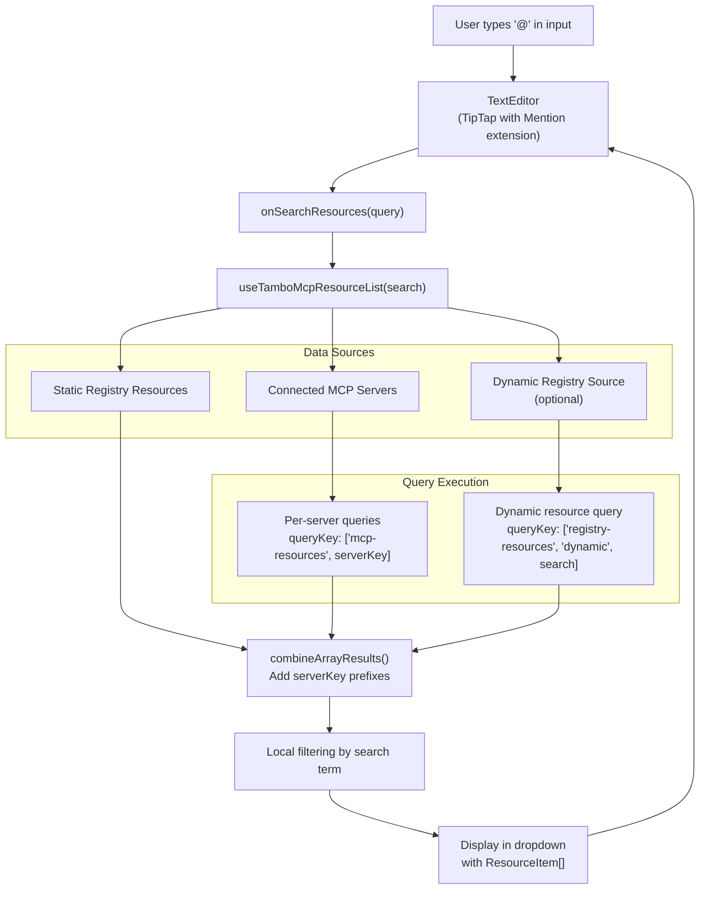
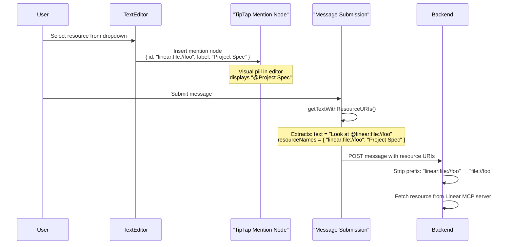
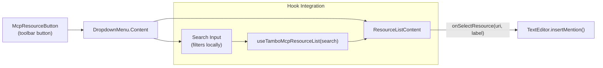
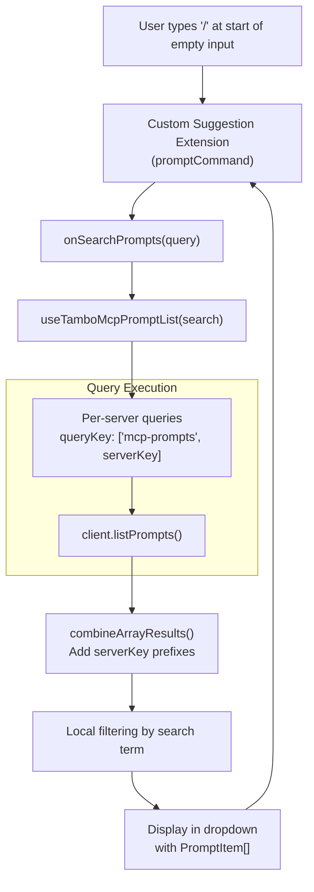
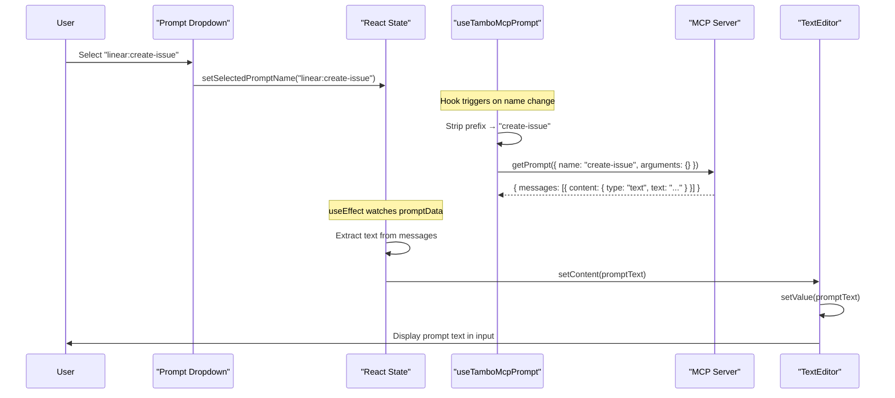
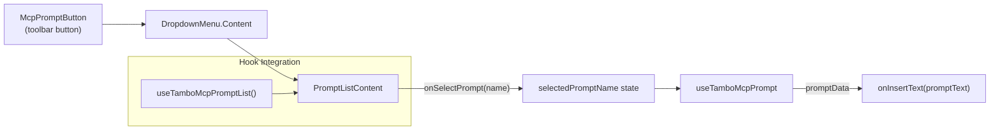
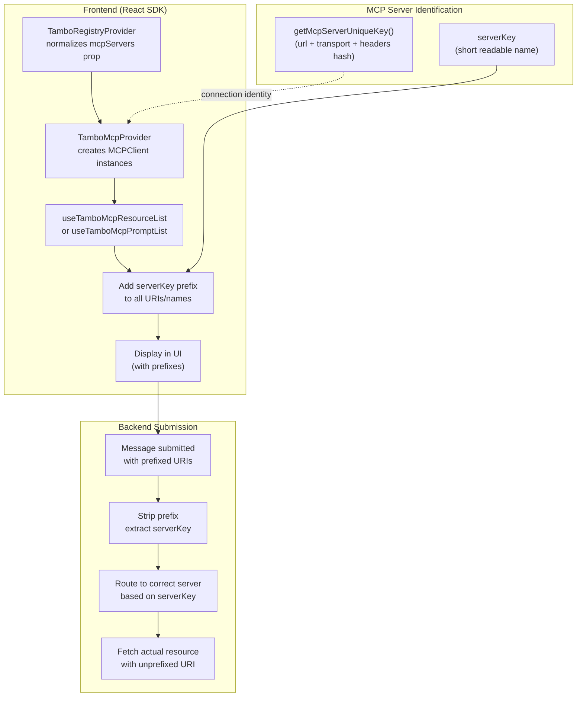

<!-- source: DeepWiki mcp.deepwiki.com · repo tambo-ai/tambo · page 6.3 MCP Resources and Prompts · fetched 2026-10-29 -->

# MCP Resources and Prompts

<details>
<summary>Relevant source files</summary>

The following files were used as context for generating this wiki page:

- [react-sdk/src/mcp/index.ts](react-sdk/src/mcp/index.ts)
- [react-sdk/src/mcp/mcp-client.ts](react-sdk/src/mcp/mcp-client.ts)
- [react-sdk/src/mcp/mcp-hooks.ts](react-sdk/src/mcp/mcp-hooks.ts)
- [react-sdk/src/mcp/tambo-mcp-provider.tsx](react-sdk/src/mcp/tambo-mcp-provider.tsx)
- [react-sdk/src/providers/tambo-mcp-token-provider.tsx](react-sdk/src/providers/tambo-mcp-token-provider.tsx)

</details>


This document explains how users interact with MCP resources and prompts through the message input interface. Resources are referenced using @ mentions in the input, while prompts are accessed via / commands. This covers the client-side UI components, autocomplete functionality, and hooks for fetching and displaying resources and prompts from MCP servers.

For information about setting up MCP servers and the client-side connection lifecycle, see [Client-Side MCP Integration](#6.2). For details about server-side MCP tool execution, see [MCP Tools and Server-Side Execution](#6.4). For a comprehensive reference of all MCP-related hooks, see [MCP Hooks Reference](#6.5).

---

## Resource @ Mentions

Resources are external data sources (files, documents, API responses, etc.) that can be referenced in messages using the @ mention syntax. When a user types `@` in the message input, a dropdown appears showing available resources from all connected MCP servers and the local registry.

### Resource URI Format

All resources are identified by URIs that are prefixed with a `serverKey` to ensure uniqueness across multiple servers:

| Source Type | Prefix | Example URI |
|------------|--------|-------------|
| MCP Server | `{serverKey}:` | `linear:file:///project/123` |
| Local Registry | `registry:` | `registry:component://form-1` |

The prefix is added by `useTamboMcpResourceList` and stripped by the backend before fetching the actual resource content. This ensures that resources from different servers with overlapping URI schemes don't conflict.

**Sources**: [react-sdk/src/mcp/mcp-hooks.ts:252-380]()

### Resource Discovery Flow



**Sources**: [react-sdk/src/mcp/mcp-hooks.ts:252-381](), [showcase/src/components/tambo/message-input.tsx:151-224]()

### Resource List Hook

The `useTamboMcpResourceList` hook fetches resources from all connected MCP servers and the local registry:

```typescript
// Hook signature
function useTamboMcpResourceList(search?: string): {
  data: ListResourceEntry[];
  isLoading: boolean;
  error: Error | null;
  // ... other query state
}

// Resource entry types
type ListResourceEntry = RegistryResourceEntry | McpResourceEntry;

interface RegistryResourceEntry {
  server: null;  // Indicates registry resource
  resource: ListResourceItem;
}

interface McpResourceEntry {
  server: ConnectedMcpServer;
  resource: ListResourceItem;
}

interface ListResourceItem {
  uri: string;      // Prefixed: "serverKey:original-uri"
  name?: string;    // Display name
  description?: string;
  mimeType?: string;
}
```

**Query behavior:**
- **MCP servers**: Query key does NOT include search, so queries don't re-run on search changes. Results are filtered locally.
- **Dynamic registry sources**: Query key INCLUDES search, allowing server-side filtering/generation.
- **Static registry resources**: No query needed, merged directly into results.

**Sources**: [react-sdk/src/mcp/mcp-hooks.ts:252-381]()

### Resource Selection and Insertion

When a user selects a resource from the dropdown:



**Sources**: [cli/src/registry/message-input/text-editor.tsx:499-526](), [showcase/src/components/tambo/message-input.tsx:510-516]()

### TextEditor Integration

The `TextEditor` component uses TipTap's Mention extension for @ mention support:

```typescript
// Mention extension configuration
Mention.configure({
  HTMLAttributes: {
    class: "mention resource inline-flex items-center rounded-md bg-muted px-2 py-0.5 text-xs font-medium text-muted-foreground"
  },
  suggestion: createResourceMentionConfig(
    stableSearchResources,    // Callback to update search state
    handleResourceSelect,     // Callback when resource selected
    resourceRef               // Ref to suggestion state
  ),
  renderLabel: ({ node }) => `@${node.attrs.label ?? ""}`
})
```

The mention configuration connects TipTap's suggestion plugin to the parent component's state:

| Callback | Purpose |
|----------|---------|
| `items({ query })` | Triggers `onSearchResources(query)` to update parent state |
| `onStart(props)` | Opens dropdown, stores TipTap's command function |
| `onUpdate(props)` | Updates dropdown position when cursor moves |
| `onKeyDown({ event })` | Handles arrow keys, Enter, Escape |
| `onExit()` | Closes dropdown |

**Sources**: [cli/src/registry/message-input/text-editor.tsx:296-379](), [showcase/src/components/tambo/text-editor.tsx:296-389]()

### McpResourceButton Component

The `McpResourceButton` provides an alternative dropdown interface for selecting resources without typing @:



**Sources**: [cli/src/registry/mcp-components/mcp-components.tsx:185-318]()

---

## Prompt / Commands

Prompts are pre-defined message templates provided by MCP servers. Users access prompts by typing `/` at the start of an empty input, which shows a dropdown of available prompts. Selecting a prompt fetches its content and replaces the entire input.

### Prompt Name Format

Like resources, prompts are prefixed with `serverKey`:

| Example | Description |
|---------|-------------|
| `linear:create-issue` | Prompt from Linear MCP server |
| `github:pr-template` | Prompt from GitHub MCP server |

The prefix is added by `useTamboMcpPromptList` and stripped before calling `getPrompt()` on the MCP server.

**Sources**: [react-sdk/src/mcp/mcp-hooks.ts:78-138]()

### Prompt Discovery Flow



**Sources**: [react-sdk/src/mcp/mcp-hooks.ts:78-138](), [cli/src/registry/message-input/text-editor.tsx:381-495]()

### Prompt List Hook

The `useTamboMcpPromptList` hook fetches prompts from all connected MCP servers:

```typescript
// Hook signature
function useTamboMcpPromptList(search?: string): {
  data: ListPromptEntry[];
  isLoading: boolean;
  error: Error | null;
  // ... other query state
}

// Prompt entry type
interface ListPromptEntry {
  server: ConnectedMcpServer;
  prompt: ListPromptItem;
}

interface ListPromptItem {
  name: string;         // Prefixed: "serverKey:original-name"
  description?: string;
  arguments?: Array<{
    name: string;
    description?: string;
    required?: boolean;
  }>;
}
```

**Query behavior:**
- Query key does NOT include search term
- All prompts are fetched once per server
- Search filtering happens locally in React (no re-queries)

**Sources**: [react-sdk/src/mcp/mcp-hooks.ts:78-138]()

### Prompt Fetch and Insertion

When a user selects a prompt, the full prompt content must be fetched:



**Sources**: [showcase/src/components/tambo/message-input.tsx:829-853](), [cli/src/registry/mcp-components/mcp-components.tsx:51-71]()

### Prompt Fetch Hook

The `useTamboMcpPrompt` hook fetches the full content of a specific prompt:

```typescript
// Hook signature
function useTamboMcpPrompt(
  promptName: string | undefined,
  args: Record<string, string> = {}
): {
  data: GetPromptResult | null;
  isLoading: boolean;
  error: Error | null;
}

// Result type
interface GetPromptResult {
  description?: string;
  messages: Array<{
    role: "user" | "assistant";
    content: {
      type: "text" | "image" | "resource";
      text?: string;
      // ... other content types
    };
  }>;
}
```

**Usage pattern:**
```typescript
const [selectedPromptName, setSelectedPromptName] = useState<string | null>(null);
const { data: promptData } = useTamboMcpPrompt(selectedPromptName ?? "");

useEffect(() => {
  if (promptData && selectedPromptName) {
    const text = promptData.messages
      .map(msg => msg.content.type === "text" ? msg.content.text : "")
      .filter(Boolean)
      .join("\n");
    
    editor.setContent(text);
    setSelectedPromptName(null);  // Reset after insertion
  }
}, [promptData, selectedPromptName]);
```

**Sources**: [react-sdk/src/mcp/mcp-hooks.ts:199-249](), [showcase/src/components/tambo/message-input.tsx:825-853]()

### TextEditor Prompt Extension

The `TextEditor` uses a custom TipTap extension for / command support:

```typescript
// Custom extension using Suggestion plugin
Extension.create({
  name: "promptCommand",
  
  addProseMirrorPlugins() {
    return [
      Suggestion({
        editor: this.editor,
        char: "/",
        items: ({ query, editor }) => {
          // Only show prompts when editor is empty (except for "/" and query)
          const editorValue = editor.getText().replace("/", "").trim();
          if (editorValue.length > 0) {
            stateRef.current.setState({ isOpen: false });
            return [];
          }
          
          // Trigger search - actual items come from props via stateRef
          onSearchChange(query);
          return [];
        },
        render: () => ({
          onStart: (props) => {
            // Delete the "/" and query range
            createCommand = (item: PromptItem) => {
              props.editor.commands.deleteRange({
                from: props.range.from,
                to: props.range.to
              });
              onSelect(item);  // Triggers prompt fetch
            };
            // ... set state
          },
          // ... onUpdate, onKeyDown, onExit handlers
        })
      })
    ];
  }
})
```

**Key differences from resource mentions:**
- Only triggers when input is empty (except for the / query itself)
- Deletes the `/query` text when prompt is selected
- Prompts replace entire input content (vs. mention nodes that are inline)

**Sources**: [cli/src/registry/message-input/text-editor.tsx:381-495](), [showcase/src/components/tambo/text-editor.tsx:391-505]()

### McpPromptButton Component

The `McpPromptButton` provides a toolbar button for accessing prompts without typing /:



**Implementation pattern:**
```typescript
const [selectedPromptName, setSelectedPromptName] = useState<string | null>(null);
const { data: promptData } = useTamboMcpPrompt(selectedPromptName ?? "");

// When prompt data is fetched, insert it
useEffect(() => {
  if (promptData && selectedPromptName) {
    const promptText = extractTextFromMessages(promptData.messages);
    const newValue = value ? `${value}\n\n${promptText}` : promptText;
    onInsertText(newValue);
    setSelectedPromptName(null);  // Reset
  }
}, [promptData, selectedPromptName]);
```

**Sources**: [cli/src/registry/mcp-components/mcp-components.tsx:29-122]()

---

## Combined Resource and Prompt Providers

The `MessageInputTextarea` component uses a provider pattern to support both MCP sources and external custom sources:

### ResourceProvider Interface

```typescript
interface ResourceProvider {
  /** Search for resources matching the query */
  search(query: string): Promise<ResourceItem[]>;
}

interface ResourceItem {
  id: string;        // URI (already prefixed)
  name: string;      // Display name
  icon?: ReactNode;  // Optional icon
  componentData?: unknown;  // Additional data
}
```

### PromptProvider Interface

```typescript
interface PromptProvider {
  /** Search for prompts matching the query */
  search(query: string): Promise<PromptItem[]>;
  
  /** Get the full prompt details including text by ID */
  get(id: string): Promise<PromptItem>;
}

interface PromptItem {
  id: string;        // Name (already prefixed)
  name: string;      // Display name
  icon?: ReactNode;  // Optional icon
  text: string;      // Full prompt text
}
```

### Combining MCP and External Sources

The `useCombinedResourceList` and `useCombinedPromptList` hooks merge MCP data with external providers:

```typescript
// Resource combining
function useCombinedResourceList(
  externalProvider: ResourceProvider | undefined,
  search: string
): ResourceItem[] {
  // 1. Get MCP resources from hook
  const { data: mcpResources } = useTamboMcpResourceList(search);
  
  // 2. Convert to ResourceItem format
  const mcpItems = mcpResources?.map(entry => ({
    id: entry.resource.uri,  // Already prefixed
    name: entry.resource.name ?? entry.resource.uri,
    icon: <AtSign className="w-4 h-4" />
  })) ?? [];
  
  // 3. Fetch external resources
  const [externalItems, setExternalItems] = useState<ResourceItem[]>([]);
  useEffect(() => {
    if (!externalProvider) return;
    externalProvider.search(search).then(setExternalItems);
  }, [externalProvider, search]);
  
  // 4. Combine and dedupe
  return dedupeResourceItems([...mcpItems, ...externalItems]);
}
```

**Sources**: [showcase/src/components/tambo/message-input.tsx:151-293]()

---

## ServerKey Prefixing Architecture

All resources and prompts are prefixed with their server's `serverKey` to ensure uniqueness across multiple MCP servers:



**Key points:**
- **serverKey**: Short, readable identifier (e.g., `"linear"`, `"github"`). Used for prefixing and namespacing.
- **uniqueKey**: Hash of `url + transport + headers`. Used for connection identity and detecting server changes.
- **Registry resources**: Use special prefix `"registry:"` instead of a server key.

**Sources**: [react-sdk/src/mcp/tambo-mcp-provider.tsx:711-728](), [react-sdk/src/model/mcp-server-info.ts]()

### Prefix Addition in Hooks

Both `useTamboMcpResourceList` and `useTamboMcpPromptList` add prefixes in their combine function:

```typescript
// In useTamboMcpResourceList
combine: (results) => {
  const combined = combineArrayResults(results);
  
  // Apply serverKey prefix to ALL resources
  const prefixedData = combined.data.map((entry) => {
    if (entry.server === null) {
      // Registry resource - prefix with REGISTRY_SERVER_KEY
      return {
        ...entry,
        resource: {
          ...entry.resource,
          uri: `${REGISTRY_SERVER_KEY}:${entry.resource.uri}`
        }
      };
    }
    // MCP resource - prefix with serverKey
    return {
      ...entry,
      resource: {
        ...entry.resource,
        uri: `${entry.server.serverKey}:${entry.resource.uri}`
      }
    };
  });
  
  return { ...combined, data: prefixedData };
}
```

**Sources**: [react-sdk/src/mcp/mcp-hooks.ts:304-350](), [react-sdk/src/mcp/mcp-hooks.ts:105-120]()

### Prefix Stripping in Fetch Hooks

When fetching a specific resource or prompt, the prefix must be stripped:

```typescript
// In useTamboMcpResource
function useTamboMcpResource(resourceUri: string | undefined) {
  const { data: resourceEntries } = useTamboMcpResourceList();
  
  // Find which server has this resource
  const resourceEntry = resourceEntries?.find(
    entry => entry.resource.uri === resourceUri  // Match with prefix
  );
  
  const mcpServer = resourceEntry?.server;
  const hasRegistryPrefix = resourceUri?.startsWith(`${REGISTRY_SERVER_KEY}:`);
  
  // Strip prefix to get original URI
  let originalResourceUri: string | undefined;
  if (hasRegistryPrefix) {
    originalResourceUri = resourceUri?.slice(REGISTRY_SERVER_KEY.length + 1);
  } else if (mcpServer) {
    originalResourceUri = resourceUri?.slice(mcpServer.serverKey.length + 1);
  }
  
  // Fetch using original URI
  return useTamboQuery({
    queryFn: async () => {
      if (mcpServer) {
        return await mcpServer.client.client.readResource({
          uri: originalResourceUri  // Unprefixed
        });
      }
      // ... handle registry sources
    }
  });
}
```

**Sources**: [react-sdk/src/mcp/mcp-hooks.ts:383-458]()

---

