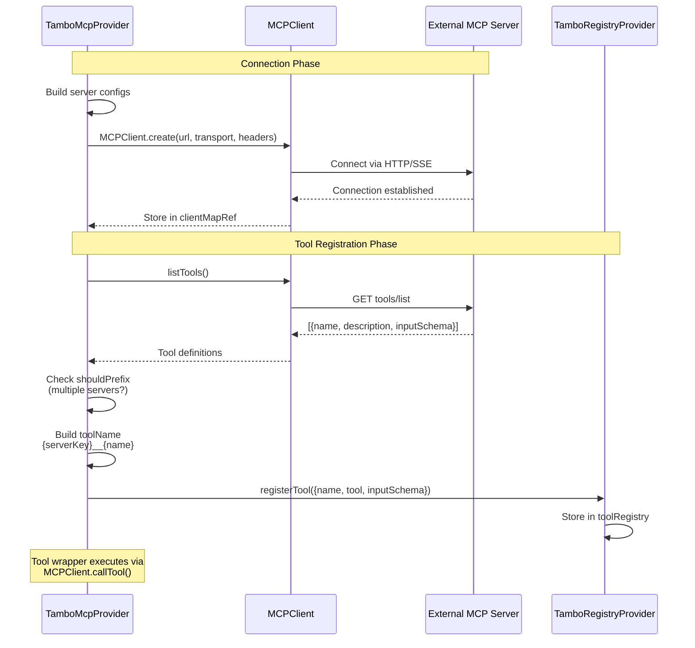
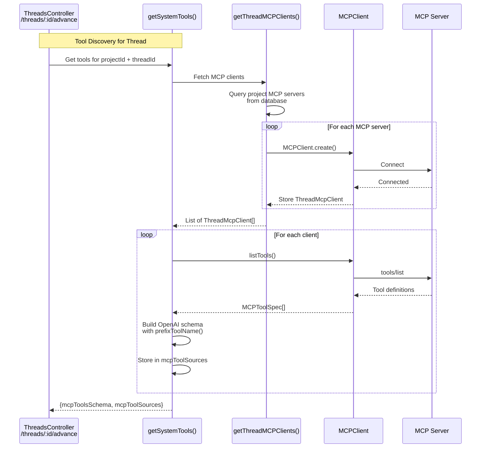
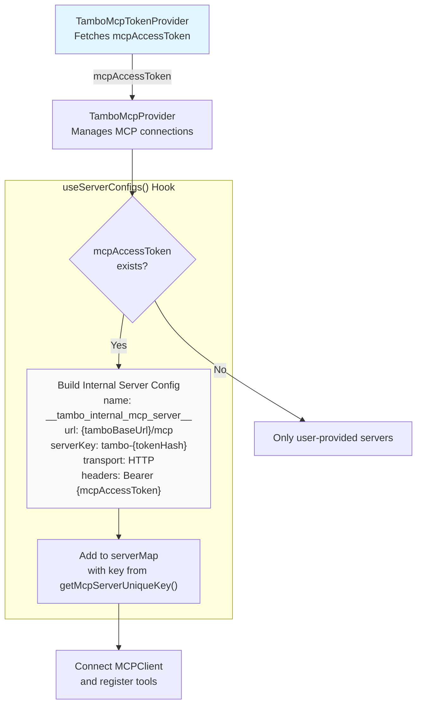
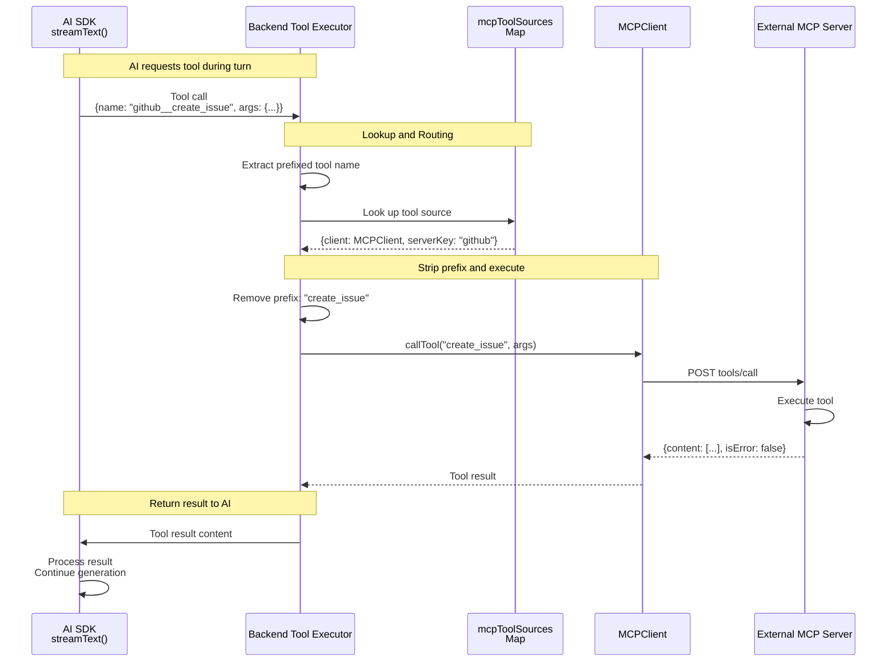
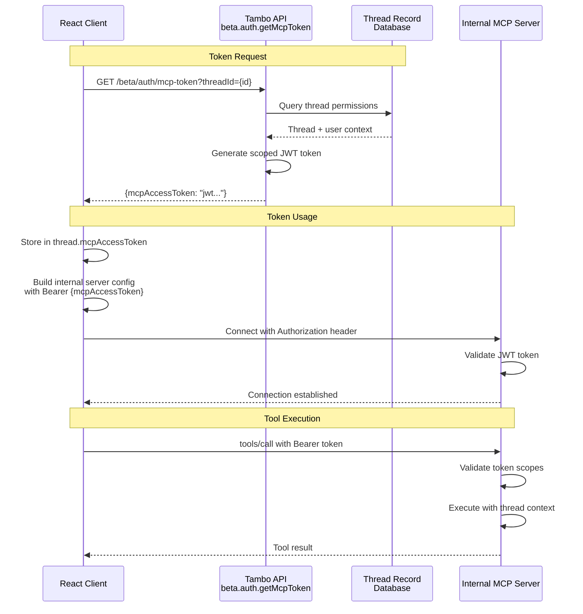
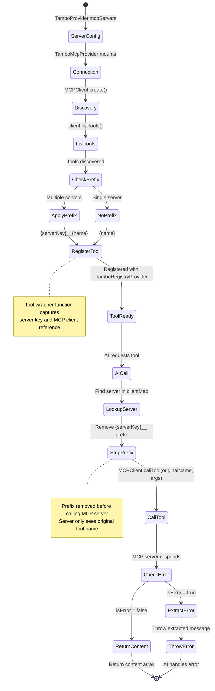
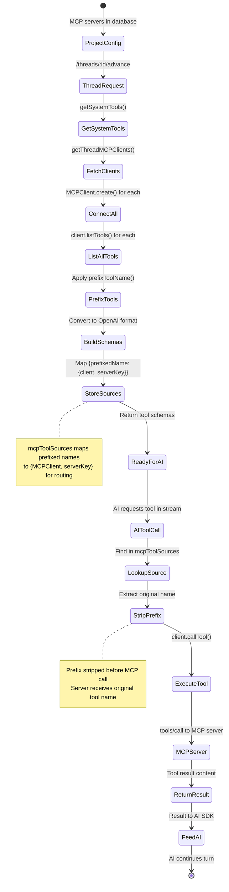

<!-- source: DeepWiki mcp.deepwiki.com · repo tambo-ai/tambo · page 6.4 MCP Tools · fetched 2026-10-29 -->

# MCP Tools and Server-Side Execution

<details>
<summary>Relevant source files</summary>

The following files were used as context for generating this wiki page:

- [react-sdk/src/mcp/index.ts](react-sdk/src/mcp/index.ts)
- [react-sdk/src/mcp/mcp-client.ts](react-sdk/src/mcp/mcp-client.ts)
- [react-sdk/src/mcp/mcp-hooks.ts](react-sdk/src/mcp/mcp-hooks.ts)
- [react-sdk/src/mcp/tambo-mcp-provider.tsx](react-sdk/src/mcp/tambo-mcp-provider.tsx)
- [react-sdk/src/providers/tambo-mcp-token-provider.tsx](react-sdk/src/providers/tambo-mcp-token-provider.tsx)

</details>


MCP tools are functions exposed by MCP servers that AI models call during conversations. This page documents how tools are discovered, registered with name prefixing to prevent collisions, and executed server-side for security. It covers both client-side tool registration in `TamboMcpProvider` and server-side execution in the Tambo API backend, including the special-case Tambo Internal MCP server that provides per-thread data access.

## Overview

MCP tools enable AI models to interact with external systems through structured function calls. Tools are discovered during MCP client connection, registered with the tool registry, and executed server-side when the AI model requests them during a conversation turn.

Key characteristics:
- Tools discovered via `MCPClient.listTools()` during server connection
- Name prefixing (`{serverKey}__{toolName}`) prevents collisions across servers
- Client-side registration wraps tools for browser-side MCP servers
- Server-side execution handles all tool calls for security and access control
- Tambo Internal MCP server provides per-thread authenticated data access

**Sources**: 
- [react-sdk/src/mcp/tambo-mcp-provider.tsx:1-729]()
- [apps/api/src/common/systemTools.ts:1-376]()
- [react-sdk/src/mcp/mcp-client.ts:1-366]()

## Tool Discovery and Registration

Tools are discovered and registered in two locations: client-side in `TamboMcpProvider` for browser-side MCP servers, and server-side in the Tambo API backend for all tool execution.

### Client-Side Tool Registration Flow



The `TamboMcpProvider` manages the lifecycle of browser-side MCP server connections and registers their tools with the tool registry. When multiple servers are configured, tool names are prefixed to prevent collisions.

**Sources**:
- [react-sdk/src/mcp/tambo-mcp-provider.tsx:271-343]()
- [react-sdk/src/mcp/tambo-mcp-provider.tsx:453-561]()
- [react-sdk/src/mcp/mcp-client.ts:218-256]()

### Server-Side Tool Discovery Flow



On the server side, `getSystemTools()` fetches tools from all MCP servers configured for a project. It builds OpenAI-compatible tool schemas and stores tool sources for routing execution to the correct MCP server.

**Sources**:
- [apps/api/src/common/systemTools.ts:42-72]()
- [apps/api/src/common/systemTools.ts:88-193]()
- [apps/api/src/common/systemTools.ts:196-282]()

### Tool Schema Structure

Each MCP tool includes these fields:

| Field | Type | Purpose |
|-------|------|---------|
| `name` | string | Tool identifier (may be prefixed with `{serverKey}__`) |
| `description` | string | Human-readable description shown to AI |
| `inputSchema` | JSONSchema7 | JSON Schema defining parameters and types |
| `maxCalls` | number (optional) | Maximum number of calls allowed per turn |

The `inputSchema` uses JSON Schema Draft 7 format to describe expected parameters. The AI model uses this schema to generate valid tool call arguments, and Tambo validates inputs against it before execution.

**Sources**:
- [react-sdk/src/mcp/mcp-client.ts:360-366]()
- [apps/api/src/common/systemTools.ts:249-266]()

## Tool Name Prefixing

When multiple MCP servers are configured, tool names are prefixed with the server key to prevent collisions. This ensures that if two servers both provide a tool named `search`, they can coexist without conflict.

### Prefixing Logic

**Client-Side Prefixing (`TamboMcpProvider`)**:

```typescript
// From tambo-mcp-provider.tsx:516-520
const shouldPrefix = currentServersMap.size > 1;
await registerServerTools(client, serverInfo, key, shouldPrefix, ...);

// From tambo-mcp-provider.tsx:288-290
const toolName = shouldPrefix
  ? `${serverInfo.serverKey}__${tool.name}`
  : tool.name;
```

When multiple servers are connected, tools are registered as `{serverKey}__{toolName}`. With a single server, tools use their original names.

**Server-Side Prefixing (`getSystemTools`)**:

```typescript
// From systemTools.ts:253
name: prefixToolName(serverKey, tool.name)

// prefixToolName implementation (from @tambo-ai-cloud/backend)
function prefixToolName(serverKey: string, toolName: string): string {
  return `${serverKey}__${toolName}`;
}
```

Server-side tools are always prefixed regardless of server count, ensuring consistent naming for backend execution.

### Prefix Format

| Component | Format | Example |
|-----------|--------|---------|
| Server Key | User-defined or auto-generated | `github`, `slack`, `server-a` |
| Separator | Double underscore | `__` |
| Tool Name | Original MCP tool name | `create_issue`, `search` |
| Full Name | `{serverKey}__{toolName}` | `github__create_issue` |

**Special Case - Tambo Internal Server**:

The internal MCP server uses a hash-based server key:

```typescript
// From tambo-mcp-provider.tsx:249
serverKey: `tambo-${tokenHash}`
// Example: tambo-a7f3k2
```

This ensures the internal server's tools have unique, stable names across thread sessions.

**Sources**:
- [react-sdk/src/mcp/tambo-mcp-provider.tsx:288-290]()
- [react-sdk/src/mcp/tambo-mcp-provider.tsx:516-525]()
- [apps/api/src/common/systemTools.ts:248-266]()
- [react-sdk/src/mcp/tambo-mcp-provider.tsx:156-163]()

### Tool Ownership and Deduplication

The `TamboMcpProvider` tracks tool ownership to prevent duplicate registrations:

```typescript
// From tambo-mcp-provider.tsx:265-268
interface ToolOwnershipRefs {
  toolOwnerRef: React.MutableRefObject<Map<string, string>>;
  keyToToolsRef: React.MutableRefObject<Map<string, Set<string>>>;
}
```

When a tool is registered:
1. Check if another server already owns this tool name (`toolOwnerRef`)
2. If owned, skip registration to avoid duplicates
3. If not owned, record ownership and register the tool (`keyToToolsRef`)

When a server is removed, its owned tools are released and unregistered.

**Sources**:
- [react-sdk/src/mcp/tambo-mcp-provider.tsx:265-268]()
- [react-sdk/src/mcp/tambo-mcp-provider.tsx:293-305]()
- [react-sdk/src/mcp/tambo-mcp-provider.tsx:348-360]()

## Tambo Internal MCP Server

The Tambo Internal MCP server is automatically configured when a thread has an MCP access token. It provides per-thread, per-user authenticated access to data and operations scoped to the current context.

### Internal Server Configuration



The internal server is constructed in `useServerConfigs()`:

```typescript
// From tambo-mcp-provider.tsx:240-259
if (mcpAccessToken && tamboBaseUrl) {
  const base = new URL(tamboBaseUrl);
  base.pathname = `${base.pathname.replace(/\/+$/, "")}/mcp`;
  const tamboMcpUrl = base.toString();
  const tokenHash = hashString(mcpAccessToken);
  const internalServer: NormalizedMcpServerInfo = {
    name: TAMBO_INTERNAL_MCP_SERVER_NAME,
    url: tamboMcpUrl,
    transport: MCPTransport.HTTP,
    serverKey: `tambo-${tokenHash}`,
    customHeaders: {
      Authorization: `Bearer ${mcpAccessToken}`,
    },
  };
  const serverInfo = normalizeServerInfo(internalServer, ServerType.TAMBO_INTERNAL);
  serverMap.set(serverInfo.key, serverInfo);
}
```

**Key Properties**:

| Property | Value | Purpose |
|----------|-------|---------|
| `name` | `__tambo_internal_mcp_server__` | Constant identifier |
| `url` | `{tamboBaseUrl}/mcp` | Internal MCP endpoint |
| `serverKey` | `tambo-{tokenHash}` | Unique key based on token hash |
| `transport` | `MCPTransport.HTTP` | Uses HTTP transport |
| `serverType` | `ServerType.TAMBO_INTERNAL` | Marks as internal server |
| `customHeaders` | `Authorization: Bearer {mcpAccessToken}` | Per-thread authentication |

The server key includes a hash of the access token to ensure it's stable within a session but changes if the token changes.

**Sources**:
- [react-sdk/src/mcp/tambo-mcp-provider.tsx:144]()
- [react-sdk/src/mcp/tambo-mcp-provider.tsx:225-263]()
- [react-sdk/src/mcp/tambo-mcp-provider.tsx:156-163]()

### Per-Thread Token Authentication

The MCP access token is fetched per-thread and provides scoped access:

```typescript
// From tambo-mcp-token-provider.tsx:98-127
if (shouldFetchThreadToken) {
  const fetchThreadToken = async () => {
    try {
      const response = await client.beta.auth.getMcpToken({
        threadId: currentThreadId,
      });
      if (response.mcpAccessToken) {
        // Update thread in threadMap with new token
        setThreadMap((prev) => {
          const thread = prev[currentThreadId];
          if (thread) {
            return {
              ...prev,
              [currentThreadId]: {
                ...thread,
                mcpAccessToken: response.mcpAccessToken,
              },
            };
          }
          return prev;
        });
      }
    } catch (error) {
      console.error(`Failed to fetch MCP token for thread ${currentThreadId}:`, error);
    }
  };
  void fetchThreadToken();
}
```

The token is stored in the thread object and automatically included in the internal MCP server's `Authorization` header. This ensures tools from the internal server can only access data scoped to the current thread and user.

**Sources**:
- [react-sdk/src/providers/tambo-mcp-token-provider.tsx:85-128]()
- [react-sdk/src/providers/tambo-mcp-token-provider.tsx:152-219]()

## Tool Execution Pipeline

### Client-Side Tool Wrapper Execution

When the AI calls a tool registered by `TamboMcpProvider`, the execution flows through the tool wrapper function:

```typescript
// From tambo-mcp-provider.tsx:307-335
registerTool({
  description: tool.description ?? "",
  name: toolName,
  tool: async (args: Record<string, unknown> = {}) => {
    const server = clientMap.get(key);
    if (!server?.client) {
      throw new Error(`MCP server for tool ${tool.name} is not connected`);
    }
    const result = await server.client.callTool(tool.name, args);
    if (result.isError) {
      const errorMessage = extractErrorMessage(result.content);
      throw new Error(errorMessage);
    }
    return result.content;
  },
  inputSchema: tool.inputSchema ?? {},
  outputSchema: {},
  transformToContent: (content: unknown) => {
    if (isContentPartArray(content)) {
      return content;
    }
    return [{ type: "text", text: toText(content) }];
  },
});
```

**Execution steps**:
1. Look up the server from `clientMap` using the server's unique key
2. Verify the MCP client is still connected
3. Call `MCPClient.callTool()` with the original tool name (without prefix)
4. Check `result.isError` and extract error message if failed
5. Return `result.content` array or throw error

**Sources**:
- [react-sdk/src/mcp/tambo-mcp-provider.tsx:307-335]()
- [react-sdk/src/mcp/tambo-mcp-provider.tsx:36-56]()

### Server-Side Tool Execution

On the server side, tools are executed during the AI streaming turn:



The `mcpToolSources` map stores the routing information for each tool:

```typescript
// From systemTools.ts:269-274
for (const tool of tools) {
  mcpToolSources[prefixToolName(serverKey, tool.name)] = {
    client: mcpClient,
    serverKey,
  };
}
```

When executing a tool:
1. Look up the tool in `mcpToolSources` using the prefixed name
2. Extract the `MCPClient` and `serverKey`
3. Strip the prefix to get the original tool name
4. Call `client.callTool()` with the original name and args
5. Return the result content to the AI

**Sources**:
- [apps/api/src/common/systemTools.ts:269-274]()
- [apps/api/src/common/systemTools.ts:209-282]()
- [react-sdk/src/mcp/mcp-client.ts:277-288]()

### MCPClient.callTool() Implementation

The `callTool()` method sends the request to the MCP server:

```typescript
// From mcp-client.ts:277-288
async callTool(
  name: string,
  args: Record<string, unknown>,
  _meta?: Record<string, unknown>,
): Promise<MCPToolCallResult> {
  const result = await this.client.callTool({
    name,
    arguments: args,
    _meta,
  });
  return result;
}
```

The underlying MCP SDK client sends a `tools/call` request and returns:
- `content`: Array of content parts (text, image, resource references)
- `isError`: Boolean indicating success/failure

**Sources**:
- [react-sdk/src/mcp/mcp-client.ts:277-288]()
- [react-sdk/src/mcp/mcp-client.ts:345-351]()

## Resource Fetching for Server-Side MCP Servers

Server-side MCP servers (configured in the backend) can provide resources that need to be fetched when referenced in user input. The backend creates resource fetchers for these servers.

### Resource Fetcher Map

```typescript
// From systemTools.ts:354-375
export function createResourceFetcherMap(
  mcpClients: ThreadMcpClient[],
): Record<string, (uri: string) => Promise<ReadResourceResult>> {
  const fetchers: Record<string, (uri: string) => Promise<ReadResourceResult>> = {};

  for (const { client, serverKey } of mcpClients) {
    if (!serverKey) continue;

    fetchers[serverKey] = async (uri: string) => {
      // Validate that the URI starts with the serverKey prefix
      if (!uri.startsWith(`${serverKey}:`)) {
        throw new Error(`Invalid URI for server ${serverKey}: ${uri}`);
      }
      // Strip the serverKey prefix to get the MCP-native URI
      const mcpUri = uri.slice(serverKey.length + 1);
      return await client.client.readResource({ uri: mcpUri });
    };
  }

  return fetchers;
}
```

**Usage**:
1. User includes a resource reference like `@github:file://path/to/code.ts`
2. Backend extracts the server key (`github`) and URI (`file://path/to/code.ts`)
3. Looks up the fetcher for `github` in the fetcher map
4. Calls `fetchers['github']('github:file://path/to/code.ts')`
5. Fetcher strips the prefix and calls `MCPClient.readResource()`
6. Resource content is included in the AI context

**Sources**:
- [apps/api/src/common/systemTools.ts:354-375]()

## MCP Server Types

Tambo distinguishes between three types of MCP servers based on where they are configured and how they execute:

### ServerType.BROWSER_SIDE

Browser-side MCP servers connect directly from the React app via `TamboProvider.mcpServers`. Tools are registered client-side and executed by calling the MCP server from the browser.

**Configuration**:
```typescript
<TamboProvider
  mcpServers={[
    {
      url: 'https://api.example.com/mcp',
      transport: MCPTransport.HTTP,
      serverKey: 'example',
    }
  ]}
>
```

**Characteristics**:
- Configured in React app
- Tools registered via `TamboMcpProvider`
- Direct browser → MCP server connection
- Used for less sensitive integrations

**Sources**:
- [react-sdk/src/mcp/tambo-mcp-provider.tsx:234-237]()

### ServerType.TAMBO_INTERNAL

The Tambo Internal MCP server is automatically configured when a thread has an MCP access token. It provides authenticated access to per-thread data.

**Configuration**: Automatic (when `mcpAccessToken` exists)

**Characteristics**:
- Automatically added by `TamboMcpProvider`
- URL: `{tamboBaseUrl}/mcp`
- Authentication: Bearer token in headers
- Server key: `tambo-{tokenHash}`
- Provides thread-scoped data access

**Sources**:
- [react-sdk/src/mcp/tambo-mcp-provider.tsx:254-257]()

### Server-Side MCP Servers (Backend)

Backend MCP servers are configured in the Tambo API database and execute server-side for security and access control.

**Configuration**: Via Tambo Cloud dashboard or API

**Characteristics**:
- Configured in backend database
- Tools discovered via `getSystemTools()`
- All execution happens server-side
- Used for sensitive operations
- Examples: Database queries, payment processing, OAuth-protected APIs

**Sources**:
- [apps/api/src/common/systemTools.ts:88-193]()

## Error Handling

### Client-Side Error Handling

When a browser-side MCP tool execution fails, the error is extracted and thrown:

```typescript
// From tambo-mcp-provider.tsx:318-322
const result = await server.client.callTool(tool.name, args);
if (result.isError) {
  const errorMessage = extractErrorMessage(result.content);
  throw new Error(errorMessage);
}
return result.content;
```

The `extractErrorMessage()` utility normalizes error content from various formats:

```typescript
// From tambo-mcp-provider.tsx:36-56
export function extractErrorMessage(content: unknown): string {
  if (content === undefined || content === null) {
    return "Unknown error occurred";
  }

  if (Array.isArray(content)) {
    const textItems = content
      .filter((item) => item?.type === "text" && typeof item.text === "string")
      .map((item) => item.text);

    return textItems.length > 0
      ? textItems.join(" ")
      : "Error occurred but no details provided";
  }

  if (typeof content === "object") {
    return JSON.stringify(content);
  }

  return `${content}`;
}
```

**Error handling flow**:
1. MCP server returns `{isError: true, content: [...]}`
2. `extractErrorMessage()` extracts text from content array
3. Error is thrown with extracted message
4. AI receives error in tool result and adjusts response

**Sources**:
- [react-sdk/src/mcp/tambo-mcp-provider.tsx:36-56]()
- [react-sdk/src/mcp/tambo-mcp-provider.tsx:318-322]()

### Server-Side Error Handling

Server-side tool execution failures are logged and tracked:

```typescript
// From systemTools.ts:232-243
logger.error(
  `Error listing tools for MCP server ${serverId ?? "unknown"} (${url ?? "n/a"}) in project ${projectId}: ${err.message}`,
  err.stack,
);
await operations.addProjectLogEntry(
  db,
  projectId,
  LogLevel.ERROR,
  `Error listing tools for MCP server ${serverId ?? "unknown"}: ${err.message}`,
  { mcpServerId: serverId, url },
);
```

Errors during tool discovery or execution are logged to the project's log entries for debugging and monitoring.

**Sources**:
- [apps/api/src/common/systemTools.ts:214-243]()
- [apps/api/src/common/systemTools.ts:99-121]()

## Security and Access Control

### Browser-Side vs Server-Side Execution

**Browser-Side MCP Servers** (`ServerType.BROWSER_SIDE`):
- Configured in React app via `TamboProvider.mcpServers`
- MCP client runs in browser
- Tools execute by directly calling MCP server from browser
- Suitable for public APIs or low-sensitivity operations
- User's browser IP is visible to MCP server

**Server-Side MCP Servers** (Backend):
- Configured in Tambo API backend database
- MCP client runs in NestJS backend
- Tools execute server-side with backend authentication
- Protects sensitive credentials and API keys
- Enables centralized access control and rate limiting
- All tool calls logged for audit compliance

**Sources**:
- [apps/api/src/common/systemTools.ts:88-193]()
- [react-sdk/src/mcp/tambo-mcp-provider.tsx:234-237]()

### MCP Access Token Flow

For the Tambo Internal MCP server and server-side authenticated MCP servers:



The MCP access token provides:
- Per-thread authentication (token scoped to specific thread)
- Per-user authorization (token includes user identity)
- Time-limited validity (JWT expiration)
- Scope-based access control (token claims define permissions)

**Sources**:
- [react-sdk/src/providers/tambo-mcp-token-provider.tsx:85-128]()
- [react-sdk/src/mcp/tambo-mcp-provider.tsx:250-252]()

### OAuth Authentication for External MCP Servers

Server-side MCP servers can use OAuth for authentication:

```typescript
// From systemTools.ts:305-340
async function getAuthProvider(
  db: HydraDb,
  mcpServer: McpServer,
): Promise<OAuthClientProvider | undefined> {
  if (!mcpServer.contexts.length) {
    return undefined;
  }
  // ... context and client lookup ...
  
  const authProvider = new OAuthLocalProvider(db, context.id, {
    baseUrl: env.VERCEL_URL ?? "http://localhost:8260",
    serverUrl: mcpServer.url,
    clientInformation: client.sessionInfo.clientInformation,
    sessionId: client.sessionId,
  });
  return authProvider;
}
```

The `OAuthLocalProvider` handles:
- Token refresh when access tokens expire
- Secure storage of OAuth credentials in database
- Per-user OAuth sessions for multi-user MCP servers

**Sources**:
- [apps/api/src/common/systemTools.ts:305-341]()
- [apps/api/src/common/systemTools.ts:109-121]()

## Tool Lifecycle Summary

### Client-Side Tool Lifecycle (Browser-Side MCP)



**Sources**:
- [react-sdk/src/mcp/tambo-mcp-provider.tsx:453-561]()
- [react-sdk/src/mcp/tambo-mcp-provider.tsx:271-343]()

### Server-Side Tool Lifecycle (Backend MCP)



**Sources**:
- [apps/api/src/common/systemTools.ts:42-72]()
- [apps/api/src/common/systemTools.ts:196-282]()

## Related Documentation

- [MCP Overview](#6.1) - Introduction to Model Context Protocol
- [Client-Side MCP Integration](#6.2) - MCPProvider and client setup
- [MCP Resources and Prompts](#6.3) - Client-side resource/prompt fetching
- [MCP Hooks Reference](#6.5) - Complete hooks API documentation
- [Elicitation and Sampling](#6.6) - Advanced MCP request patterns
- [Backend API](#7) - Complete backend architecture

---

