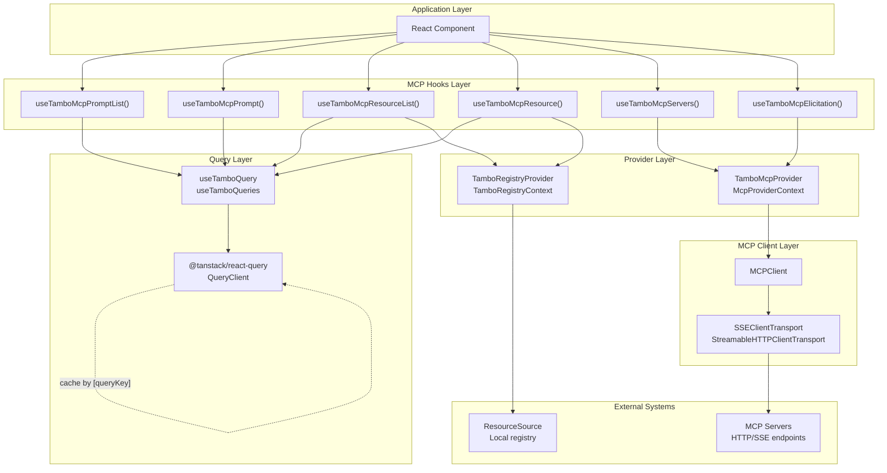
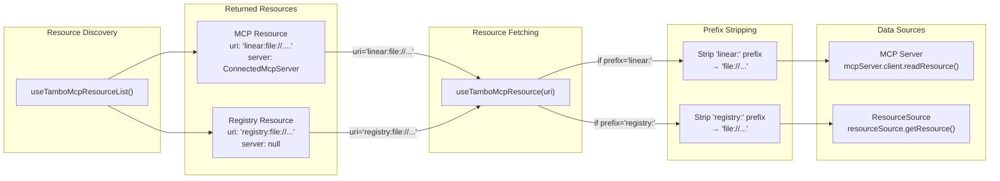

<!-- source: DeepWiki mcp.deepwiki.com · repo tambo-ai/tambo · page 6.5 MCP Hooks Reference · fetched 2026-10-29 -->

# MCP Hooks Reference

<details>
<summary>Relevant source files</summary>

The following files were used as context for generating this wiki page:

- [react-sdk/src/mcp/index.ts](react-sdk/src/mcp/index.ts)
- [react-sdk/src/mcp/mcp-client.ts](react-sdk/src/mcp/mcp-client.ts)
- [react-sdk/src/mcp/mcp-hooks.ts](react-sdk/src/mcp/mcp-hooks.ts)
- [react-sdk/src/mcp/tambo-mcp-provider.tsx](react-sdk/src/mcp/tambo-mcp-provider.tsx)
- [react-sdk/src/providers/tambo-mcp-token-provider.tsx](react-sdk/src/providers/tambo-mcp-token-provider.tsx)

</details>


This page provides a complete reference for React hooks that interact with MCP (Model Context Protocol) servers. These hooks enable client-side access to prompts, resources, and server metadata from connected MCP servers.

For information about setting up MCP integration, see [Client-Side MCP Integration](#6.2). For details on using MCP resources and prompts in the UI, see [MCP Resources and Prompts](#6.3). For server-side MCP tool execution, see [MCP Tools and Server-Side Execution](#6.4).

**Sources**: [react-sdk/src/mcp/index.ts:1-51](), [react-sdk/src/mcp/mcp-hooks.ts:1-459]()

## Hook Categories

The React SDK provides six MCP-specific hooks organized into three categories:

| Category | Hook | Purpose |
|----------|------|---------|
| **Prompts** | `useTamboMcpPromptList` | List all available prompts from MCP servers |
| | `useTamboMcpPrompt` | Fetch a specific prompt by name |
| **Resources** | `useTamboMcpResourceList` | List all available resources from MCP servers and registry |
| | `useTamboMcpResource` | Fetch a specific resource by URI |
| **Server Management** | `useTamboMcpServers` | Access connected MCP server instances |
| | `useTamboMcpElicitation` | Handle MCP elicitation requests (AI requesting user input) |

All hooks use `@tanstack/react-query` for caching and state management, providing automatic refetching, loading states, and error handling.

**Sources**: [react-sdk/src/mcp/mcp-hooks.ts:1-459](), [react-sdk/src/mcp/tambo-mcp-provider.tsx:636-700]()

## Hook Architecture and Data Flow



**Hook Invocation Flow**: Components call MCP hooks → Hooks use `useTamboQuery`/`useTamboQueries` → Queries execute via `MCPClient.client.listPrompts/listResources/etc` → Results cached by query key → Subsequent calls return cached data until invalidated.

**Sources**: [react-sdk/src/mcp/mcp-hooks.ts:1-459](), [react-sdk/src/mcp/tambo-mcp-provider.tsx:1-729]()

## Prompt Hooks

### useTamboMcpPromptList

Lists all prompts available from connected MCP servers. Prompts are automatically prefixed with their server key (e.g., `"linear:create-issue"`).

**Function Signature**:
```typescript
function useTamboMcpPromptList(search?: string): {
  data: ListPromptEntry[];
  error: Error | null;
  isPending: boolean;
  isSuccess: boolean;
  isError: boolean;
  refetch: () => Promise<void>;
}
```

**Type Definitions**:
```typescript
interface ListPromptEntry {
  server: ConnectedMcpServer;
  prompt: {
    name: string;        // Prefixed with serverKey
    description?: string;
    arguments?: Array<{
      name: string;
      description?: string;
      required?: boolean;
    }>;
  };
}
```

**Query Behavior**:
- **Query Key**: `["mcp-prompts", mcpServer.key]` - One query per server
- **Caching**: Prompts cached per server; adding/removing servers updates only affected queries
- **Search Filtering**: Local client-side filtering; does not trigger new server requests
- **Prefixing**: Always prefixes prompts with `serverKey:` regardless of server count

**Example Usage**:
```typescript
function PromptSelector() {
  const { data: prompts, isPending } = useTamboMcpPromptList("issue");
  
  if (isPending) return <div>Loading prompts...</div>;
  
  return (
    <ul>
      {prompts.map(({ prompt, server }) => (
        <li key={prompt.name}>
          {prompt.name} from {server.url}
        </li>
      ))}
    </ul>
  );
}
```

**Sources**: [react-sdk/src/mcp/mcp-hooks.ts:78-138](), [react-sdk/src/mcp/mcp-hooks.test.tsx:25-603]()

### useTamboMcpPrompt

Fetches a specific prompt by name and resolves it with provided arguments.

**Function Signature**:
```typescript
function useTamboMcpPrompt(
  promptName: string | undefined,
  args?: Record<string, string>
): {
  data: GetPromptResult | null;
  error: Error | null;
  isPending: boolean;
  enabled: boolean;
}
```

**Type Definitions**:
```typescript
interface GetPromptResult {
  description?: string;
  messages: Array<{
    role: "user" | "assistant";
    content: {
      type: "text" | "image" | "resource";
      text?: string;
      data?: string;
      mimeType?: string;
      uri?: string;
    };
  }>;
}
```

**Query Behavior**:
- **Query Key**: `["mcp-prompt", promptName, mcpServer.key, sortedArgsEntries]`
- **Enabled**: Only when `promptName` exists and server is connected
- **Prefix Stripping**: Removes `serverKey:` prefix before calling MCP server
- **Argument Canonicalization**: Sorts argument keys to prevent cache misses from object ordering

**Example Usage**:
```typescript
function PromptDisplay() {
  const { data: prompt } = useTamboMcpPrompt("linear:create-issue", {
    title: "Bug report",
    priority: "high"
  });
  
  if (!prompt) return null;
  
  return (
    <div>
      {prompt.messages.map((msg, i) => (
        <div key={i}>{msg.content.text}</div>
      ))}
    </div>
  );
}
```

**Sources**: [react-sdk/src/mcp/mcp-hooks.ts:199-249]()

## Resource Hooks

### useTamboMcpResourceList

Lists all resources from MCP servers and the local registry. Resources are prefixed with either their server key (MCP) or `"registry:"` (local).

**Function Signature**:
```typescript
function useTamboMcpResourceList(search?: string): {
  data: ListResourceEntry[];
  error: Error | null;
  errors: Error[];
  isPending: boolean;
  isSuccess: boolean;
  refetch: () => Promise<void>;
}
```

**Type Definitions**:
```typescript
type ListResourceEntry = RegistryResourceEntry | McpResourceEntry;

interface RegistryResourceEntry {
  server: null;
  resource: {
    uri: string;        // Prefixed with "registry:"
    name?: string;
    description?: string;
    mimeType?: string;
  };
}

interface McpResourceEntry {
  server: ConnectedMcpServer;
  resource: {
    uri: string;        // Prefixed with serverKey
    name?: string;
    description?: string;
    mimeType?: string;
  };
}
```

**Query Behavior**:
- **MCP Resources**: Query key `["mcp-resources", mcpServer.key]` - cached per server
- **Static Registry Resources**: No query; included directly from `useTamboRegistry()`
- **Dynamic Registry Resources**: Query key `["registry-resources", "dynamic", search]` - search triggers new query
- **Search Filtering**:
  - MCP resources: Local client-side filtering
  - Static registry resources: Local client-side filtering  
  - Dynamic registry resources: Server-side filtering via `resourceSource.listResources(search)`
- **Prefixing**: All resources prefixed - MCP with `serverKey:`, registry with `"registry:"`

**Example Usage**:
```typescript
function ResourcePicker() {
  const [search, setSearch] = useState("");
  const { data: resources } = useTamboMcpResourceList(search);
  
  return (
    <div>
      <input 
        value={search} 
        onChange={(e) => setSearch(e.target.value)} 
      />
      <ul>
        {resources.map((entry) => (
          <li key={entry.resource.uri}>
            {entry.resource.name || entry.resource.uri}
            {entry.server ? ` (${entry.server.serverKey})` : " (local)"}
          </li>
        ))}
      </ul>
    </div>
  );
}
```

**Type Guard**:
```typescript
if (isMcpResourceEntry(entry)) {
  // entry.server is ConnectedMcpServer
  console.log(entry.server.url);
} else {
  // entry.server is null (registry resource)
  console.log("Local resource");
}
```

**Sources**: [react-sdk/src/mcp/mcp-hooks.ts:251-381](), [react-sdk/src/mcp/mcp-hooks.test.tsx:793-1263]()

### useTamboMcpResource

Fetches the content of a specific resource by URI.

**Function Signature**:
```typescript
function useTamboMcpResource(
  resourceUri: string | undefined
): {
  data: ReadResourceResult | null;
  error: Error | null;
  isPending: boolean;
  enabled: boolean;
}
```

**Type Definitions**:
```typescript
interface ReadResourceResult {
  contents: Array<{
    uri: string;
    mimeType?: string;
    text?: string;
    blob?: string;
  }>;
}
```

**Query Behavior**:
- **Query Key**: `["resource", resourceUri, locationKey]`
  - `locationKey` is `"registry"` for registry resources, `mcpServer.key` for MCP resources
- **Enabled**: Only when URI exists and source (registry or MCP server) is available
- **Prefix Stripping**: Removes `registry:` or `serverKey:` prefix before fetching
- **Routing**:
  - URIs starting with `"registry:"` → fetched via `resourceSource.getResource()`
  - URIs with MCP server prefix → fetched via `mcpServer.client.client.readResource()`

**Example Usage**:
```typescript
function ResourceViewer({ uri }: { uri: string }) {
  const { data: resource, isPending } = useTamboMcpResource(uri);
  
  if (isPending) return <div>Loading...</div>;
  if (!resource) return <div>Not found</div>;
  
  return (
    <div>
      {resource.contents.map((content, i) => (
        <div key={i}>
          <strong>{content.mimeType}</strong>
          <pre>{content.text || content.blob}</pre>
        </div>
      ))}
    </div>
  );
}
```

**Sources**: [react-sdk/src/mcp/mcp-hooks.ts:383-458]()

## Resource Prefix Handling



**Prefix Behavior**: All resources returned by `useTamboMcpResourceList` are prefixed to ensure unique URIs across sources. The `useTamboMcpResource` hook automatically strips the prefix before fetching from the appropriate source.

**Sources**: [react-sdk/src/mcp/mcp-hooks.ts:324-344](), [react-sdk/src/mcp/mcp-hooks.ts:404-456]()

## Server and Elicitation Hooks

### useTamboMcpServers

Returns the list of MCP servers managed by `TamboMcpProvider`, including both successfully connected servers and failed connection attempts.

**Function Signature**:
```typescript
function useTamboMcpServers(): McpServer[]

type McpServer = ConnectedMcpServer | FailedMcpServer;

interface ConnectedMcpServer {
  name: string;
  url: string;
  transport: MCPTransport;
  serverKey: string;
  key: string;
  client: MCPClient;
}

interface FailedMcpServer {
  name: string;
  url: string;
  transport: MCPTransport;
  serverKey: string;
  key: string;
  connectionError: Error;
}
```

**Usage**:
- Access underlying MCP client for direct method calls
- Check connection status before using server
- Display server list in UI
- Manually trigger reconnection

**Example Usage**:
```typescript
function ServerStatus() {
  const servers = useTamboMcpServers();
  
  return (
    <ul>
      {servers.map((server) => (
        <li key={server.key}>
          {server.url}
          {server.client ? (
            <span>✓ Connected</span>
          ) : (
            <span>✗ Failed: {server.connectionError.message}</span>
          )}
        </li>
      ))}
    </ul>
  );
}
```

**Direct Client Access**:
```typescript
function ManualServerControl() {
  const servers = useTamboMcpServers();
  
  const reconnectAll = () => {
    servers.forEach((server) => {
      if (server.client) {
        // Direct access to MCPClient methods
        server.client.close().then(() => {
          // Client will auto-reconnect via provider
        });
      }
    });
  };
  
  return <button onClick={reconnectAll}>Reconnect All</button>;
}
```

**Sources**: [react-sdk/src/mcp/tambo-mcp-provider.tsx:635-660](), [react-sdk/src/mcp/tambo-mcp-provider.tsx:88-106]()

### useTamboMcpElicitation

Provides access to the current elicitation request and methods to respond to it. Elicitation is an MCP feature where servers can request user input during tool execution.

**Function Signature**:
```typescript
function useTamboMcpElicitation(): {
  elicitation: TamboElicitationRequest | null;
  resolveElicitation: ((response: TamboElicitationResponse) => void) | null;
}

interface TamboElicitationRequest {
  message: string;
  schema?: ElicitationRequestedSchema;
  _meta?: Record<string, unknown>;
}

interface TamboElicitationResponse {
  action: "accept" | "reject";
  content?: Record<string, unknown>;
}

type ElicitationRequestedSchema = 
  | PrimitiveSchemaDefinition
  | { type: "object"; properties: Record<string, PrimitiveSchemaDefinition> };
```

**Behavior**:
- `elicitation` is `null` when no elicitation is active
- `resolveElicitation` is `null` when no elicitation is active
- Calling `resolveElicitation()` clears the elicitation state
- New elicitations can arrive while a previous one is active (queued by MCP protocol)

**Example Usage**:
```typescript
function ElicitationDialog() {
  const { elicitation, resolveElicitation } = useTamboMcpElicitation();
  const [input, setInput] = useState({});
  
  if (!elicitation || !resolveElicitation) return null;
  
  return (
    <dialog open>
      <h3>{elicitation.message}</h3>
      {elicitation.schema && (
        <SchemaForm 
          schema={elicitation.schema}
          value={input}
          onChange={setInput}
        />
      )}
      <button onClick={() => resolveElicitation({
        action: "accept",
        content: input
      })}>
        Submit
      </button>
      <button onClick={() => resolveElicitation({ action: "reject" })}>
        Cancel
      </button>
    </dialog>
  );
}
```

For more details on elicitation handling, see [Elicitation and Sampling](#6.6).

**Sources**: [react-sdk/src/mcp/tambo-mcp-provider.tsx:662-693](), [react-sdk/src/mcp/elicitation.ts:1-200]()

## Query Caching Strategy

```mermaid
graph TB
    subgraph "Query Cache Structure"
        Cache["QueryClient Cache"]
        
        subgraph "Per-Server Prompt Queries"
            P1["['mcp-prompts', 'server-a-key']"]
            P2["['mcp-prompts', 'server-b-key']"]
        end
        
        subgraph "Per-Server Resource Queries"
            R1["['mcp-resources', 'server-a-key']"]
            R2["['mcp-resources', 'server-b-key']"]
        end
        
        subgraph "Dynamic Registry Query"
            RD["['registry-resources', 'dynamic', search]"]
        end
        
        subgraph "Individual Item Queries"
            IP["['mcp-prompt', name, serverKey, args]"]
            IR["['resource', uri, locationKey]"]
        end
    end
    
    subgraph "Query Invalidation Events"
        AddServer["Server Added"]
        RemoveServer["Server Removed"]
        SearchChange["Search Changed"]
    end
    
    Cache --> P1
    Cache --> P2
    Cache --> R1
    Cache --> R2
    Cache --> RD
    Cache --> IP
    Cache --> IR
    
    AddServer -->|"Creates new query"| P1
    AddServer -->|"Creates new query"| R1
    
    RemoveServer -->|"Removes query"| P2
    RemoveServer -->|"Removes query"| R2
    
    SearchChange -->|"Local filter only"| P1
    SearchChange -->|"Local filter only"| R1
    SearchChange -->|"New query fetch"| RD
```



**Caching Behavior**:
- **Per-Server Queries**: Prompts and resources cached independently per server; adding/removing servers affects only that server's cache
- **Static Data**: Registry resources and tool lists included directly without queries
- **Search Filtering**: MCP prompts/resources filtered locally; dynamic registry resources trigger new queries
- **Argument Stability**: Prompt and resource queries canonicalize arguments/URIs to prevent duplicate cache entries

**Sources**: [react-sdk/src/mcp/mcp-hooks.ts:85-138](), [react-sdk/src/mcp/mcp-hooks.ts:304-351](), [react-sdk/src/mcp/mcp-hooks.test.tsx:288-398]()

## Type Reference

### Core Types

```typescript
// Hook return types extend UseQueryResult from @tanstack/react-query
interface ListQueryResult<T> {
  data: T[];
  error: Error | null;
  errors: Error[];           // All errors from parallel queries
  isPending: boolean;
  isSuccess: boolean;
  isError: boolean;
  isPaused: boolean;
  isRefetching: boolean;
  isFetching: boolean;
  isLoading: boolean;
  refetch: () => Promise<void>;
}

interface ItemQueryResult<T> {
  data: T | null;
  error: Error | null;
  isPending: boolean;
  isSuccess: boolean;
  isError: boolean;
  enabled: boolean;
  refetch: () => Promise<void>;
}
```

### Server and Connection Types

```typescript
interface ConnectedMcpServer {
  name: string;
  url: string;
  transport: MCPTransport;
  serverKey: string;
  key: string;                // Unique identifier including URL/headers
  serverType: ServerType;
  customHeaders?: Record<string, string>;
  client: MCPClient;
}

interface FailedMcpServer {
  name: string;
  url: string;
  transport: MCPTransport;
  serverKey: string;
  key: string;
  serverType: ServerType;
  customHeaders?: Record<string, string>;
  connectionError: Error;
}

enum MCPTransport {
  SSE = "sse",
  HTTP = "http"
}

enum ServerType {
  BROWSER_SIDE = "browser-side",
  TAMBO_INTERNAL = "tambo-internal"
}
```

**Sources**: [react-sdk/src/mcp/tambo-mcp-provider.tsx:88-106](), [react-sdk/src/mcp/mcp-client.ts:16-20](), [react-sdk/src/mcp/mcp-constants.ts:1-15]()

## Common Usage Patterns

### Pattern: Autocomplete with Prompts

```typescript
function PromptAutocomplete() {
  const [search, setSearch] = useState("");
  const { data: prompts, isPending } = useTamboMcpPromptList(search);
  const [selected, setSelected] = useState<string>();
  const { data: prompt } = useTamboMcpPrompt(selected);
  
  return (
    <div>
      <input 
        value={search}
        onChange={(e) => setSearch(e.target.value)}
        placeholder="Search prompts..."
      />
      {isPending && <div>Loading...</div>}
      <ul>
        {prompts.map(({ prompt }) => (
          <li 
            key={prompt.name}
            onClick={() => setSelected(prompt.name)}
          >
            {prompt.name}
            {prompt.description && <small>{prompt.description}</small>}
          </li>
        ))}
      </ul>
      {prompt && (
        <div>
          {prompt.messages.map((msg, i) => (
            <div key={i}>{msg.content.text}</div>
          ))}
        </div>
      )}
    </div>
  );
}
```

### Pattern: Resource Browser with Preview

```typescript
function ResourceBrowser() {
  const [search, setSearch] = useState("");
  const { data: resources } = useTamboMcpResourceList(search);
  const [selectedUri, setSelectedUri] = useState<string>();
  const { data: resource, isPending } = useTamboMcpResource(selectedUri);
  
  return (
    <div className="flex">
      <aside>
        <input 
          value={search}
          onChange={(e) => setSearch(e.target.value)}
        />
        {resources.map((entry) => (
          <button
            key={entry.resource.uri}
            onClick={() => setSelectedUri(entry.resource.uri)}
          >
            {entry.resource.name || entry.resource.uri}
            {isMcpResourceEntry(entry) && (
              <span className="badge">{entry.server.serverKey}</span>
            )}
          </button>
        ))}
      </aside>
      <main>
        {isPending && <div>Loading...</div>}
        {resource?.contents.map((content, i) => (
          <pre key={i}>{content.text || content.blob}</pre>
        ))}
      </main>
    </div>
  );
}
```

### Pattern: Server Status Dashboard

```typescript
function ServerDashboard() {
  const servers = useTamboMcpServers();
  
  return (
    <table>
      <thead>
        <tr>
          <th>Server</th>
          <th>Status</th>
          <th>URL</th>
          <th>Transport</th>
        </tr>
      </thead>
      <tbody>
        {servers.map((server) => (
          <tr key={server.key}>
            <td>{server.name}</td>
            <td>
              {server.client ? (
                <span className="success">Connected</span>
              ) : (
                <span className="error">
                  Failed: {server.connectionError.message}
                </span>
              )}
            </td>
            <td>{server.url}</td>
            <td>{server.transport}</td>
          </tr>
        ))}
      </tbody>
    </table>
  );
}
```

**Sources**: [react-sdk/src/mcp/mcp-hooks.ts:1-459](), [cli/src/registry/mcp-components/mcp-components.tsx:1-400]()

## Error Handling

All MCP hooks use `@tanstack/react-query` error handling:

```typescript
function ResourceListWithErrors() {
  const { data, error, errors, isError } = useTamboMcpResourceList();
  
  if (isError) {
    // error: First error encountered
    // errors: Array of all errors from parallel queries
    return (
      <div>
        <h3>Failed to load resources</h3>
        <ul>
          {errors.map((err, i) => (
            <li key={i}>{err.message}</li>
          ))}
        </ul>
      </div>
    );
  }
  
  return <ResourceList resources={data} />;
}
```

**Partial Success**: List hooks (`useTamboMcpPromptList`, `useTamboMcpResourceList`) return partial results when some servers succeed and others fail. Check `errors` array for individual server failures.

**Sources**: [react-sdk/src/mcp/mcp-hooks.ts:139-187](), [react-sdk/src/mcp/mcp-hooks.test.tsx:400-480]()

## Hook Dependencies

All MCP hooks require the following provider hierarchy:

```typescript
<TamboProvider mcpServers={[...]}>
  {/* or individually: */}
  <TamboClientProvider>
    <TamboRegistryProvider mcpServers={[...]}>
      <TamboMcpTokenProvider>
        <TamboMcpProvider>
          {/* MCP hooks available here */}
          <YourComponent />
        </TamboMcpProvider>
      </TamboMcpTokenProvider>
    </TamboRegistryProvider>
  </TamboClientProvider>
</TamboProvider>
```

For provider configuration details, see [TamboProvider Setup](#3.1) and [Client-Side MCP Integration](#6.2).

**Sources**: [react-sdk/src/providers/tambo-provider.tsx:1-200](), [react-sdk/src/mcp/tambo-mcp-provider.tsx:375-448]()

---

