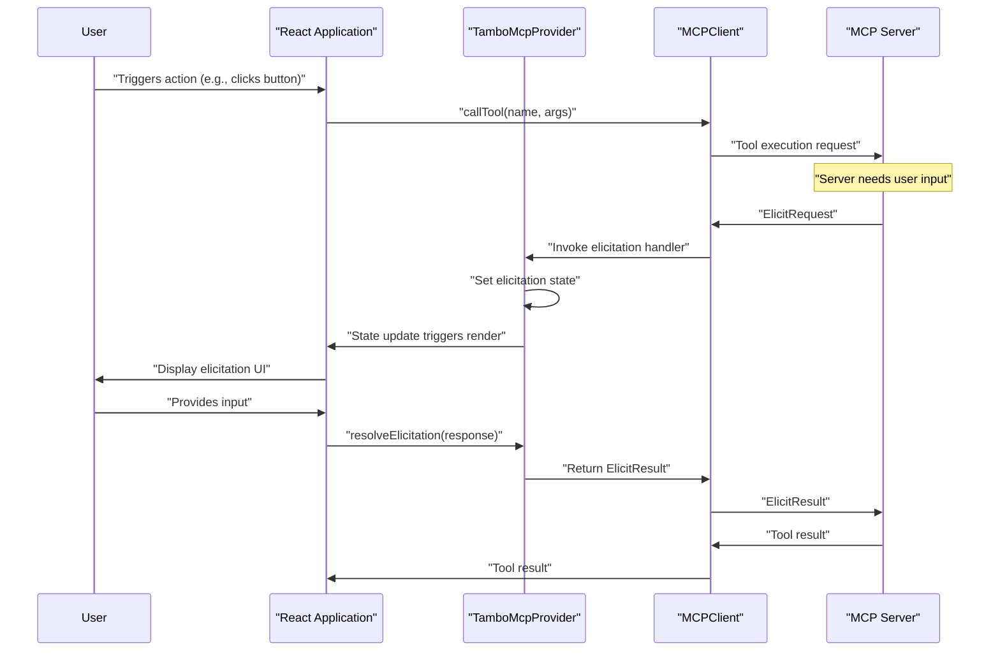
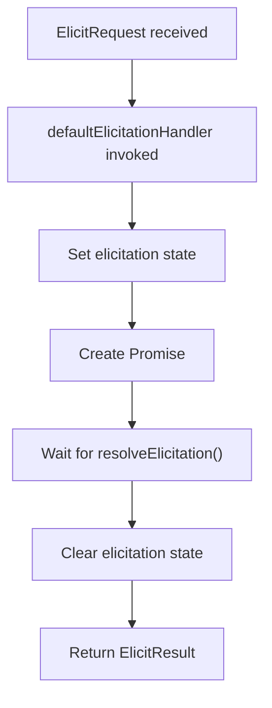
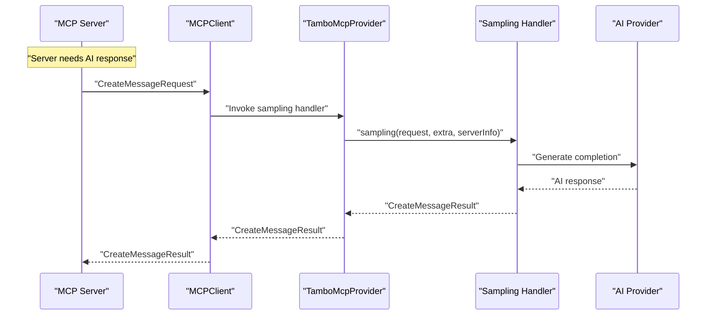
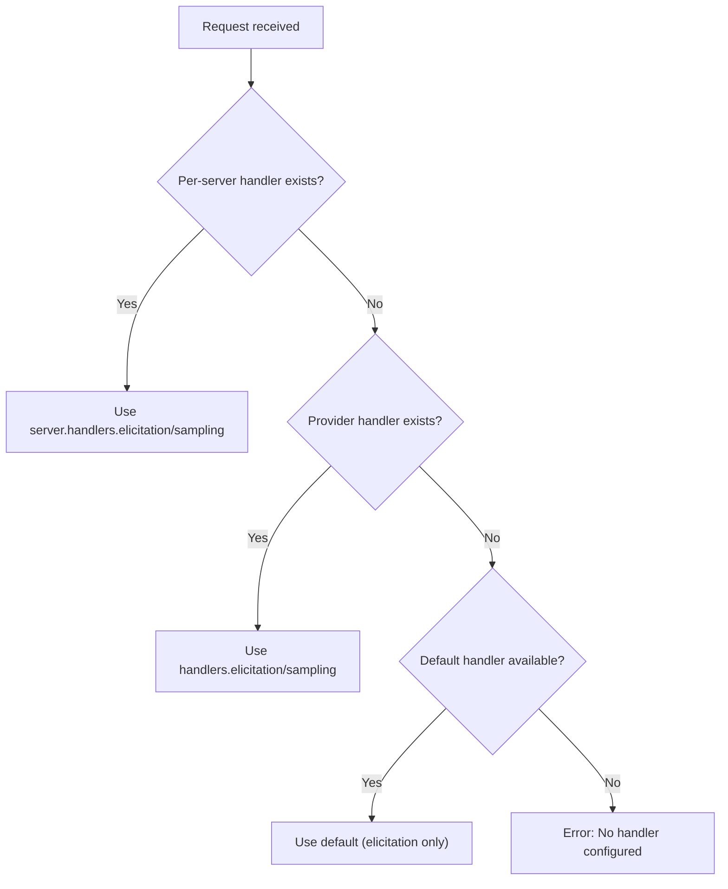
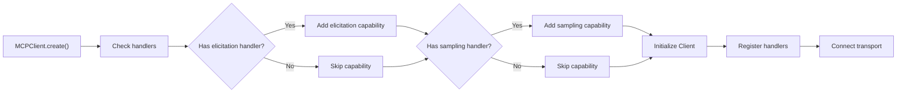

<!-- source: DeepWiki mcp.deepwiki.com · repo tambo-ai/tambo · page 6.6 Elicitation and Sampling · fetched 2026-10-29 -->

# Elicitation and Sampling

<details>
<summary>Relevant source files</summary>

The following files were used as context for generating this wiki page:

- [react-sdk/src/mcp/index.ts](react-sdk/src/mcp/index.ts)
- [react-sdk/src/mcp/mcp-client.ts](react-sdk/src/mcp/mcp-client.ts)
- [react-sdk/src/mcp/mcp-hooks.ts](react-sdk/src/mcp/mcp-hooks.ts)
- [react-sdk/src/mcp/tambo-mcp-provider.tsx](react-sdk/src/mcp/tambo-mcp-provider.tsx)
- [react-sdk/src/providers/tambo-mcp-token-provider.tsx](react-sdk/src/providers/tambo-mcp-token-provider.tsx)

</details>


This page documents advanced MCP (Model Context Protocol) features that enable bidirectional communication between MCP servers and clients. Elicitation allows servers to request user input during tool execution, while sampling allows servers to request AI-generated responses. These features enable interactive workflows where MCP servers can gather additional context or generate content on-demand.

For basic MCP integration (connecting to servers, listing tools/resources), see [MCP Integration](#6). For MCP-specific React hooks, see [MCP Hooks Reference](#6.5).

---

## Overview

**Elicitation** and **Sampling** are optional MCP protocol capabilities that reverse the typical client-server flow:

- **Elicitation**: An MCP server requests user input during tool execution. The client displays a prompt to the user and returns their response to the server.
- **Sampling**: An MCP server requests an AI-generated message. The client invokes an AI provider and returns the generated content to the server.

Both features require:
1. Client declaring support for the capability during connection initialization
2. Client implementing a handler function to process requests
3. MCP server using the capability when needed

Tambo's React SDK provides provider-level and per-server handler configuration through `TamboMcpProvider`, along with React hooks for building elicitation UI.

**Sources**: [react-sdk/src/mcp/mcp-client.ts:1-366](), [react-sdk/src/mcp/tambo-mcp-provider.tsx:1-729]()

---

## Elicitation

### What is Elicitation?

Elicitation is a protocol mechanism where an MCP server can request user input during tool execution. This enables interactive workflows where tools need additional context that wasn't provided in the original request.

**Common use cases:**
- Requesting confirmation before destructive operations
- Collecting missing required parameters
- Asking for disambiguation between multiple options
- Requesting file uploads or selections

**Request Flow:**



**Sources**: [react-sdk/src/mcp/mcp-client.ts:22-47](), [react-sdk/src/mcp/tambo-mcp-provider.tsx:454-561]()

### Handler Interface

The elicitation handler is defined as `MCPElicitationHandler`:

```typescript
type MCPElicitationHandler = (
  request: ElicitRequest,
  extra: RequestHandlerExtra<ClientRequest, ClientNotification>,
) => Promise<ElicitResult>;
```

**Request structure** ([react-sdk/src/mcp/mcp-client.ts:44-47]()):
- `request: ElicitRequest` - Contains the elicitation prompt details
- `extra: RequestHandlerExtra` - Includes `AbortSignal` for cancellation handling

**Response structure**:
- `ElicitResult` - Contains `action` (accept/reject) and optional `content`

**Sources**: [react-sdk/src/mcp/mcp-client.ts:44-47]()

### Provider-Level Handler Configuration

Handlers can be configured at the provider level using `ProviderMCPHandlers`:

```typescript
interface ProviderMCPHandlers {
  elicitation?: (
    request: Parameters<MCPElicitationHandler>[0],
    extra: Parameters<MCPElicitationHandler>[1],
    serverInfo: McpServerConfig,
  ) => ReturnType<MCPElicitationHandler>;
  // ...
}
```

The provider-level handler receives an additional `serverInfo` parameter, allowing context-aware handling based on which server made the request.

**Handler precedence** ([react-sdk/src/mcp/tambo-mcp-provider.tsx:192-218]()):
1. Per-server handler (if configured on individual `mcpServers` entry)
2. Provider-level handler (passed to `TamboMcpProvider` `handlers` prop)
3. Default handler (built-in state-based handler)

**Sources**: [react-sdk/src/mcp/tambo-mcp-provider.tsx:117-128](), [react-sdk/src/mcp/tambo-mcp-provider.tsx:192-218]()

### Elicitation State Management

The provider manages elicitation state through the `useElicitation()` hook and exposes it via `useTamboMcpElicitation()`:

```typescript
interface ElicitationContextState {
  elicitation: TamboElicitationRequest | null;
  resolveElicitation: ((response: TamboElicitationResponse) => void) | null;
}
```

**State flow**:
1. MCP server sends elicitation request
2. Provider sets `elicitation` state with request details
3. UI component renders using `useTamboMcpElicitation()` hook
4. User provides input
5. UI calls `resolveElicitation(response)`
6. Provider resolves promise and returns to server

**Key state properties**:
- `elicitation`: Current active elicitation request (null if none)
- `resolveElicitation`: Callback to submit user's response

**Sources**: [react-sdk/src/mcp/tambo-mcp-provider.tsx:133-141](), [react-sdk/src/mcp/tambo-mcp-provider.tsx:687-693]()

### Default Elicitation Handler

The provider includes a built-in handler that manages state automatically ([react-sdk/src/mcp/tambo-mcp-provider.tsx:386-391]()):



This default handler:
- Sets the elicitation state to display UI
- Creates a promise that waits for user response
- Clears state after response is received
- Returns the result to the MCP server

Custom handlers can override this behavior by providing their own `handlers.elicitation` implementation.

**Sources**: [react-sdk/src/mcp/tambo-mcp-provider.tsx:386-391]()

### Building Elicitation UI

React components can access elicitation state using `useTamboMcpElicitation()`:

```typescript
function ElicitationDialog() {
  const { elicitation, resolveElicitation } = useTamboMcpElicitation();
  
  if (!elicitation) return null;
  
  return (
    <dialog open>
      <h2>{elicitation.message}</h2>
      {/* Render input fields based on elicitation.schema */}
      <button onClick={() => resolveElicitation?.({ 
        action: "accept", 
        content: { /* user input */ } 
      })}>
        Submit
      </button>
      <button onClick={() => resolveElicitation?.({ 
        action: "reject" 
      })}>
        Cancel
      </button>
    </dialog>
  );
}
```

**Elicitation request properties**:
- `message`: Prompt text to display to user
- `schema`: JSON schema defining expected input structure (optional)
- Other MCP-defined properties per ElicitRequest specification

**Response actions**:
- `accept`: User provided input (include `content` object)
- `reject`: User declined or cancelled

**Sources**: [react-sdk/src/mcp/index.ts:16-21](), [react-sdk/src/mcp/tambo-mcp-provider.tsx:687-693]()

---

## Sampling

### What is Sampling?

Sampling allows MCP servers to request AI-generated messages through the client. This enables servers to incorporate AI capabilities without implementing their own LLM integration.

**Common use cases:**
- Generating summaries of retrieved data
- Creating responses based on external tool results
- Formatting structured data into natural language
- Exploring multiple response options

**Request Flow:**



**Sources**: [react-sdk/src/mcp/mcp-client.ts:50-59]()

### Handler Interface

The sampling handler is defined as `MCPSamplingHandler`:

```typescript
type MCPSamplingHandler = (
  request: CreateMessageRequest,
  extra: RequestHandlerExtra<ClientRequest, ClientNotification>,
) => Promise<CreateMessageResult>;
```

**Request structure** ([react-sdk/src/mcp/mcp-client.ts:56-59]()):
- `request: CreateMessageRequest` - Contains messages and sampling parameters
- `extra: RequestHandlerExtra` - Includes `AbortSignal` for cancellation handling

**Response structure**:
- `CreateMessageResult` - Contains generated message content

**Sources**: [react-sdk/src/mcp/mcp-client.ts:56-59]()

### Provider-Level Configuration

Like elicitation, sampling handlers can be configured at provider level:

```typescript
<TamboMcpProvider
  handlers={{
    sampling: async (request, extra, serverInfo) => {
      // Call your AI provider
      const response = await callAI(request.messages);
      return {
        role: "assistant",
        content: { type: "text", text: response }
      };
    }
  }}
>
  {children}
</TamboMcpProvider>
```

**Handler precedence** (same as elicitation):
1. Per-server handler
2. Provider-level handler
3. No default handler (sampling requires explicit implementation)

**Sources**: [react-sdk/src/mcp/tambo-mcp-provider.tsx:117-128](), [react-sdk/src/mcp/tambo-mcp-provider.tsx:383-384]()

### Implementation Requirements

Unlike elicitation (which has a default UI-based handler), sampling requires custom implementation:

**No default handler**: The provider does not include a built-in sampling handler because:
- AI provider integration is application-specific
- Requires API keys and configuration
- May involve complex prompt engineering
- Different apps use different AI providers (OpenAI, Anthropic, etc.)

**Custom implementation needed**:
```typescript
const samplingHandler: MCPSamplingHandler = async (request, extra) => {
  // 1. Extract messages from request
  const messages = request.messages;
  
  // 2. Call your AI provider
  const response = await yourAIProvider.complete({
    messages,
    model: request.modelPreferences?.hints?.find(h => h.name),
    // ... other parameters from request
  });
  
  // 3. Return formatted result
  return {
    role: "assistant",
    content: {
      type: "text",
      text: response.text
    }
  };
};
```

**Sources**: [react-sdk/src/mcp/mcp-client.ts:56-59](), [react-sdk/src/mcp/tambo-mcp-provider.tsx:383-384]()

---

## Provider Configuration

### TamboMcpProvider Setup

The `TamboMcpProvider` component manages MCP client lifecycle and handler registration:

```typescript
<TamboMcpProvider
  handlers={{
    elicitation: async (request, extra, serverInfo) => {
      // Custom elicitation handler
      // Receives serverInfo for context-aware handling
    },
    sampling: async (request, extra, serverInfo) => {
      // Custom sampling handler
      // Must be implemented if servers use sampling
    }
  }}
  contextKey="optional-key-for-threadless-tokens"
>
  {children}
</TamboMcpProvider>
```

**Handler parameters**:
- `request`: The MCP request object (ElicitRequest or CreateMessageRequest)
- `extra`: RequestHandlerExtra with AbortSignal
- `serverInfo`: McpServerConfig with server metadata (provider-level handlers only)

**Sources**: [react-sdk/src/mcp/tambo-mcp-provider.tsx:375-448]()

### Per-Server Handler Configuration

Handlers can also be configured per server through the registry:

```typescript
<TamboRegistryProvider
  mcpServers={[
    {
      url: "https://special-server.example",
      transport: MCPTransport.HTTP,
      handlers: {
        elicitation: async (request, extra) => {
          // Server-specific elicitation logic
        }
      }
    }
  ]}
>
```

Per-server handlers take precedence over provider-level handlers, allowing specialized behavior for specific servers.

**Sources**: [react-sdk/src/mcp/tambo-mcp-provider.tsx:70-86](), [react-sdk/src/mcp/tambo-mcp-provider.tsx:192-218]()

### Handler Precedence and Lifecycle

**Handler selection** ([react-sdk/src/mcp/tambo-mcp-provider.tsx:192-218]()):



**Handler updates** ([react-sdk/src/mcp/tambo-mcp-provider.tsx:566-610]()):
- Handlers can be updated without recreating clients
- `updateElicitationHandler()` and `updateSamplingHandler()` methods
- Provider detects handler changes and updates all connected clients
- Limitations: Cannot add capabilities after initial connection (only update existing handlers)

**Sources**: [react-sdk/src/mcp/tambo-mcp-provider.tsx:192-218](), [react-sdk/src/mcp/tambo-mcp-provider.tsx:566-610]()

---

## Implementation Details

### Client Initialization with Capabilities

The `MCPClient` advertises elicitation and sampling capabilities during connection:



**Capability declaration** ([react-sdk/src/mcp/mcp-client.ts:187-203]()):
```typescript
const elicitationCapability = this.handlers.elicitation
  ? { elicitation: {} }
  : {};
const samplingCapability = this.handlers.sampling ? { sampling: {} } : {};
const client = new Client(
  { name: "tambo-mcp-client", version: "1.0.0" },
  { capabilities: { ...elicitationCapability, ...samplingCapability } }
);
```

Only capabilities with configured handlers are advertised to the server. This prevents servers from making requests the client cannot handle.

**Sources**: [react-sdk/src/mcp/mcp-client.ts:187-215]()

### Handler Registration

After client creation, handlers are registered for their respective request types:

**Elicitation** ([react-sdk/src/mcp/mcp-client.ts:205-207]()):
```typescript
if (this.handlers.elicitation) {
  client.setRequestHandler(ElicitRequestSchema, this.handlers.elicitation);
}
```

**Sampling** ([react-sdk/src/mcp/mcp-client.ts:208-212]()):
```typescript
if (this.handlers.sampling) {
  client.setRequestHandler(
    CreateMessageRequestSchema,
    this.handlers.sampling,
  );
}
```

These registrations link MCP SDK request schemas to the handler functions provided by the application.

**Sources**: [react-sdk/src/mcp/mcp-client.ts:205-214]()

### Dynamic Handler Updates

Handlers can be updated after client initialization without reconnecting:

**Update flow** ([react-sdk/src/mcp/mcp-client.ts:290-334]()):
1. Detect handler change (reference equality check)
2. Validate: Cannot add capability that wasn't declared initially
3. Remove old handler if handler is now undefined
4. Register new handler with `setRequestHandler()`

**Limitations**:
- Cannot add elicitation capability after declaring client without it
- Cannot add sampling capability after declaring client without it
- Can update existing handlers or remove them
- Attempts to add new capabilities throw errors

**Implementation**:
```typescript
updateElicitationHandler(handler: MCPElicitationHandler | undefined) {
  if (handler === this.handlers.elicitation) return; // Skip if unchanged
  
  if (handler && !this.handlers.elicitation) {
    throw new Error("Elicitation handler must be set on create");
  }
  
  this.handlers = { ...this.handlers, elicitation: handler };
  
  if (!handler) {
    this.client.removeRequestHandler(ElicitRequestSchema.shape.method.value);
  } else {
    this.client.setRequestHandler(ElicitRequestSchema, handler);
  }
}
```

**Sources**: [react-sdk/src/mcp/mcp-client.ts:290-334]()

### Cancellation Support

Both elicitation and sampling handlers receive an `AbortSignal` through the `extra` parameter:

**Usage**:
```typescript
const handler: MCPElicitationHandler = async (request, extra) => {
  extra.signal.addEventListener('abort', () => {
    console.log('Request cancelled by server');
    // Clean up resources
  });
  
  // Long-running operation
  const result = await getUserInput(request, extra.signal);
  return result;
};
```

The signal fires when:
- MCP server cancels the request
- Client disconnects
- Request timeout expires

Applications should check the signal and abort operations gracefully to avoid resource leaks.

**Sources**: [react-sdk/src/mcp/mcp-client.ts:27-42](), [react-sdk/src/mcp/mcp-client.ts:44-47]()

---

## Summary Table

| Feature | Purpose | Handler Required | Default Handler | Common Use Cases |
|---------|---------|------------------|-----------------|------------------|
| **Elicitation** | Server requests user input | Optional (default provided) | Yes (state-based) | Confirmations, missing parameters, file uploads |
| **Sampling** | Server requests AI response | Required | No | Summaries, content generation, formatting |

**Handler Configuration Levels**:
| Level | Scope | Receives serverInfo | Precedence |
|-------|-------|---------------------|------------|
| Per-server | Single server | No | Highest |
| Provider-level | All servers | Yes | Medium |
| Default | All servers | N/A (built-in) | Lowest (elicitation only) |

**Key Exports** ([react-sdk/src/mcp/index.ts:10-44]()):
- `MCPElicitationHandler` - Elicitation handler type
- `MCPSamplingHandler` - Sampling handler type  
- `MCPHandlers` - Combined handler interface
- `ProviderMCPHandlers` - Provider-level handler interface
- `TamboMcpProvider` - Provider component
- `useTamboMcpElicitation` - Hook for elicitation state
- `TamboElicitationRequest` - Elicitation request type
- `TamboElicitationResponse` - Elicitation response type

**Sources**: [react-sdk/src/mcp/index.ts:1-51]()

---

