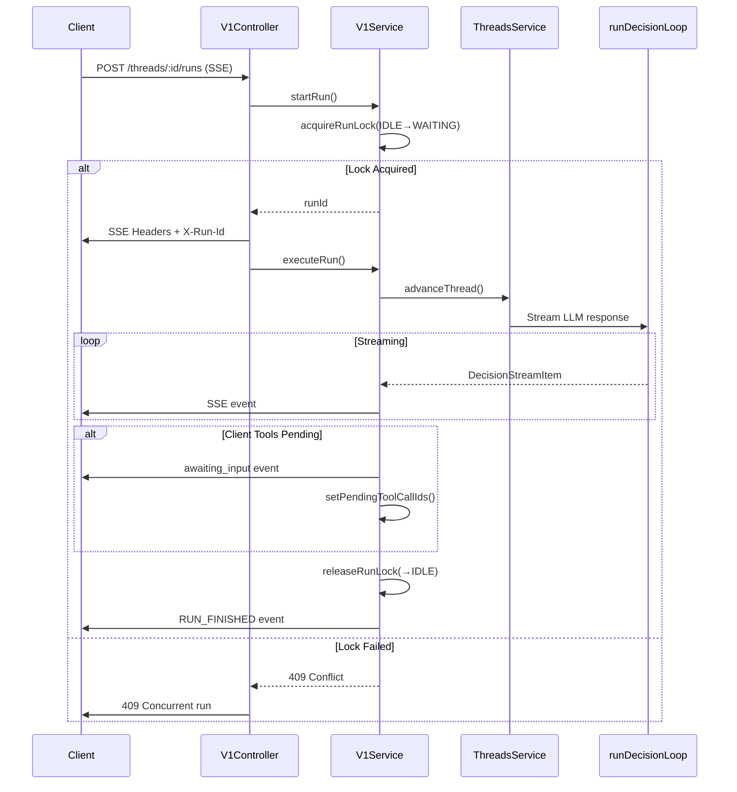
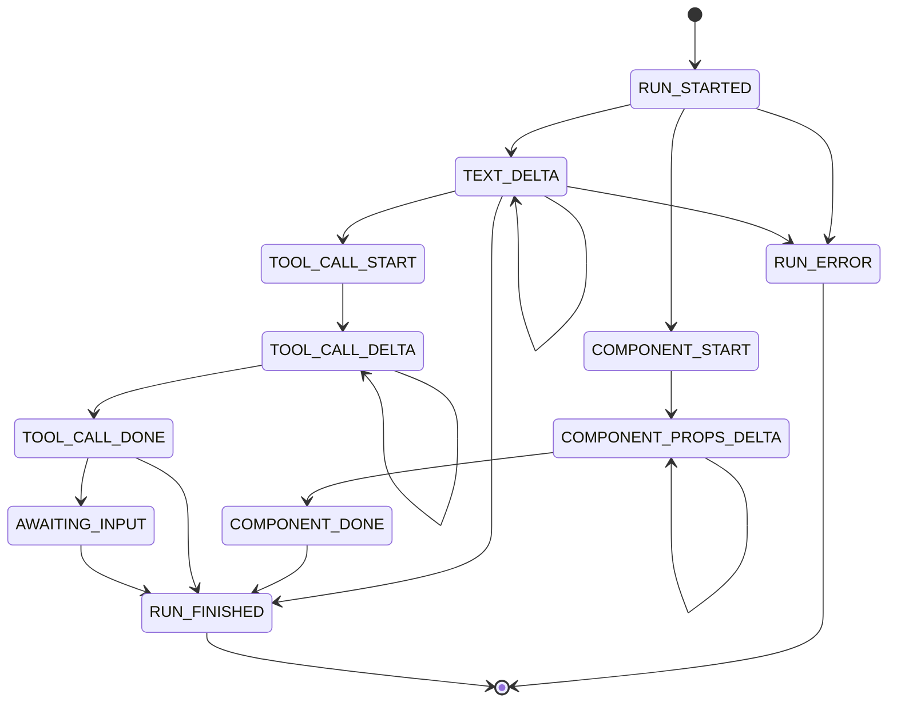
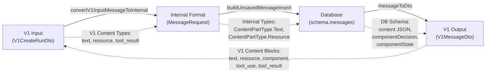
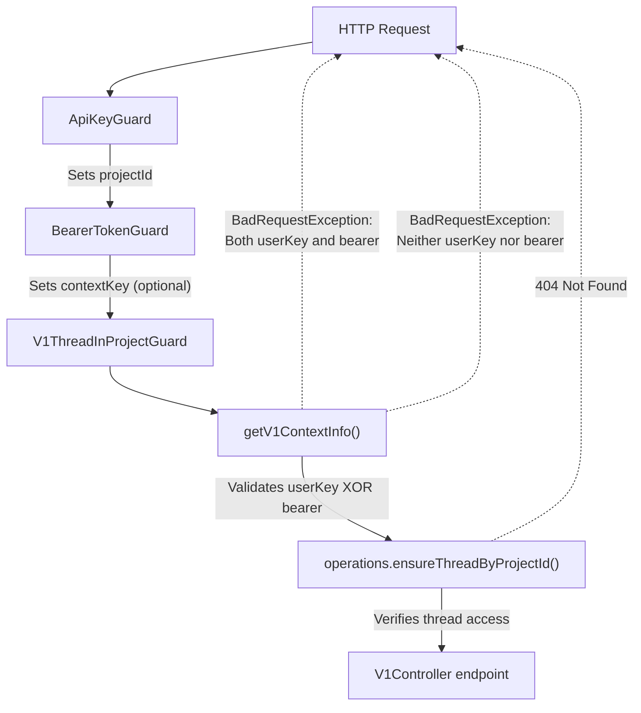

<!-- source: DeepWiki mcp.deepwiki.com · repo tambo-ai/tambo · page 7.1 V1 API Reference · fetched 2026-10-29 -->

# V1 API Reference

<details>
<summary>Relevant source files</summary>

The following files were used as context for generating this wiki page:

- [apps/api/src/threads/guards/thread-in-project-guard.ts](apps/api/src/threads/guards/thread-in-project-guard.ts)
- [apps/api/src/v1/__tests__/v1-conversions.test.ts](apps/api/src/v1/__tests__/v1-conversions.test.ts)
- [apps/api/src/v1/__tests__/v1-thread-in-project-guard.test.ts](apps/api/src/v1/__tests__/v1-thread-in-project-guard.test.ts)
- [apps/api/src/v1/__tests__/v1.controller.test.ts](apps/api/src/v1/__tests__/v1.controller.test.ts)
- [apps/api/src/v1/__tests__/v1.service.test.ts](apps/api/src/v1/__tests__/v1.service.test.ts)
- [apps/api/src/v1/dto/component-state.dto.ts](apps/api/src/v1/dto/component-state.dto.ts)
- [apps/api/src/v1/dto/message.dto.ts](apps/api/src/v1/dto/message.dto.ts)
- [apps/api/src/v1/dto/thread.dto.ts](apps/api/src/v1/dto/thread.dto.ts)
- [apps/api/src/v1/guards/v1-thread-in-project-guard.ts](apps/api/src/v1/guards/v1-thread-in-project-guard.ts)
- [apps/api/src/v1/utils/get-v1-context-info.ts](apps/api/src/v1/utils/get-v1-context-info.ts)
- [apps/api/src/v1/v1-conversions.ts](apps/api/src/v1/v1-conversions.ts)
- [apps/api/src/v1/v1.controller.ts](apps/api/src/v1/v1.controller.ts)
- [apps/api/src/v1/v1.service.ts](apps/api/src/v1/v1.service.ts)
- [packages/db/src/index.ts](packages/db/src/index.ts)
- [packages/db/src/operations/thread.ts](packages/db/src/operations/thread.ts)
- [react-sdk/src/v1/types/message.ts](react-sdk/src/v1/types/message.ts)

</details>


This document provides a complete reference for the Tambo V1 REST API. The V1 API enables server-side integration with Tambo's generative UI capabilities through a RESTful interface with Server-Sent Events (SSE) streaming.

For client-side React integration, see [React SDK](#3). For backend LLM integration architecture, see [LLM Integration](#7.4). For API architecture and service layer design, see [API Architecture](#7.2).

## Overview

The V1 API provides programmatic access to Tambo's core functionality:

- **Thread Management** - Create and manage conversation threads with cursor-based pagination
- **Message Operations** - Access conversation history with flexible ordering
- **Run Execution** - Stream AI responses via Server-Sent Events with real-time component rendering
- **Component State** - Update component state with JSON Patch support
- **Suggestion Generation** - Generate contextual message suggestions

All endpoints are implemented in [apps/api/src/v1/v1.controller.ts:64-693]() with business logic in [apps/api/src/v1/v1.service.ts:111-1532]().

**Sources:** apps/api/src/v1/v1.controller.ts, apps/api/src/v1/v1.service.ts

## Authentication

The V1 API supports two authentication methods:

### API Key Authentication

Include your project API key in the `X-API-Key` header:

```
X-API-Key: tambo_sk_...
```

When using API keys, threads are scoped by `userKey` - a string identifier you provide to organize threads by user.

### Bearer Token Authentication (OAuth)

Include an OAuth bearer token in the `Authorization` header:

```
Authorization: Bearer oauth_token_...
```

Bearer tokens automatically provide a `contextKey` for thread scoping. You cannot specify both a bearer token and a `userKey` parameter - requests must use exactly one context identifier.

Authentication is enforced by `ApiKeyGuard` and `BearerTokenGuard` at [apps/api/src/v1/v1.controller.ts:67](). Context resolution logic is in [apps/api/src/v1/utils/get-v1-context-info.ts:11-42]().

**Sources:** apps/api/src/v1/v1.controller.ts, apps/api/src/v1/utils/get-v1-context-info.ts, apps/api/src/projects/guards/apikey.guard.ts

## Core Concepts

### Threads

A thread represents a conversation session. Each thread:
- Belongs to a specific project (via API key)
- Is scoped to a `contextKey` (from bearer token) or `userKey` (explicit parameter)
- Contains an ordered sequence of messages
- Tracks run status for concurrency control

Thread schema defined in [apps/api/src/v1/dto/thread.dto.ts:51-175]().

### Messages

Messages are the building blocks of conversations. Each message:
- Has a role: `user`, `assistant`, or `system`
- Contains an array of content blocks (text, resources, components, tool calls)
- May have metadata and parent message relationships (for MCP sampling/elicitation)

Message schema defined in [apps/api/src/v1/dto/message.dto.ts:33-107]().

### Runs

A run represents an AI generation cycle. Runs:
- Are created on a thread to generate new content
- Stream events via Server-Sent Events (SSE)
- Use atomic run locks to prevent concurrent execution on the same thread
- Require `previousRunId` when continuing after client-side tool calls

Run lifecycle managed in [apps/api/src/v1/v1.service.ts:395-651]().

### Content Blocks

Messages contain typed content blocks:

| Type | Description | Used In |
|------|-------------|---------|
| `text` | Plain text content | User, Assistant |
| `resource` | File/image references with URI and MIME type | User, Assistant |
| `tool_use` | AI-initiated tool call with parameters | Assistant |
| `tool_result` | Result from tool execution | User (as input) |
| `component` | Rendered UI component with props and state | Assistant |

Content block schemas in [apps/api/src/v1/dto/content.dto.ts:1-186]().

**Sources:** apps/api/src/v1/dto/thread.dto.ts, apps/api/src/v1/dto/message.dto.ts, apps/api/src/v1/dto/content.dto.ts, apps/api/src/v1/v1.service.ts

## API Endpoints

### Thread Operations

#### List Threads

```http
GET /v1/threads?userKey={userKey}&limit={limit}&cursor={cursor}
```

Returns threads for the authenticated project with cursor-based pagination.

**Query Parameters:**
- `userKey` (optional) - Filter by user key (required if no bearer token)
- `limit` (optional) - Results per page (1-100, default: 20)
- `cursor` (optional) - Pagination cursor from previous response

**Response:** `V1ListThreadsResponseDto`
```json
{
  "threads": [...],
  "nextCursor": "dGhyXzEyMzp...",
  "hasMore": true
}
```

Implementation: [apps/api/src/v1/v1.service.ts:149-183]()

---

#### Get Thread

```http
GET /v1/threads/:threadId?userKey={userKey}
```

Returns a single thread with all messages.

**Response:** `V1GetThreadResponseDto` - Thread with embedded messages array.

Hidden UI tool responses (internal `show_component_*` messages) are filtered out at [apps/api/src/v1/v1.service.ts:205-208]().

Implementation: [apps/api/src/v1/v1.service.ts:188-216]()

---

#### Create Thread

```http
POST /v1/threads
```

**Request Body:** `V1CreateThreadDto`
```json
{
  "userKey": "user_123",
  "metadata": { "source": "web" },
  "initialMessages": [
    {
      "role": "user",
      "content": [{ "type": "text", "text": "Hello" }]
    }
  ]
}
```

Creates a new thread, optionally seeded with initial messages. Routes through `ThreadsService.createThread` for system prompt injection and validation at [apps/api/src/v1/v1.service.ts:234-237]().

**Response:** `V1CreateThreadResponseDto` with `runStatus: "idle"`.

Implementation: [apps/api/src/v1/v1.service.ts:224-248]()

---

#### Update Thread

```http
PATCH /v1/threads/:threadId
```

**Request Body:** `V1UpdateThreadDto`
```json
{
  "name": "Renamed conversation",
  "metadata": { "archived": true }
}
```

Updates thread metadata. Used for manual thread renaming or custom metadata management.

Implementation: [apps/api/src/v1/v1.service.ts:253-277]()

---

#### Delete Thread

```http
DELETE /v1/threads/:threadId
```

Permanently deletes a thread and all its messages. Returns `204 No Content` on success.

Implementation: [apps/api/src/v1/v1.service.ts:282-287]()

**Sources:** apps/api/src/v1/v1.service.ts, apps/api/src/v1/v1.controller.ts, apps/api/src/v1/dto/thread.dto.ts

### Message Operations

#### List Messages

```http
GET /v1/threads/:threadId/messages?limit={limit}&cursor={cursor}&order={order}
```

Returns messages in a thread with cursor-based pagination.

**Query Parameters:**
- `limit` (optional) - Results per page (1-100, default: 50)
- `cursor` (optional) - Pagination cursor
- `order` (optional) - `asc` (oldest first) or `desc` (newest first), default: `asc`

**Special Handling:** Fetches 2x the limit to account for hidden UI tool responses that are filtered out, ensuring correct `hasMore` values at page boundaries [apps/api/src/v1/v1.service.ts:318-323]().

Implementation: [apps/api/src/v1/v1.service.ts:300-347]()

---

#### Get Message

```http
GET /v1/threads/:threadId/messages/:messageId
```

Returns a single message by ID. Returns `404` for hidden UI tool responses.

Implementation: [apps/api/src/v1/v1.service.ts:355-379]()

**Sources:** apps/api/src/v1/v1.service.ts, apps/api/src/v1/dto/message.dto.ts

### Run Operations



**Diagram: Run execution flow with atomic concurrency control**

**Sources:** apps/api/src/v1/v1.service.ts, apps/api/src/v1/v1.controller.ts

---

#### Create Run

```http
POST /v1/threads/:threadId/runs
Content-Type: application/json
Accept: text/event-stream
```

Starts a streaming run on an existing thread. Returns SSE stream of AG-UI events.

**Request Body:** `V1CreateRunDto`
```json
{
  "message": {
    "role": "user",
    "content": [
      { "type": "text", "text": "What's the weather?" }
    ],
    "additionalContext": {
      "currentPage": "/dashboard"
    }
  },
  "tools": [...],
  "availableComponents": [...],
  "model": "gpt-4o",
  "previousRunId": "run_123",
  "toolChoice": "auto"
}
```

**Key Fields:**
- `message` - User message to append. May contain `tool_result` blocks for continuing after client-side tools
- `previousRunId` - Required when thread has existing messages or pending tool calls
- `tools` - Client-side tools (registered in SDK)
- `availableComponents` - UI components AI can render
- `toolChoice` - Force tool usage: `"auto"`, `"required"`, or specific tool `{ "type": "tool", "name": "tool_name" }`

**Response Headers:**
```
X-Run-Id: run_xyz789abc
Content-Type: text/event-stream
```

**Concurrency Control:**

The run system uses atomic database operations to prevent race conditions:

1. **Lock Acquisition** - `acquireRunLock` sets `runStatus: WAITING` only if current status is `IDLE` [apps/api/src/v1/v1.service.ts:496-498]()
2. **Tool Result Validation** - Validates `tool_result` blocks match `pendingToolCallIds` with snapshot-based concurrency detection [apps/api/src/v1/v1.service.ts:445-476]()
3. **Lock Release** - `releaseRunLockIfCurrent` atomically clears lock only if `currentRunId` matches [apps/api/src/v1/v1.service.ts:864-872]()

If lock acquisition fails, returns `409 Conflict` with `CONCURRENT_RUN` error code.

Implementation: [apps/api/src/v1/v1.service.ts:395-944]()

---

#### Create Thread with Run

```http
POST /v1/threads/runs
Content-Type: application/json
Accept: text/event-stream
```

Creates a new thread and immediately starts a streaming run. Combines thread creation + run execution into a single request.

**Request Body:** `V1CreateThreadWithRunDto` - extends `V1CreateRunDto` with:
```json
{
  "thread": {
    "userKey": "user_123",
    "metadata": { "source": "chat" },
    "initialMessages": [...]
  },
  "message": {...},
  "tools": [...]
}
```

**Response Headers:**
```
X-Thread-Id: thr_abc123xyz
X-Run-Id: run_xyz789abc
Content-Type: text/event-stream
```

Implementation: [apps/api/src/v1/v1.controller.ts:341-420]()

---

#### Cancel Run

```http
DELETE /v1/threads/:threadId/runs/:runId
```

Explicitly cancels an active run. Note that closing the SSE connection also triggers automatic cancellation via connection close handler at [apps/api/src/v1/v1.controller.ts:479-499]().

**Response:** `V1CancelRunResponseDto`
```json
{
  "runId": "run_xyz789abc",
  "status": "cancelled"
}
```

**Cancellation Process:**
1. Releases run lock with `wasCancelled: true` [apps/api/src/v1/v1.service.ts:604-612]()
2. Marks run as cancelled in database
3. Resets `generationStage` to prevent stuck processing state
4. Marks latest assistant message as cancelled

Implementation: [apps/api/src/v1/v1.service.ts:591-651]()

**Sources:** apps/api/src/v1/v1.service.ts, apps/api/src/v1/v1.controller.ts, apps/api/src/v1/dto/run.dto.ts

### Component State Operations

#### Update Component State

```http
POST /v1/threads/:threadId/components/:componentId/state
```

Updates component state with full replacement or JSON Patch operations. Thread must be `idle` (no active run).

**Request Body:** `UpdateComponentStateDto` (one of):

**Full Replacement:**
```json
{
  "state": {
    "loading": false,
    "data": [1, 2, 3]
  }
}
```

**JSON Patch (RFC 6902):**
```json
{
  "patch": [
    { "op": "replace", "path": "/loading", "value": false },
    { "op": "add", "path": "/data/-", "value": 4 }
  ]
}
```

**Validation:**
- Exactly one of `state` or `patch` must be provided [apps/api/src/v1/v1.service.ts:1015-1033]()
- `state` must be a JSON object
- `patch` must be non-empty array
- Thread must be `IDLE` (checked with `FOR UPDATE` lock) [apps/api/src/v1/v1.service.ts:979-1005]()

**Response:** `UpdateComponentStateResponseDto`
```json
{
  "state": {
    "loading": false,
    "data": [1, 2, 3, 4]
  }
}
```

Implementation: [apps/api/src/v1/v1.service.ts:973-1127]()

**Sources:** apps/api/src/v1/v1.service.ts, apps/api/src/v1/dto/component-state.dto.ts

### Suggestion Operations

#### List Suggestions

```http
GET /v1/threads/:threadId/messages/:messageId/suggestions?limit={limit}&cursor={cursor}
```

Returns suggestions generated for a specific message.

Implementation: [apps/api/src/v1/v1.service.ts:1308-1367]()

---

#### Generate Suggestions

```http
POST /v1/threads/:threadId/messages/:messageId/suggestions
```

**Request Body:** `V1GenerateSuggestionsDto`
```json
{
  "count": 3
}
```

Generates new contextual suggestions for a message using the thread's conversation history.

Implementation: [apps/api/src/v1/v1.service.ts:1369-1532]()

**Sources:** apps/api/src/v1/v1.service.ts, apps/api/src/v1/dto/suggestion.dto.ts

## Content Block Schemas

### Text Content

```typescript
{
  type: "text",
  text: string
}
```

Simple text content. Used in both user and assistant messages.

---

### Resource Content

```typescript
{
  type: "resource",
  resource: {
    uri: string,        // URL or data URI
    mimeType: string,   // e.g., "image/png", "application/pdf"
    text?: string       // Optional text content for text-based resources
  }
}
```

References external resources like images, files, or documents. Images from OpenAI's `image_url` format are converted to resource blocks at [apps/api/src/v1/v1-conversions.ts:140-159]().

---

### Tool Use Content

```typescript
{
  type: "tool_use",
  id: string,                        // Tool call ID (e.g., "call_abc123")
  name: string,                      // Tool name
  input: Record<string, unknown>     // Tool parameters
}
```

Represents an AI-initiated tool call. The `input` field may contain special `_tambo_*` properties for UI display:
- `_tambo_statusMessage` - Message shown during execution
- `_tambo_completionStatusMessage` - Message shown after completion

These properties are extracted from `componentDecision` in the database at [apps/api/src/v1/v1-conversions.ts:291-302]().

UI tools (`show_component_*`) are hidden from the V1 API as they're internal implementation details.

---

### Tool Result Content

```typescript
{
  type: "tool_result",
  toolUseId: string,                           // Matching tool_use id
  content: Array<TextContent | ResourceContent>,
  isError?: boolean                            // True if tool execution failed
}
```

Contains the result from tool execution. Used in user messages to provide tool results back to the AI.

---

### Component Content

```typescript
{
  type: "component",
  id: string,                        // Component instance ID
  name: string,                      // Component name from registry
  props: Record<string, unknown>,    // Component props
  state?: Record<string, unknown>    // Component state (if stateful)
}
```

Represents a rendered UI component. The `state` field is merged from the message's `componentState` column for up-to-date values at [apps/api/src/v1/v1-conversions.ts:227-232]().

For backward compatibility, components are generated from `componentDecision` if not found in the content array at [apps/api/src/v1/v1-conversions.ts:243-271]().

**Sources:** apps/api/src/v1/dto/content.dto.ts, apps/api/src/v1/v1-conversions.ts

## Streaming Protocol

Runs stream events via Server-Sent Events (SSE). Each event is sent as:

```
data: {"type":"EVENT_TYPE","...":"..."}\n\n
```

### Event Types



**Diagram: Run event state transitions**

---

#### RUN_STARTED

```typescript
{
  type: "RUN_STARTED",
  threadId: string,
  runId: string,
  timestamp: number
}
```

Emitted when run begins execution.

---

#### TEXT_DELTA

```typescript
{
  type: "TEXT_DELTA",
  textDelta: string,
  messageId: string
}
```

Incremental text content from the AI. Multiple deltas accumulate to form complete text.

---

#### COMPONENT_START

```typescript
{
  type: "COMPONENT_START",
  componentId: string,
  componentName: string,
  messageId: string
}
```

Component rendering initiated. Props will follow in subsequent deltas.

---

#### COMPONENT_PROPS_DELTA

```typescript
{
  type: "COMPONENT_PROPS_DELTA",
  componentId: string,
  propsDelta: string,  // Incremental JSON string
  messageId: string
}
```

Incremental component props as JSON string chunks. The client must accumulate and parse JSON progressively.

---

#### COMPONENT_DONE

```typescript
{
  type: "COMPONENT_DONE",
  componentId: string,
  messageId: string
}
```

Component props streaming complete. Final props available for rendering.

---

#### TOOL_CALL_START

```typescript
{
  type: "TOOL_CALL_START",
  toolCallId: string,
  toolName: string,
  messageId: string
}
```

AI initiating tool call. Parameters will follow in deltas.

---

#### TOOL_CALL_DELTA

```typescript
{
  type: "TOOL_CALL_DELTA",
  toolCallId: string,
  parametersDelta: string,  // Incremental JSON string
  messageId: string
}
```

Incremental tool parameters as JSON string chunks.

---

#### TOOL_CALL_DONE

```typescript
{
  type: "TOOL_CALL_DONE",
  toolCallId: string,
  messageId: string
}
```

Tool parameters streaming complete. Client should execute tool if it's a client-side tool.

---

#### AWAITING_INPUT

```typescript
{
  type: "AWAITING_INPUT",
  pendingToolCalls: Array<{
    toolCallId: string,
    toolName: string
  }>,
  timestamp: number
}
```

Emitted when run completes with pending client-side tool calls. The client must:
1. Execute each pending tool
2. Create a new run with `tool_result` blocks in the message
3. Include the current `runId` as `previousRunId`

Created at [apps/api/src/v1/v1-client-tools.ts:67-76]().

---

#### RUN_FINISHED

```typescript
{
  type: "RUN_FINISHED",
  threadId: string,
  runId: string,
  timestamp: number
}
```

Run completed successfully. Stream will close after this event.

---

#### RUN_ERROR

```typescript
{
  type: "RUN_ERROR",
  message: string,
  code: string,
  timestamp: number
}
```

Error occurred during run. Generic message used to avoid exposing internal details at [apps/api/src/v1/v1.service.ts:901-906](). Full error stored in database for debugging.

---

### Message ID Mapping

Temporary message IDs (e.g., `message-xyz`) from the LLM client are mapped to real database IDs (e.g., `msg_abc123`) in events. The mapping is tracked at [apps/api/src/v1/v1.service.ts:770-834]() and transformed via `transformEventMessageIds`.

---

### Event Sanitization

All events are sanitized before emission to prevent exposure of sensitive data at [apps/api/src/v1/v1.service.ts:950-953]() using `sanitizeEvent` from the backend package.

**Sources:** apps/api/src/v1/v1.service.ts, apps/api/src/v1/dto/event.dto.ts, apps/api/src/v1/v1-client-tools.ts, packages/backend/src/utils/event-sanitization.ts

## Pagination

All list endpoints use compound cursor-based pagination for stable ordering with ties.

### Cursor Format

Cursors encode `(createdAt, id)` tuples as base64 JSON:

```typescript
// Encode
const cursor = encodeV1CompoundCursor({
  createdAt: new Date("2024-01-15T12:00:00Z"),
  id: "thr_abc123"
});
// Result: "eyJjcmVhdGVkQXQiOjE3MDUzMjQ4MDAwMDAsImlkIjoidGhyX2FiYzEyMyJ9"

// Decode
const { createdAt, id } = parseV1CompoundCursor(cursor);
```

Implementation: [apps/api/src/v1/v1-pagination.ts:1-84]()

### Pagination Logic

Queries use compound ordering `ORDER BY createdAt DESC, id DESC` to break ties deterministically:

```sql
WHERE (createdAt < cursor.createdAt) 
   OR (createdAt = cursor.createdAt AND id < cursor.id)
ORDER BY createdAt DESC, id DESC
LIMIT {limit + 1}
```

Database operations at [packages/db/src/operations/thread.ts:184-219]() and [packages/db/src/operations/message.ts:252-298]().

### Has More Detection

Services fetch `limit + 1` records. If result count exceeds requested limit, `hasMore: true` and `nextCursor` is set to the last returned item at [apps/api/src/v1/v1.service.ts:170-181]().

**Sources:** apps/api/src/v1/v1-pagination.ts, packages/db/src/operations/thread.ts, packages/db/src/operations/message.ts

## Error Handling

### Error Response Format (RFC 7807)

All errors follow Problem Details for HTTP APIs:

```json
{
  "type": "https://docs.tambo.ai/errors/CONCURRENT_RUN",
  "title": "Concurrent Run Conflict",
  "status": 409,
  "detail": "A run is already active on thread thr_123",
  "threadId": "thr_123",
  "currentRunId": "run_456"
}
```

Created via `createProblemDetail` at [apps/api/src/v1/v1.errors.ts:1-83]().

### V1 Error Codes

| Code | HTTP Status | Description |
|------|-------------|-------------|
| `THREAD_NOT_FOUND` | 404 | Thread does not exist or not accessible |
| `CONCURRENT_RUN` | 409 | Another run is active on the thread |
| `INVALID_PREVIOUS_RUN` | 400 | `previousRunId` mismatch or missing |
| `INVALID_TOOL_RESULT` | 400 | Tool result validation failed |
| `RUN_ACTIVE` | 409 | Cannot update component state during run |
| `VALIDATION_ERROR` | 400 | Request validation failed |
| `INVALID_JSON_PATCH` | 400 | JSON Patch operation invalid |
| `INTERNAL_ERROR` | 500 | Unexpected server error |

Error code definitions at [apps/api/src/v1/v1.errors.ts:11-28]().

### Tool Result Validation

When continuing a run with tool results, the system validates:
1. **Missing Results** - All `pendingToolCallIds` must have corresponding `tool_result` blocks
2. **Extra Results** - No `tool_result` blocks for non-pending tool calls
3. **Duplicate Results** - Multiple results for same `toolCallId` (logged and dropped at [apps/api/src/v1/v1.service.ts:472-476]())

Validation logic at [apps/api/src/v1/v1-tool-results.ts:81-140]().

### Concurrency Conflicts

When `acquireRunLock` fails or `pendingToolCallIds` state changes between snapshot and application, returns:

```json
{
  "type": "https://docs.tambo.ai/errors/CONCURRENT_RUN",
  "title": "Concurrent Run Conflict",
  "status": 409,
  "detail": "Thread pending tool call state changed; please retry"
}
```

Clients should retry the entire request with fresh data.

**Sources:** apps/api/src/v1/v1.errors.ts, apps/api/src/v1/v1-tool-results.ts, apps/api/src/v1/v1.service.ts

## Data Conversion Pipeline



**Diagram: Request/response data flow through conversion layers**

### Request Conversion (V1 → Internal)

- `convertV1InputMessageToInternal` at [apps/api/src/v1/v1-conversions.ts:387-417]()
  - Converts `V1InputMessage` to `MessageRequest`
  - Maps V1 content types to internal `ContentPartType` enum
  - Preserves `additionalContext` for context injection
  - Filters out `tool_result` blocks (processed separately)

- `convertV1ToolsToInternal` at [apps/api/src/v1/v1-tool-conversions.ts:184-235]()
  - Converts V1 tool JSON schemas to internal `ToolParameters[]` format
  - Parses schemas using Zod for validation

- `convertV1ComponentsToInternal` at [apps/api/src/v1/v1-tool-conversions.ts:91-182]()
  - Converts component `propsSchema` to internal format
  - Generates `show_component_*` tool definitions

### Response Conversion (DB → V1)

- `messageToDto` at [apps/api/src/v1/v1-conversions.ts:338-354]()
  - Converts database message to V1 API format
  - Maps role (`tool` → `assistant`)
  - Calls `contentToV1Blocks` for content conversion

- `contentToV1Blocks` at [apps/api/src/v1/v1-conversions.ts:191-314]()
  - Converts internal content parts to V1 content blocks
  - Wraps tool role messages in `tool_result` blocks at [apps/api/src/v1/v1-conversions.ts:199-217]()
  - Merges `componentState` into component blocks at [apps/api/src/v1/v1-conversions.ts:227-232]()
  - Generates component blocks from `componentDecision` for backward compatibility at [apps/api/src/v1/v1-conversions.ts:243-271]()
  - Adds `tool_use` blocks for non-UI tools at [apps/api/src/v1/v1-conversions.ts:275-311]()

### Content Type Mapping

| V1 Type | Internal Type | Database Column |
|---------|---------------|-----------------|
| `text` | `ContentPartType.Text` | `content[].type = "text"` |
| `resource` | `ContentPartType.Resource` | `content[].type = "resource"` |
| `tool_use` | N/A (generated from `toolCallRequest`) | `toolCallRequest`, `toolCallId` |
| `tool_result` | Tool role message | `role = "tool"`, `toolCallId` |
| `component` | Component block + state | `componentDecision`, `componentState` |

### Special Handling

- **Image URLs** - Converted from OpenAI `image_url` format to `resource` blocks at [apps/api/src/v1/v1-conversions.ts:140-159]()
- **UI Tool Responses** - Hidden via `isHiddenUiToolResponse` check at [apps/api/src/v1/v1-conversions.ts:329-331]()
- **Tool Display Props** - `_tambo_*` properties extracted from `componentDecision` at [apps/api/src/v1/v1-conversions.ts:291-302]()

**Sources:** apps/api/src/v1/v1-conversions.ts, apps/api/src/v1/v1-tool-conversions.ts, packages/db/src/operations/thread.ts

## Thread Guards and Authorization



**Diagram: Request authorization flow for thread endpoints**

### Guard Chain

1. **ApiKeyGuard** - Extracts `projectId` from API key, stores in `request[ProjectId]` at [apps/api/src/projects/guards/apikey.guard.ts:1-80]()

2. **BearerTokenGuard** - Extracts `contextKey` from OAuth bearer token (if present), stores in `request[ContextKey]` at [apps/api/src/projects/guards/bearer-token.guard.ts:1-103]()

3. **V1ThreadInProjectGuard** - Verifies thread belongs to project and is accessible with the resolved context at [apps/api/src/v1/guards/v1-thread-in-project-guard.ts:28-88]()

### Context Resolution

`getV1ContextInfo` at [apps/api/src/v1/utils/get-v1-context-info.ts:11-42]() enforces:
- Exactly one context identifier (userKey XOR bearer token)
- Non-empty `userKey` strings
- Returns `{ projectId, contextKey, sdkVersion }`

Throws `BadRequestException` if:
- Both `userKey` and bearer `contextKey` provided
- Neither provided
- `userKey` is empty string or whitespace

### Thread Access Control

`operations.ensureThreadByProjectId` at [packages/db/src/operations/thread.ts:564-577]() verifies:
- Thread exists
- Thread belongs to project
- Thread's `contextKey` matches requested context

Throws `ThreadNotFoundError` if any check fails, which guards convert to `404` or `false` return.

**Sources:** apps/api/src/v1/guards/v1-thread-in-project-guard.ts, apps/api/src/v1/utils/get-v1-context-info.ts, packages/db/src/operations/thread.ts, apps/api/src/projects/guards/apikey.guard.ts, apps/api/src/projects/guards/bearer-token.guard.ts

## Rate Limiting and Cancellation

### Cancellation Detection

During streaming, the system periodically checks for cancellation to abort LLM requests promptly:

```typescript
const CANCEL_CHECK_INTERVAL_MS = 500; // apps/api/src/v1/v1.service.ts:16

// In streaming loop:
const now = Date.now();
if (now - lastCancelCheckTime >= CANCEL_CHECK_INTERVAL_MS) {
  const run = await operations.getRun(this.db, threadId, runId);
  if (run?.isCancelled) {
    abortController.abort();
    // Mark message as cancelled...
  }
}
```

Implementation at [apps/api/src/v1/v1.service.ts:781-808](). This throttled approach balances responsiveness (500ms max delay) against database load.

### Connection Close Handling

SSE connection close triggers automatic run cancellation:

```typescript
response.on('close', () => {
  if (!shouldCancelOnClose) return;
  
  void this.v1Service.cancelRun(
    threadId, 
    runId, 
    "connection_closed"
  );
});
```

Connection handlers at [apps/api/src/v1/v1.controller.ts:479-499]() and [apps/api/src/v1/v1.controller.ts:373-392](). The `shouldCancelOnClose` flag is cleared on `finish` event to prevent double-cancellation when stream completes normally.

### Database Connection Pooling

The database uses connection pooling with limits to prevent resource exhaustion:

```typescript
const MAX_POOL_SIZE = 75; // packages/db/src/index.ts:12
```

Configured at [packages/db/src/index.ts:16-21](). When behind a connection pooler (e.g., Supavisor), this limits concurrent connections from the app to the pooler, not to Postgres directly.

**Sources:** apps/api/src/v1/v1.service.ts, apps/api/src/v1/v1.controller.ts, packages/db/src/index.ts

---

