<!-- source: DeepWiki mcp.deepwiki.com · repo tambo-ai/tambo · page 7.2 API Architecture · fetched 2026-10-29 -->

# API Architecture

<details>
<summary>Relevant source files</summary>

The following files were used as context for generating this wiki page:

- [apps/api/src/threads/guards/thread-in-project-guard.ts](apps/api/src/threads/guards/thread-in-project-guard.ts)
- [apps/api/src/threads/threads.service.test.ts](apps/api/src/threads/threads.service.test.ts)
- [apps/api/src/threads/threads.service.ts](apps/api/src/threads/threads.service.ts)
- [apps/api/src/threads/util/content.test.ts](apps/api/src/threads/util/content.test.ts)
- [apps/api/src/threads/util/content.ts](apps/api/src/threads/util/content.ts)
- [apps/api/src/threads/util/thread-state.test.ts](apps/api/src/threads/util/thread-state.test.ts)
- [apps/api/src/threads/util/thread-state.ts](apps/api/src/threads/util/thread-state.ts)
- [apps/api/src/v1/__tests__/v1-conversions.test.ts](apps/api/src/v1/__tests__/v1-conversions.test.ts)
- [apps/api/src/v1/__tests__/v1-thread-in-project-guard.test.ts](apps/api/src/v1/__tests__/v1-thread-in-project-guard.test.ts)
- [apps/api/src/v1/__tests__/v1.controller.test.ts](apps/api/src/v1/__tests__/v1.controller.test.ts)
- [apps/api/src/v1/__tests__/v1.service.test.ts](apps/api/src/v1/__tests__/v1.service.test.ts)
- [apps/api/src/v1/dto/component-state.dto.ts](apps/api/src/v1/dto/component-state.dto.ts)
- [apps/api/src/v1/dto/message.dto.ts](apps/api/src/v1/dto/message.dto.ts)
- [apps/api/src/v1/dto/thread.dto.ts](apps/api/src/v1/dto/thread.dto.ts)
- [apps/api/src/v1/guards/v1-thread-in-project-guard.ts](apps/api/src/v1/guards/v1-thread-in-project-guard.ts)
- [apps/api/src/v1/utils/get-v1-context-info.ts](apps/api/src/v1/utils/get-v1-context-info.ts)
- [apps/api/src/v1/v1-conversions.ts](apps/api/src/v1/v1-conversions.ts)
- [apps/api/src/v1/v1.controller.ts](apps/api/src/v1/v1.controller.ts)
- [apps/api/src/v1/v1.service.ts](apps/api/src/v1/v1.service.ts)
- [packages/backend/src/index.ts](packages/backend/src/index.ts)
- [packages/backend/src/services/decision-loop/decision-loop-service.ts](packages/backend/src/services/decision-loop/decision-loop-service.ts)
- [packages/backend/src/services/llm/ai-sdk-client-abort.test.ts](packages/backend/src/services/llm/ai-sdk-client-abort.test.ts)
- [packages/backend/src/services/llm/ai-sdk-client.test.ts](packages/backend/src/services/llm/ai-sdk-client.test.ts)
- [packages/backend/src/services/llm/ai-sdk-client.ts](packages/backend/src/services/llm/ai-sdk-client.ts)
- [packages/backend/src/services/llm/llm-client.ts](packages/backend/src/services/llm/llm-client.ts)
- [packages/backend/src/services/tool/tool-service.ts](packages/backend/src/services/tool/tool-service.ts)
- [packages/backend/src/tambo-backend.ts](packages/backend/src/tambo-backend.ts)
- [packages/backend/src/util/component-streaming.test.ts](packages/backend/src/util/component-streaming.test.ts)
- [packages/backend/src/util/component-streaming.ts](packages/backend/src/util/component-streaming.ts)
- [packages/core/src/ComponentDecision.ts](packages/core/src/ComponentDecision.ts)
- [packages/db/src/index.ts](packages/db/src/index.ts)
- [packages/db/src/operations/thread.ts](packages/db/src/operations/thread.ts)
- [packages/react-ui-base/src/toolcall-info/result/toolcall-info-result.tsx](packages/react-ui-base/src/toolcall-info/result/toolcall-info-result.tsx)
- [packages/ui-registry/src/components/thread-content/thread-content.tsx](packages/ui-registry/src/components/thread-content/thread-content.tsx)
- [react-sdk/src/v1/types/message.ts](react-sdk/src/v1/types/message.ts)

</details>


## Purpose and Scope

This document describes the architecture of the Tambo backend API, specifically the V1 REST API implementation. It covers the NestJS application structure, request flow from HTTP endpoints through business logic to database operations, streaming infrastructure for real-time AI responses, and concurrency control mechanisms.

For information about the React SDK that consumes this API, see [3](#3). For details on LLM integration and decision loops, see [7.4](#7.4). For database schema details, see [7.6](#7.6).

---

## NestJS Application Structure

The API is built using NestJS with a layered architecture that separates HTTP concerns, business logic, and data access.

### Layer Responsibilities

| Layer | Responsibility | Key Files |
|-------|----------------|-----------|
| **Controller** | HTTP routing, request validation, response formatting | `V1Controller` |
| **Service** | Business logic, orchestration, error handling | `V1Service`, `ThreadsService` |
| **Operations** | Database queries, transactions, data access | `operations.*` |
| **Guards** | Authentication, authorization, request validation | `ApiKeyGuard`, `BearerTokenGuard`, `V1ThreadInProjectGuard` |
| **DTOs** | Request/response validation and type safety | `dto/*.dto.ts` |

### Module Organization

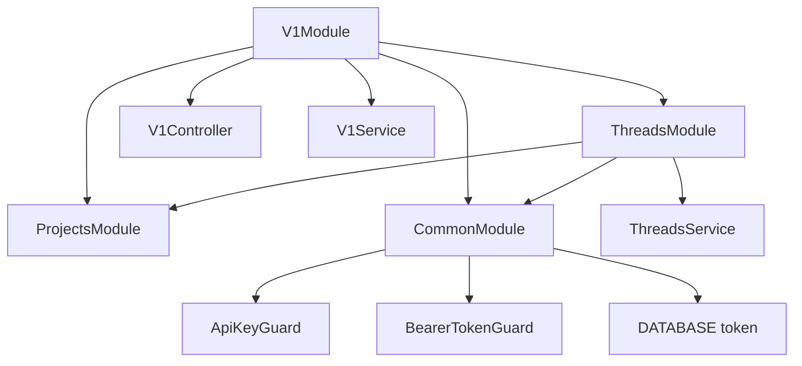

**Sources:** [apps/api/src/v1/v1.controller.ts:1-70](), [apps/api/src/v1/v1.service.ts:1-136](), [apps/api/src/threads/threads.service.ts:1-111]()

---

## Request Flow Architecture

### HTTP Request to Database Flow

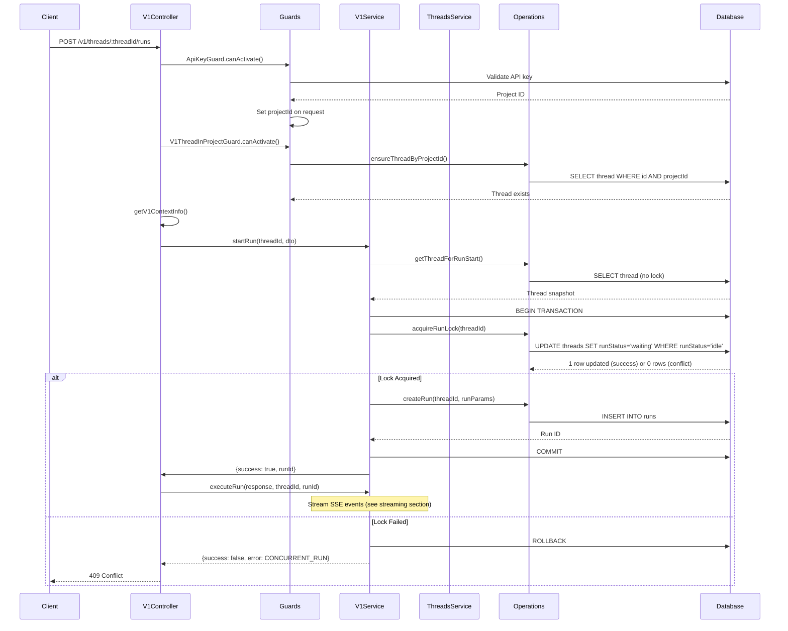

**Sources:** [apps/api/src/v1/v1.controller.ts:422-527](), [apps/api/src/v1/v1.service.ts:394-581](), [apps/api/src/v1/guards/v1-thread-in-project-guard.ts:18-66]()

---

## Controller Layer

### V1Controller Endpoints

The `V1Controller` class exposes RESTful endpoints for thread and message management. All endpoints require authentication via `ApiKeyGuard` or `BearerTokenGuard`.

#### Endpoint Groups

| Group | Routes | Purpose |
|-------|--------|---------|
| **Threads** | `GET /threads`, `POST /threads`, `GET /threads/:threadId`, `PATCH /threads/:threadId`, `DELETE /threads/:threadId` | Thread CRUD operations |
| **Messages** | `GET /threads/:threadId/messages`, `GET /threads/:threadId/messages/:messageId` | Message retrieval with pagination |
| **Runs** | `POST /threads/runs`, `POST /threads/:threadId/runs`, `DELETE /threads/:threadId/runs/:runId` | AI run execution and cancellation |
| **Component State** | `PATCH /threads/:threadId/components/:componentId` | Update component state |
| **Suggestions** | `GET /threads/:threadId/messages/:messageId/suggestions`, `POST /threads/:threadId/messages/:messageId/suggestions` | Message suggestions |

#### Authentication Flow

```mermaid
graph LR
    Request["HTTP Request"]
    ApiKeyGuard["ApiKeyGuard"]
    BearerTokenGuard["BearerTokenGuard"]
    ThreadGuard["V1ThreadInProjectGuard"]
    Controller["V1Controller"]
    
    Request --> ApiKeyGuard
    ApiKeyGuard -->|"Extract API key"| ProjectLookup["Lookup project_id"]
    ProjectLookup -->|"Set request[ProjectId]"| BearerTokenGuard
    
    BearerTokenGuard -->|"Extract bearer token"| UserLookup["Lookup user_id"]
    UserLookup -->|"Set request[UserId]"| ThreadGuard
    
    ThreadGuard -->|"For thread routes"| VerifyThread["Verify thread in project"]
    VerifyThread --> Controller
    
    BearerTokenGuard -->|"For non-thread routes"| Controller
```

**Sources:** [apps/api/src/v1/v1.controller.ts:64-227](), [apps/api/src/projects/guards/apikey.guard.ts](), [apps/api/src/projects/guards/bearer-token.guard.ts](), [apps/api/src/v1/guards/v1-thread-in-project-guard.ts:18-66]()

### Context Resolution

The `getV1ContextInfo()` helper extracts context from requests:

```typescript
// From v1.controller.ts calls
const { projectId, contextKey, sdkVersion } = getV1ContextInfo(request, dto.userKey);
```

Context resolution priority:
1. **Bearer token** → Extract `user_id` from database lookup → Use as `contextKey`
2. **Query/body `userKey`** → Use directly as `contextKey`
3. **No context** → `contextKey = undefined`

**Sources:** [apps/api/src/v1/utils/get-v1-context-info.ts:1-44](), [apps/api/src/common/utils/extract-context-info.ts]()

---

## Service Layer

### V1Service Responsibilities

The `V1Service` class orchestrates V1 API operations and bridges between HTTP layer and core business logic.

```mermaid
graph TB
    V1Service["V1Service"]
    
    subgraph "Thread Operations"
        listThreads["listThreads()"]
        getThread["getThread()"]
        createThread["createThread()"]
        updateThread["updateThread()"]
        deleteThread["deleteThread()"]
    end
    
    subgraph "Message Operations"
        listMessages["listMessages()"]
        getMessage["getMessage()"]
    end
    
    subgraph "Run Operations"
        startRun["startRun()"]
        executeRun["executeRun()"]
        cancelRun["cancelRun()"]
    end
    
    subgraph "Component State"
        updateComponentState["updateComponentState()"]
    end
    
    V1Service --> listThreads
    V1Service --> getThread
    V1Service --> createThread
    V1Service --> updateThread
    V1Service --> deleteThread
    
    V1Service --> listMessages
    V1Service --> getMessage
    
    V1Service --> startRun
    V1Service --> executeRun
    V1Service --> cancelRun
    
    V1Service --> updateComponentState
    
    listThreads --> operations_listThreadsPaginated["operations.listThreadsPaginated()"]
    getThread --> operations_getThreadForProjectId["operations.getThreadForProjectId()"]
    createThread --> ThreadsService_createThread["ThreadsService.createThread()"]
    
    startRun --> operations_acquireRunLock["operations.acquireRunLock()"]
    executeRun --> ThreadsService_advanceThread["ThreadsService.advanceThread()"]
    cancelRun --> operations_releaseRunLockIfCurrent["operations.releaseRunLockIfCurrent()"]
```

**Sources:** [apps/api/src/v1/v1.service.ts:110-136]()

### ThreadsService Core Logic

`ThreadsService` implements the core thread orchestration and AI generation logic:

**Key Methods:**

| Method | Purpose | Transaction Boundary |
|--------|---------|---------------------|
| `createThread()` | Create thread with optional initial messages | Single transaction for thread + messages |
| `advanceThread()` | Run AI generation loop with streaming | Multiple transactions (user message, streaming updates) |
| `createTamboBackendForThread()` | Initialize LLM client for thread | No transaction |
| `checkMessageLimit()` | Validate free tier limits | Transaction for usage updates |
| `cancelThread()` | Mark thread as cancelled | Transaction for status + message updates |

**Sources:** [apps/api/src/threads/threads.service.ts:98-296]()

---

## Run Lifecycle and Concurrency Control

### Atomic Run Locking

Runs use optimistic locking with atomic database operations to prevent concurrent execution.

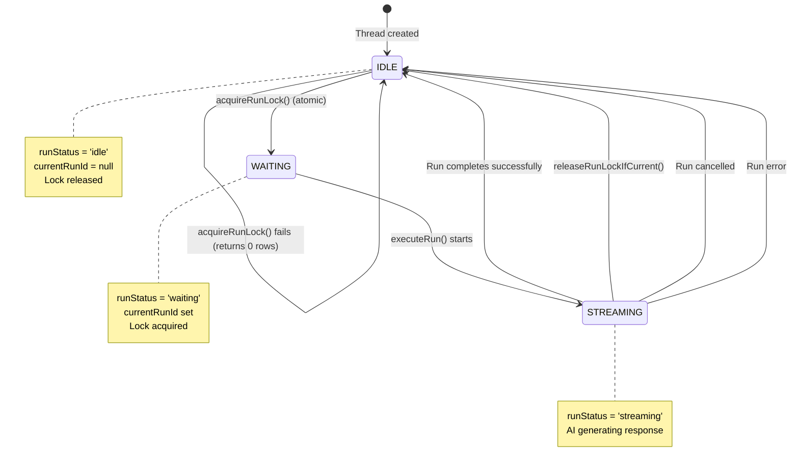

### Run Lock Implementation

**Acquire Lock:**
```sql
-- operations.acquireRunLock()
UPDATE threads 
SET 
  runStatus = 'waiting',
  currentRunId = $runId,
  lastRunCancelled = NULL,
  lastRunError = NULL,
  pendingToolCallIds = NULL
WHERE id = $threadId 
  AND runStatus = 'idle'
RETURNING id;
-- Returns 1 row if lock acquired, 0 rows if already locked
```

**Release Lock:**
```sql
-- operations.releaseRunLockIfCurrent()
UPDATE threads
SET
  runStatus = 'idle',
  currentRunId = NULL,
  lastCompletedRunId = $runId,
  lastRunCancelled = $wasCancelled,
  lastRunError = $errorInfo,
  pendingToolCallIds = $pendingToolCallIds
WHERE id = $threadId
  AND currentRunId = $runId
RETURNING id;
-- Only releases if this run is still current
```

**Sources:** [apps/api/src/v1/v1.service.ts:494-530](), [packages/db/src/operations/v1-run.ts]()

### Concurrency Conflict Handling

The `startRun()` method returns a discriminated union to handle conflicts:

```typescript
export type StartRunResult =
  | { success: true; runId: string; threadId: string }
  | { success: false; error: HttpException };
```

When lock acquisition fails:
1. Read latest thread state (no lock)
2. Return `409 Conflict` with current `runId` in error body
3. Client must wait for completion or cancel the existing run

**Sources:** [apps/api/src/v1/v1.service.ts:103-108](), [apps/api/src/v1/v1.service.ts:559-576]()

---

## Streaming Architecture

### Server-Sent Events (SSE) Flow

Runs stream AI responses using SSE with AG-UI events.

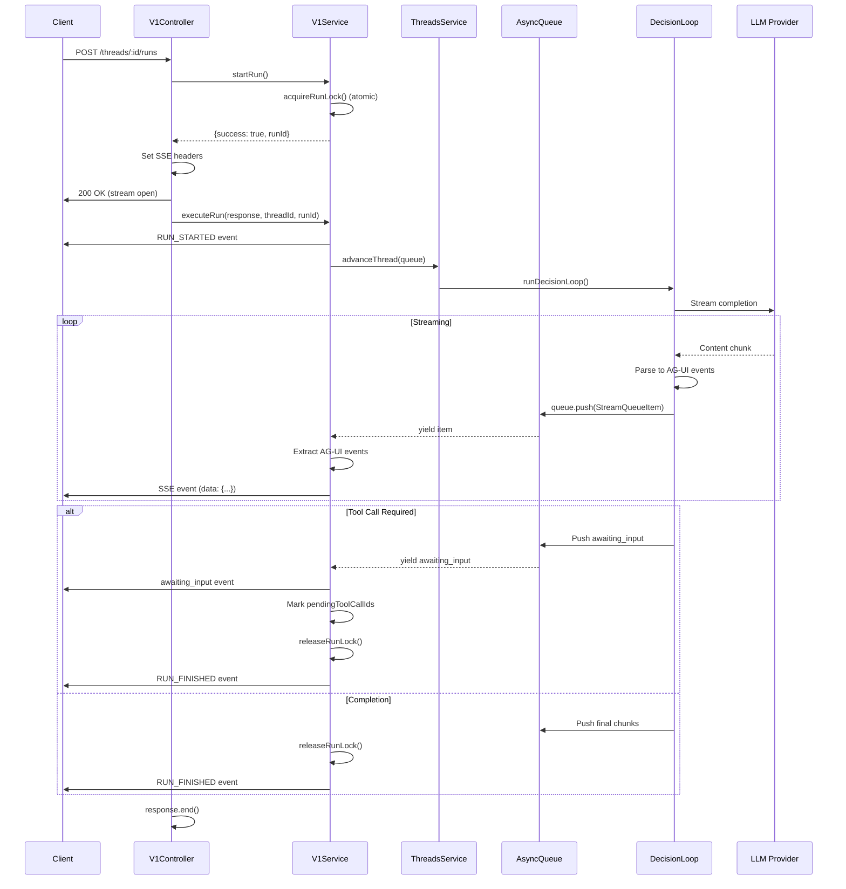

**Sources:** [apps/api/src/v1/v1.service.ts:654-944](), [apps/api/src/v1/v1.controller.ts:422-527]()

### Event Stream Structure

Each SSE event is formatted as:
```
data: {"type":"TEXT_MESSAGE_START","messageId":"msg_123","timestamp":1234567890}\n\n
```

**Event Types:**

| Event Type | When Emitted | Purpose |
|------------|--------------|---------|
| `RUN_STARTED` | Run begins | Signal streaming started |
| `TEXT_MESSAGE_START` | Assistant message begins | Create message placeholder |
| `TEXT_MESSAGE_CONTENT` | Text chunk received | Append text content |
| `TOOL_CALL_START` | Tool call detected | Signal tool execution |
| `TOOL_CALL_ARGS` | Tool args streaming | Stream tool parameters |
| `COMPONENT_START` | Component detected | Create component placeholder |
| `COMPONENT_UPDATE` | Component props streaming | Update component props |
| `AWAITING_INPUT` | Client tool needed | Signal pause for tool execution |
| `RUN_FINISHED` | Run completes | Signal stream end |
| `RUN_ERROR` | Error occurs | Signal failure |

**Sources:** [apps/api/src/v1/v1.service.ts:698-704](), [apps/api/src/v1/v1.service.ts:779-841]()

### AsyncQueue Implementation

The `AsyncQueue<StreamQueueItem>` enables fire-and-forget streaming:

```typescript
// V1Service.executeRun()
const queue = new AsyncQueue<StreamQueueItem>();

// ThreadsService.advanceThread() pushes to queue asynchronously
const streamingPromise = this.threadsService.advanceThread(
  contextInfo,
  runParams,
  threadId,
  toolCallCounts,
  cachedSystemTools,
  queue, // <-- queue for async push
  abortController.signal
);

// V1Service consumes queue while streaming continues
for await (const item of queue) {
  if (item.aguiEvents) {
    for (const event of item.aguiEvents) {
      this.emitEvent(response, event);
    }
  }
}
```

**Sources:** [apps/api/src/v1/v1.service.ts:719-841](), [packages/core/src/async-queue.ts]()

### Cancellation Handling

#### Connection Close Detection

```typescript
// V1Controller.createRun()
let shouldCancelOnClose = true;
response.on("finish", () => {
  shouldCancelOnClose = false; // Normal completion
});
response.on("close", () => {
  if (!shouldCancelOnClose) return;
  
  void this.v1Service.cancelRun(threadId, runId, "connection_closed");
});
```

#### Polling Cancellation Status

```typescript
// V1Service.executeRun()
const CANCEL_CHECK_INTERVAL_MS = 500;
let lastCancelCheckTime = Date.now();

for await (const item of queue) {
  const now = Date.now();
  if (now - lastCancelCheckTime >= CANCEL_CHECK_INTERVAL_MS) {
    lastCancelCheckTime = now;
    const run = await operations.getRun(this.db, threadId, runId);
    if (run?.isCancelled) {
      abortController.abort(); // Stop LLM stream
      await operations.markMessageCancelled(this.db, currentMessageId);
      this.emitEvent(response, cancelErrorEvent);
      return;
    }
  }
}
```

**Sources:** [apps/api/src/v1/v1.controller.ts:479-499](), [apps/api/src/v1/v1.service.ts:773-809](), [apps/api/src/v1/v1.service.ts:13-16]()

---

## Content Conversion Pipeline

### Internal Format to V1 API Format

Content flows through multiple conversion layers to transform between internal database format and V1 API DTOs.

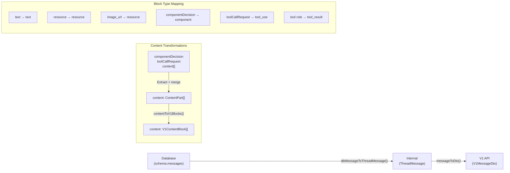

**Sources:** [apps/api/src/v1/v1-conversions.ts:114-314]()

### Content Block Conversion Rules

The `contentToV1Blocks()` function applies these rules:

1. **Text Content:** Pass through unchanged
   ```typescript
   { type: "text", text: "Hello world" }
   ```

2. **Resource Content:** Pass through unchanged
   ```typescript
   { type: "resource", resource: { uri: "...", mimeType: "..." } }
   ```

3. **Image URL → Resource:** Convert to resource format
   ```typescript
   // Input: { type: "image_url", image_url: { url: "..." } }
   // Output: { type: "resource", resource: { uri: "...", mimeType: "image/*" } }
   ```

4. **Component Decision → Component Block:**
   ```typescript
   // message.componentDecision + message.componentState
   {
     type: "component",
     id: "comp_msg_123", // Generated from message ID
     name: message.componentDecision.componentName,
     props: message.componentDecision.props,
     state: message.componentState // May be updated separately
   }
   ```

5. **Tool Call Request → Tool Use Block:**
   ```typescript
   // message.toolCallRequest (skip UI tools like show_component_*)
   {
     type: "tool_use",
     id: message.toolCallId,
     name: message.toolCallRequest.toolName,
     input: {
       ...parametersAsObject,
       _tambo_statusMessage: decision.statusMessage,
       _tambo_completionStatusMessage: decision.completionStatusMessage
     }
   }
   ```

6. **Tool Role Message → Tool Result Block:**
   ```typescript
   // role: "tool"
   {
     type: "tool_result",
     toolUseId: message.toolCallId,
     content: [/* text or resource blocks */],
     isError: message.error ? true : undefined
   }
   ```

**Sources:** [apps/api/src/v1/v1-conversions.ts:191-314]()

### Hidden UI Tool Responses

The function `isHiddenUiToolResponse()` filters internal UI tool responses:

```typescript
// These are auto-generated "Component was rendered" messages
export function isHiddenUiToolResponse(message: DbMessage): boolean {
  return message.role === "tool" && !!message.componentDecision?.componentName;
}
```

These messages are filtered from:
- `V1Service.getThread()` - When returning thread with messages
- `V1Service.listMessages()` - When paginating messages  
- `V1Service.getMessage()` - Returns 404 for hidden messages

**Sources:** [apps/api/src/v1/v1-conversions.ts:329-331](), [apps/api/src/v1/v1.service.ts:206-208]()

---

## Authentication and Authorization

### Guard Execution Order

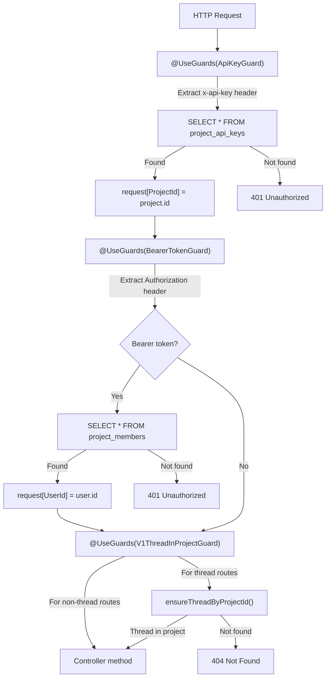

**Sources:** [apps/api/src/v1/v1.controller.ts:64-68](), [apps/api/src/projects/guards/apikey.guard.ts](), [apps/api/src/v1/guards/v1-thread-in-project-guard.ts:18-66]()

### V1ThreadInProjectGuard Implementation

This guard verifies thread ownership before allowing access:

```typescript
async canActivate(context: ExecutionContext): Promise<boolean> {
  const request = context.switchToHttp().getRequest();
  const projectId = request[ProjectId]; // Set by ApiKeyGuard
  const threadId = request.params.threadId;
  
  try {
    // Uses ANY_CONTEXT_KEY to verify project ownership only
    await operations.ensureThreadByProjectId(
      this.db,
      threadId,
      projectId,
      operations.ANY_CONTEXT_KEY
    );
    return true;
  } catch (error) {
    if (error instanceof ThreadNotFoundError) {
      return false; // Returns 404
    }
    throw error;
  }
}
```

**Sources:** [apps/api/src/v1/guards/v1-thread-in-project-guard.ts:24-65]()

---

## Database Operations Layer

### Transaction Patterns

#### Single Transaction Operations

```typescript
// operations.createThread() - Single atomic insert
const [thread] = await db
  .insert(schema.threads)
  .values({ projectId, contextKey, metadata, name })
  .returning();
```

#### Multi-step Transactions

```typescript
// V1Service.startRun() - Acquire lock + create run + save tool results
const runId = await this.db.transaction(async (tx) => {
  // Step 1: Acquire lock (atomic - returns 0 or 1)
  const didAcquire = await operations.acquireRunLock(tx, threadId);
  if (!didAcquire) return null;
  
  // Step 2: Save tool result messages
  for (const toolMessage of toolResultMessages) {
    await operations.addMessage(tx, threadId, toolMessage);
  }
  
  // Step 3: Clear pending tool call IDs
  if (toolResultMessages.length > 0) {
    await operations.clearPendingToolCalls(tx, threadId, snapshotPendingToolCallIds);
  }
  
  // Step 4: Create run record
  const run = await operations.createRun(tx, { threadId, model, ... });
  await operations.setCurrentRunId(tx, threadId, run.id);
  
  return run.id;
});
```

**Sources:** [apps/api/src/v1/v1.service.ts:494-530]()

#### Isolation Levels

| Operation | Isolation Level | Reason |
|-----------|----------------|--------|
| Run lock acquisition | `read committed` (default) | Optimistic locking with atomic UPDATE |
| Component state update | `read committed` | Row-level lock via `SELECT ... FOR UPDATE` |
| Message append | `read committed` | Append-only, no conflicts |

**Sources:** [apps/api/src/v1/v1.service.ts:495](), [apps/api/src/v1/v1.service.ts:978-989]()

### Cursor-based Pagination

The V1 API uses compound cursors for stable pagination:

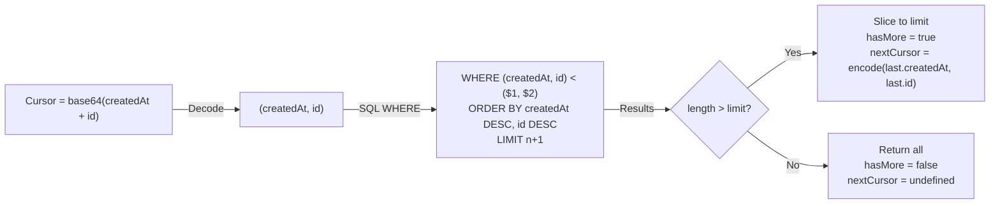

**Cursor Encoding:**
```typescript
// apps/api/src/v1/v1-pagination.ts
export function encodeV1CompoundCursor(cursor: { createdAt: Date; id: string }): string {
  const json = JSON.stringify({
    c: cursor.createdAt.toISOString(),
    i: cursor.id
  });
  return Buffer.from(json, "utf-8").toString("base64url");
}
```

**SQL Query Pattern:**
```sql
-- packages/db/src/operations/thread.ts (listThreadsPaginated)
SELECT * FROM threads
WHERE project_id = $1
  AND context_key = $2
  AND (created_at, id) < ($cursorCreatedAt, $cursorId) -- Compound comparison
ORDER BY created_at DESC, id DESC
LIMIT $limit; -- Fetch limit+1 to detect hasMore
```

**Sources:** [apps/api/src/v1/v1-pagination.ts:1-46](), [packages/db/src/operations/thread.ts:184-215]()

---

## Error Handling

### Structured Error Responses

V1 API uses RFC 7807 Problem Details format:

```typescript
// apps/api/src/v1/v1.errors.ts
export function createProblemDetail(
  code: string,
  message: string,
  details?: Record<string, unknown>
) {
  return {
    type: `https://tambo.ai/errors/${code}`,
    title: code,
    detail: message,
    ...details
  };
}
```

**Error Code Mapping:**

| Code | HTTP Status | Cause | Example |
|------|-------------|-------|---------|
| `THREAD_NOT_FOUND` | 404 | Thread doesn't exist or wrong project | Invalid `threadId` |
| `CONCURRENT_RUN` | 409 | Run already active | Lock acquisition failed |
| `INVALID_PREVIOUS_RUN` | 400 | Wrong `previousRunId` | Stale client state |
| `INVALID_TOOL_RESULT` | 400 | Missing/extra tool results | Client sent wrong tools |
| `RUN_ACTIVE` | 409 | Component state update while running | Race condition |
| `VALIDATION_ERROR` | 400 | Invalid request body | DTO validation failed |
| `INVALID_JSON_PATCH` | 400 | Malformed JSON Patch | Invalid patch operation |
| `INTERNAL_ERROR` | 500 | Unexpected error | LLM failure, database error |

**Sources:** [apps/api/src/v1/v1.errors.ts:1-79](), [apps/api/src/v1/v1.service.ts:407-442]()

### Error Flow for Concurrent Runs

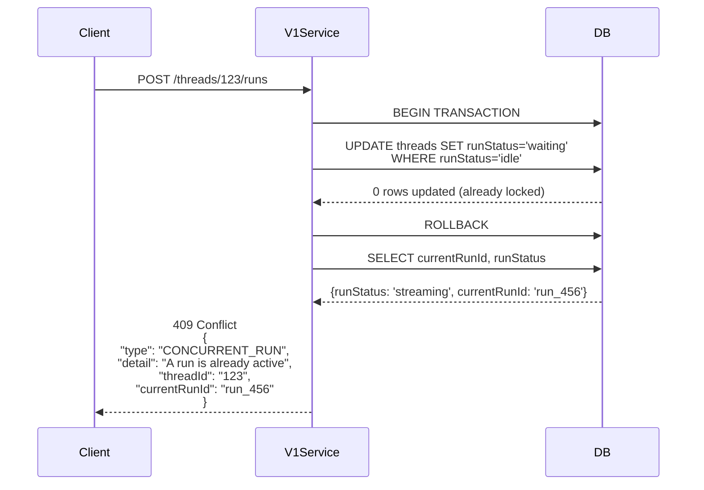

**Sources:** [apps/api/src/v1/v1.service.ts:559-576]()

### Sentry Integration

Critical paths wrap operations with Sentry spans:

```typescript
// V1Service.executeRun()
return await Sentry.startSpan(
  {
    op: "v1.executeRun",
    name: `V1 Run ${runId}`,
    attributes: { threadId, runId, projectId }
  },
  async () => {
    Sentry.setContext("v1Run", { threadId, runId, model });
    
    try {
      // ... execution logic
    } catch (error) {
      Sentry.captureException(error, {
        tags: { threadId, runId, projectId },
        extra: { model, contextKey }
      });
      throw error;
    }
  }
);
```

**Sources:** [apps/api/src/v1/v1.service.ts:679-695](), [apps/api/src/v1/v1.service.ts:888-898]()

---

## Component State Management

### Update Endpoint

`PATCH /threads/:threadId/components/:componentId` supports two update modes:

1. **Full replacement** (provide `state`)
2. **JSON Patch** (provide `patch` array)

### State Update Flow

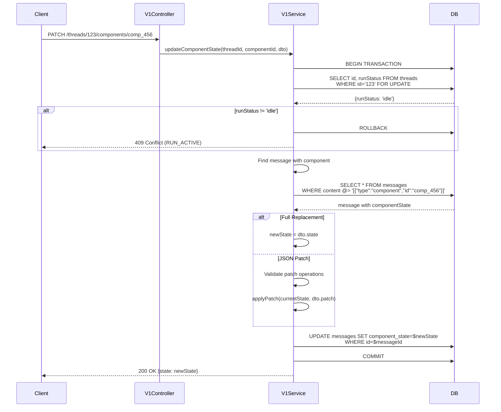

**Sources:** [apps/api/src/v1/v1.service.ts:973-1127](), [apps/api/src/v1/dto/component-state.dto.ts:1-87]()

### JSON Patch Support

Supported operations: `add`, `remove`, `replace`, `move`, `copy`, `test`

```typescript
// Example: Update nested state property
{
  "patch": [
    { "op": "replace", "path": "/expanded", "value": true },
    { "op": "add", "path": "/metadata/lastUpdated", "value": "2024-01-15T12:00:00Z" }
  ]
}
```

Validation:
1. **DTO validation** - Ensures `op` is valid, `path` is string, etc.
2. **JSON Patch validation** - Uses `fast-json-patch` library to validate patch can be applied
3. **Application** - Applies patch immutably (creates new object)

**Sources:** [apps/api/src/v1/v1.service.ts:1089-1114]()

---

## Summary: Key Architectural Patterns

| Pattern | Implementation | Benefit |
|---------|---------------|---------|
| **Layered Architecture** | Controller → Service → Operations → Database | Clear separation of concerns, testability |
| **Atomic Concurrency Control** | Optimistic locking with `UPDATE ... WHERE runStatus='idle'` | Prevents race conditions without distributed locks |
| **Discriminated Unions** | `StartRunResult` for lock acquisition | Type-safe error handling |
| **Fire-and-Forget Streaming** | `AsyncQueue` + async generators | Decouples LLM streaming from HTTP response |
| **Compound Cursors** | `(createdAt, id)` for pagination | Stable pagination under concurrent inserts |
| **Content Conversion Pipeline** | DB → Internal → V1 API → React SDK | Clean abstraction boundaries |
| **Guard Composition** | `ApiKeyGuard` → `BearerTokenGuard` → `V1ThreadInProjectGuard` | Modular authentication/authorization |
| **Transaction Isolation** | Row-level locking with `FOR UPDATE` | Safe concurrent state updates |
| **SSE Event Streaming** | AG-UI events over Server-Sent Events | Real-time updates with HTTP/1.1 compatibility |
| **Structured Errors** | RFC 7807 Problem Details | Consistent, machine-readable error format |

**Sources:** [apps/api/src/v1/v1.service.ts:1-1500](), [apps/api/src/v1/v1.controller.ts:1-600](), [apps/api/src/threads/threads.service.ts:1-1500]()

---

