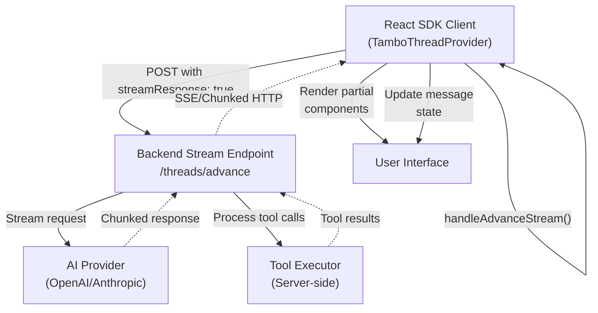
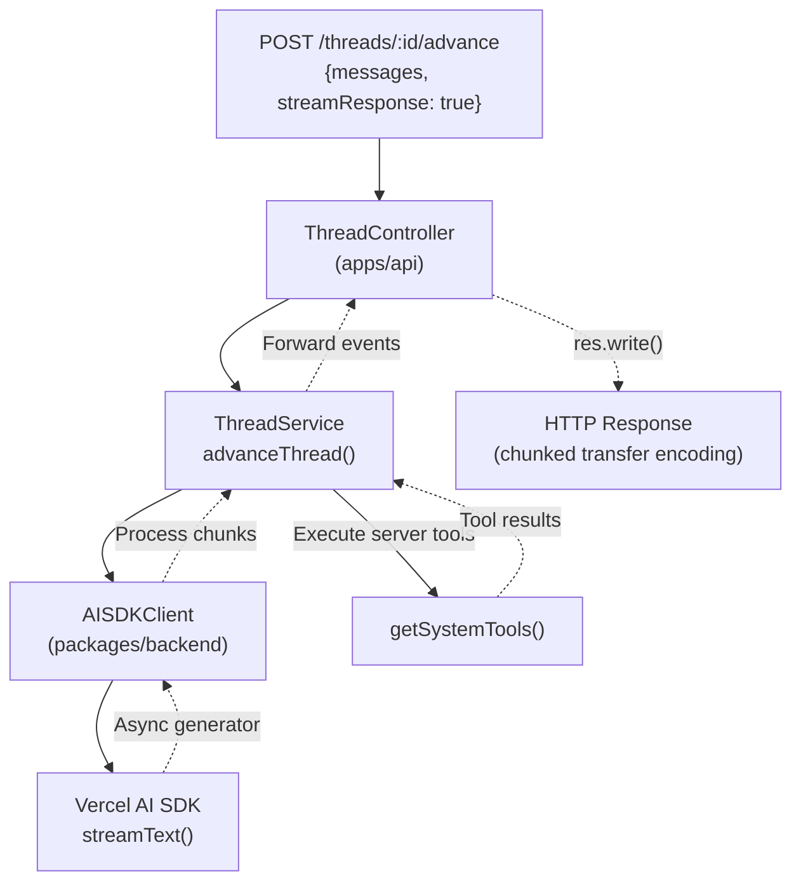
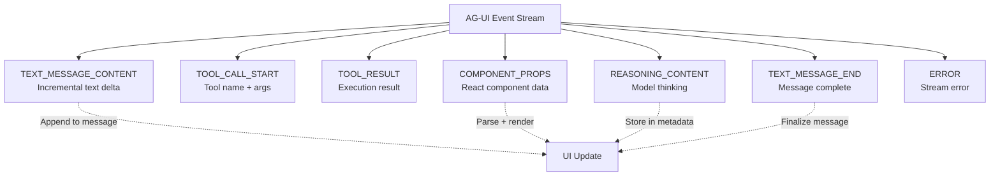
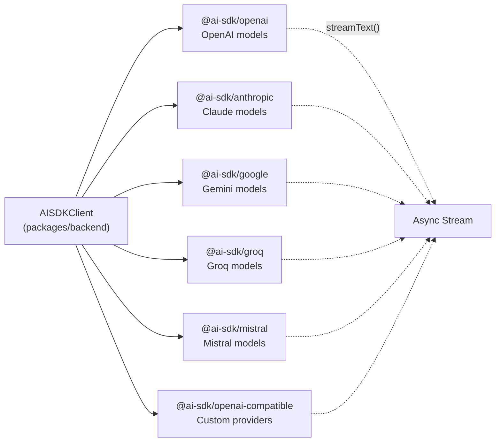
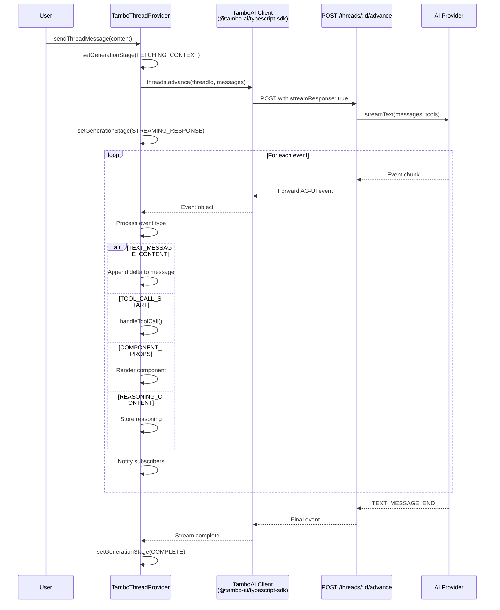
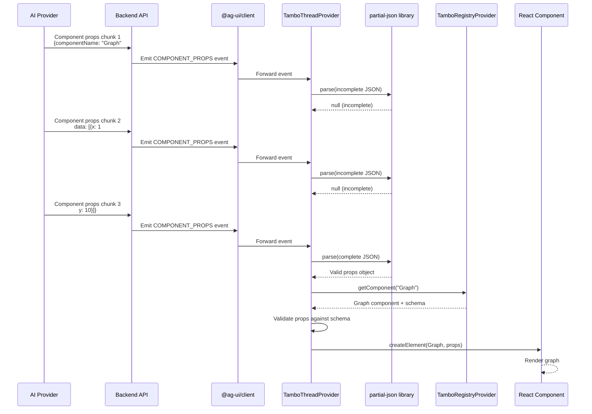
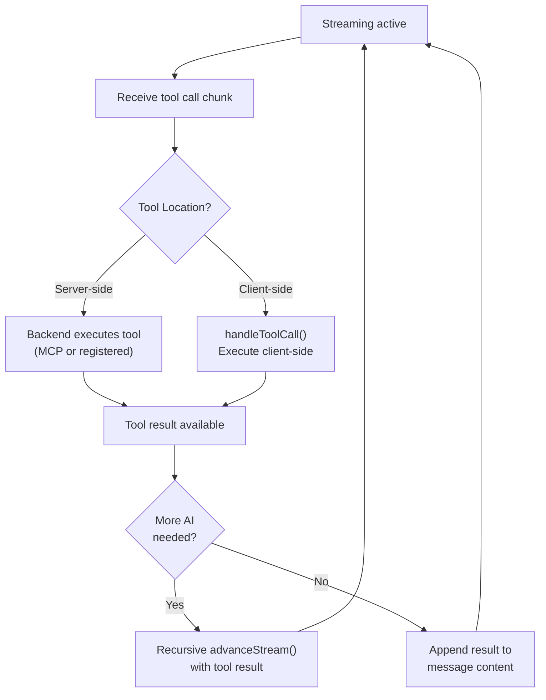
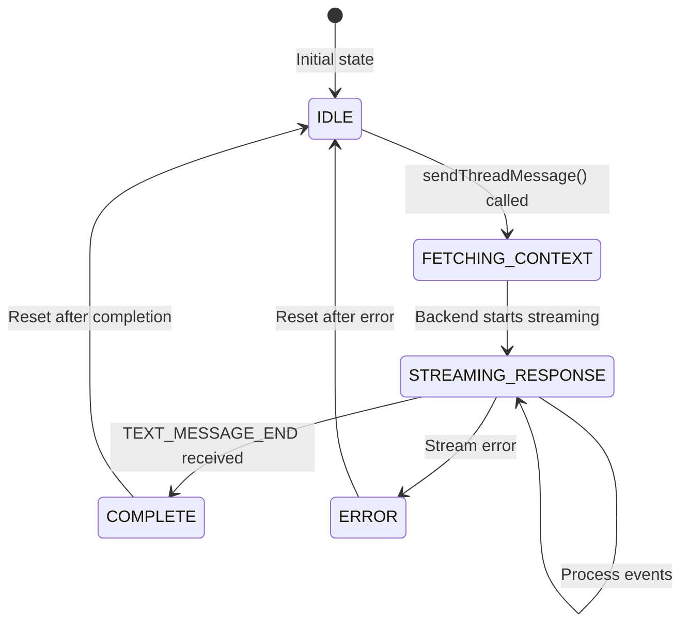
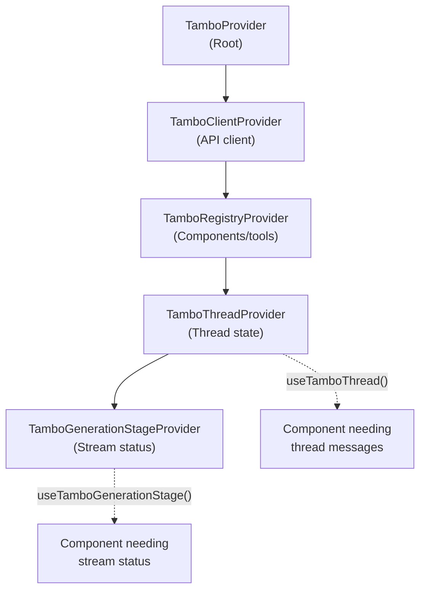
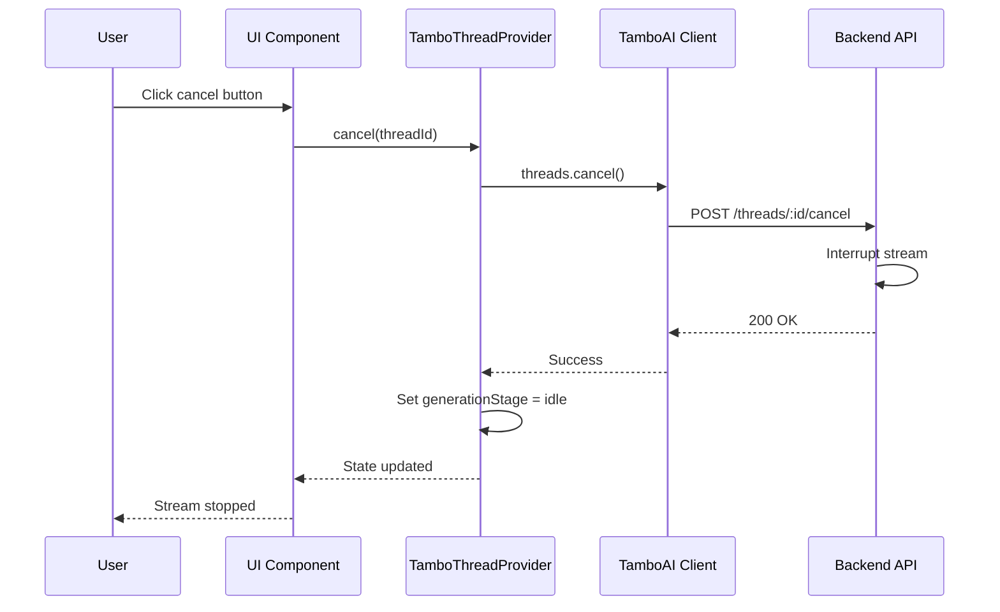

<!-- source: DeepWiki mcp.deepwiki.com · repo tambo-ai/tambo · page 7.3 Streaming Responses · fetched 2026-10-29 -->

# Streaming Responses

<details>
<summary>Relevant source files</summary>

The following files were used as context for generating this wiki page:

- [apps/api/src/threads/guards/thread-in-project-guard.ts](apps/api/src/threads/guards/thread-in-project-guard.ts)
- [apps/api/src/threads/threads.service.test.ts](apps/api/src/threads/threads.service.test.ts)
- [apps/api/src/threads/threads.service.ts](apps/api/src/threads/threads.service.ts)
- [apps/api/src/threads/util/content.test.ts](apps/api/src/threads/util/content.test.ts)
- [apps/api/src/threads/util/content.ts](apps/api/src/threads/util/content.ts)
- [apps/api/src/threads/util/thread-state.test.ts](apps/api/src/threads/util/thread-state.test.ts)
- [apps/api/src/threads/util/thread-state.ts](apps/api/src/threads/util/thread-state.ts)
- [apps/api/src/v1/__tests__/v1-conversions.test.ts](apps/api/src/v1/__tests__/v1-conversions.test.ts)
- [apps/api/src/v1/__tests__/v1-thread-in-project-guard.test.ts](apps/api/src/v1/__tests__/v1-thread-in-project-guard.test.ts)
- [apps/api/src/v1/__tests__/v1.controller.test.ts](apps/api/src/v1/__tests__/v1.controller.test.ts)
- [apps/api/src/v1/__tests__/v1.service.test.ts](apps/api/src/v1/__tests__/v1.service.test.ts)
- [apps/api/src/v1/dto/component-state.dto.ts](apps/api/src/v1/dto/component-state.dto.ts)
- [apps/api/src/v1/dto/message.dto.ts](apps/api/src/v1/dto/message.dto.ts)
- [apps/api/src/v1/dto/thread.dto.ts](apps/api/src/v1/dto/thread.dto.ts)
- [apps/api/src/v1/guards/v1-thread-in-project-guard.ts](apps/api/src/v1/guards/v1-thread-in-project-guard.ts)
- [apps/api/src/v1/utils/get-v1-context-info.ts](apps/api/src/v1/utils/get-v1-context-info.ts)
- [apps/api/src/v1/v1-conversions.ts](apps/api/src/v1/v1-conversions.ts)
- [apps/api/src/v1/v1.controller.ts](apps/api/src/v1/v1.controller.ts)
- [apps/api/src/v1/v1.service.ts](apps/api/src/v1/v1.service.ts)
- [packages/backend/src/index.ts](packages/backend/src/index.ts)
- [packages/backend/src/services/decision-loop/decision-loop-service.ts](packages/backend/src/services/decision-loop/decision-loop-service.ts)
- [packages/backend/src/services/llm/ai-sdk-client-abort.test.ts](packages/backend/src/services/llm/ai-sdk-client-abort.test.ts)
- [packages/backend/src/services/llm/ai-sdk-client.test.ts](packages/backend/src/services/llm/ai-sdk-client.test.ts)
- [packages/backend/src/services/llm/ai-sdk-client.ts](packages/backend/src/services/llm/ai-sdk-client.ts)
- [packages/backend/src/services/llm/llm-client.ts](packages/backend/src/services/llm/llm-client.ts)
- [packages/backend/src/services/tool/tool-service.ts](packages/backend/src/services/tool/tool-service.ts)
- [packages/backend/src/tambo-backend.ts](packages/backend/src/tambo-backend.ts)
- [packages/backend/src/util/component-streaming.test.ts](packages/backend/src/util/component-streaming.test.ts)
- [packages/backend/src/util/component-streaming.ts](packages/backend/src/util/component-streaming.ts)
- [packages/core/src/ComponentDecision.ts](packages/core/src/ComponentDecision.ts)
- [packages/db/src/index.ts](packages/db/src/index.ts)
- [packages/db/src/operations/thread.ts](packages/db/src/operations/thread.ts)
- [packages/react-ui-base/src/toolcall-info/result/toolcall-info-result.tsx](packages/react-ui-base/src/toolcall-info/result/toolcall-info-result.tsx)
- [packages/ui-registry/src/components/thread-content/thread-content.tsx](packages/ui-registry/src/components/thread-content/thread-content.tsx)
- [react-sdk/src/v1/types/message.ts](react-sdk/src/v1/types/message.ts)

</details>


## Purpose and Scope

This document describes how the Tambo backend API streams AI responses to clients, including the implementation of Server-Sent Events (SSE) or chunked HTTP responses, stream processing on the client side, and handling of incremental content updates, tool calls, and component rendering during streaming. 

For information about the overall API architecture and controller-service pattern, see [API Architecture](#7.1). For details on tool execution specifically, see [Tool Execution Pipeline](#7.3).

## Streaming Architecture Overview

The streaming system enables real-time transmission of AI-generated content from the backend to the React SDK client. This allows users to see responses as they are generated rather than waiting for complete responses.



**Sources:** [react-sdk/src/providers/tambo-thread-provider.tsx:1-844](), [apps/api/package.json:1-93](), High-level architecture diagrams

## Backend Streaming Implementation

### Thread Controller Endpoint

The backend exposes streaming endpoints through the NestJS Thread Controller at `apps/api`. The primary endpoint is `POST /threads/:id/advance` which handles streaming responses.

#### Thread Advance Endpoint Flow



**Sources:** [apps/api/package.json:27-69](), [packages/backend/package.json:26-55](), [packages/backend/src/services/llm/ai-sdk-client.ts:1-500]()

### AG-UI Event Protocol

The streaming protocol is based on the AG-UI (Agentic UI) event system. The backend uses `@ag-ui/client` (version 0.0.43) to emit structured events during streaming. Each chunk is a JSON-serialized event with a specific type.

#### Event Types



The event types are defined in the `@ag-ui/client` package and include:

| Event Type | Purpose | Payload |
|-----------|---------|---------|
| `TEXT_MESSAGE_CONTENT` | Incremental text from AI | `{ delta: string }` |
| `TOOL_CALL_START` | AI requests tool execution | `{ toolCallId, toolName, args }` |
| `TOOL_RESULT` | Tool execution complete | `{ toolCallId, result }` |
| `COMPONENT_PROPS` | Component to render | `{ componentName, props }` |
| `REASONING_CONTENT` | Model's thinking process | `{ reasoning: string }` |
| `TEXT_MESSAGE_END` | Message generation done | `{ messageId }` |

**Sources:** [apps/api/package.json:27-38](), [packages/backend/package.json:27-29](), [package-lock.json:1-50]()

### AI SDK Integration

The backend uses the Vercel AI SDK (`ai` package version 5.0.123+) to interface with multiple AI providers. The `AISDKClient` class in `packages/backend/src/services/llm/ai-sdk-client.ts` abstracts provider-specific implementations.



**Sources:** [packages/backend/package.json:32-37](), [packages/backend/src/services/llm/ai-sdk-client.ts:1-50]()

## Client-Side Stream Processing Pipeline

### TamboThreadProvider Stream Handler

The `TamboThreadProvider` component in `react-sdk/src/providers/tambo-thread-provider.tsx` manages stream consumption. The core method is `sendThreadMessage()` which initiates streaming and processes events.

#### Stream Processing Flow



**Sources:** [react-sdk/src/providers/tambo-thread-provider.tsx:1-844](), High-level architecture diagram 3

### Event Processing by Type

The `TamboThreadProvider` handles different AG-UI events with specific logic:

```typescript
// Simplified event handling flow
switch (event.type) {
  case "TEXT_MESSAGE_CONTENT":
    // Append text delta to current message
    appendToMessageContent(event.delta);
    break;
    
  case "TOOL_CALL_START":
    // Execute tool (client-side or server-side)
    await handleToolCall(event.toolName, event.args);
    break;
    
  case "COMPONENT_PROPS":
    // Parse partial JSON and render component
    renderComponentIntoMessage(event.componentName, event.props);
    break;
    
  case "REASONING_CONTENT":
    // Store reasoning metadata
    storeReasoning(event.reasoning);
    break;
    
  case "TEXT_MESSAGE_END":
    // Finalize message
    markMessageComplete(event.messageId);
    break;
}
```

**Sources:** [react-sdk/src/providers/tambo-thread-provider.tsx:464-844]()

### Key Processing Functions

| Function | Location | Purpose |
|----------|----------|---------|
| `sendThreadMessage()` | [react-sdk/src/providers/tambo-thread-provider.tsx]() | Initiates a streaming request to the backend |
| `handleAdvanceStream()` | [react-sdk/src/providers/tambo-thread-provider.tsx]() | Core stream processing loop that handles each chunk type |
| `renderComponentIntoMessage()` | [react-sdk/src/util/generate-component.ts:12-67]() | Parses partial JSON and renders React components as props stream in |
| `handleToolCall()` | [react-sdk/src/util/tool-caller.ts]() | Executes client-side or server-side tool calls |

**Sources:** [react-sdk/src/providers/tambo-thread-provider.tsx:1-844](), [react-sdk/src/util/generate-component.ts](), High-level architecture diagram 7

## Incremental Component Rendering

One of the most sophisticated aspects of streaming is the ability to render React components as their props are being streamed. This provides a smooth UX where components appear and update in real-time.

### Component Prop Streaming Architecture



**Sources:** [react-sdk/src/providers/tambo-thread-provider.tsx](), [react-sdk/package.json:81](), High-level architecture diagram 7

### Partial JSON Parsing

The `partial-json` library (version 0.1.7) enables parsing of incomplete JSON objects. The React SDK uses this to attempt parsing after each chunk:

```typescript
import { parse as parsePartialJSON } from "partial-json";

// In TamboThreadProvider
function processComponentPropsEvent(event: ComponentPropsEvent) {
  try {
    const partialProps = parsePartialJSON(event.partialJSON);
    
    if (partialProps !== null) {
      // Successfully parsed - validate and render
      const component = registry.getComponent(event.componentName);
      const validatedProps = component.propsSchema.parse(partialProps);
      
      renderComponent(component, validatedProps);
    }
    // If null, wait for more chunks
  } catch (error) {
    // Parse error - wait for more chunks
  }
}
```

The function attempts to parse and render after each chunk. If parsing fails or returns `null`, it waits for the next chunk. Once parsing succeeds and props pass schema validation, the component is immediately rendered.

**Sources:** [react-sdk/package.json:81](), [react-sdk/src/providers/tambo-thread-provider.tsx]()

## Tool Call Handling During Streaming

When the AI decides to call a tool during streaming, the flow can become recursive. The backend executes server-side tools, while client-side tools are executed by the React SDK. Both types can trigger additional AI requests.



**Sources:** [react-sdk/src/providers/tambo-thread-provider.tsx:464-844](), [react-sdk/src/util/tool-caller.ts](), High-level architecture diagram 4

### Tool Call Flow Details

The `handleToolCall()` function in the thread provider:

1. Checks if the tool is registered in the client-side registry
2. For client-side tools, executes the tool function with provided arguments
3. For server-side tools, the backend has already executed them
4. Calls `transformToContent()` if the tool provides this function to format results
5. Recursively calls `advanceStream()` if the tool result requires further AI processing

**Sources:** [react-sdk/src/providers/tambo-thread-provider.tsx](), [react-sdk/src/util/tool-caller.ts]()

## Stream State Management

The React SDK maintains several pieces of state during streaming to provide a responsive UI:

| State Variable | Type | Purpose |
|---------------|------|---------|
| `generationStage` | `GenerationStage` enum | Current stage of message generation |
| `generationStatusMessage` | `string \| null` | Human-readable status for UI display |
| `streaming` | `boolean` | Whether a stream is currently active |
| `threadMap` | `Record<string, TamboThread>` | All threads by ID with their messages |
| `currentThreadId` | `string \| null` | Active thread being streamed to |

### GenerationStage Enum

The `GenerationStage` enum tracks the current phase of message generation:

```typescript
enum GenerationStage {
  IDLE = "IDLE",
  FETCHING_CONTEXT = "FETCHING_CONTEXT",
  STREAMING_RESPONSE = "STREAMING_RESPONSE", 
  COMPLETE = "COMPLETE",
  ERROR = "ERROR"
}
```

The stage transitions follow this lifecycle:



**Sources:** [react-sdk/src/providers/tambo-thread-provider.tsx:36-79](), High-level architecture diagram 3, [packages/core/src/types/generation-stage.ts]()

### Generation Stage Context

The `TamboGenerationStageProvider` wraps the stream state in a separate context to prevent unnecessary re-renders of components that only need thread data but not generation status.



**Sources:** [react-sdk/src/providers/tambo-thread-provider.tsx:36-79](), [react-sdk/src/providers/tambo-provider.tsx:1-112]()

## Error Handling and Stream Cancellation

### Error Handling

Streaming errors are caught and handled gracefully to ensure the UI remains responsive:

- **Network errors**: Caught during the `advanceStream()` call, stored in message metadata
- **Parsing errors**: Partial JSON that cannot be parsed is buffered until more data arrives
- **Tool execution errors**: Caught and converted to error messages in the thread
- **Validation errors**: Component props that fail schema validation are rejected

**Sources:** [react-sdk/src/providers/tambo-thread-provider.tsx](), [react-sdk/src/util/generate-component.ts]()

### Stream Cancellation

The `cancel()` method in `TamboThreadProvider` allows interrupting an active stream:



**Sources:** [react-sdk/src/providers/tambo-thread-provider.tsx](), [apps/api/package.json:27-69]()

The cancellation process:

1. User triggers cancel (e.g., clicking a stop button)
2. `cancel(threadId)` is called on the thread provider
3. The method calls `client.beta.threads.cancel()` from the TypeScript SDK
4. Backend receives cancellation request and interrupts the stream
5. Client state is updated to reflect idle status
6. UI components re-render to show stream is stopped

**Sources:** [react-sdk/src/providers/tambo-thread-provider.tsx:118-119](), [react-sdk/src/providers/tambo-client-provider.tsx]()

## Stream Status Hooks

Developers can use specialized hooks to track stream status in their components:

```typescript
// Check if props are still streaming
const { isStreaming, getPropStatus } = useTamboStreamStatus();

// Check overall generation stage
const { generationStage, isIdle } = useTamboGenerationStage();
```

The `useTamboStreamStatus()` hook provides granular status information about individual props during streaming, useful for showing loading states on specific form fields or UI elements as they are generated.

**Sources:** [react-sdk/src/hooks/use-tambo-stream-status.tsx](), [react-sdk/src/providers/tambo-thread-provider.tsx:36-79]()

## Backend Dependencies

The backend streaming implementation relies on several key packages:

| Package | Purpose |
|---------|---------|
| `@nestjs/platform-express` | HTTP server with streaming support |
| `openai` | OpenAI SDK for streaming AI responses |
| `@tambo-ai-cloud/backend` | AI provider abstractions and tool execution |
| `rxjs` | Reactive streams for processing async data |
| `superjson` | Serialization that preserves types during streaming |

**Sources:** [apps/api/package.json:27-69](), [packages/backend/package.json:26-55]()

---

