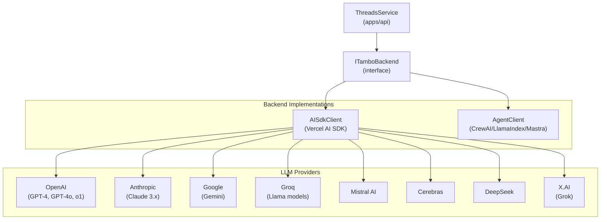
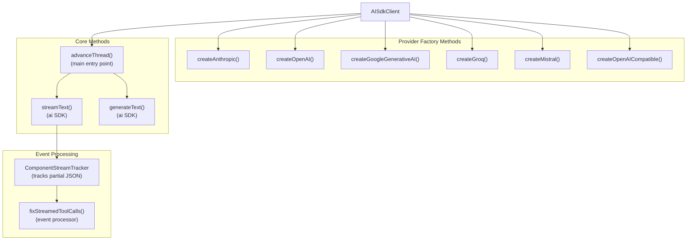
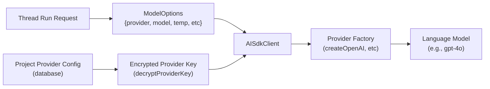
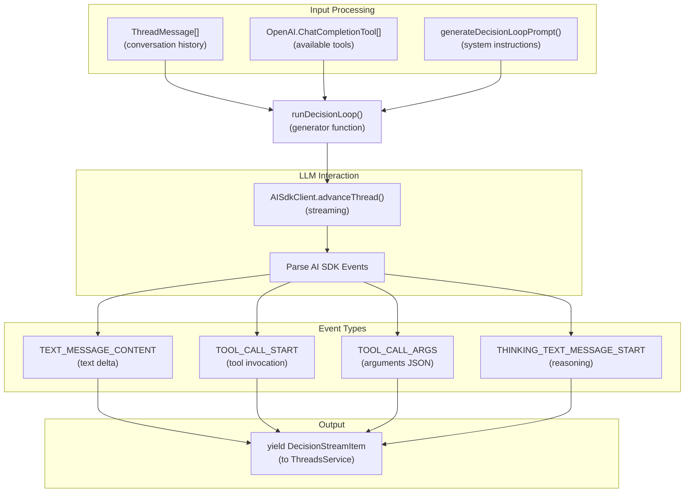
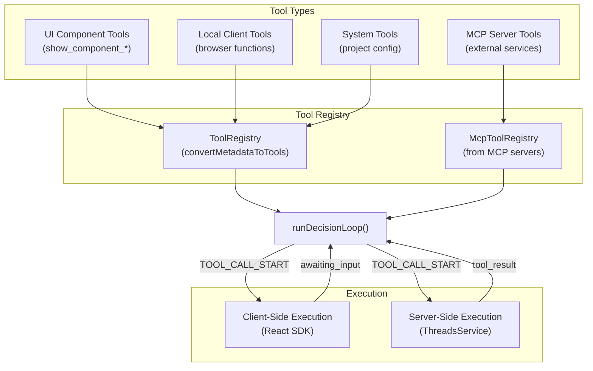
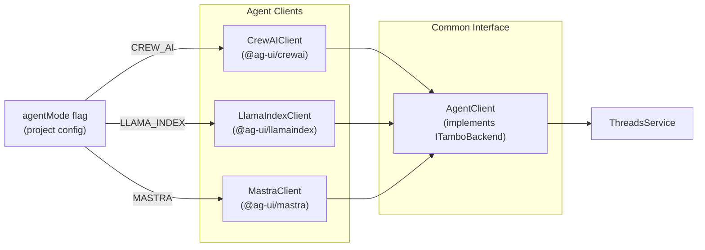
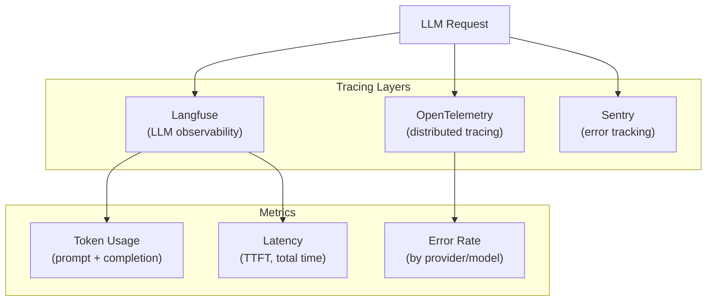
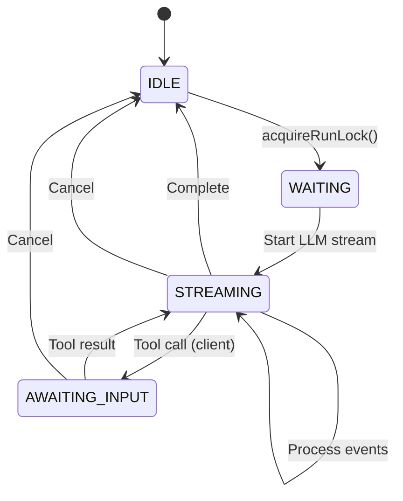

<!-- source: DeepWiki mcp.deepwiki.com · repo tambo-ai/tambo · page 7.4 LLM Integration · fetched 2026-10-29 -->

# LLM Integration

<details>
<summary>Relevant source files</summary>

The following files were used as context for generating this wiki page:

- [.config/release-please/.release-please-manifest.json](.config/release-please/.release-please-manifest.json)
- [apps/api/CHANGELOG.md](apps/api/CHANGELOG.md)
- [apps/api/package.json](apps/api/package.json)
- [apps/api/src/threads/threads.service.test.ts](apps/api/src/threads/threads.service.test.ts)
- [apps/api/src/threads/threads.service.ts](apps/api/src/threads/threads.service.ts)
- [apps/api/src/threads/util/content.test.ts](apps/api/src/threads/util/content.test.ts)
- [apps/api/src/threads/util/content.ts](apps/api/src/threads/util/content.ts)
- [apps/api/src/threads/util/thread-state.test.ts](apps/api/src/threads/util/thread-state.test.ts)
- [apps/api/src/threads/util/thread-state.ts](apps/api/src/threads/util/thread-state.ts)
- [apps/docs-mcp/package.json](apps/docs-mcp/package.json)
- [apps/test-mcp-server/package.json](apps/test-mcp-server/package.json)
- [apps/web/CHANGELOG.md](apps/web/CHANGELOG.md)
- [apps/web/package.json](apps/web/package.json)
- [cli/CHANGELOG.md](cli/CHANGELOG.md)
- [cli/package.json](cli/package.json)
- [create-tambo-app/CHANGELOG.md](create-tambo-app/CHANGELOG.md)
- [create-tambo-app/package.json](create-tambo-app/package.json)
- [docs/CHANGELOG.md](docs/CHANGELOG.md)
- [docs/package.json](docs/package.json)
- [package-lock.json](package-lock.json)
- [package.json](package.json)
- [packages/backend/package.json](packages/backend/package.json)
- [packages/backend/src/index.ts](packages/backend/src/index.ts)
- [packages/backend/src/services/decision-loop/decision-loop-service.ts](packages/backend/src/services/decision-loop/decision-loop-service.ts)
- [packages/backend/src/services/llm/ai-sdk-client-abort.test.ts](packages/backend/src/services/llm/ai-sdk-client-abort.test.ts)
- [packages/backend/src/services/llm/ai-sdk-client.test.ts](packages/backend/src/services/llm/ai-sdk-client.test.ts)
- [packages/backend/src/services/llm/ai-sdk-client.ts](packages/backend/src/services/llm/ai-sdk-client.ts)
- [packages/backend/src/services/llm/llm-client.ts](packages/backend/src/services/llm/llm-client.ts)
- [packages/backend/src/services/tool/tool-service.ts](packages/backend/src/services/tool/tool-service.ts)
- [packages/backend/src/tambo-backend.ts](packages/backend/src/tambo-backend.ts)
- [packages/backend/src/util/component-streaming.test.ts](packages/backend/src/util/component-streaming.test.ts)
- [packages/backend/src/util/component-streaming.ts](packages/backend/src/util/component-streaming.ts)
- [packages/core/package.json](packages/core/package.json)
- [packages/core/src/ComponentDecision.ts](packages/core/src/ComponentDecision.ts)
- [packages/eslint-config/package.json](packages/eslint-config/package.json)
- [packages/react-ui-base/CHANGELOG.md](packages/react-ui-base/CHANGELOG.md)
- [packages/react-ui-base/package.json](packages/react-ui-base/package.json)
- [packages/react-ui-base/src/toolcall-info/result/toolcall-info-result.tsx](packages/react-ui-base/src/toolcall-info/result/toolcall-info-result.tsx)
- [packages/testing/package.json](packages/testing/package.json)
- [packages/ui-registry/package.json](packages/ui-registry/package.json)
- [packages/ui-registry/src/components/thread-content/thread-content.tsx](packages/ui-registry/src/components/thread-content/thread-content.tsx)
- [react-sdk/CHANGELOG.md](react-sdk/CHANGELOG.md)
- [react-sdk/package.json](react-sdk/package.json)
- [showcase/CHANGELOG.md](showcase/CHANGELOG.md)
- [showcase/package.json](showcase/package.json)

</details>


This document explains how the Tambo backend integrates with Large Language Model (LLM) providers to power AI-driven conversations and component generation. It covers the abstraction layer, multi-provider support, streaming infrastructure, and the decision loop that orchestrates LLM interactions.

For information about the API endpoints that expose this functionality, see [7.1 V1 API Reference](#7.1). For details on tool execution, see [7.5 Tool Execution Pipeline](#7.5).

---

## Overview

The LLM integration architecture provides a unified interface for multiple LLM providers through the `ITamboBackend` abstraction. The system supports both direct LLM streaming (via Vercel AI SDK) and agent framework integration (CrewAI, LlamaIndex, Mastra). The core decision loop (`runDecisionLoop`) orchestrates multi-turn conversations, tool calls, and structured output generation.

**Sources:** [packages/backend/src/services/llm/ai-sdk-client.ts:1-800](), [apps/api/src/threads/threads.service.ts:1-1000]()

---

## Backend Abstraction Layer



**Backend Abstraction Architecture**

The `ITamboBackend` interface defines three methods that all backend implementations must provide:

- `advanceThread()`: Advances conversation with new messages
- `generateTitle()`: Generates thread title from message history
- `cancel()`: Cancels ongoing operations

This abstraction allows `ThreadsService` to remain agnostic to the underlying LLM provider or agent framework.

**Sources:** [packages/backend/src/services/llm/ai-sdk-client.ts:1-50](), [apps/api/src/threads/threads.service.ts:100-200]()

---

## AISdkClient Implementation



**AISdkClient Component Architecture**

The `AISdkClient` class wraps the Vercel AI SDK to provide multi-provider LLM support. It handles:

1. **Provider Selection**: Factory methods instantiate provider-specific clients based on configuration
2. **Streaming**: Converts AI SDK events to Tambo's `DecisionStreamItem` format
3. **Partial JSON Parsing**: `ComponentStreamTracker` accumulates streaming tool call arguments
4. **Event Processing**: `fixStreamedToolCalls` normalizes event sequences for downstream consumers

**Sources:** [packages/backend/src/services/llm/ai-sdk-client.ts:1-800](), [apps/api/src/threads/util/thread-state.ts:1-500]()

---

## Multi-Provider Support

| Provider | Models | Configuration | Notes |
|----------|--------|---------------|-------|
| **OpenAI** | `gpt-4`, `gpt-4o`, `gpt-4-turbo`, `o1-preview`, `o1-mini` | `OPENAI_API_KEY` | Default provider, supports structured outputs |
| **Anthropic** | `claude-3-opus`, `claude-3-sonnet`, `claude-3-haiku`, `claude-3.5-sonnet` | `ANTHROPIC_API_KEY` | Extended thinking via `thinking` blocks |
| **Google** | `gemini-1.5-pro`, `gemini-1.5-flash`, `gemini-2.0-flash-exp` | `GOOGLE_API_KEY` | Multi-modal support |
| **Groq** | `llama-3.1-70b`, `llama-3.1-8b`, `mixtral-8x7b` | `GROQ_API_KEY` | High-speed inference |
| **Mistral** | `mistral-large`, `mistral-medium` | `MISTRAL_API_KEY` | European provider |
| **Cerebras** | `llama3.1-8b`, `llama3.1-70b` | `CEREBRAS_API_KEY` | Ultra-fast inference |
| **DeepSeek** | `deepseek-chat`, `deepseek-reasoner` | `DEEPSEEK_API_KEY` | Reasoning-focused models |
| **X.AI** | `grok-beta`, `grok-vision-beta` | `XAI_API_KEY` | Multi-modal support |

Provider-specific clients are created using factory methods:

```typescript
// Example from ai-sdk-client.ts
const anthropic = createAnthropic({ apiKey: providerKey });
const model = anthropic(modelName);
```

Each provider may have unique features (e.g., Anthropic's `thinking` blocks, OpenAI's `reasoning_effort`) that are conditionally enabled based on `ModelOptions`.

**Sources:** [packages/backend/src/services/llm/ai-sdk-client.ts:100-300](), [apps/api/src/threads/threads.service.ts:200-400]()

---

## Model Configuration



**Model Configuration Flow**

Configuration is resolved through multiple layers:

1. **Run-Level Options**: `ModelOptions` passed per-run override defaults
2. **Project Provider**: Database stores encrypted API keys per project
3. **Environment Variables**: Fallback for global API keys
4. **Default Model**: `DEFAULT_OPENAI_MODEL` constant used if unspecified

The `decryptProviderKey()` function decrypts stored API keys using project-specific encryption.

**Key Parameters:**
- `provider`: Enum value (`Provider.OPENAI`, etc.)
- `model`: Model identifier string
- `temperature`: Float 0-2 (default 0.3)
- `maxTokens`: Output token limit
- `reasoningEffort`: For reasoning models (`low`, `medium`, `high`)
- `toolChoice`: Forces specific tool execution

**Sources:** [apps/api/src/threads/threads.service.ts:400-600](), [packages/backend/src/services/llm/ai-sdk-client.ts:50-150]()

---

## Decision Loop Architecture



**Decision Loop Event Flow**

The `runDecisionLoop()` function is an async generator that yields `DecisionStreamItem` events as the LLM generates responses. It handles:

1. **Prompt Construction**: Combines system prompt, conversation history, and tool definitions
2. **Streaming**: Calls `AISdkClient.advanceThread()` which returns an async generator of events
3. **Event Transformation**: Converts AI SDK events to Tambo's internal format
4. **Tool Call Detection**: Identifies when LLM requests tool execution (UI rendering or function calls)
5. **Multi-round Support**: Yields control when awaiting tool results, then resumes

The decision loop is the central orchestration point for AI-driven interactions.

**Sources:** [packages/backend/src/services/decision-loop/decision-loop-service.ts:1-400](), [apps/api/src/threads/threads.service.ts:600-900]()

---

## Event Streaming Pipeline

```mermaid
sequenceDiagram
    participant Backend as AISdkClient
    participant Loop as runDecisionLoop
    participant State as ThreadState
    participant Queue as AsyncQueue
    participant Client as React SDK
    
    Backend->>Loop: streamText() async generator
    loop For each AI SDK event
        Backend->>Loop: yield BaseEvent
        Loop->>Loop: Transform to DecisionStreamItem
        Loop->>State: Update ThreadState
        State->>State: fixStreamedToolCalls()
        State->>Queue: Push StreamQueueItem
        Queue->>Client: SSE event
    end
    
    Note over Loop,Client: Tool call detected
    Loop->>State: awaiting_input
    State->>Queue: AWAITING_INPUT event
    Queue->>Client: Pause streaming
    Client->>Queue: Tool result
    Queue->>State: Resume
    State->>Loop: Continue decision loop
```

**Streaming Event Pipeline**

Events flow through several processing stages:

1. **AI SDK Events**: Raw events from Vercel AI SDK (`TextDeltaEvent`, `ToolCallDeltaEvent`, etc.)
2. **DecisionStreamItem**: Transformed events with Tambo-specific structure
3. **ThreadState**: Accumulates events and tracks partial JSON for tool arguments
4. **fixStreamedToolCalls()**: Post-processes event sequences to ensure consistency
5. **StreamQueueItem**: Final format pushed to `AsyncQueue` for SSE transmission
6. **React SDK**: Client-side `streamReducer` accumulates events and updates UI

The `ComponentStreamTracker` class (in `ai-sdk-client.ts`) handles incremental JSON parsing for streaming tool call arguments, allowing UI updates before the entire argument payload arrives.

**Sources:** [apps/api/src/threads/util/thread-state.ts:1-500](), [packages/backend/src/services/llm/ai-sdk-client.ts:400-800]()

---

## Tool Call Integration



**Tool Call Flow**

When the LLM generates a tool call:

1. **Detection**: `TOOL_CALL_START` event emitted with tool name and arguments
2. **Routing**: Based on tool prefix (`show_component_*` vs others), route to client or server
3. **Execution**: 
   - UI tools: Rendered by React SDK, no result needed
   - Client tools: Executed in browser, result sent back
   - Server tools: Executed by `ThreadsService`, result injected into conversation
4. **Continuation**: LLM receives tool result and continues generation

The `getToolsFromSources()` function aggregates tools from multiple sources and converts them to OpenAI's format via `convertMetadataToTools()`.

**Sources:** [apps/api/src/threads/threads.service.ts:200-600](), [packages/backend/src/services/tool/tool-service.ts:1-300]()

---

## Agent Framework Support



**Agent Framework Architecture**

When `agentMode` is enabled in project configuration, `ThreadsService` routes requests to an `AgentClient` instead of `AISdkClient`. Agent frameworks provide:

- **Multi-Agent Orchestration**: Coordinate multiple specialized agents
- **Memory Systems**: Built-in conversation and task memory
- **Tool Execution**: Native tool calling with retries and validation
- **RAG Integration**: Retrieval-augmented generation support

Each framework client wraps the framework's API to conform to the `ITamboBackend` interface, ensuring consistent behavior from `ThreadsService`'s perspective.

**Configuration:**
```typescript
{
  agentMode: AgentProvider.CREW_AI,
  agentEndpoint: "https://your-crewai-instance.com"
}
```

**Sources:** [apps/api/src/threads/threads.service.ts:100-200](), [packages/backend/package.json:28-31]()

---

## Observability and Tracing



**Observability Infrastructure**

The LLM integration includes comprehensive observability:

1. **Langfuse Integration**: Automatic trace creation for each LLM call
   - Prompt logging (with PII redaction)
   - Token usage tracking
   - Model version tracking
   - User feedback correlation

2. **OpenTelemetry**: Distributed tracing spans
   - `advanceThread` span for full request lifecycle
   - Provider-specific spans
   - Correlation with API requests

3. **Sentry**: Error capture and performance monitoring
   - LLM provider errors
   - Timeout tracking
   - Performance regression detection

Configuration is handled via environment variables (`LANGFUSE_PUBLIC_KEY`, `OTEL_EXPORTER_OTLP_ENDPOINT`).

**Sources:** [apps/api/src/threads/threads.service.ts:1-100](), [packages/backend/src/services/llm/ai-sdk-client.ts:1-100]()

---

## Concurrency and Cancellation



**Run State Machine**

The `ThreadsService` implements optimistic locking to prevent concurrent runs on the same thread:

1. **Lock Acquisition**: `acquireRunLock()` atomically updates thread status from `IDLE` to `WAITING`
2. **Stream Processing**: Status transitions to `STREAMING` when LLM begins generating
3. **Cancellation**: `cancel()` method aborts ongoing LLM requests and resets status
4. **Lock Release**: `releaseRunLock()` returns thread to `IDLE` state

The `AISdkClient.cancel()` method uses `AbortController` to terminate HTTP streams:

```typescript
// From ai-sdk-client.ts
cancel() {
  this.abortController?.abort();
}
```

This ensures resources are freed and the thread becomes available for new runs.

**Sources:** [apps/api/src/threads/threads.service.ts:600-900](), [packages/backend/src/services/llm/ai-sdk-client.ts:700-800]()

---

## Error Handling and Retries

| Error Type | Handling Strategy | Retry Behavior |
|------------|------------------|----------------|
| **Rate Limit (429)** | Exponential backoff | Up to 3 retries with jitter |
| **Timeout** | Abort stream, return partial | No retry (user re-runs) |
| **Invalid Tool Call** | Log error, continue | Skip invalid tool, proceed |
| **Provider Outage** | Sentry alert, return error | No automatic retry |
| **JSON Parse Error** | Use partial JSON parser | Continue streaming |
| **Token Limit** | Truncate messages | Retry with truncation |

The AI SDK automatically handles many provider errors with built-in retry logic. Tambo adds additional handling for:

- **Partial JSON Recovery**: `parse()` from `partial-json` package recovers incomplete tool arguments
- **Stream Interruption**: If connection drops, partial results are preserved
- **Tool Execution Errors**: Failures are logged but don't crash the entire run

**Sources:** [packages/backend/src/services/llm/ai-sdk-client.ts:400-600](), [apps/api/src/threads/threads.service.ts:800-1000]()

---

## Configuration Reference

**Environment Variables:**

```bash
# Provider API Keys
OPENAI_API_KEY=sk-...
ANTHROPIC_API_KEY=sk-ant-...
GOOGLE_API_KEY=...
GROQ_API_KEY=gsk_...
MISTRAL_API_KEY=...
CEREBRAS_API_KEY=...
DEEPSEEK_API_KEY=...
XAI_API_KEY=xai-...

# Observability
LANGFUSE_PUBLIC_KEY=pk-lf-...
LANGFUSE_SECRET_KEY=sk-lf-...
LANGFUSE_HOST=https://cloud.langfuse.com
OTEL_EXPORTER_OTLP_ENDPOINT=...

# Default Configuration
DEFAULT_MODEL=gpt-4o
DEFAULT_TEMPERATURE=0.3
DEFAULT_MAX_TOKENS=4096
```

**ModelOptions Schema:**

```typescript
interface ModelOptions {
  provider: Provider;           // Enum: OPENAI, ANTHROPIC, etc.
  model: string;                // Model identifier
  temperature?: number;         // 0-2, default 0.3
  maxTokens?: number;           // Output limit
  reasoningEffort?: "low" | "medium" | "high";  // For o1 models
  toolChoice?: "auto" | "none" | { type: "tool", name: string };
  parallel_tool_calls?: boolean; // Allow concurrent tool execution
}
```

**Sources:** [apps/api/src/threads/threads.service.ts:100-300](), [packages/backend/src/services/llm/ai-sdk-client.ts:1-100]()

---

