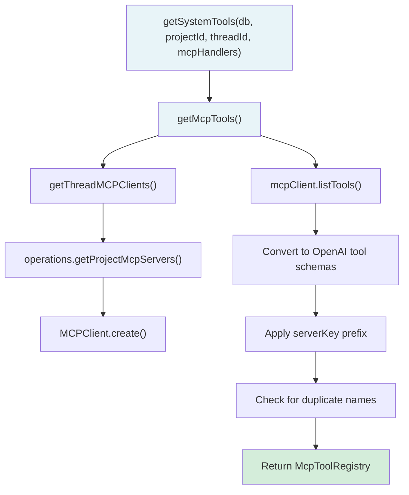
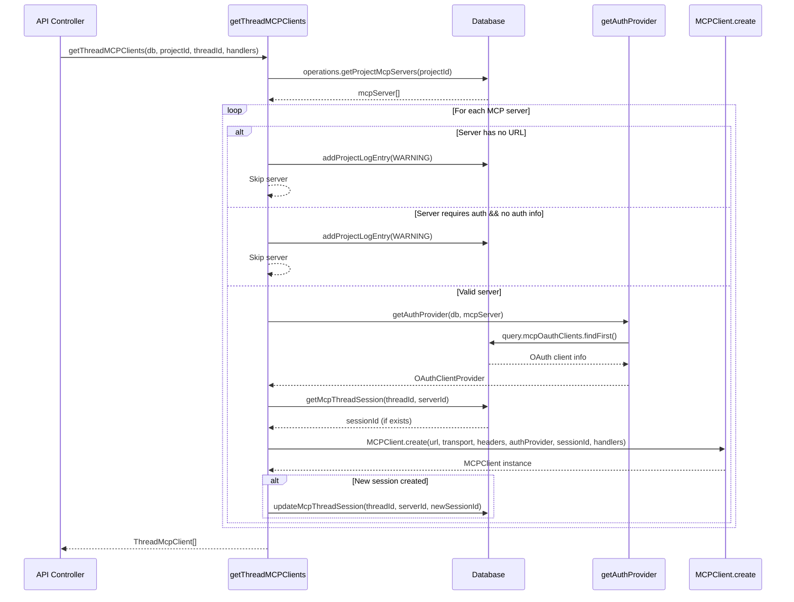
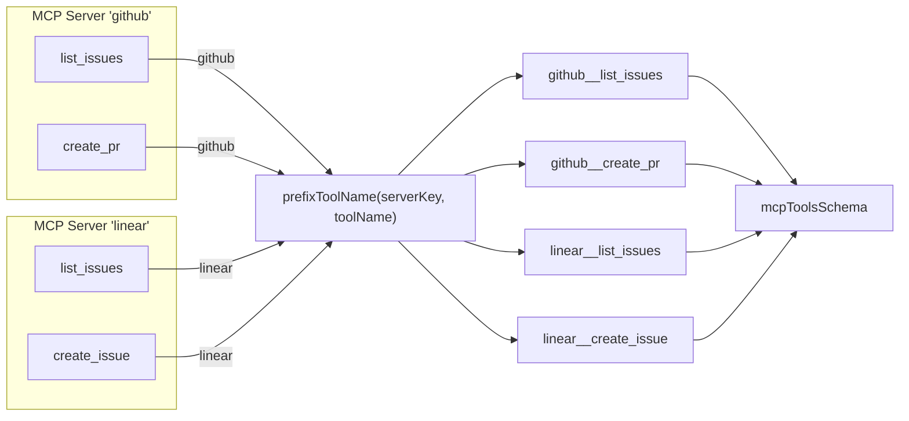
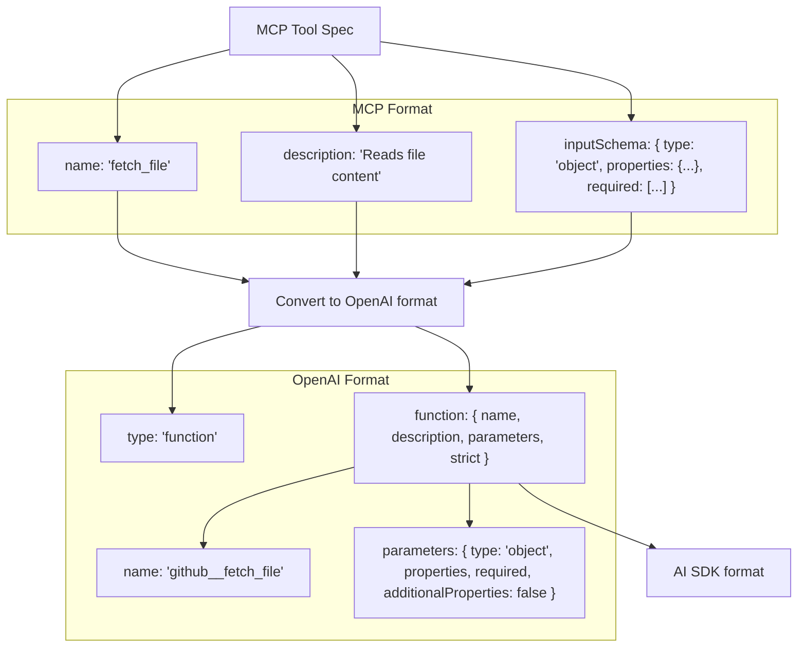
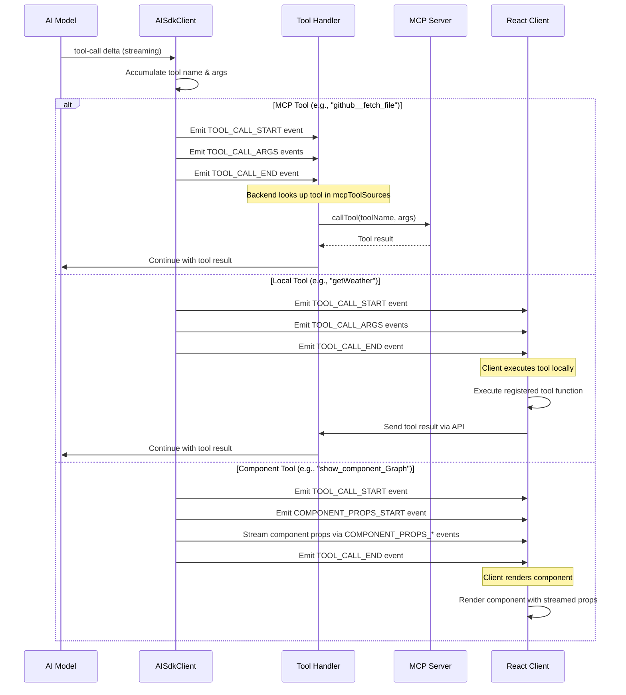

<!-- source: DeepWiki mcp.deepwiki.com · repo tambo-ai/tambo · page 7.5 Tool Execution Pipeline · fetched 2026-10-29 -->

# Tool Execution Pipeline

<details>
<summary>Relevant source files</summary>

The following files were used as context for generating this wiki page:

- [apps/api/src/threads/threads.service.test.ts](apps/api/src/threads/threads.service.test.ts)
- [apps/api/src/threads/threads.service.ts](apps/api/src/threads/threads.service.ts)
- [apps/api/src/threads/util/content.test.ts](apps/api/src/threads/util/content.test.ts)
- [apps/api/src/threads/util/content.ts](apps/api/src/threads/util/content.ts)
- [apps/api/src/threads/util/thread-state.test.ts](apps/api/src/threads/util/thread-state.test.ts)
- [apps/api/src/threads/util/thread-state.ts](apps/api/src/threads/util/thread-state.ts)
- [packages/backend/src/index.ts](packages/backend/src/index.ts)
- [packages/backend/src/services/decision-loop/decision-loop-service.ts](packages/backend/src/services/decision-loop/decision-loop-service.ts)
- [packages/backend/src/services/llm/ai-sdk-client-abort.test.ts](packages/backend/src/services/llm/ai-sdk-client-abort.test.ts)
- [packages/backend/src/services/llm/ai-sdk-client.test.ts](packages/backend/src/services/llm/ai-sdk-client.test.ts)
- [packages/backend/src/services/llm/ai-sdk-client.ts](packages/backend/src/services/llm/ai-sdk-client.ts)
- [packages/backend/src/services/llm/llm-client.ts](packages/backend/src/services/llm/llm-client.ts)
- [packages/backend/src/services/tool/tool-service.ts](packages/backend/src/services/tool/tool-service.ts)
- [packages/backend/src/tambo-backend.ts](packages/backend/src/tambo-backend.ts)
- [packages/backend/src/util/component-streaming.test.ts](packages/backend/src/util/component-streaming.test.ts)
- [packages/backend/src/util/component-streaming.ts](packages/backend/src/util/component-streaming.ts)
- [packages/core/src/ComponentDecision.ts](packages/core/src/ComponentDecision.ts)
- [packages/react-ui-base/src/toolcall-info/result/toolcall-info-result.tsx](packages/react-ui-base/src/toolcall-info/result/toolcall-info-result.tsx)
- [packages/ui-registry/src/components/thread-content/thread-content.tsx](packages/ui-registry/src/components/thread-content/thread-content.tsx)

</details>


This page documents how tool calls are processed in the Tambo Cloud backend API, from tool discovery and registration through execution and result handling. This covers the server-side execution of both MCP server tools and the coordination of client-side tools.

For information about how AI models are configured and how tool schemas are passed to models, see [AI Model Configuration](#7.4). For details on the streaming architecture that delivers tool calls to clients, see [Streaming Responses](#7.2).

## Overview

The tool execution pipeline coordinates tools from multiple sources:

| Tool Source | Execution Location | Registration Mechanism |
|-------------|-------------------|------------------------|
| **MCP Servers** | MCP server (external) | Queried via `listTools()` API, prefixed with `serverKey` |
| **Local Browser Tools** | React client | Registered via `registerTool()` in `TamboRegistryProvider` |
| **Component Tools** | Determined by AI | Generated as `show_component_*` or `update_component_props_*` |

This page focuses on the server-side coordination of MCP tools. Local browser tools are executed on the client side as documented in [Tool Registration](#3.5).

## Tool Registry Assembly

The `getSystemTools()` function is the entry point for assembling all available tools for a project and thread.



**Tool Registry Assembly Flow**

The `getSystemTools()` function returns a `McpToolRegistry` containing:

```typescript
interface McpToolRegistry {
  mcpToolsSchema: OpenAI.Chat.Completions.ChatCompletionTool[];
  mcpToolSources: Record<string, McpToolSource>;
  mcpHandlers: MCPHandlers;
}
```

- **`mcpToolsSchema`**: Array of tool definitions in OpenAI format, passed to the AI model
- **`mcpToolSources`**: Map from prefixed tool name to `{ client, serverKey }` for execution
- **`mcpHandlers`**: Callbacks for elicitation requests and sampling operations

**Sources:** [apps/api/src/common/systemTools.ts:42-72](), [packages/backend/src/services/llm/ai-sdk-client.ts:352-373]()

## MCP Client Creation

MCP clients are created for each MCP server configured in a project. The `getThreadMCPClients()` function handles authentication, session management, and error handling.



**MCP Client Creation and Session Management**

### Authentication Flow

MCP servers requiring OAuth authentication use the `OAuthLocalProvider` class to manage tokens:

1. **Client Info Lookup**: Queries `mcpOauthClients` table for client credentials
2. **Provider Creation**: Instantiates `OAuthLocalProvider` with:
   - Base URL (e.g., `http://localhost:8260`)
   - Server URL (MCP server endpoint)
   - Client information (client ID, client secret)
   - Session ID (if resuming existing session)
3. **Token Management**: Provider automatically refreshes expired tokens during requests

### Session Persistence

Each MCP client maintains a session ID that persists across requests:

- **First Connection**: `getMcpThreadSession()` returns `undefined`, client creates new session
- **Session Tracking**: If `MCPClient.sessionId` differs from database value, `updateMcpThreadSession()` saves it
- **Reconnection**: Subsequent calls reuse stored `sessionId` for stateful MCP servers

**Sources:** [apps/api/src/common/systemTools.ts:88-193](), [apps/api/src/common/systemTools.ts:305-341]()

## Tool Name Collision Handling

When multiple MCP servers provide tools with identical names, the system applies server-specific prefixes to prevent collisions.



**Tool Name Prefixing to Avoid Collisions**

### Prefix Format

All MCP tools are prefixed using the pattern: `{serverKey}__{toolName}`

- **Separator**: Double underscore (`__`) to avoid conflicts with single underscores in tool names
- **Server Key**: The `serverKey` field from the `toolProviderServers` table
- **Original Name**: The tool name returned by `mcpClient.listTools()`

### Duplicate Detection

After all tools are collected, `getSystemTools()` checks for duplicates:

```typescript
const mcpToolNames = mcpToolsSchema.map((tool) => getToolName(tool));
if (new Set(mcpToolNames).size !== mcpToolNames.length) {
  const duplicateToolNames = mcpToolNames.filter(
    (toolName, index) => mcpToolNames.indexOf(toolName) !== index,
  );
  console.warn(`Tool names must be unique, found duplicates for project ${projectId}: ${duplicateToolNames.join(", ")}`);
}
```

Duplicate tool names after prefixing indicate configuration errors (e.g., two servers with the same `serverKey`). The system logs a warning but continues with duplicate names, which may cause unpredictable behavior.

**Sources:** [apps/api/src/common/systemTools.ts:55-66](), [apps/api/src/common/systemTools.ts:248-275]()

## Tool Schema Conversion

MCP tools use JSON Schema format and must be converted to OpenAI's `ChatCompletionTool` format for the AI SDK.



**MCP to OpenAI Tool Schema Conversion**

### Conversion Process

For each MCP tool returned by `mcpClient.listTools()`:

1. **Name Prefixing**: Apply `prefixToolName(serverKey, tool.name)`
2. **Description**: Copy directly from `tool.description`
3. **Strict Mode**: Set `strict: true` to enforce schema validation
4. **Parameters**: Convert JSON Schema `inputSchema` to OpenAI parameters format:
   - Preserve `type`, `properties`, `required` fields
   - Add `additionalProperties: false` for strict schema enforcement
5. **Tool Source Tracking**: Store mapping from prefixed name to `{ client, serverKey }`

### Schema Validation

OpenAI's strict mode requires:

- All properties must be defined in `properties` object
- `required` array must list mandatory parameters
- `additionalProperties: false` prevents unexpected parameters
- Only JSON Schema Draft 7 features are supported

**Sources:** [apps/api/src/common/systemTools.ts:196-282](), [packages/backend/src/services/llm/ai-sdk-client.ts:352-373]()

## Tool Execution During Streaming

When the AI model decides to call a tool, the execution flow differs based on tool type.



**Tool Call Execution Flow by Tool Type**

### Tool Call Event Sequence

The AI SDK streaming response emits events in this order:

1. **`tool-input-start`**: Tool name is known, begins accumulating arguments
2. **`tool-input-delta`**: Chunks of JSON arguments arrive (may be multiple events)
3. **`tool-input-end`**: Arguments complete but not yet validated
4. **`tool-call`**: Tool call is complete with `toolCallId`, arguments are validated JSON

These events are converted to AG-UI events:

- `EventType.TOOL_CALL_START`: Signals tool execution beginning
- `EventType.TOOL_CALL_ARGS`: Streams argument deltas for progressive display
- `EventType.TOOL_CALL_END`: Marks completion of tool call information

### MCP Tool Execution

MCP tools are executed server-side:

1. **Tool Lookup**: Use `mcpToolSources[toolName]` to find the `{ client, serverKey }`
2. **Name Unprefixing**: Strip the `serverKey__` prefix to get the original tool name
3. **Tool Call**: Invoke `mcpClient.callTool(originalName, args)`
4. **Result Handling**: Parse result and add to message history for AI continuation

### Component Streaming

Component tool calls trigger additional AG-UI events for progressive prop rendering:

- `EventType.COMPONENT_PROPS_START`: Component rendering begins
- `EventType.COMPONENT_PROPS_DELTA`: Individual prop values arrive
- `EventType.COMPONENT_PROPS_END`: All props received, component ready

The `ComponentStreamTracker` class in the backend detects `show_component_*` tool names and emits these events during `tool-input-delta` processing.

**Sources:** [packages/backend/src/services/llm/ai-sdk-client.ts:430-674](), [packages/backend/src/util/component-streaming.ts]()

## Resource Fetching

MCP resources (accessed via `@mentions` in the UI) are fetched through a separate mechanism from tools.

### Resource Fetcher Map

The `createResourceFetcherMap()` function creates a mapping from server keys to resource fetcher functions:

```typescript
export function createResourceFetcherMap(
  mcpClients: ThreadMcpClient[],
): Record<string, (uri: string) => Promise<ReadResourceResult>> {
  const fetchers: Record<string, (uri: string) => Promise<ReadResourceResult>> = {};

  for (const { client, serverKey } of mcpClients) {
    if (!serverKey) continue;

    fetchers[serverKey] = async (uri: string) => {
      // Validate URI has serverKey prefix
      if (!uri.startsWith(`${serverKey}:`)) {
        throw new Error(`Invalid URI for server ${serverKey}: ${uri}`);
      }
      // Strip prefix and fetch from MCP server
      const mcpUri = uri.slice(serverKey.length + 1);
      return await client.client.readResource({ uri: mcpUri });
    };
  }

  return fetchers;
}
```

### Resource URI Format

Resources are addressed using the pattern: `{serverKey}:{mcpUri}`

- **Server Key Prefix**: Identifies which MCP server owns the resource
- **Colon Separator**: Distinguishes server key from MCP-native URI
- **MCP URI**: The actual URI understood by the MCP server (e.g., `file:///path/to/file.txt`)

When fetching a resource:

1. Parse the `{serverKey}:` prefix to determine which MCP client to use
2. Strip the prefix to get the original MCP URI
3. Call `mcpClient.readResource({ uri: mcpUri })` to fetch content
4. Return the `ReadResourceResult` containing resource contents

**Sources:** [apps/api/src/common/systemTools.ts:343-376]()

## Error Handling

The tool execution pipeline includes multiple error handling layers:

### Server Discovery Errors

- **Missing URL**: Servers without URLs are skipped, warning logged to project log
- **Auth Required but Missing**: Servers requiring auth without credentials are skipped
- **Connection Failures**: Caught per-server, logged, and excluded from tool registry

### Tool Listing Errors

The `ListToolsError` class wraps errors from `mcpClient.listTools()` with context:

```typescript
class ListToolsError extends Error {
  constructor(
    message: string,
    public readonly serverId: string,
    public readonly url: string,
    cause?: unknown,
  ) {
    super(message, { cause });
    this.name = "ListToolsError";
  }
}
```

Errors during tool listing:
- Are caught per-server using `Promise.allSettled()`
- Are logged with server ID and URL for debugging
- Are recorded in the project log with `LogLevel.ERROR`
- Do not block other servers from being processed

### Partial Success Model

The system continues operating even when some MCP servers fail:

1. **Per-Server Isolation**: Each server is processed independently
2. **Graceful Degradation**: Failed servers are excluded, successful servers provide tools
3. **Observable Failures**: All errors are logged to both console and project logs
4. **No Silent Failures**: The "fail-fast, no fallbacks" principle applies within each server, but server-level failures don't cascade

**Sources:** [apps/api/src/common/systemTools.ts:28-39](), [apps/api/src/common/systemTools.ts:166-181](), [apps/api/src/common/systemTools.ts:224-244]()

---

