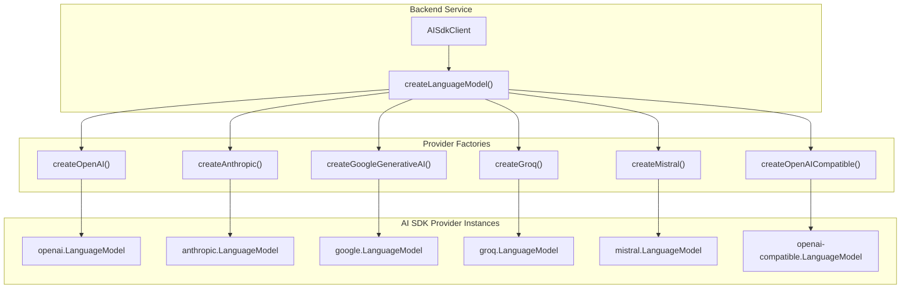
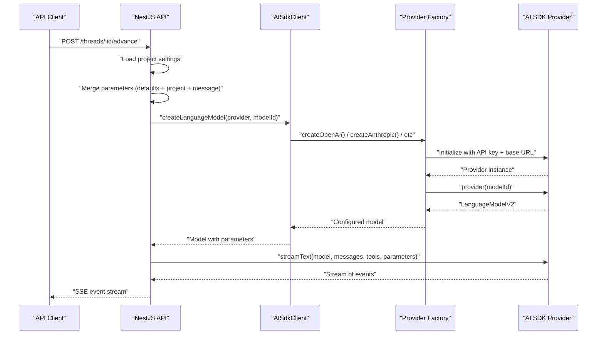

<!-- source: DeepWiki mcp.deepwiki.com · repo tambo-ai/tambo · page 7.7 AI Model Configuration · fetched 2026-10-29 -->

# AI Model Configuration

<details>
<summary>Relevant source files</summary>

The following files were used as context for generating this wiki page:

- [.config/release-please/.release-please-manifest.json](.config/release-please/.release-please-manifest.json)
- [CONTRIBUTING.md](CONTRIBUTING.md)
- [apps/api/CHANGELOG.md](apps/api/CHANGELOG.md)
- [apps/api/package.json](apps/api/package.json)
- [apps/api/src/threads/threads.service.test.ts](apps/api/src/threads/threads.service.test.ts)
- [apps/api/src/threads/threads.service.ts](apps/api/src/threads/threads.service.ts)
- [apps/api/src/threads/util/content.test.ts](apps/api/src/threads/util/content.test.ts)
- [apps/api/src/threads/util/content.ts](apps/api/src/threads/util/content.ts)
- [apps/api/src/threads/util/thread-state.test.ts](apps/api/src/threads/util/thread-state.test.ts)
- [apps/api/src/threads/util/thread-state.ts](apps/api/src/threads/util/thread-state.ts)
- [apps/docs-mcp/package.json](apps/docs-mcp/package.json)
- [apps/test-mcp-server/package.json](apps/test-mcp-server/package.json)
- [apps/web/CHANGELOG.md](apps/web/CHANGELOG.md)
- [apps/web/package.json](apps/web/package.json)
- [cli/CHANGELOG.md](cli/CHANGELOG.md)
- [cli/package.json](cli/package.json)
- [create-tambo-app/CHANGELOG.md](create-tambo-app/CHANGELOG.md)
- [create-tambo-app/package.json](create-tambo-app/package.json)
- [docs/CHANGELOG.md](docs/CHANGELOG.md)
- [docs/package.json](docs/package.json)
- [package-lock.json](package-lock.json)
- [package.json](package.json)
- [packages/backend/package.json](packages/backend/package.json)
- [packages/backend/src/index.ts](packages/backend/src/index.ts)
- [packages/backend/src/services/decision-loop/decision-loop-service.ts](packages/backend/src/services/decision-loop/decision-loop-service.ts)
- [packages/backend/src/services/llm/ai-sdk-client-abort.test.ts](packages/backend/src/services/llm/ai-sdk-client-abort.test.ts)
- [packages/backend/src/services/llm/ai-sdk-client.test.ts](packages/backend/src/services/llm/ai-sdk-client.test.ts)
- [packages/backend/src/services/llm/ai-sdk-client.ts](packages/backend/src/services/llm/ai-sdk-client.ts)
- [packages/backend/src/services/llm/llm-client.ts](packages/backend/src/services/llm/llm-client.ts)
- [packages/backend/src/services/tool/tool-service.ts](packages/backend/src/services/tool/tool-service.ts)
- [packages/backend/src/tambo-backend.ts](packages/backend/src/tambo-backend.ts)
- [packages/backend/src/util/component-streaming.test.ts](packages/backend/src/util/component-streaming.test.ts)
- [packages/backend/src/util/component-streaming.ts](packages/backend/src/util/component-streaming.ts)
- [packages/core/package.json](packages/core/package.json)
- [packages/core/src/ComponentDecision.ts](packages/core/src/ComponentDecision.ts)
- [packages/eslint-config/package.json](packages/eslint-config/package.json)
- [packages/react-ui-base/CHANGELOG.md](packages/react-ui-base/CHANGELOG.md)
- [packages/react-ui-base/package.json](packages/react-ui-base/package.json)
- [packages/react-ui-base/src/toolcall-info/result/toolcall-info-result.tsx](packages/react-ui-base/src/toolcall-info/result/toolcall-info-result.tsx)
- [packages/testing/package.json](packages/testing/package.json)
- [packages/ui-registry/package.json](packages/ui-registry/package.json)
- [packages/ui-registry/src/components/thread-content/thread-content.tsx](packages/ui-registry/src/components/thread-content/thread-content.tsx)
- [react-sdk/CHANGELOG.md](react-sdk/CHANGELOG.md)
- [react-sdk/package.json](react-sdk/package.json)
- [showcase/CHANGELOG.md](showcase/CHANGELOG.md)
- [showcase/package.json](showcase/package.json)

</details>


This document describes the AI model configuration system in the Tambo Cloud backend. It covers the AI SDK Client architecture, multi-provider support, model parameter configuration, and the parameter hierarchy that governs how settings are applied.

For information about streaming AI responses to clients, see [Streaming Responses](#7.2). For information about tool execution during AI generation, see [Tool Execution Pipeline](#7.3).

## AI SDK Client Architecture

The backend uses Vercel AI SDK as the foundation for multi-provider LLM integration. The `AISdkClient` class [packages/backend/src/services/llm/ai-sdk-client.ts:37-326]() provides a unified interface for creating and configuring language models regardless of provider.



**Sources:** [packages/backend/src/services/llm/ai-sdk-client.ts:1-326]()

The `createLanguageModel` method [packages/backend/src/services/llm/ai-sdk-client.ts:41-148]() accepts a provider name and model identifier, returning a configured `LanguageModelV2` instance from the appropriate AI SDK provider package.

## Supported Providers

Tambo supports six LLM provider categories, each with its own SDK integration:

| Provider | SDK Package | Environment Variable | Example Models |
|----------|-------------|---------------------|----------------|
| OpenAI | `@ai-sdk/openai` | `OPENAI_API_KEY` | `gpt-4o`, `gpt-4o-mini`, `o1`, `o3-mini` |
| Anthropic | `@ai-sdk/anthropic` | `ANTHROPIC_API_KEY` | `claude-3-5-sonnet-latest`, `claude-3-5-haiku-latest`, `claude-opus-4` |
| Google | `@ai-sdk/google` | `GOOGLE_GENERATIVE_AI_API_KEY` | `gemini-2.0-flash-exp`, `gemini-1.5-pro` |
| Groq | `@ai-sdk/groq` | `GROQ_API_KEY` | `llama-3.3-70b-versatile`, `mixtral-8x7b-32768` |
| Mistral | `@ai-sdk/mistral` | `MISTRAL_API_KEY` | `mistral-large-latest`, `codestral-latest` |
| Cerebras | `@ai-sdk/openai-compatible` | `CEREBRAS_API_KEY` | `llama-3.3-70b`, `llama3.1-8b` |
| OpenAI-Compatible | `@ai-sdk/openai-compatible` | Varies | Any OpenAI API-compatible endpoint |

**Sources:** [packages/backend/src/services/llm/ai-sdk-client.ts:41-148](), [packages/backend/src/model/providers.ts:1-11](), [apps/api/package.json:32-36]()

The provider type definitions [packages/backend/src/model/providers.ts:1-11]() enumerate all supported providers:

```typescript
type Provider =
  | "openai"
  | "mistral"
  | "anthropic"
  | "bedrock"
  | "gemini"
  | "groq"
  | "cerebras"
  | "openai-compatible";
```

## Model Configuration Parameters

Each model request can be configured with multiple parameters that control generation behavior. The `ModelParameters` interface defines the available settings:

| Parameter | Type | Description |
|-----------|------|-------------|
| `temperature` | `number` | Controls randomness (0.0 = deterministic, 2.0 = very random) |
| `maxTokens` | `number` | Maximum tokens to generate |
| `topP` | `number` | Nucleus sampling threshold (0.0-1.0) |
| `frequencyPenalty` | `number` | Penalizes token repetition based on frequency |
| `presencePenalty` | `number` | Penalizes token repetition based on presence |
| `seed` | `number` | Random seed for deterministic sampling |
| `thinking` | `ReasoningConfig` | Configuration for reasoning models |

**Sources:** [packages/backend/src/services/llm/ai-sdk-client.ts:16-35]()

### Reasoning Model Configuration

Reasoning models (like OpenAI's o1, o3-mini, or Anthropic's extended thinking mode) expose their internal reasoning process. The `ReasoningConfig` interface [packages/backend/src/services/llm/ai-sdk-client.ts:24-35]() controls this behavior:

```typescript
interface ReasoningConfig {
  budget?: "low" | "medium" | "high";
  effort?: "low" | "medium" | "high";
  enabled?: boolean;
}
```

When `thinking.enabled` is true, the model's reasoning tokens are captured separately from the final response and can be streamed to the client.

**Sources:** [packages/backend/src/services/llm/ai-sdk-client.ts:24-35](), [docs/content/docs/models/reasoning-models.mdx:1-150]()

## Parameter Hierarchy

Model parameters follow a three-level hierarchy, with later levels overriding earlier ones:


**Sources:** [packages/backend/src/services/llm/ai-sdk-client.ts:41-148]()

### 1. Provider Defaults

Each provider has default parameter values based on its API characteristics. These are the baseline settings when no other configuration is provided.

### 2. Project Settings

Projects can configure default model parameters in their settings [packages/db/src/operations/thread.ts:1-500](). These override provider defaults and apply to all messages within that project.

### 3. Per-Message Overrides

Individual messages can specify custom parameters [packages/backend/src/services/llm/ai-sdk-client.ts:41-148]() that override both provider defaults and project settings. This provides maximum flexibility for specific use cases.

## Model Instantiation Flow

The following diagram shows how a model instance is created and configured:



**Sources:** [packages/backend/src/services/llm/ai-sdk-client.ts:41-148](), [apps/api/src/threads/threads.controller.ts]()

### Provider-Specific Configuration

Each provider factory applies provider-specific configuration:

**OpenAI** [packages/backend/src/services/llm/ai-sdk-client.ts:55-69]():
- API key from `OPENAI_API_KEY`
- Optional organization ID from `OPENAI_ORG_ID`
- Optional base URL override
- Supports structured outputs and tool calling

**Anthropic** [packages/backend/src/services/llm/ai-sdk-client.ts:70-82]():
- API key from `ANTHROPIC_API_KEY`
- Optional base URL override
- Supports extended thinking mode for reasoning models

**Google** [packages/backend/src/services/llm/ai-sdk-client.ts:83-95]():
- API key from `GOOGLE_GENERATIVE_AI_API_KEY`
- Optional base URL override
- Uses Gemini models

**Groq** [packages/backend/src/services/llm/ai-sdk-client.ts:96-108]():
- API key from `GROQ_API_KEY`
- Optional base URL override
- Fast inference for open-source models

**Mistral** [packages/backend/src/services/llm/ai-sdk-client.ts:109-121]():
- API key from `MISTRAL_API_KEY`
- Optional base URL override
- Supports Mistral and Codestral models

**Cerebras** [packages/backend/src/services/llm/ai-sdk-client.ts:122-134]():
- API key from `CEREBRAS_API_KEY`
- Base URL: `https://api.cerebras.ai/v1`
- Uses OpenAI-compatible SDK with Cerebras endpoint

**OpenAI-Compatible** [packages/backend/src/services/llm/ai-sdk-client.ts:135-147]():
- Requires custom base URL and API key
- Supports any service implementing OpenAI's API format
- Allows integration with local models, proxies, or custom endpoints

**Sources:** [packages/backend/src/services/llm/ai-sdk-client.ts:55-147]()

## Environment Variables

The backend requires provider-specific API keys to be configured as environment variables:

| Variable | Provider | Required |
|----------|----------|----------|
| `OPENAI_API_KEY` | OpenAI | For OpenAI models |
| `ANTHROPIC_API_KEY` | Anthropic | For Claude models |
| `GOOGLE_GENERATIVE_AI_API_KEY` | Google | For Gemini models |
| `GROQ_API_KEY` | Groq | For Groq models |
| `MISTRAL_API_KEY` | Mistral | For Mistral models |
| `CEREBRAS_API_KEY` | Cerebras | For Cerebras models |
| `OPENAI_ORG_ID` | OpenAI | Optional organization ID |

**Sources:** [packages/backend/src/services/llm/ai-sdk-client.ts:41-148](), [apps/api/package.json:27-70]()

---

