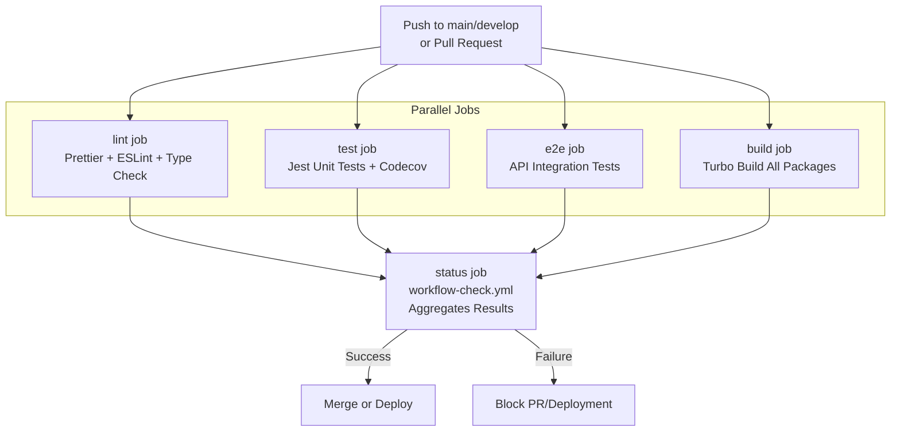
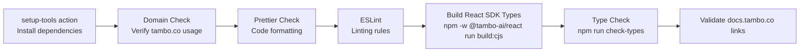
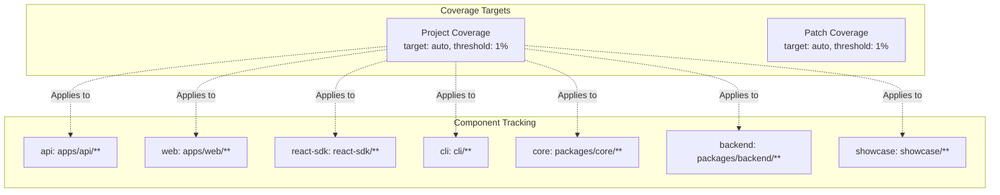
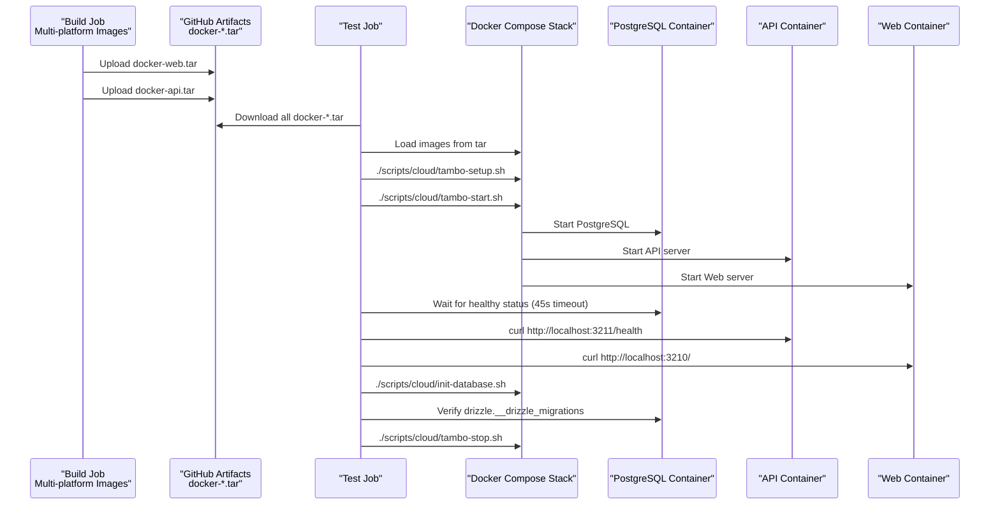
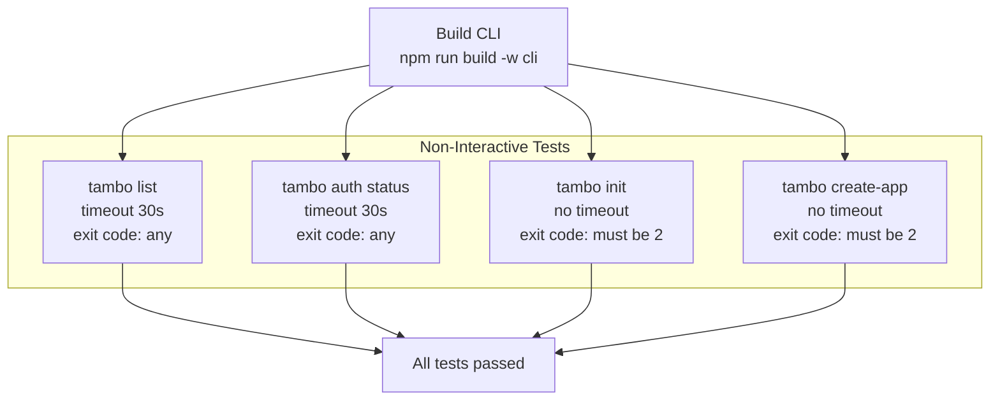

<!-- source: DeepWiki mcp.deepwiki.com · repo tambo-ai/tambo · page 8.3 Testing Infrastructure · fetched 2026-10-29 -->

# Testing Infrastructure

<details>
<summary>Relevant source files</summary>

The following files were used as context for generating this wiki page:

- [.config/release-please/release-please-config.json](.config/release-please/release-please-config.json)
- [.github/codecov.yml](.github/codecov.yml)
- [.github/dependabot.yml](.github/dependabot.yml)
- [.github/labels.yml](.github/labels.yml)
- [.github/renovate.json5](.github/renovate.json5)
- [.github/workflows/automation-labels.yml](.github/workflows/automation-labels.yml)
- [.github/workflows/ci.yml](.github/workflows/ci.yml)
- [.github/workflows/claude.yml](.github/workflows/claude.yml)
- [.github/workflows/cli-non-interactive.yml](.github/workflows/cli-non-interactive.yml)
- [.github/workflows/conventional-commits.yml](.github/workflows/conventional-commits.yml)
- [.github/workflows/docker.yml](.github/workflows/docker.yml)
- [.github/workflows/mcp-everything-docker-cloud.yml](.github/workflows/mcp-everything-docker-cloud.yml)
- [.github/workflows/migrate-db.yml](.github/workflows/migrate-db.yml)
- [.github/workflows/release-please-sync-lockfile.yml](.github/workflows/release-please-sync-lockfile.yml)
- [.github/workflows/release-please.yml](.github/workflows/release-please.yml)
- [.github/workflows/stainless-cloud.yml](.github/workflows/stainless-cloud.yml)
- [.github/workflows/template-maintenance.yml](.github/workflows/template-maintenance.yml)
- [.github/workflows/workflow-check.yml](.github/workflows/workflow-check.yml)
- [.node-version](.node-version)
- [.nvmrc](.nvmrc)
- [.prettierrc](.prettierrc)
- [mise.toml](mise.toml)
- [packages/react-ui-base/LICENSE](packages/react-ui-base/LICENSE)
- [packages/react-ui-base/eslint.config.mjs](packages/react-ui-base/eslint.config.mjs)
- [packages/react-ui-base/jest.config.ts](packages/react-ui-base/jest.config.ts)
- [packages/react-ui-base/lint-staged.config.mjs](packages/react-ui-base/lint-staged.config.mjs)
- [plans/fix-fork-pr-labeling.md](plans/fix-fork-pr-labeling.md)
- [react-sdk/src/v1/hooks/use-tambo-current-message.tsx](react-sdk/src/v1/hooks/use-tambo-current-message.tsx)
- [react-sdk/src/v1/hooks/use-tambo-v1-auth-state.ts](react-sdk/src/v1/hooks/use-tambo-v1-auth-state.ts)
- [react-sdk/src/v1/types/auth.ts](react-sdk/src/v1/types/auth.ts)

</details>


This document describes the testing infrastructure used throughout the Tambo monorepo, including test framework configuration, CI test workflows, coverage reporting, and specialized test types. For information about the broader CI/CD pipeline including release automation and deployments, see [CI/CD Pipeline](#8.2).

## Overview

The Tambo testing infrastructure uses Jest as the primary test framework, with specialized testing approaches for different package types:

- **Unit tests**: React SDK, packages, CLI
- **E2E tests**: API server integration tests
- **Docker integration tests**: Full-stack validation with PostgreSQL
- **Non-interactive tests**: CLI command validation in CI environments
- **Coverage tracking**: Codecov with component-level reporting

Tests run in parallel during CI via the `.github/workflows/ci.yml` workflow, with results aggregated by the `workflow-check.yml` reusable workflow.

**Sources:** [.github/workflows/ci.yml:1-172](), [.github/codecov.yml:1-70]()

---

## CI Test Workflow Architecture

The CI workflow runs four parallel test jobs that execute on every push to `main`/`develop` and all pull requests:



**Diagram: CI Workflow Parallel Test Execution**

Each job uses the reusable `.github/actions/setup-tools` action to configure the environment with Node.js, npm, and dependencies. The `status` job uses `workflow-check.yml` to fail if any upstream job does not have result `success` or `skipped`.

**Sources:** [.github/workflows/ci.yml:16-172](), [.github/workflows/workflow-check.yml:1-45]()

---

## Test Configuration Structure

### Jest Configuration

The monorepo uses Jest with TypeScript support via `ts-jest`. The `packages/react-ui-base/jest.config.ts` demonstrates the standard configuration pattern:

| Configuration Key | Purpose |
|------------------|---------|
| `preset: "ts-jest/presets/default-esm"` | Enable ESM module support |
| `testEnvironment: "jsdom"` | Browser-like environment for React components |
| `extensionsToTreatAsEsm: [".ts", ".tsx"]` | Treat TypeScript files as ESM |
| `moduleNameMapper` | Map React imports to single instance at monorepo root |
| `setupFilesAfterEnv` | Shared test setup file |
| `transformIgnorePatterns: ["/node_modules/"]` | Skip transforming dependencies |

The `moduleNameMapper` is critical for preventing React version conflicts in the monorepo:

```typescript
moduleNameMapper: {
  // Ensure single React instance - point to monorepo root node_modules
  "^react$": "<rootDir>/../../node_modules/react",
  "^react-dom$": "<rootDir>/../../node_modules/react-dom",
  // Mock @tambo-ai/react for testing
  "^@tambo-ai/react$": "<rootDir>/../ui-registry/__tests__/__mocks__/@tambo-ai-react.ts",
}
```

**Sources:** [packages/react-ui-base/jest.config.ts:1-39]()

---

## CI Job Details

### Lint Job

The lint job runs code quality checks in sequence:



**Diagram: Lint Job Steps**

The domain check uses `git grep` to detect incorrect domain usage (`.ai`, `.com` instead of `.co`), avoiding false positives like `.component` files:

```bash
# Pattern matches: tambo.ai/, tambo.ai:443
# Excludes: tambo.component, tambo.company
PAT_AI="${BASE}\.ai([^[:alnum:]-]|$)"
PAT_COM="${BASE}\.com([^[:alnum:]-]|$)"
```

**Sources:** [.github/workflows/ci.yml:17-104]()

### Test Job

The test job runs all Jest unit tests with coverage collection:

```bash
npm run test -- -- --coverage
```

The double `--` is necessary because:
1. First `--`: npm delimiter to pass args to the underlying command
2. Second `--`: Turbo delimiter to pass args to the wrapped script

Coverage is uploaded to Codecov using the `codecov-action@v5.5.2` with the configuration at `.github/codecov.yml`. The action is pinned to a specific SHA for security.

**Sources:** [.github/workflows/ci.yml:105-127]()

### E2E Job

The E2E job runs integration tests for the API package:

```bash
npm run test:e2e -w @tambo-ai-cloud/api
```

This executes the test suite defined in `apps/api/test/` which tests HTTP endpoints and business logic.

**Sources:** [.github/workflows/ci.yml:128-142]()

### Build Job

The build job validates that all packages compile successfully:

```bash
npm run build
```

It provides dummy environment variables for build-time validation:

| Variable | Dummy Value | Purpose |
|----------|-------------|---------|
| `DATABASE_URL` | `postgresql://dummy-user:...` | Required by Drizzle schema |
| `API_KEY_SECRET` | `dummy-api-key-secret` | Encryption key for API keys |
| `NEXTAUTH_SECRET` | `dummy-nextauth-secret` | NextAuth.js session secret |
| `SKIP_ENV_VALIDATION` | `"true"` | Skip runtime env checks |

**Sources:** [.github/workflows/ci.yml:143-164]()

---

## Codecov Configuration

The `.github/codecov.yml` file configures coverage requirements and component-level tracking:



**Diagram: Codecov Component Coverage Tracking**

The configuration uses `target: auto` which dynamically adjusts the required coverage based on historical values, with a 1% threshold to prevent small regressions. Comment layout is configured as `"header, diff, components"` to show component-level details on PRs.

**Sources:** [.github/codecov.yml:1-70]()

---

## Docker Integration Tests

The Docker workflow includes a comprehensive integration test suite that validates the full stack:



**Diagram: Docker Integration Test Flow**

The test validates:
1. **Health checks**: PostgreSQL container reports healthy status
2. **API availability**: `/health` endpoint responds
3. **Web availability**: Root endpoint responds
4. **Database initialization**: Migrations table exists with expected schema

Health check waits use `timeout 45` with `bash -c` loops to prevent infinite hangs:

```bash
# Wait for PostgreSQL to be healthy
timeout 45 bash -c 'until docker inspect --format={{.State.Health.Status}} tambo_postgres 2>/dev/null | grep -q ^healthy$; do sleep 3; done'

# Wait for API to be ready
timeout 45 bash -c 'until curl -fso /dev/null http://localhost:3211/health 2>/dev/null; do sleep 3; done'
```

**Sources:** [.github/workflows/docker.yml:143-228]()

---

## CLI Non-Interactive Testing

The `.github/workflows/cli-non-interactive.yml` workflow ensures CLI commands don't hang in CI environments by:

1. Testing commands complete within 30s timeout
2. Verifying correct exit codes for non-interactive scenarios
3. Using `timeout` command to enforce limits



**Diagram: CLI Non-Interactive Test Cases**

The tests verify that commands requiring interactive input return exit code `2` (guidance needed) in non-TTY environments:

```bash
# init without args should return guidance (exit 2)
set +e  # Disable errexit to capture exit code
node ./cli/dist/cli.js init
code=$?
set -e  # Re-enable errexit
if [ $code -ne 2 ]; then
  echo "Expected exit code 2, got $code"
  exit 1
fi
```

This prevents commands from hanging indefinitely waiting for user input when run in CI/CD pipelines.

**Sources:** [.github/workflows/cli-non-interactive.yml:1-73]()

---

## Test Execution Patterns

### Local Development

```bash
# Run all tests
npm run test

# Run tests for specific workspace
npm run test -w @tambo-ai/react

# Run tests with coverage
npm run test -- -- --coverage

# Run E2E tests
npm run test:e2e -w @tambo-ai-cloud/api
```

### CI Execution

Tests in CI benefit from:
- **Turbo caching**: Build artifacts and test results cached via `TURBO_TOKEN`
- **Parallel execution**: Four jobs run simultaneously
- **Concurrency control**: `cancel-in-progress: true` cancels outdated runs
- **Required status checks**: All jobs must pass for PR merge

The CI workflow uses concurrency groups to prevent duplicate runs:

```yaml
concurrency:
  group: ${{ github.workflow }}-${{ github.ref_name }}
  cancel-in-progress: true
```

**Sources:** [.github/workflows/ci.yml:9-11]()

---

## Test File Patterns

Jest test discovery follows these patterns:

| Pattern | Location | Purpose |
|---------|----------|---------|
| `**/*.test.ts` | Anywhere | TypeScript unit tests |
| `**/*.test.tsx` | Anywhere | React component tests |
| `test/**` | Package root | Integration tests |
| `__tests__/**` | Anywhere | Test fixtures/utilities |

The Jest configuration explicitly ignores:
- `/node_modules/` - Dependencies
- `/dist/` - Build output
- Test files in coverage: `**/*.test.ts`, `**/*.test.tsx`

**Sources:** [packages/react-ui-base/jest.config.ts:30-31](), [.github/codecov.yml:62-69]()

---

## Workflow Status Aggregation

The `workflow-check.yml` reusable workflow provides a single status check by validating all upstream jobs:

```yaml
# Usage in ci.yml
status:
  needs: [lint, test, e2e, build]
  if: ${{ always() }}
  uses: ./.github/workflows/workflow-check.yml
  with:
    json-needs: ${{ toJSON(needs) }}
    error-message: "One or more of the CI jobs have failed..."
```

The check job iterates through the `needs` JSON and fails if any job result is not `success` or `skipped`:

```bash
JOBS=$(jq -c '.[]' <<< "$JSON_NEEDS")

while read -r job; do
  JOB_RESULT=$(jq -r '.result' <<< "$job")
  
  if [[ $JOB_RESULT != 'success' && $JOB_RESULT != 'skipped' ]]; then
    echo "::error title=Condition Failed::${ERROR_MESSAGE}"
    exit 1
  fi
done <<< "$JOBS"
```

This pattern allows setting a single required status check (`status`) instead of requiring each individual job, simplifying branch protection rules.

**Sources:** [.github/workflows/ci.yml:165-171](), [.github/workflows/workflow-check.yml:18-44]()

---

## Environment Setup

The `.github/actions/setup-tools` composite action standardizes environment setup across all test jobs:

1. **Checkout repository**: `actions/checkout@v6`
2. **Setup Node.js**: `actions/setup-node@v6` with npm cache
3. **Pin npm version**: `npm install -g npm@11.7.0`
4. **Install dependencies**: `npm ci`

All workflows reference this action for consistency:

```yaml
- name: Setup tools
  uses: ./.github/actions/setup-tools
```

For test jobs that need to modify `package-lock.json` (e.g., release-please lockfile sync), the action accepts a `frozen: false` parameter.

**Sources:** [.github/workflows/ci.yml:26-27](), [.github/workflows/release-please-sync-lockfile.yml:26-28]()

---

## Test Dependencies Management

Test-related dependencies are grouped in Dependabot for efficient updates:

```yaml
groups:
  testing:
    patterns:
      - "jest"
      - "@types/jest"
      - "jest-*"
      - "ts-jest"
      - "@testing-library/*"
      - "supertest"
```

This creates a single PR for all testing dependency updates, reducing maintenance overhead. Updates are scheduled weekly on Mondays.

**Sources:** [.github/dependabot.yml:80-87]()

---

## Test Isolation and Mocking

React tests require careful dependency isolation to avoid version conflicts. The Jest configuration ensures a single React instance:

```typescript
// packages/react-ui-base/jest.config.ts
moduleNameMapper: {
  "^react$": "<rootDir>/../../node_modules/react",
  "^react-dom$": "<rootDir>/../../node_modules/react-dom",
  "^react-dom/(.*)$": "<rootDir>/../../node_modules/react-dom/$1",
  "^react/jsx-runtime$": "<rootDir>/../../node_modules/react/jsx-runtime",
}
```

The SDK is mocked for component tests to prevent circular dependencies:

```typescript
"^@tambo-ai/react$": "<rootDir>/../ui-registry/__tests__/__mocks__/@tambo-ai-react.ts"
```

Test setup files (e.g., `setupFilesAfterEnv`) configure global test utilities like `@testing-library/jest-dom` matchers.

**Sources:** [packages/react-ui-base/jest.config.ts:8-21](), [packages/react-ui-base/jest.config.ts:32]()

---

