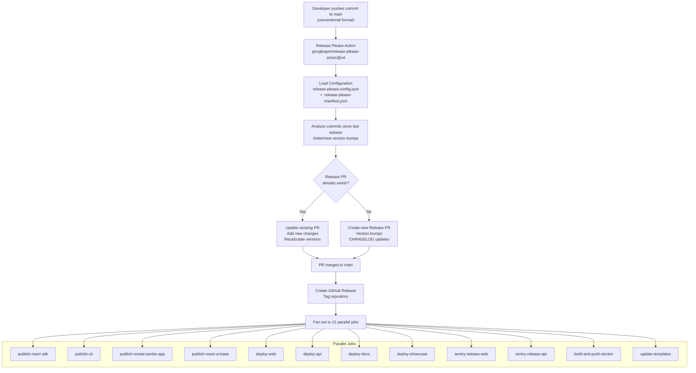
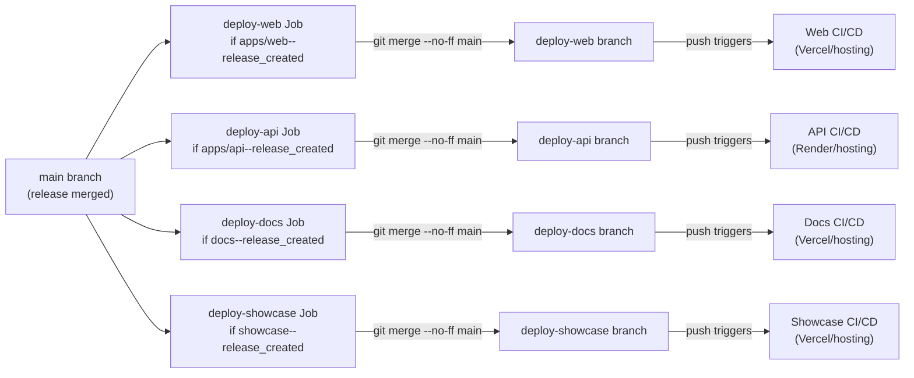
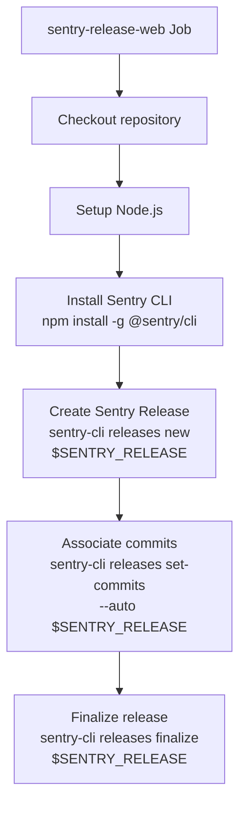
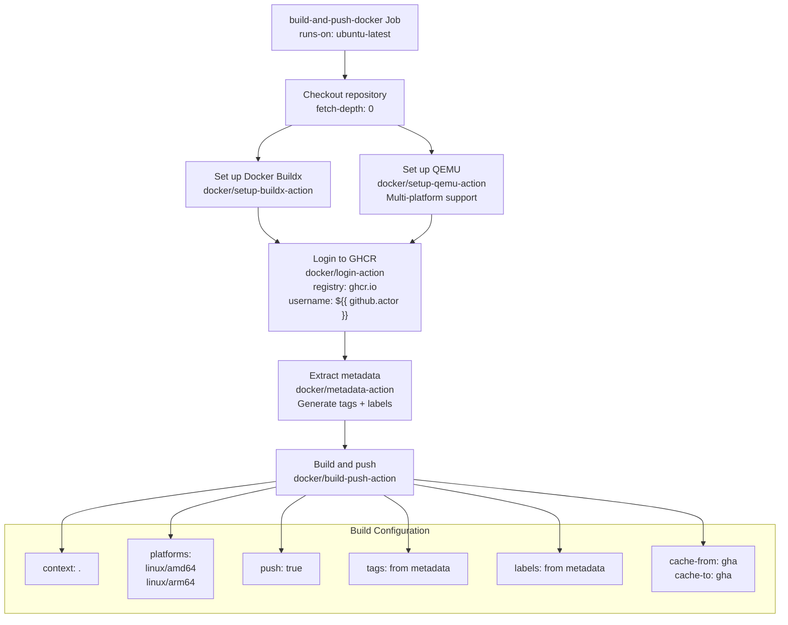
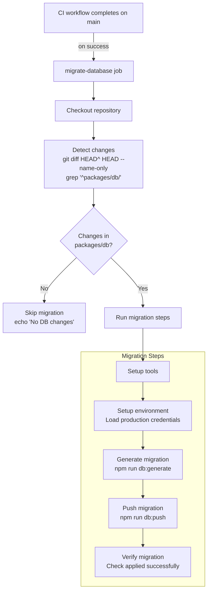
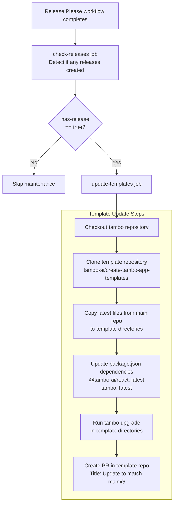

<!-- source: DeepWiki mcp.deepwiki.com · repo tambo-ai/tambo · page 8.5 Release Process · fetched 2026-10-29 -->

# Release Process

<details>
<summary>Relevant source files</summary>

The following files were used as context for generating this wiki page:

- [.config/release-please/.release-please-manifest.json](.config/release-please/.release-please-manifest.json)
- [.github/workflows/ci.yml](.github/workflows/ci.yml)
- [.github/workflows/claude.yml](.github/workflows/claude.yml)
- [.github/workflows/cli-non-interactive.yml](.github/workflows/cli-non-interactive.yml)
- [.github/workflows/docker.yml](.github/workflows/docker.yml)
- [.github/workflows/mcp-everything-docker-cloud.yml](.github/workflows/mcp-everything-docker-cloud.yml)
- [.github/workflows/migrate-db.yml](.github/workflows/migrate-db.yml)
- [.github/workflows/release-please-sync-lockfile.yml](.github/workflows/release-please-sync-lockfile.yml)
- [.github/workflows/release-please.yml](.github/workflows/release-please.yml)
- [.github/workflows/stainless-cloud.yml](.github/workflows/stainless-cloud.yml)
- [.github/workflows/template-maintenance.yml](.github/workflows/template-maintenance.yml)
- [apps/api/CHANGELOG.md](apps/api/CHANGELOG.md)
- [apps/api/package.json](apps/api/package.json)
- [apps/docs-mcp/package.json](apps/docs-mcp/package.json)
- [apps/test-mcp-server/package.json](apps/test-mcp-server/package.json)
- [apps/web/CHANGELOG.md](apps/web/CHANGELOG.md)
- [apps/web/package.json](apps/web/package.json)
- [cli/CHANGELOG.md](cli/CHANGELOG.md)
- [cli/package.json](cli/package.json)
- [create-tambo-app/CHANGELOG.md](create-tambo-app/CHANGELOG.md)
- [create-tambo-app/package.json](create-tambo-app/package.json)
- [docs/CHANGELOG.md](docs/CHANGELOG.md)
- [docs/package.json](docs/package.json)
- [package-lock.json](package-lock.json)
- [package.json](package.json)
- [packages/backend/package.json](packages/backend/package.json)
- [packages/core/package.json](packages/core/package.json)
- [packages/eslint-config/package.json](packages/eslint-config/package.json)
- [packages/react-ui-base/CHANGELOG.md](packages/react-ui-base/CHANGELOG.md)
- [packages/react-ui-base/package.json](packages/react-ui-base/package.json)
- [packages/testing/package.json](packages/testing/package.json)
- [packages/ui-registry/package.json](packages/ui-registry/package.json)
- [react-sdk/CHANGELOG.md](react-sdk/CHANGELOG.md)
- [react-sdk/package.json](react-sdk/package.json)
- [showcase/CHANGELOG.md](showcase/CHANGELOG.md)
- [showcase/package.json](showcase/package.json)

</details>


This document describes the automated release process for the Tambo AI monorepo, including version management, package publishing, deployment workflows, and database migrations. The system uses conventional commits and Release Please to automate version bumping, changelog generation, and distribution across NPM packages and deployment environments.

For information about CI/CD pipelines and testing, see [8.2](#8.2). For database migration specifics, see [8.4](#8.4).

## Overview

The Tambo repository employs a fully automated release workflow that:
- Detects conventional commits on the `main` branch
- Creates or updates release PRs with version bumps and changelogs
- Publishes packages to NPM upon merge
- Deploys applications to environment-specific branches
- Triggers database migrations when schema changes are detected
- Updates template repositories with latest component versions

The release process is orchestrated by the Release Please GitHub Action, which creates a single PR that aggregates all changes across the monorepo's packages and applications.

**Sources:** [.github/workflows/release-please.yml:1-310](), [.config/release-please/.release-please-manifest.json:1-2]()

## Conventional Commits Standard

### Commit Message Format

The release system relies on conventional commit messages to determine version bumps and generate changelogs. Commits must follow this format:

```
<type>(<scope>): <description>

[optional body]

[optional footer]
```

**Commit Types and Version Impact:**

| Commit Type | Version Bump | Example |
|-------------|--------------|---------|
| `fix:` | PATCH | `fix(react-sdk): resolve memory leak in event accumulator` |
| `feat:` | MINOR | `feat(api): add v1 thread cancellation endpoint` |
| `BREAKING CHANGE:` footer | MAJOR | Any commit with `BREAKING CHANGE:` in footer |
| `chore:`, `docs:`, `style:` | No release | Changelog only |

**Valid Scopes:**
- `react-sdk` - [@tambo-ai/react](react-sdk/package.json:2-3)()
- `cli` - [tambo](cli/package.json:2-3)()
- `api` - [@tambo-ai-cloud/api](apps/api/package.json:2-3)()
- `web` - [@tambo-ai-cloud/web](apps/web/package.json:2-3)()
- `docs` - [@tambo-ai/docs](docs/package.json:2-3)()
- `showcase` - [@tambo-ai/showcase](showcase/package.json:2-3)()

**Sources:** [.github/workflows/release-please.yml:36-40](), [react-sdk/CHANGELOG.md:1-282]()

## Release Please Workflow

### Trigger Conditions

The release workflow runs on:
```yaml
on:
  workflow_dispatch:  # Manual trigger
  push:
    branches:
      - main
```

It uses a concurrency group `release-please-${{ github.ref }}` to prevent simultaneous releases.

**Sources:** [.github/workflows/release-please.yml:3-11]()

### Release Creation Process



**Sources:** [.github/workflows/release-please.yml:17-40]()

### Configuration Files

**Version Manifest** (`.config/release-please/.release-please-manifest.json`):
```json
{
  "react-sdk": "1.0.0",
  "showcase": "0.37.0",
  "cli": "0.51.0",
  "create-tambo-app": "0.2.3",
  "docs": "1.26.1",
  "apps/web": "0.132.1",
  "apps/api": "0.143.0",
  "packages/react-ui-base": "0.1.0-alpha.3"
}
```

This manifest tracks the current version of each releasable package. Release Please updates these values when creating releases.

**Sources:** [.config/release-please/.release-please-manifest.json:1-2]()

### Release Please Outputs

The `release-please` job produces outputs that control downstream jobs:

```yaml
outputs:
  react-sdk--release_created: ${{ steps.release.outputs.react-sdk--release_created }}
  cli--release_created: ${{ steps.release.outputs.cli--release_created }}
  create-tambo-app--release_created: ${{ steps.release.outputs.create-tambo-app--release_created }}
  # ... additional outputs for each package
  tag_name: ${{ steps.release.outputs.tag_name }}
```

These boolean outputs indicate which packages had releases created, allowing conditional job execution.

**Sources:** [.github/workflows/release-please.yml:19-32]()

## NPM Package Publishing

### Publishing Workflow

```mermaid
graph TB
    subgraph "publish-react-sdk Job"
        Check1["Check if react-sdk--release_created == true"]
        Checkout1["Checkout repository<br/>actions/checkout@v6"]
        Setup1["Setup tools<br/>./.github/actions/setup-tools"]
        NPMSetup1["Setup npm registry<br/>actions/setup-node@v6<br/>registry-url: npmjs.org"]
        Build1["Build: npx turbo build<br/>--filter=@tambo-ai/react"]
        Publish1["npm publish --access public<br/>working-directory: ./react-sdk"]
    end
    
    subgraph "publish-cli Job"
        Check2["Check if cli--release_created == true"]
        Checkout2["Checkout repository"]
        Setup2["Setup tools"]
        NPMSetup2["Setup npm registry"]
        Build2["Build: npx turbo build<br/>--filter=tambo"]
        Publish2["npm publish --access public<br/>working-directory: ./cli"]
    end
    
    subgraph "publish-create-tambo-app Job"
        Check3["Check if create-tambo-app--release_created == true"]
        Checkout3["Checkout repository"]
        Setup3["Setup tools"]
        NPMSetup3["Setup npm registry"]
        Build3["Build: npx turbo build<br/>--filter=create-tambo-app"]
        Publish3["npm publish --access public<br/>working-directory: ./create-tambo-app"]
    end
    
    subgraph "publish-react-ui-base Job"
        Check4["Check if packages/react-ui-base--release_created == true"]
        Checkout4["Checkout repository"]
        Setup4["Setup tools"]
        NPMSetup4["Setup npm registry"]
        Build4["Build: npx turbo build<br/>--filter=@tambo-ai/react-ui-base"]
        Publish4["npm publish --access public --tag next<br/>working-directory: ./packages/react-ui-base"]
    end
    
    Check1 --> Checkout1 --> Setup1 --> NPMSetup1 --> Build1 --> Publish1
    Check2 --> Checkout2 --> Setup2 --> NPMSetup2 --> Build2 --> Publish2
    Check3 --> Checkout3 --> Setup3 --> NPMSetup3 --> Build3 --> Publish3
    Check4 --> Checkout4 --> Setup4 --> NPMSetup4 --> Build4 --> Publish4
```



### Published Packages

| Package Name | Working Directory | Filter | Tag |
|--------------|-------------------|--------|-----|
| @tambo-ai/react | `./react-sdk` | `@tambo-ai/react` | `latest` |
| tambo | `./cli` | `tambo` | `latest` |
| create-tambo-app | `./create-tambo-app` | `create-tambo-app` | `latest` |
| @tambo-ai/react-ui-base | `./packages/react-ui-base` | `@tambo-ai/react-ui-base` | `next` |

The `@tambo-ai/react-ui-base` package is published with the `--tag next` flag, indicating it's in alpha/beta status.

**Sources:** [.github/workflows/release-please.yml:43-153](), [react-sdk/package.json:2-3](), [cli/package.json:2-3](), [create-tambo-app/package.json:2-3](), [packages/react-ui-base/package.json:2-3]()

### OIDC Authentication

All NPM publishing jobs use OpenID Connect (OIDC) for authentication:

```yaml
permissions:
  contents: read
  id-token: write  # Required for OIDC publishing to NPM
```

This eliminates the need for long-lived NPM tokens in GitHub Secrets. The GitHub Actions runner obtains a short-lived token directly from NPM.

**Sources:** [.github/workflows/release-please.yml:47-49]()

## Application Deployment

### Deployment Strategy

Applications deploy via git branch merges rather than direct builds. Each application has a dedicated deployment branch that triggers environment-specific CI/CD pipelines.



### Deployment Job Template

Each deployment job follows this pattern:

```yaml
deploy-web:
  needs: release-please
  runs-on: ubuntu-latest
  if: ${{ needs.release-please.outputs['apps/web--release_created'] == 'true' }}
  steps:
    - uses: actions/checkout@v6
      with:
        fetch-depth: 0
        token: ${{ secrets.RELEASE_PLEASE_TOKEN }}
    
    - name: Setup Git User
      run: |
        git config --global user.name "GitHub Actions Bot"
        git config --global user.email "actions@github.com"
    
    - name: Merge main into deploy-web
      run: |
        git checkout deploy-web
        git merge --no-ff main -m "chore: merge main into deploy-web for release $TAG_NAME"
        git push origin deploy-web
```

The `--no-ff` (no fast-forward) flag ensures a merge commit is always created, preserving deployment history.

**Sources:** [.github/workflows/release-please.yml:155-220]()

## Sentry Release Tracking

### Sentry Release Job



Sentry releases are created for both web and API applications when their respective `--release_created` outputs are true. The release name format is:

```bash
SENTRY_RELEASE="${{ needs.release-please.outputs.tag_name }}"
```

This correlates error tracking with specific deployed versions.

**Sources:** [.github/workflows/release-please.yml:223-270]()

## Docker Image Publishing

### Docker Build Workflow

The `build-and-push-docker` job runs on any release creation and builds multi-platform Docker images:



The images are published to GitHub Container Registry (GHCR) at `ghcr.io/tambo-ai/tambo`.

**Sources:** [.github/workflows/release-please.yml:273-310]()

## Database Migration Workflow

### Migration Trigger

Database migrations run separately from the main release workflow, triggered when changes are detected in the `packages/db` directory:

```yaml
name: Migrate Database
on:
  workflow_run:
    workflows: ["CI"]
    types:
      - completed
    branches:
      - main
```

### Migration Detection



**Migration Commands:**
- `npm run db:generate` - Generates migration SQL from Drizzle schema changes
- `npm run db:push` - Applies migration to production database

**Sources:** [.github/workflows/migrate-db.yml:1-95]()

## Template Repository Maintenance

### Automated Template Updates

The template maintenance workflow updates the `create-tambo-app` template repositories after successful releases:



This ensures that `create-tambo-app` always scaffolds projects with the latest package versions and component configurations.

**Sources:** [.github/workflows/template-maintenance.yml:1-150]()

## Version Manifest Management

### Package Version Tracking

The release manifest at `.config/release-please/.release-please-manifest.json` is the single source of truth for all package versions:

| Package | Current Version | Last Release |
|---------|----------------|--------------|
| @tambo-ai/react | 1.0.0 | 2026-02-10 |
| tambo (CLI) | 0.51.0 | 2026-01-31 |
| create-tambo-app | 0.2.3 | 2026-01-27 |
| @tambo-ai/docs | 1.26.1 | 2026-02-10 |
| @tambo-ai/showcase | 0.37.0 | 2026-02-10 |
| @tambo-ai-cloud/web | 0.132.1 | 2026-02-10 |
| @tambo-ai-cloud/api | 0.143.0 | 2026-02-10 |
| @tambo-ai/react-ui-base | 0.1.0-alpha.3 | 2026-02-10 |

Release Please automatically updates this manifest when creating releases, incrementing versions according to conventional commit types.

**Sources:** [.config/release-please/.release-please-manifest.json:1-2](), [react-sdk/package.json:2-3](), [cli/package.json:2-3](), [create-tambo-app/package.json:2-3](), [docs/package.json:2-3](), [showcase/package.json:2-3](), [apps/web/package.json:2-3](), [apps/api/package.json:2-3](), [packages/react-ui-base/package.json:2-3]()

## Changelog Generation

### Automated Changelog Updates

Release Please generates and maintains CHANGELOG.md files for each package following the Keep a Changelog format:

**Changelog Structure:**
```markdown
# Changelog

## [1.0.0](github-compare-url) (2026-02-10)

### Features
* **scope:** description ([#PR](pr-url)) ([commit](commit-url))

### Bug Fixes
* **scope:** description ([#PR](pr-url)) ([commit](commit-url))

### BREAKING CHANGES
* description of breaking change
```

**Example from React SDK:**
```markdown
## [1.0.0-rc.5](https://github.com/tambo-ai/tambo/compare/react-v1.0.0-rc.4...react-v1.0.0-rc.5) (2026-02-10)

### Features
* **api:** expose parentMessageId on V1 messages and SDK ([#2349](https://github.com/tambo-ai/tambo/issues/2349)) ([fcd9ffc](https://github.com/tambo-ai/tambo/commit/fcd9ffcd0da0b23cece51f3b87a9b5deca73dd63))
```

Changelogs are updated in the release PR before merge, ensuring they're always synchronized with published versions.

**Sources:** [react-sdk/CHANGELOG.md:1-20](), [cli/CHANGELOG.md:1-20](), [docs/CHANGELOG.md:1-20]()

## Release Workflow Permissions

### Required Permissions

The release workflow requires specific GitHub token permissions:

```yaml
# release-please job
permissions:
  contents: write      # Create releases and tags
  pull-requests: write # Create/update release PRs

# NPM publishing jobs
permissions:
  contents: read
  id-token: write     # OIDC authentication to NPM

# Deployment jobs
permissions:
  contents: write     # Push to deployment branches
```

The workflow uses `${{ secrets.RELEASE_PLEASE_TOKEN }}` (a GitHub PAT) for operations requiring elevated permissions, such as triggering subsequent workflows from deployment branch pushes.

**Sources:** [.github/workflows/release-please.yml:13-21](), [.github/workflows/release-please.yml:47-49](), [.github/workflows/release-please.yml:157-162]()

## Manual Release Triggers

### Workflow Dispatch

Releases can be manually triggered via the GitHub Actions UI:

```yaml
on:
  workflow_dispatch:  # Manual trigger
  push:
    branches:
      - main
```

This is useful for:
- Forcing a release when commits don't follow conventional format
- Creating releases during hotfix scenarios
- Testing release automation

The workflow behavior is identical whether triggered manually or by push.

**Sources:** [.github/workflows/release-please.yml:3-7]()

## Concurrency Control

### Preventing Simultaneous Releases

The release workflow uses a concurrency group to prevent overlapping executions:

```yaml
concurrency:
  group: release-please-${{ github.ref }}
```

This ensures:
- Only one release process runs at a time
- No conflicts when updating version manifests
- Predictable release ordering

If a new release is triggered while one is in progress, the new one waits for completion rather than running in parallel.

**Sources:** [.github/workflows/release-please.yml:10-11]()

---

