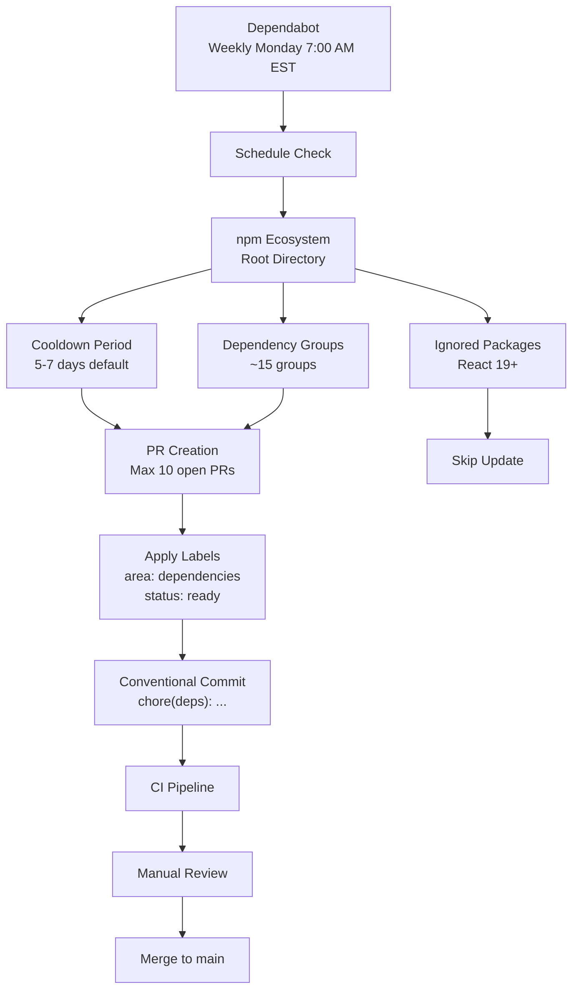
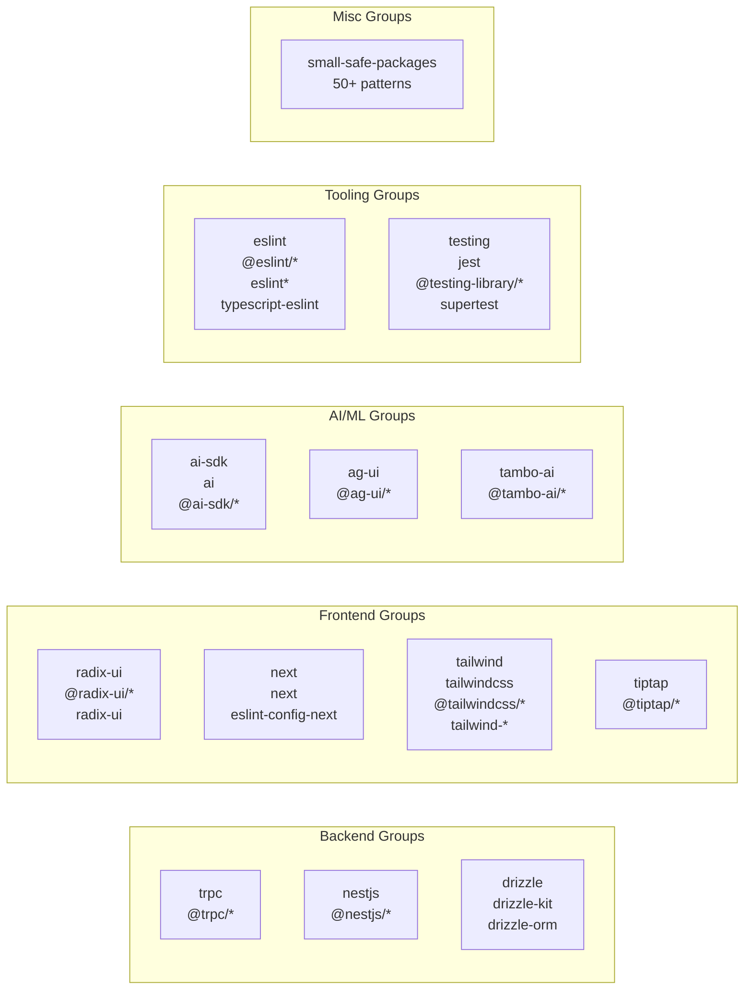
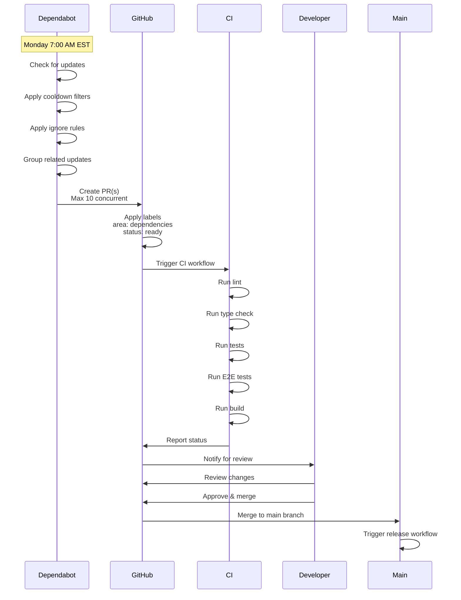
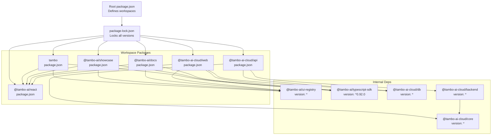

<!-- source: DeepWiki mcp.deepwiki.com · repo tambo-ai/tambo · page 8.6 Dependency Management · fetched 2026-10-29 -->

# Dependency Management

<details>
<summary>Relevant source files</summary>

The following files were used as context for generating this wiki page:

- [.config/release-please/.release-please-manifest.json](.config/release-please/.release-please-manifest.json)
- [.config/release-please/release-please-config.json](.config/release-please/release-please-config.json)
- [.github/codecov.yml](.github/codecov.yml)
- [.github/dependabot.yml](.github/dependabot.yml)
- [.github/labels.yml](.github/labels.yml)
- [.github/renovate.json5](.github/renovate.json5)
- [.github/workflows/automation-labels.yml](.github/workflows/automation-labels.yml)
- [.github/workflows/conventional-commits.yml](.github/workflows/conventional-commits.yml)
- [.github/workflows/workflow-check.yml](.github/workflows/workflow-check.yml)
- [.node-version](.node-version)
- [.nvmrc](.nvmrc)
- [.prettierrc](.prettierrc)
- [apps/api/CHANGELOG.md](apps/api/CHANGELOG.md)
- [apps/api/package.json](apps/api/package.json)
- [apps/docs-mcp/package.json](apps/docs-mcp/package.json)
- [apps/test-mcp-server/package.json](apps/test-mcp-server/package.json)
- [apps/web/CHANGELOG.md](apps/web/CHANGELOG.md)
- [apps/web/package.json](apps/web/package.json)
- [cli/CHANGELOG.md](cli/CHANGELOG.md)
- [cli/package.json](cli/package.json)
- [create-tambo-app/CHANGELOG.md](create-tambo-app/CHANGELOG.md)
- [create-tambo-app/package.json](create-tambo-app/package.json)
- [docs/CHANGELOG.md](docs/CHANGELOG.md)
- [docs/package.json](docs/package.json)
- [mise.toml](mise.toml)
- [package-lock.json](package-lock.json)
- [package.json](package.json)
- [packages/backend/package.json](packages/backend/package.json)
- [packages/core/package.json](packages/core/package.json)
- [packages/eslint-config/package.json](packages/eslint-config/package.json)
- [packages/react-ui-base/CHANGELOG.md](packages/react-ui-base/CHANGELOG.md)
- [packages/react-ui-base/LICENSE](packages/react-ui-base/LICENSE)
- [packages/react-ui-base/eslint.config.mjs](packages/react-ui-base/eslint.config.mjs)
- [packages/react-ui-base/jest.config.ts](packages/react-ui-base/jest.config.ts)
- [packages/react-ui-base/lint-staged.config.mjs](packages/react-ui-base/lint-staged.config.mjs)
- [packages/react-ui-base/package.json](packages/react-ui-base/package.json)
- [packages/testing/package.json](packages/testing/package.json)
- [packages/ui-registry/package.json](packages/ui-registry/package.json)
- [plans/fix-fork-pr-labeling.md](plans/fix-fork-pr-labeling.md)
- [react-sdk/CHANGELOG.md](react-sdk/CHANGELOG.md)
- [react-sdk/package.json](react-sdk/package.json)
- [react-sdk/src/v1/hooks/use-tambo-current-message.tsx](react-sdk/src/v1/hooks/use-tambo-current-message.tsx)
- [react-sdk/src/v1/hooks/use-tambo-v1-auth-state.ts](react-sdk/src/v1/hooks/use-tambo-v1-auth-state.ts)
- [react-sdk/src/v1/types/auth.ts](react-sdk/src/v1/types/auth.ts)
- [showcase/CHANGELOG.md](showcase/CHANGELOG.md)
- [showcase/package.json](showcase/package.json)

</details>


This document covers the automated dependency management system used in the Tambo monorepo, including Dependabot configuration, dependency grouping strategies, version constraints, and the update workflow. For information about database migrations and schema changes, see [Database Migrations](#8.4). For information about the release and versioning process, see [Release Process](#8.5).

---

## Purpose and Scope

The Tambo monorepo manages dependencies across multiple packages (React SDK, CLI, showcase, docs, and cloud applications) using npm workspaces and automated tooling. This document describes:

- Automated dependency update infrastructure via Dependabot
- Package manager configuration and lock file strategy
- Dependency grouping and batching strategies
- Version constraints and compatibility policies
- The workflow from dependency update to merge

---

## Automation Infrastructure

### Dependabot Configuration

Dependency updates are automated using GitHub Dependabot, configured in [.github/dependabot.yml:1-120](). The system runs weekly updates on Mondays at 7:00 AM EST.

**Configuration Structure:**



**Sources:** [.github/dependabot.yml:1-120]()

### Update Schedule and Limits

The system enforces limits to prevent overwhelming the team with dependency PRs:

| Parameter | Value | Purpose |
|-----------|-------|---------|
| `interval` | `weekly` | Update frequency |
| `day` | `monday` | Day of week for updates |
| `open-pull-requests-limit` | `10` | Maximum concurrent PRs |
| `cooldown.default-days` | `5` | Waiting period for stable packages |
| `cooldown.semver-major-days` | `7` | Longer wait for major versions |
| `cooldown.semver-minor-days` | `4` | Medium wait for minor versions |
| `cooldown.semver-patch-days` | `2` | Short wait for patches |

**Cooldown Exclusions:** Packages excluded from cooldown periods to ensure rapid updates:
- `@tambo-ai/*` - All Tambo internal packages
- `ai` - Vercel AI SDK
- `@ai-sdk/*` - AI SDK provider packages

**Sources:** [.github/dependabot.yml:34-46]()

---

## Dependency Grouping Strategy

Dependencies are organized into semantic groups to batch related updates together, reducing PR noise and ensuring compatibility.

### Defined Groups



**Sources:** [.github/dependabot.yml:57-120]()

### Group Definitions Table

| Group Name | Patterns | Purpose |
|------------|----------|---------|
| `trpc` | `@trpc/*` | tRPC framework for type-safe APIs |
| `nestjs` | `@nestjs/*` | NestJS backend framework |
| `radix-ui` | `@radix-ui/*`, `radix-ui` | Radix UI component primitives |
| `drizzle` | `drizzle-kit`, `drizzle-orm` | Database ORM and migrations |
| `eslint` | `@eslint/*`, `eslint`, `typescript-eslint`, `eslint-plugin-*`, `eslint-config-*` | Linting infrastructure |
| `testing` | `jest`, `@types/jest`, `jest-*`, `ts-jest`, `@testing-library/*`, `supertest` | Testing frameworks and utilities |
| `ai-sdk` | `ai`, `@ai-sdk/*` | Vercel AI SDK for LLM integration |
| `react` | `react`, `react-dom`, `@types/react*` (excluding v19+) | React framework |
| `next` | `next`, `eslint-config-next` | Next.js framework |
| `tailwind` | `tailwindcss`, `@tailwindcss/*`, `tailwind-*` | Tailwind CSS styling |
| `tiptap` | `@tiptap/*` | TipTap rich text editor |
| `tambo-ai` | `@tambo-ai/*` | Internal Tambo packages |
| `ag-ui` | `@ag-ui/*` | Agent UI framework |
| `small-safe-packages` | 50+ individual packages | Low-risk utility packages |

**Sources:** [.github/dependabot.yml:57-120]()

---

## Package Manager Configuration

### npm and Workspaces

The monorepo uses npm with workspaces defined in [package.json:45-53]():

```
workspaces:
  - react-sdk
  - showcase
  - docs
  - cli
  - create-tambo-app
  - packages/*
  - apps/*
```

**Package Manager Version Enforcement:**

[package.json:44]() specifies:
```
"packageManager": "npm@11.7.0+sha512.c22099a6fff8d5b2286c2a09df5352b4858a7c0c716320f58989d60ad8b29ecf2ce6fdfe97ccb41c23ffb1272e1fa079f868487dd6b81d02a2a9e199c095a117"
```

This ensures all developers and CI use the exact same npm version via Corepack.

**Sources:** [package.json:1-70]()

### Volta Configuration

Node.js and npm versions are managed via Volta for consistent environments:

[package.json:66-69]():
```json
{
  "volta": {
    "node": "22.22.0",
    "npm": "11.7.0"
  }
}
```

**Sources:** [package.json:66-69]()

### Lock File Strategy

A single [package-lock.json]() at the root manages all workspace dependencies, ensuring deterministic installs across all packages. The lock file uses `lockfileVersion: 3` and contains:

- Top-level dependencies for the monorepo
- Workspace package dependencies and their resolutions
- Nested `node_modules` for packages with conflicting version requirements

**Sources:** [package-lock.json:1-10]()

---

## Version Constraints and Compatibility

### Ignored Packages

Certain packages are permanently ignored to prevent breaking changes:

[.github/dependabot.yml:48-56]():
```yaml
ignore:
  - dependency-name: "react"
    versions: [">=19"]
  - dependency-name: "react-dom"
    versions: [">=19"]
  - dependency-name: "@types/react"
    versions: [">=19"]
  - dependency-name: "@types/react-dom"
    versions: [">=19"]
```

**Rationale:** React 19 introduces breaking changes that require significant refactoring. The codebase remains on React 18 until migration is planned.

**Sources:** [.github/dependabot.yml:48-56]()

### Peer Dependencies

The React SDK defines strict peer dependencies to ensure compatibility with consumer projects:

[react-sdk/package.json:61-77]():
```json
{
  "peerDependencies": {
    "@modelcontextprotocol/sdk": "^1.26.0",
    "@types/react": "^18.0.0 || ^19.0.0",
    "@types/react-dom": "^18.0.0 || ^19.0.0",
    "react": "^18.0.0 || ^19.0.0",
    "react-dom": "^18.0.0 || ^19.0.0",
    "zod": "^3.25.76 || ^4",
    "zod-to-json-schema": "^3.25.1"
  },
  "peerDependenciesMeta": {
    "@modelcontextprotocol/sdk": {
      "optional": true
    },
    "zod-to-json-schema": {
      "optional": true
    }
  }
}
```

**Optional Peer Dependencies:** MCP SDK and Zod JSON Schema are optional because:
- `@modelcontextprotocol/sdk` - Only needed if using MCP features
- `zod-to-json-schema` - Only needed if using Zod schemas (not required for Valibot/ArkType)

**Sources:** [react-sdk/package.json:61-77]()

### Engine Requirements

Packages specify minimum Node.js versions:

[cli/package.json:45-47]():
```json
{
  "engines": {
    "node": ">=22"
  }
}
```

[create-tambo-app/package.json:38-40]():
```json
{
  "engines": {
    "node": ">=22"
  }
}
```

**Sources:** [cli/package.json:45-47](), [create-tambo-app/package.json:38-40]()

---

## Update Workflow



**Sources:** [.github/dependabot.yml:1-120]()

### Conventional Commit Format

All Dependabot PRs use conventional commits with the `chore` type:

[.github/dependabot.yml:29-32]():
```yaml
commit-message:
  prefix: "chore"
  prefix-development: "chore"
  include: "scope"
```

**Example commit messages:**
- `chore(deps): bump the eslint group with 4 updates`
- `chore(deps): bump @tambo-ai/typescript-sdk from 0.88.0 to 0.89.0`
- `chore(deps-dev): bump @types/node from 22.19.7 to 22.19.8`

**Sources:** [.github/dependabot.yml:29-32](), [react-sdk/CHANGELOG.md:35-101]()

### Label Assignment

All dependency PRs receive standardized labels for filtering and triage:

[.github/dependabot.yml:33]():
```yaml
labels: ["area: dependencies", "status: ready"]
```

These labels:
- Enable filtering dependency PRs in GitHub
- Integrate with automated label workflows
- Indicate PRs are ready for review without additional setup

**Sources:** [.github/dependabot.yml:33]()

---

## Internal Dependencies

### Workspace Dependencies

Internal packages use the `*` version specifier for workspace dependencies to always resolve to the local version:

**Example from [react-sdk/package.json:78-93]():**
```json
{
  "dependencies": {
    "@ag-ui/core": "^0.0.43",
    "@tambo-ai/typescript-sdk": "^0.92.0"
  }
}
```

**Example from [cli/package.json:57-84]():**
```json
{
  "dependencies": {
    "@tambo-ai/react": "*",
    "@tambo-ai/typescript-sdk": "^0.92.0"
  },
  "devDependencies": {
    "@tambo-ai/ui-registry": "*"
  }
}
```

**Patterns:**
- `*` - Local workspace packages (always use local version)
- `^x.y.z` - Published packages (use semantic versioning)

**Sources:** [react-sdk/package.json:78-93](), [cli/package.json:57-84]()

### Dependency Resolution Flow



**Sources:** [package.json:45-53](), [cli/package.json:57-84](), [showcase/package.json:19-66](), [docs/package.json:16-40](), [apps/web/package.json:19-117](), [apps/api/package.json:27-76]()

---

## CI Integration

### Dependency Update Validation

All dependency PRs trigger the full CI pipeline defined in `.github/workflows/*.yml`:

1. **Lint** - ESLint validation across all packages
2. **Type Check** - TypeScript compilation without emit
3. **Test** - Jest unit tests with coverage
4. **E2E** - End-to-end integration tests
5. **Build** - Production build verification

Only PRs passing all checks can be merged.

**Sources:** [.github/workflows/workflow-check.yml:1-53]()

### Automated vs Manual Review

**Automated Approval Candidates:**
- Patch version updates (x.y.Z) in the `small-safe-packages` group
- DevDependencies updates for build tools (Prettier, ESLint plugins)

**Requires Manual Review:**
- Major version updates (X.y.z)
- Minor version updates (x.Y.z) for core dependencies
- Updates to `@tambo-ai/*`, `react`, `next`, `ai`, `@ai-sdk/*`
- Any update affecting peer dependencies

**Sources:** [.github/dependabot.yml:34-46]()

---

## Summary

The Tambo dependency management system uses Dependabot to automate weekly updates with intelligent grouping, cooldown periods, and ignore rules. The monorepo structure with npm workspaces enables shared dependency resolution via a single lock file, while internal packages use workspace references (`*`) for local dependencies. All updates follow conventional commits, receive standardized labels, and undergo full CI validation before merge.

**Key Files:**
- [.github/dependabot.yml]() - Dependabot configuration
- [package.json]() - Root workspace configuration
- [package-lock.json]() - Dependency lock file
- [.github/workflows/conventional-commits.yml]() - PR title validation
- [react-sdk/package.json]() - React SDK peer dependencies

---

