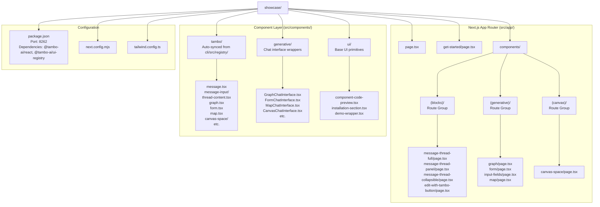
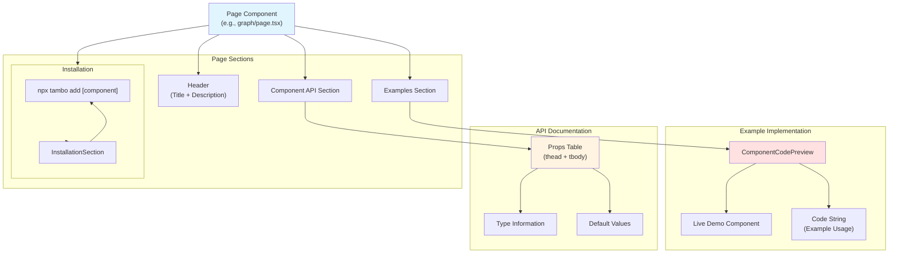
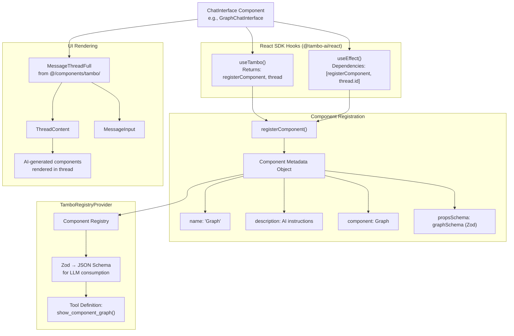
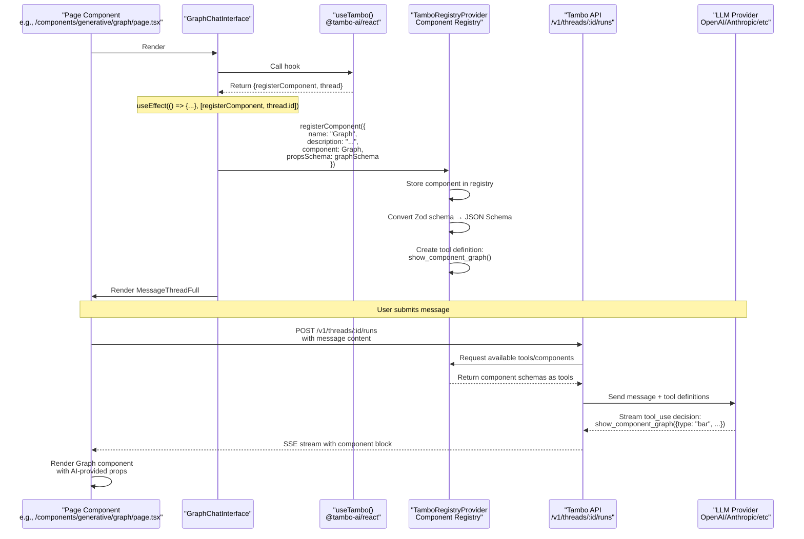
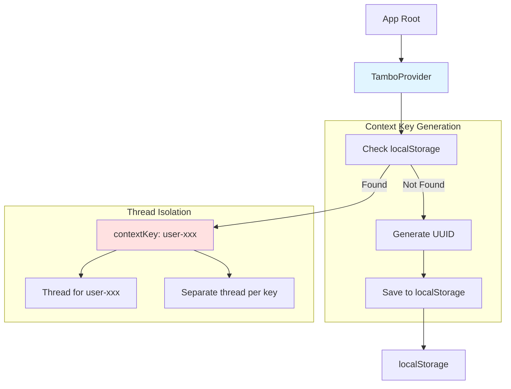

<!-- source: DeepWiki mcp.deepwiki.com · repo tambo-ai/tambo · page 9 Showcase Application · fetched 2026-10-29 -->

# Showcase Application

<details>
<summary>Relevant source files</summary>

The following files were used as context for generating this wiki page:

- [.config/release-please/.release-please-manifest.json](.config/release-please/.release-please-manifest.json)
- [apps/api/CHANGELOG.md](apps/api/CHANGELOG.md)
- [apps/api/package.json](apps/api/package.json)
- [apps/docs-mcp/package.json](apps/docs-mcp/package.json)
- [apps/test-mcp-server/package.json](apps/test-mcp-server/package.json)
- [apps/web/CHANGELOG.md](apps/web/CHANGELOG.md)
- [apps/web/package.json](apps/web/package.json)
- [cli/CHANGELOG.md](cli/CHANGELOG.md)
- [cli/package.json](cli/package.json)
- [cli/src/types/components.d.ts](cli/src/types/components.d.ts)
- [cli/src/types/utils.d.ts](cli/src/types/utils.d.ts)
- [create-tambo-app/CHANGELOG.md](create-tambo-app/CHANGELOG.md)
- [create-tambo-app/package.json](create-tambo-app/package.json)
- [docs/CHANGELOG.md](docs/CHANGELOG.md)
- [docs/package.json](docs/package.json)
- [package-lock.json](package-lock.json)
- [package.json](package.json)
- [packages/backend/package.json](packages/backend/package.json)
- [packages/core/package.json](packages/core/package.json)
- [packages/eslint-config/package.json](packages/eslint-config/package.json)
- [packages/react-ui-base/CHANGELOG.md](packages/react-ui-base/CHANGELOG.md)
- [packages/react-ui-base/package.json](packages/react-ui-base/package.json)
- [packages/testing/package.json](packages/testing/package.json)
- [packages/ui-registry/package.json](packages/ui-registry/package.json)
- [react-sdk/CHANGELOG.md](react-sdk/CHANGELOG.md)
- [react-sdk/package.json](react-sdk/package.json)
- [showcase/CHANGELOG.md](showcase/CHANGELOG.md)
- [showcase/package.json](showcase/package.json)

</details>


The Showcase Application is a Next.js-based demonstration and documentation site located in the `showcase/` directory. It provides interactive examples of all Tambo UI components and generative components, with live code previews, API documentation, and fullscreen testing capabilities. The showcase serves as the primary visual reference for developers evaluating Tambo components before installation via the CLI.

## Purpose and Architecture

The Showcase serves multiple purposes:
- **Component Gallery**: Browse and interact with pre-built Tambo components from `@tambo-ai/ui-registry`
- **Documentation**: View detailed API tables for component props and types
- **Interactive Testing**: Test components in real-time with AI-powered generation using `@tambo-ai/react` SDK
- **Code Examples**: Copy-paste ready code snippets for each component
- **Installation Guide**: CLI commands (`npx tambo add [component]`) for adding components to projects
- **Live Demos**: Fullscreen interactive demonstrations with Tambo AI integration

The application architecture:
- **Framework**: Next.js 15.5.11 App Router with client-side rendering
- **Component Source**: Components auto-synced from `cli/src/registry/` to `showcase/src/components/tambo/` via automation script
- **UI Package**: Components are also available via `@tambo-ai/ui-registry` package
- **React SDK**: Version 1.0.0 (`@tambo-ai/react`) for AI integration and component registration
- **Port**: Runs on port 8262 (configured in `showcase/package.json`)

**Sources:** [showcase/package.json:1-94]()

## Showcase Directory Structure

#### Diagram: Showcase Application Directory Organization



**Sources:** [showcase/package.json:1-94]()

## Component Demonstration Pages

Each component demonstration page follows a consistent structure implemented as a Next.js page component. The pages are organized into three categories:

### Block Components

Chat interface layout components that provide pre-built UI patterns:

| Component | File Path | Description |
|-----------|-----------|-------------|
| `MessageThreadFull` | `components/(blocks)/message-thread-full/page.tsx` | Full-screen chat interface |
| `MessageThreadPanel` | `components/(blocks)/message-thread-panel/page.tsx` | Sidebar-style chat panel |
| `MessageThreadCollapsible` | `components/(blocks)/message-thread-collapsible/page.tsx` | Collapsible chat widget |
| `EditWithTamboButton` | `components/(blocks)/edit-with-tambo-button/page.tsx` | Inline component editing button |

### Generative Components

AI-generated UI components that render data visualizations and forms:

| Component | File Path | Description |
|-----------|-----------|-------------|
| `Graph` | `components/(generative)/graph/page.tsx` | Chart visualization component |
| `Form` | `components/(generative)/form/page.tsx` | Dynamic form builder |
| `InputFields` | `components/(generative)/input-fields/page.tsx` | Focused input field collection |
| `Map` | `components/(generative)/map/page.tsx` | Interactive map with markers |

### Canvas Components

Components for displaying AI-generated UI in dedicated spaces:

| Component | File Path | Description |
|-----------|-----------|-------------|
| `CanvasSpace` | `components/(canvas)/canvas-space/page.tsx` | Container for generated components |

**Sources:** [showcase/src/app/components/(blocks)/message-thread-full/page.tsx:1-93](), [showcase/src/app/components/(generative)/graph/page.tsx:1-202](), [showcase/src/app/components/(canvas)/canvas-space/page.tsx:1-84]()

## Page Component Structure



Each page component renders four main sections:

1. **Header**: Title and description text explaining the component's purpose [showcase/src/app/components/(generative)/graph/page.tsx:10-20]()
2. **Examples Section**: One or more `ComponentCodePreview` instances showing the component in action [showcase/src/app/components/(generative)/graph/page.tsx:23-66]()
3. **Installation Section**: `InstallationSection` component with the CLI command [showcase/src/app/components/(generative)/graph/page.tsx:69-71]()
4. **Component API Section**: Tables documenting all props, types, defaults, and descriptions [showcase/src/app/components/(generative)/graph/page.tsx:74-198]()

**Sources:** [showcase/src/app/components/(generative)/graph/page.tsx:1-202](), [showcase/src/app/components/(blocks)/message-thread-full/page.tsx:1-93]()

## Interactive Chat Interfaces

For generative components, the showcase uses specialized chat interface wrappers that demonstrate AI-powered component generation. These wrappers register components with Tambo SDK and provide a chat UI for testing.

### Chat Interface Pattern

#### Diagram: Chat Interface Component Registration and Rendering Flow



### Example: GraphChatInterface

The `GraphChatInterface` component demonstrates the standard pattern for registering and testing generative components:

```typescript
// File: showcase/src/components/generative/GraphChatInterface.tsx

// 1. Import component and schema from synced tambo directory
import { Graph, graphSchema } from "@/components/tambo/graph";
import { MessageThreadFull } from "@/components/tambo/message-thread-full";
import { useTambo } from "@tambo-ai/react";
import { useEffect } from "react";

export const GraphChatInterface = () => {
  // 2. Extract registration function and thread from SDK
  const { registerComponent, thread } = useTambo();

  // 3. Register component when thread changes
  useEffect(() => {
    registerComponent({
      name: "Graph",
      description: `Renders data visualizations...`, // AI instructions
      component: Graph,
      propsSchema: graphSchema, // Zod schema for props validation
    });
  }, [registerComponent, thread.id]);

  // 4. Render chat interface (700px fixed height)
  return (
    <div className="flex flex-col" style={{ height: "700px" }}>
      <MessageThreadFull className="rounded-lg" />
    </div>
  );
};
```

### Available Chat Interfaces

| Interface | File Location | Registered Components | Height |
|-----------|---------------|----------------------|--------|
| `GraphChatInterface` | `src/components/generative/GraphChatInterface.tsx` | `Graph` | 700px |
| `FormChatInterface` | `src/components/generative/FormChatInterface.tsx` | `FormComponent` | 700px |
| `InputFieldsChatInterface` | `src/components/generative/InputFieldsChatInterface.tsx` | `InputFields` | 700px |
| `MapChatInterface` | `src/components/generative/MapChatInterface.tsx` | `Map` | 700px |
| `CanvasChatInterface` | `src/components/generative/CanvasChatInterface.tsx` | `Graph`, `CanvasSpace` | Variable |

All interfaces follow the same pattern: import component + schema → register with `useTambo()` → render `MessageThreadFull`.

**Sources:** [showcase/package.json:1-94]()

## Helper Components

The showcase uses several helper components to provide consistent UI patterns across all demonstration pages.

### ComponentCodePreview

The `ComponentCodePreview` component (referenced in [showcase/src/app/components/(generative)/graph/page.tsx:28-64]()) displays a live component preview alongside its code. It supports:

- **Side-by-side view**: Component preview + code snippet
- **Fullscreen mode**: Toggle via `enableFullscreen` prop
- **Custom preview styling**: Via `previewClassName` and `fullBleed` props
- **Minimum height**: Controlled by `minHeight` prop

Usage pattern:
```typescript
<ComponentCodePreview
  title="Example Title"
  component={<LiveComponent />}
  code={`import { Component } from "@/components/tambo/component";
  
export function Example() {
  return <Component />;
}`}
  previewClassName="p-0"
  fullBleed
  minHeight={700}
  enableFullscreen
  fullscreenTitle="Component Demo"
/>
```

### InstallationSection

The `InstallationSection` component (referenced in [showcase/src/app/components/(generative)/graph/page.tsx:70]()) displays CLI installation instructions:

```typescript
<InstallationSection cliCommand="npx tambo add graph" />
```

This renders a formatted section with the command and copy-to-clipboard functionality.

### DemoWrapper

The `DemoWrapper` component [showcase/src/app/components/demo-wrapper.tsx:1-93]() provides a consistent container with fullscreen capabilities:

```typescript
<DemoWrapper 
  title="Message Thread"
  height={600}
  hidePreviewHeading
>
  <MessageThreadFull />
</DemoWrapper>
```

Key features:
- **Fullscreen Dialog**: Opens demo in full-screen overlay [showcase/src/app/components/demo-wrapper.tsx:43-75]()
- **Gradient Background**: Consistent visual styling [showcase/src/app/components/demo-wrapper.tsx:55-73]()
- **Header Management**: Optional preview heading visibility [showcase/src/app/components/demo-wrapper.tsx:34-42]()
- **Configurable Height**: Via `height` prop (defaults to 650px) [showcase/src/app/components/demo-wrapper.tsx:16-29]()

**Sources:** [showcase/src/app/components/demo-wrapper.tsx:1-93](), [showcase/src/app/components/(generative)/graph/page.tsx:28-64]()

## Component Registration Flow

#### Diagram: End-to-End Component Registration and AI Invocation Sequence



The registration flow ensures components are available to the AI before any messages are sent:

1. **Page Mount**: Chat interface component mounts and calls `useTambo()`
2. **Hook Extraction**: `useTambo()` returns `registerComponent` function and `thread` object
3. **Effect Trigger**: `useEffect` executes when `registerComponent` or `thread.id` changes
4. **Registration**: `registerComponent()` stores component metadata in `TamboRegistryProvider`
5. **Schema Conversion**: Zod schema converted to JSON Schema format for LLM consumption
6. **Tool Definition**: Component registered as a tool (e.g., `show_component_graph()`)
7. **API Request**: When user sends message, registered components sent to backend as available tools
8. **AI Decision**: LLM decides to invoke component tool with generated props
9. **UI Render**: `MessageThreadFull` renders component with AI-provided props

**Sources:** [showcase/package.json:1-94]()

## Showcase Component Organization

The showcase application maintains two types of component files:

### CLI-Synced Components

Components in `showcase/src/components/tambo/` are auto-synced from the CLI registry via the automation script defined in `showcase/package.json`:

```typescript
/**
 * THIS FILE IS AUTO-SYNCED FROM CLI REGISTRY
 *
 * Component: map
 * Source: cli/src/registry/map/
 *
 * DO NOT EDIT THIS FILE DIRECTLY
 * Make changes in cli/src/registry/map/ and run sync script
 */
```

The sync process is triggered by:
- **Automation Script**: Referenced in [showcase/package.json:1-94]()
- **Source Directory**: `cli/src/registry/` contains canonical component implementations
- **Target Directory**: `showcase/src/components/tambo/` receives synced components
- **CLI Package**: Components are also packaged in `@tambo-ai/ui-registry` for distribution

Key synced components include:
- **Message Components**: `message.tsx`, `message-input/`, `message-suggestions.tsx`
- **Thread Components**: `thread-content.tsx`, `thread-history.tsx`, `thread-list.tsx`, `thread-dropdown.tsx`
- **Layout Components**: `message-thread-full/`, `message-thread-panel/`, `message-thread-collapsible/`
- **Generative Components**: `graph.tsx`, `form.tsx`, `input-fields.tsx`, `map.tsx`
- **Canvas Components**: `canvas-space/`
- **Utility Components**: `scrollable-message-container.tsx`, `edit-with-tambo-button/`
- **MCP Components**: `mcp-components/`, `elicitation-ui/`

### Showcase-Specific Components

Components unique to the showcase application:

| Component | Purpose | Location |
|-----------|---------|----------|
| Chat Interfaces | Wrap components for AI demo | `src/components/generative/` |
| UI Components | Base UI primitives | `src/components/ui/` |
| Helper Components | CodePreview, DemoWrapper | `src/components/` |

**Sources:** [showcase/src/components/tambo/map.tsx:1-10](), [showcase/src/components/generative/GraphChatInterface.tsx:1-52]()

## Context Key Management

The showcase application uses a per-user context key pattern for thread isolation. Each user gets a unique context key stored in localStorage:



This pattern is mentioned in several component pages [showcase/src/app/components/(generative)/graph/page.tsx:26-30]():

```tsx
<p className="text-sm text-muted-foreground">
  This interactive demo runs inside the showcase's app-level
  TamboProvider, which sets a per-user context key (persisted in
  localStorage).
</p>
```

The context key ensures:
- **User Isolation**: Different users see different conversation histories
- **Persistence**: Conversations survive page reloads
- **Demo Separation**: Each component demo can have its own thread via unique context keys

**Sources:** [showcase/src/app/components/(generative)/graph/page.tsx:26-30](), [showcase/src/app/components/(generative)/form/page.tsx:26-30]()

## API Documentation Tables

Each component page includes detailed prop tables following a consistent structure:

### Table Structure

```typescript
<table>
  <thead>
    <tr>
      <th>Prop</th>
      <th>Type</th>
      <th>Default</th>
      <th>Description</th>
    </tr>
  </thead>
  <tbody>
    <tr>
      <td>propName</td>
      <td>"type" | "union"</td>
      <td>defaultValue</td>
      <td>Description text</td>
    </tr>
  </tbody>
</table>
```

### Example: Graph Component Props

From [showcase/src/app/components/(generative)/graph/page.tsx:80-148]():

| Prop | Type | Default | Description |
|------|------|---------|-------------|
| `title` | `string` | - | Chart title displayed above the graph |
| `description` | `string` | - | Optional description text below the title |
| `type` | `"bar" \| "line" \| "pie"` | `"bar"` | Type of chart to render |
| `labels` | `string[]` | `[]` | Array of labels for the x-axis |
| `datasets` | `Dataset[]` | `[]` | Array of dataset configurations |
| `variant` | `"solid" \| "bordered"` | `"solid"` | Visual style of the graph container |
| `size` | `"small" \| "medium" \| "large"` | `"medium"` | Height of the graph container |
| `showLegend` | `boolean` | `true` | Whether to display the legend |
| `className` | `string` | - | Additional CSS classes for customization |

### Nested Object Documentation

Some components document nested object types separately, like the `Dataset` type for the Graph component [showcase/src/app/components/(generative)/graph/page.tsx:151-196]():

| Prop | Type | Default | Description |
|------|------|---------|-------------|
| `label` | `string` | - | Dataset label shown in the legend |
| `data` | `number[]` | `[]` | Array of data values |
| `backgroundColor` | `string \| string[]` | - | Background color(s) for data points |
| `borderColor` | `string` | - | Border color for data points (line charts) |
| `borderWidth` | `number` | `1` | Border width for data points |

**Sources:** [showcase/src/app/components/(generative)/graph/page.tsx:74-198](), [showcase/src/app/components/(generative)/form/page.tsx:95-219]()

## Adding New Component Demonstrations

To add a new component to the showcase:

### 1. Create Component Implementation

Add the component to the CLI registry at `cli/src/registry/your-component/`. The component will be automatically synced to `showcase/src/components/tambo/` via the automation script. See page 5.2 for CLI component management.

### 2. Create Page Component

Create a new page in the appropriate category directory:

```
showcase/src/app/components/
  (blocks)/           # Layout/UI components (MessageThread*, EditWithTamboButton)
  (generative)/       # AI-generated components (Graph, Form, Map, InputFields)
  (canvas)/           # Canvas-related components (CanvasSpace)
    your-component/
      page.tsx        # Component demonstration page (must be client component)
```

### 3. Implement Page Structure

Follow the standard page structure pattern:

```tsx
"use client";

import { ComponentCodePreview } from "@/components/component-code-preview";
import { InstallationSection } from "@/components/installation-section";

export default function YourComponentPage() {
  return (
    <div className="prose max-w-8xl space-y-12">
      {/* Title & Description */}
      <header className="space-y-4">
        <h1 className="text-3xl md:text-4xl font-semibold tracking-tight">
          Your Component
        </h1>
        <p className="text-lg text-muted-foreground">
          Component description...
        </p>
      </header>

      {/* Examples Section */}
      <section className="space-y-6">
        <h2 className="text-2xl font-semibold">Examples</h2>
        <ComponentCodePreview
          title="Example Title"
          component={<YourComponent />}
          code={`// Example code...`}
          minHeight={700}
        />
      </section>

      {/* Installation */}
      <section>
        <InstallationSection cliCommand="npx tambo add your-component" />
      </section>

      {/* Component API */}
      <section className="space-y-6">
        <h2 className="text-2xl font-semibold">Component API</h2>
        {/* Props tables */}
      </section>
    </div>
  );
}
```

### 4. Create Chat Interface (For Generative Components)

If the component is AI-generated, create a chat interface wrapper:

```typescript
// showcase/src/components/generative/YourComponentChatInterface.tsx
import { YourComponent, yourComponentSchema } from "@/components/tambo/your-component";
import { MessageThreadFull } from "@/components/tambo/message-thread-full";
import { useTambo } from "@tambo-ai/react";
import { useEffect } from "react";

export const YourComponentChatInterface = () => {
  const { registerComponent, thread } = useTambo();

  useEffect(() => {
    registerComponent({
      name: "YourComponent",
      description: `Detailed description for AI...`,
      component: YourComponent,
      propsSchema: yourComponentSchema,
    });
  }, [registerComponent, thread.id]);

  return (
    <div className="flex flex-col" style={{ height: "700px" }}>
      <MessageThreadFull className="rounded-lg" />
    </div>
  );
};
```

### 5. Update Navigation

Add the new component to the showcase navigation menu to make it discoverable.

**Sources:** [showcase/src/app/components/(generative)/graph/page.tsx:1-202](), [showcase/src/components/generative/GraphChatInterface.tsx:1-52]()