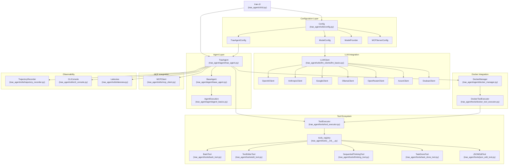
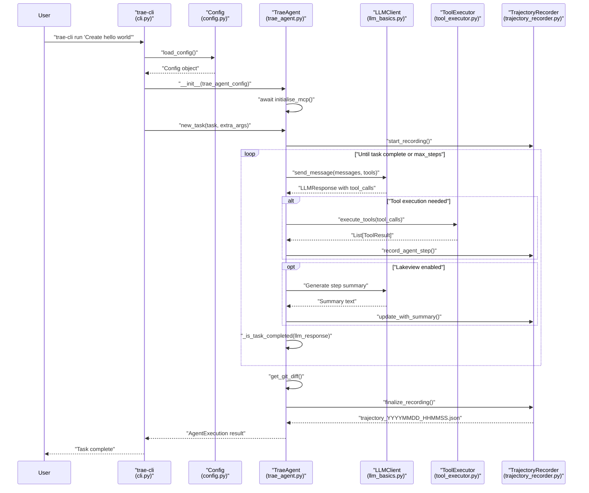

<!-- source: DeepWiki mcp.deepwiki.com · repo bytedance/trae-agent · page 1 Overview · fetched 2026-10-29 -->

# Overview

Relevant source files

The following files were used as context for generating this wiki page:

- [README.md](README.md)
- [pyproject.toml](pyproject.toml)
- [trae_agent/__init__.py](trae_agent/__init__.py)
- [trae_agent/agent/__init__.py](trae_agent/agent/__init__.py)
- [uv.lock](uv.lock)

This document provides a high-level introduction to the Trae Agent system architecture, its core components, and execution model. For detailed information on specific subsystems, refer to the Architecture section. For usage instructions, see the Usage Guide.

## Purpose and Scope

**Trae Agent** is an LLM-based autonomous agent designed for general-purpose software engineering tasks. It accepts natural language task descriptions and executes them by coordinating multiple tools through iterative LLM-driven decision-making. The system is built for research-friendly extensibility, allowing modification of agent behaviors, tool implementations, and LLM providers.

**Sources**: [README.md:1-16](), [pyproject.toml:4-5]()

## System Design Philosophy

Trae Agent follows a modular, layered architecture with clear separation of concerns:

| Layer | Responsibility | Key Components |
|-------|----------------|----------------|
| **Interface** | User interaction and task submission | `trae-cli`, interactive REPL |
| **Orchestration** | Task execution and decision-making | `TraeAgent`, `BaseAgent` |
| **Integration** | External service connections | LLM providers, MCP servers, Docker |
| **Execution** | Tool invocation and environment management | `ToolExecutor`, `DockerToolExecutor` |
| **Observability** | Logging and user feedback | `TrajectoryRecorder`, `CLIConsole`, Lakeview |

The design prioritizes:
- **Transparency**: All agent decisions and tool calls are recorded via `TrajectoryRecorder`.
- **Extensibility**: New tools, LLM providers, and agent behaviors can be added to the modular framework.
- **Reproducibility**: Docker isolation and trajectory recording enable consistent execution across environments.
- **Flexibility**: Multiple configuration methods (YAML, ENV, CLI) and provider options (OpenAI, Anthropic, etc.).

**Sources**: [README.md:9-26](), [trae_agent/agent/trae_agent.py:1-64](), [trae_agent/agent/base_agent.py:1-10]()

## Core Architecture

### Component Hierarchy

This diagram maps natural language concepts to concrete code entities in the system. Each node references the actual class or module path, enabling direct code exploration.

**Sources**: [trae_agent/agent/trae_agent.py:1-64](), [trae_agent/agent/base_agent.py:1-10](), [trae_agent/agent/__init__.py:1-11](), [trae_agent/__init__.py:1-14]()

### Task Execution Flow

This sequence diagram shows the actual method calls and class interactions during task execution. Function names match those in the codebase.

**Sources**: [trae_agent/agent/trae_agent.py:103-170](), [trae_agent/agent/base_agent.py:1-10](), [trae_agent/__init__.py:8-13]()

## Key System Components

### Agent System

The agent system implements the core decision-making logic:

| Class | File Path | Responsibility |
|-------|-----------|----------------|
| `TraeAgent` | [trae_agent/agent/trae_agent.py:30-259]() | Software engineering task orchestration, git diff generation, MCP tool discovery |
| `BaseAgent` | [trae_agent/agent/base_agent.py]() | Generic agent loop, tool execution coordination, state management |
| `AgentExecution` | [trae_agent/agent/agent_basics.py]() | Execution result encapsulation with success status and final output |

The `TraeAgent` class extends `BaseAgent` and specializes it for software engineering by:
- Integrating project path and git tracking.
- Supporting patch generation with test filtering.
- Managing MCP client lifecycle.

**Sources**: [trae_agent/agent/trae_agent.py:30-259](), [trae_agent/agent/base_agent.py:1-10](), [trae_agent/__init__.py:8-9]()

### LLM Integration

The system supports multiple LLM providers through a unified `LLMClient` abstraction:

| Provider | Client Class | File Path |
|----------|-------------|-----------|
| OpenAI | `OpenAIClient` | [trae_agent/utils/llm_clients/openai_client.py]() |
| Anthropic | `AnthropicClient` | [trae_agent/utils/llm_clients/anthropic_client.py]() |
| Google Gemini | `GoogleClient` | [trae_agent/utils/llm_clients/google_client.py]() |
| Azure OpenAI | `AzureClient` | [trae_agent/utils/llm_clients/azure_client.py]() |
| Ollama | `OllamaClient` | [trae_agent/utils/llm_clients/ollama_client.py]() |
| OpenRouter | `OpenRouterClient` | [trae_agent/utils/llm_clients/openrouter_client.py]() |
| Doubao | `DoubaoClient` | [trae_agent/utils/llm_clients/doubao_client.py]() |

Configuration uses a hierarchy: `model_providers` → `models` → `agent config`. This enables flexible model switching and reusable configurations.

**Sources**: [README.md:20-164](), [trae_agent/__init__.py:11]()

### Tool Ecosystem

Tools are registered in the system and instantiated based on configuration:

| Tool Name | Class | File Path | Purpose |
|-----------|-------|-----------|---------|
| `bash` | `BashTool` | [trae_agent/tools/bash_tool.py]() | Shell command execution with persistent sessions |
| `str_replace_based_edit_tool` | `TextEditorTool` | [trae_agent/tools/edit_tool.py]() | File creation and string-based editing |
| `sequentialthinking` | `SequentialThinkingTool` | [trae_agent/tools/thinking_tool.py]() | Structured reasoning with branching logic |
| `task_done` | `TaskDoneTool` | [trae_agent/tools/task_done_tool.py]() | Task completion signaling |
| `json_edit_tool` | `JSONEditTool` | [trae_agent/tools/json_edit_tool.py]() | JSONPath-based JSON manipulation |

The `ToolExecutor` manages tool invocation, while `DockerToolExecutor` routes specific tools to Docker containers for isolation.

**Sources**: [trae_agent/agent/trae_agent.py:21-27](), [trae_agent/__init__.py:10](), [README.md:217-220]()

### Docker Integration

Docker support enables isolated, reproducible execution:

| Component | Class | File Path | Responsibility |
|-----------|-------|-----------|----------------|
| Docker Manager | `DockerManager` | [trae_agent/agent/docker_manager.py]() | Container lifecycle, image building/loading |
| Docker Tool Executor | `DockerToolExecutor` | [trae_agent/tools/docker_tool_executor.py]() | Tool execution routing to containers |

Docker can be initialized via image name, Dockerfile path, image tar file, or an existing container ID. The `DockerToolExecutor` wraps the standard `ToolExecutor` and translates paths between host and container filesystems.

**Sources**: [README.md:181-204](), [trae_agent/agent/docker_manager.py](), [trae_agent/tools/docker_tool_executor.py]()

### MCP Integration

Model Context Protocol (MCP) enables dynamic tool discovery from external servers:

| Component | Class | File Path | Responsibility |
|-----------|-------|-----------|----------------|
| MCP Client | `MCPClient` | [trae_agent/utils/mcp_client.py]() | Server connection, tool discovery |

MCP servers are configured in `trae_config.yaml`. The `TraeAgent.discover_mcp_tools()` method asynchronously connects to configured servers and extends the tool list with discovered tools.

**Sources**: [README.md:111-121](), [trae_agent/agent/trae_agent.py:52-101](), [trae_agent/utils/mcp_client.py]()

## Configuration System

Configuration follows a priority cascade: **CLI arguments** > **YAML file** > **Environment variables** > **Default values**.

The configuration system uses dataclass-based objects to manage agent settings, model providers, and MCP servers. The system merges configuration from all sources according to the priority cascade.

**Sources**: [README.md:42-125](), [README.md:123-124]()

## Observability Features

### Trajectory Recording

The `TrajectoryRecorder` captures complete execution traces, including LLM interactions, agent steps (state transitions and tool calls), and metadata. Trajectory recording is automatically enabled and files are saved as JSON.

### Lakeview Summarization

Lakeview provides optional step summarization using a dedicated LLM to generate concise summaries of agent reasoning and actions, which are then embedded in trajectory files.

### Console Feedback

The `CLIConsole` provides real-time user feedback with support for both simple text output and an advanced TUI using the Textual framework.

**Sources**: [README.md:19-23](), [README.md:221-234](), [pyproject.toml:25]()

## Development and Testing

The project uses modern Python tooling:

| Tool | Purpose |
|------|---------|
| `uv` | Fast dependency management and sync |
| `pytest` | Testing framework for unit and integration tests |
| `ruff` | Linting and formatting |
| `hatchling` | Build backend for wheel targets |

**Sources**: [README.md:27-40](), [pyproject.toml:30-42](), [pyproject.toml:48-49](), [pyproject.toml:86-96]()

---

