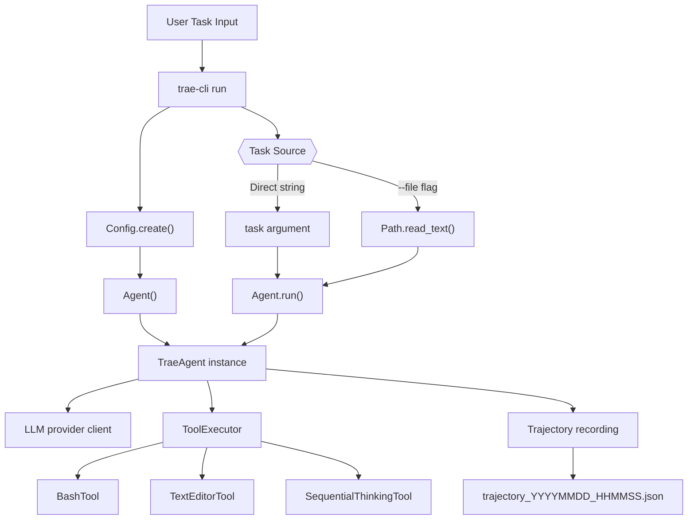
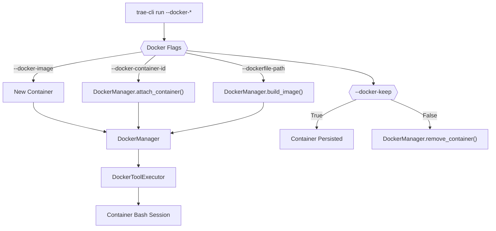

<!-- source: DeepWiki mcp.deepwiki.com · repo bytedance/trae-agent · page 3 Usage Guide · fetched 2026-10-29 -->

# Usage Guide

Relevant source files

The following files were used as context for generating this wiki page:

- [README.md](README.md)
- [tests/test_cli.py](tests/test_cli.py)
- [trae_agent/cli.py](trae_agent/cli.py)

This guide covers how to use Trae Agent for software engineering tasks through its command-line interface. It explains task execution patterns, configuration options, and workflow management. For installation and initial setup, see [Installation and Setup](#2).

## Overview

Trae Agent provides three primary usage modes through the `trae-cli` command:
- **Run mode**: Execute single tasks with immediate completion [trae_agent/cli.py:192-213]()
- **Interactive mode**: Continuous conversation-based task execution [trae_agent/cli.py:423-441]()
- **Configuration management**: View and validate system settings [trae_agent/cli.py:594-612]()

## Task Execution Flow

The following diagram shows how user tasks flow through the CLI interface to the agent execution system, associating natural language inputs with the underlying `Agent` class and `Tool` entities.

**Diagram: CLI to Agent Execution Flow**

Sources: [trae_agent/cli.py:180-394](), [trae_agent/cli.py:355-368](), [README.md:128-140]()

## Basic Task Execution

### Run Mode

Run mode executes a single task and exits. The basic syntax is `trae-cli run "task description"`. The CLI accepts tasks through two mechanisms:

| Input Method | CLI Option | Code Implementation |
|--------------|------------|---------|
| Direct string | First argument | `task` argument in `run()` [trae_agent/cli.py:193]() |
| File content | `--file` / `-f` | `file_path` reading in [trae_agent/cli.py:270-280]() |

**Working Directory Management**: The `--working-dir` option sets the project context. If not specified, the current directory is used. The CLI ensures the working directory is an absolute path [trae_agent/cli.py:332-337]().

For details, see [CLI Commands](#3.1).

Sources: [trae_agent/cli.py:116-131](), [trae_agent/cli.py:318-330](), [README.md:131-140]()

### Interactive Mode

Interactive mode provides a REPL-like session for iterative development. The interactive loop is handled by `_run_simple_interactive_loop` or `_run_rich_interactive_loop` depending on the `--console-type` [trae_agent/cli.py:481-494]().

**Interactive Commands**: The simple console [trae_agent/utils/cli.py:22]() supports these built-in commands [trae_agent/cli.py:512-545]():
- `help`: Show available commands.
- `status`: Display agent configuration and tool count.
- `clear`: Clear terminal screen.
- `exit`/`quit`: End session.

For details, see [Interactive Mode](#3.3).

Sources: [trae_agent/cli.py:423-494](), [trae_agent/cli.py:497-576](), [README.md:138-139]()

## Provider and Model Selection

### Configuration Resolution

The CLI resolves configuration values with a specific precedence order defined in the `Config` resolution logic [trae_agent/cli.py:282-290]():
1. **Command-line arguments**: `--provider`, `--model`, `--api-key`, etc. [trae_agent/cli.py:129-133]()
2. **Environment variables**: `OPENAI_API_KEY`, `ANTHROPIC_API_KEY`, etc. [README.md:95-109]()
3. **Configuration file**: Values from `trae_config.yaml` [README.md:53-79]()
4. **Default values**: Hardcoded system defaults.

For details, see [Configuration](#3.2).

Sources: [trae_agent/cli.py:118-122](), [README.md:142-163](), [README.md:123]()

## Docker Integration

### Docker Execution Modes

Trae Agent supports containerized execution via `DockerManager` to provide isolated environments for tool execution.

**Diagram: Docker Integration Architecture**

**Tool Binaries**: Docker mode requires pre-built tool binaries (e.g., `edit_tool`, `json_edit_tool`). The CLI includes a helper to build these using PyInstaller [trae_agent/cli.py:89-116]().

For details, see [Docker Mode](#3.4).

Sources: [trae_agent/cli.py:145-175](), [trae_agent/cli.py:208-212](), [README.md:181-204]()

## Trajectory Recording

All task executions generate trajectory files containing the history of agent thoughts, tool calls, and LLM responses.

- **Default Path**: `trajectories/trajectory_YYYYMMDD_HHMMSS.json` [README.md:227-228]().
- **Custom Path**: Specified via `--trajectory-file` or `-t` [trae_agent/cli.py:142]().

The CLI displays the final trajectory path after the agent finishes its task [trae_agent/cli.py:370](), [trae_agent/cli.py:567]().

Sources: [trae_agent/cli.py:131](), [trae_agent/cli.py:409](), [README.md:221-234]()

## Configuration Management

### View Current Configuration

Use `trae-cli show-config` to inspect the active settings. This command prints a formatted table of providers, models, and agent settings [trae_agent/cli.py:614-681]().

### Configuration File Resolution

The CLI handles backward compatibility between YAML and JSON configurations through `resolve_config_file()` [trae_agent/cli.py:31-50](). It prefers `.yaml` or `.yml` but will fall back to `.json` if the former are missing.

Sources: [trae_agent/cli.py:594-681](), [trae_agent/cli.py:30-49](), [README.md:135-136]()

## Error Handling

- **Docker Checks**: The CLI validates the Docker CLI and daemon status before attempting containerized tasks [trae_agent/cli.py:53-87]().
- **Interruption**: `KeyboardInterrupt` (Ctrl+C) is caught to ensure trajectories are saved before exiting [trae_agent/cli.py:372-375]().
- **Directory Errors**: The CLI validates the existence of the `--working-dir` and reports errors if `os.chdir` fails [tests/test_cli.py:113-139]().

Sources: [trae_agent/cli.py:53-87](), [trae_agent/cli.py:372-394](), [tests/test_cli.py:113-139]()

---

