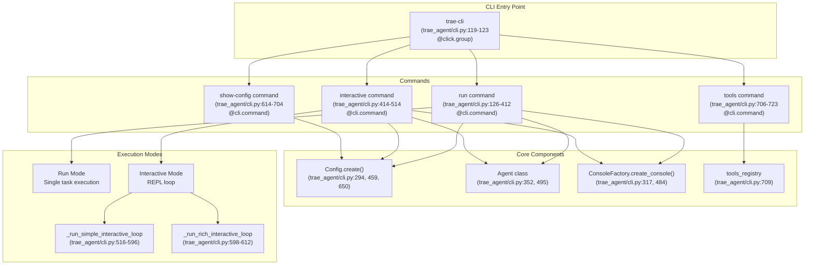
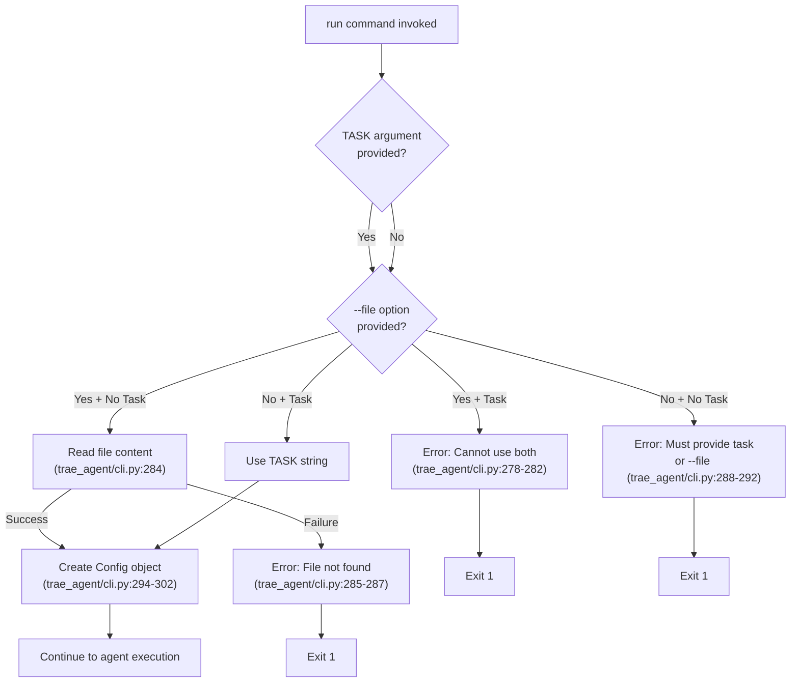
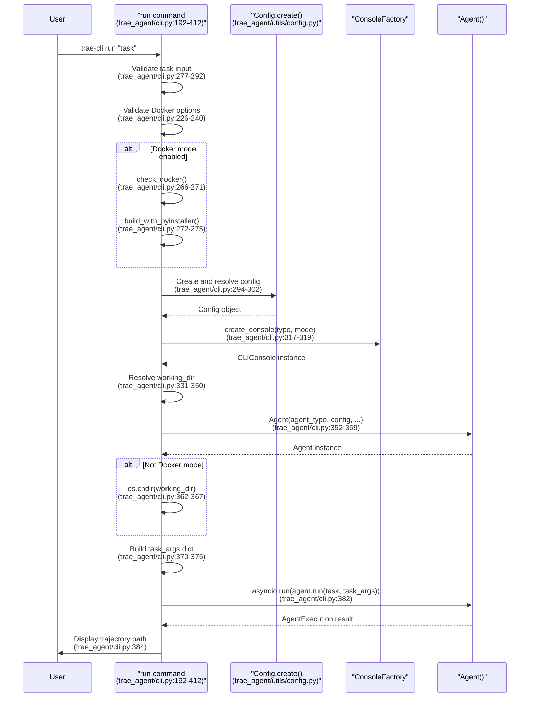
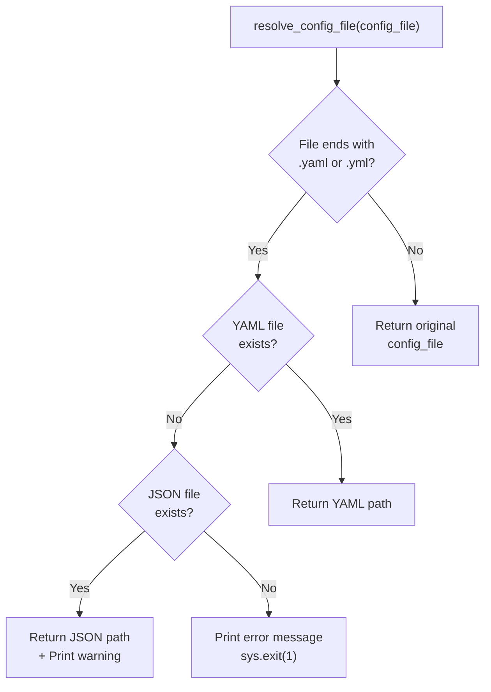

<!-- source: DeepWiki mcp.deepwiki.com · repo bytedance/trae-agent · page 3.1 CLI Commands · fetched 2026-10-29 -->

# CLI Commands

<details>
<summary>Relevant source files</summary>

The following files were used as context for generating this wiki page:

- [README.md](README.md)
- [tests/test_cli.py](tests/test_cli.py)
- [trae_agent/cli.py](trae_agent/cli.py)

</details>


This page provides comprehensive documentation for all command-line interface (CLI) commands available in Trae Agent. The CLI is the primary user interface for interacting with the agent system, enabling task execution, interactive sessions, configuration inspection, and tool discovery.

For configuration file format and options, see [Configuration](#3.2). For details about interactive REPL mode operation, see [Interactive Mode](#3.3). For Docker container integration, see [Docker Mode](#3.4).

## Overview

The Trae Agent CLI is implemented in [trae_agent/cli.py]() and provides four main commands through the Click framework. All commands share a common configuration system that supports multiple input sources with clear priority ordering.

**Command Entry Point:** `trae-cli` is the main executable, defined at [trae_agent/cli.py:121]().

**Available Commands:**
- `run` - Execute a single task with the agent [trae_agent/cli.py:126-412]()
- `interactive` - Start an interactive REPL session [trae_agent/cli.py:414-514]()
- `show-config` - Display current configuration settings [trae_agent/cli.py:614-704]()
- `tools` - List all available tools and their descriptions [trae_agent/cli.py:706-723]()

**Configuration Priority:** CLI arguments > Configuration file > Environment variables > Default values (enforced at [trae_agent/cli.py:294-302]() and [trae_agent/cli.py:459-467]()).

## Command Structure

The following diagram shows the CLI command hierarchy and how commands map to code entities:

**Diagram 1: CLI Architecture and Code Entity Mapping**


**Sources:** [trae_agent/cli.py:119-723]()

## `run` Command

The `run` command executes a single task using Trae Agent. It is the primary command for non-interactive task execution.

### Basic Syntax

```bash
trae-cli run [TASK] [OPTIONS]
trae-cli run --file FILE [OPTIONS]
```

### Arguments

| Argument | Type | Required | Description |
|----------|------|----------|-------------|
| `TASK` | string | Conditional* | Natural language task description |

\* Either `TASK` argument or `--file` option must be provided (enforced at [trae_agent/cli.py:277-292]()).

### Core Options

| Option | Short | Type | Default | Description |
|--------|-------|------|---------|-------------|
| `--file` | `-f` | path | None | Path to file containing task description [trae_agent/cli.py:128]() |
| `--provider` | `-p` | string | None | LLM provider (openai, anthropic, google, etc.) [trae_agent/cli.py:129]() |
| `--model` | `-m` | string | None | Specific model name [trae_agent/cli.py:130]() |
| `--model-base-url` | - | string | None | Base URL for model API [trae_agent/cli.py:131]() |
| `--api-key` | `-k` | string | None | API key for provider [trae_agent/cli.py:132]() |
| `--max-steps` | - | int | None | Maximum number of agent execution steps [trae_agent/cli.py:133]() |
| `--working-dir` | `-w` | path | current dir | Working directory (must be absolute path) [trae_agent/cli.py:134]() |
| `--must-patch` | `-mp` | flag | False | Require code changes [trae_agent/cli.py:135]() |
| `--config-file` | - | path | trae_config.yaml | Path to configuration file [trae_agent/cli.py:137-141]() |
| `--trajectory-file` | `-t` | path | auto-generated | Path to save trajectory recording [trae_agent/cli.py:142]() |
| `--patch-path` | `-pp` | path | None | Path to save git diff patch [trae_agent/cli.py:143]() |
| `--console-type` | `-ct` | choice | simple | Console type: simple or rich [trae_agent/cli.py:179-184]() |
| `--agent-type` | `-at` | choice | trae_agent | Agent type to use [trae_agent/cli.py:186-191]() |

### Docker Mode Options

Docker mode enables isolated task execution in containers. See [Docker Mode](#3.4) for comprehensive details.

| Option | Type | Default | Description |
|--------|------|---------|-------------|
| `--docker-image` | string | None | Docker image name to create new container [trae_agent/cli.py:146-150]() |
| `--docker-container-id` | string | None | Existing container ID to attach to [trae_agent/cli.py:152-156]() |
| `--dockerfile-path` | path | None | Path to Dockerfile for building image [trae_agent/cli.py:158-162]() |
| `--docker-image-file` | path | None | Path to tar archive of Docker image [trae_agent/cli.py:164-168]() |
| `--docker-keep` | bool | True | Keep container after task completion [trae_agent/cli.py:170-174]() |

**Mutual Exclusivity:** Only one of `--docker-image`, `--docker-container-id`, `--dockerfile-path`, or `--docker-image-file` may be specified (enforced at [trae_agent/cli.py:226-240]()).

### Task Input Modes

The following diagram illustrates task input resolution:

**Diagram 2: Task Input Logic Flow**


**Sources:** [trae_agent/cli.py:277-292]()

### Execution Flow



**Sources:** [trae_agent/cli.py:192-412]()

### Working Directory Requirements

The working directory must be an absolute path (validated at [trae_agent/cli.py:346-350]()):

```python
# Ensure working directory is an absolute path
if not Path(working_dir).is_absolute():
    console.print(
        f"[red]Working directory must be an absolute path: {working_dir}, "
        f"it should start with `/`[/red]"
    )
    sys.exit(1)
```

**Behavior:**
- If `--working-dir` is provided: Creates directory if needed [trae_agent/cli.py:332-337](), converts to absolute path [trae_agent/cli.py:343]().
- If not provided: Uses current working directory (`os.getcwd()`) [trae_agent/cli.py:331]().
- Docker mode: Working directory is used for mounting workspace.
- Non-Docker mode: Agent changes to working directory via `os.chdir()` [trae_agent/cli.py:363]().

**Sources:** [trae_agent/cli.py:330-367]()

### Docker Mode Initialization

When any Docker option is specified, the CLI performs initialization checks at [trae_agent/cli.py:265-275]():

1. **Docker Availability Check:** Executes `check_docker()` function ([trae_agent/cli.py:53-86]()) which verifies:
   - Docker CLI installed (`shutil.which("docker")`) [trae_agent/cli.py:55]().
   - Docker daemon running (`docker version` command) [trae_agent/cli.py:64-69]().
   - Returns status dict with `cli`, `daemon`, `version`, and `error` fields.

2. **Tool Building:** On first Docker mode use, builds standalone tool binaries with PyInstaller:
   - Checks for `trae_agent/dist/` and `trae_agent/dist/_internal/` directories [trae_agent/cli.py:272-273]().
   - Builds `edit_tool` and `json_edit_tool` executables ([trae_agent/cli.py:89-116]()).
   - These binaries are copied into Docker containers for tool execution.

**Sources:** [trae_agent/cli.py:53-116, 265-275]()

## `interactive` Command

The `interactive` command starts a REPL (Read-Eval-Print Loop) session for iterative task execution. See [Interactive Mode](#3.3) for detailed usage patterns.

### Basic Syntax

```bash
trae-cli interactive [OPTIONS]
```

### Options

| Option | Short | Type | Default | Description |
|--------|-------|------|---------|-------------|
| `--provider` | `-p` | string | None | LLM provider to use [trae_agent/cli.py:415]() |
| `--model` | `-m` | string | None | Specific model name [trae_agent/cli.py:416]() |
| `--model-base-url` | - | string | None | Base URL for model API [trae_agent/cli.py:417]() |
| `--api-key` | `-k` | string | None | API key for provider [trae_agent/cli.py:418]() |
| `--config-file` | - | path | trae_config.yaml | Path to configuration file [trae_agent/cli.py:423-427]() |
| `--max-steps` | - | int | 20 | Maximum steps per task [trae_agent/cli.py:419]() |
| `--trajectory-file` | `-t` | path | auto-generated | Path to save trajectory [trae_agent/cli.py:428]() |
| `--console-type` | `-ct` | choice | simple | Console type: simple or rich [trae_agent/cli.py:430-435]() |
| `--agent-type` | `-at` | choice | trae_agent | Agent type to use [trae_agent/cli.py:436-441]() |

### Interactive Session Commands

When in interactive mode, special commands are available (implemented in simple console at [trae_agent/cli.py:516-596]()):

| Command | Description | Code Reference |
|---------|-------------|----------------|
| `<task description>` | Execute a task | [trae_agent/cli.py:576-586]() |
| `status` | Show agent information | [trae_agent/cli.py:548-560]() |
| `help` | Display available commands | [trae_agent/cli.py:531-544]() |
| `clear` | Clear the screen | [trae_agent/cli.py:562-564]() |
| `exit` or `quit` | End the session | [trae_agent/cli.py:526-529]() |

### Console Type Behavior

The interactive command supports two console types:

**Simple Console** ([trae_agent/cli.py:516-596]()):
- Traditional REPL loop with `input()` prompts.
- Prompts for task and working directory for each execution [trae_agent/cli.py:566-574]().
- Displays formatted panels for status and help.
- Handles `KeyboardInterrupt` and `EOFError` for graceful exit [trae_agent/cli.py:588-592]().

**Rich Console** ([trae_agent/cli.py:598-612]()):
- Textual-based TUI with advanced features.
- Agent context set via `set_agent_context()` method [trae_agent/cli.py:607-608]().
- Single `await cli_console.start()` call runs entire UI [trae_agent/cli.py:611]().

**Sources:** [trae_agent/cli.py:440-612]()

## `show-config` Command

The `show-config` command displays the current resolved configuration, showing values from all sources (CLI args, config file, environment variables, defaults).

### Implementation

The command reads from the resolved `Config` object and displays values using Rich library tables [trae_agent/cli.py:666-703](). It masks API keys for security, showing only the first and last 4 characters [trae_agent/cli.py:692]().

### Examples

```bash
# Show current configuration
trae-cli show-config

# Show config with overrides
trae-cli show-config --provider openai --model gpt-4o
```

**Sources:** [trae_agent/cli.py:614-704]()

## `tools` Command

The `tools` command lists all available tools registered in the tool ecosystem.

### Implementation

The command iterates through the `tools_registry` at [trae_agent/cli.py:709-722]():

1. Imports `tools_registry` from `trae_agent.tools`.
2. Iterates over all registered tool names.
3. Instantiates each tool to retrieve its `name` and `description` [trae_agent/cli.py:716]().
4. Displays the information in a `rich.table.Table` [trae_agent/cli.py:711-722]().

**Sources:** [trae_agent/cli.py:706-723]()

## Configuration File Resolution

The CLI supports backward compatibility between YAML and JSON configuration formats through the `resolve_config_file()` function at [trae_agent/cli.py:31-51]():



**Sources:** [trae_agent/cli.py:31-51]()

## Error Handling

The CLI implements comprehensive error handling for common failure scenarios:

| Error Category | Scenario | Behavior | Code Reference |
|----------------|----------|----------|----------------|
| **Task Input** | Both task string and `--file` | Exit 1 with error message | [trae_agent/cli.py:278-282]() |
| **Task Input** | Neither task nor `--file` | Exit 1 with error message | [trae_agent/cli.py:288-292]() |
| **Docker** | Multiple Docker options | Exit 1 with error message | [trae_agent/cli.py:237-240]() |
| **Docker** | Daemon not reachable | Exit 1 with error message | [trae_agent/cli.py:269-271]() |
| **Path** | Working dir not absolute | Exit 1 with error message | [trae_agent/cli.py:346-350]() |
| **Config** | Missing agent config | Exit 1 with error message | [trae_agent/cli.py:471-473]() |
| **Runtime** | KeyboardInterrupt | Graceful exit with message | [trae_agent/cli.py:386-389]() |

**Sources:** [trae_agent/cli.py:237-411](), [tests/test_cli.py]()

## Testing

The CLI is tested via Click's `CliRunner` in [tests/test_cli.py](). Key test cases include:
- Long prompt handling [tests/test_cli.py:18-47]()
- File argument reading [tests/test_cli.py:54-86]()
- Non-existent file error [tests/test_cli.py:89-93]()
- Working directory validation [tests/test_cli.py:110-138]()

**Sources:** [tests/test_cli.py]()

---

