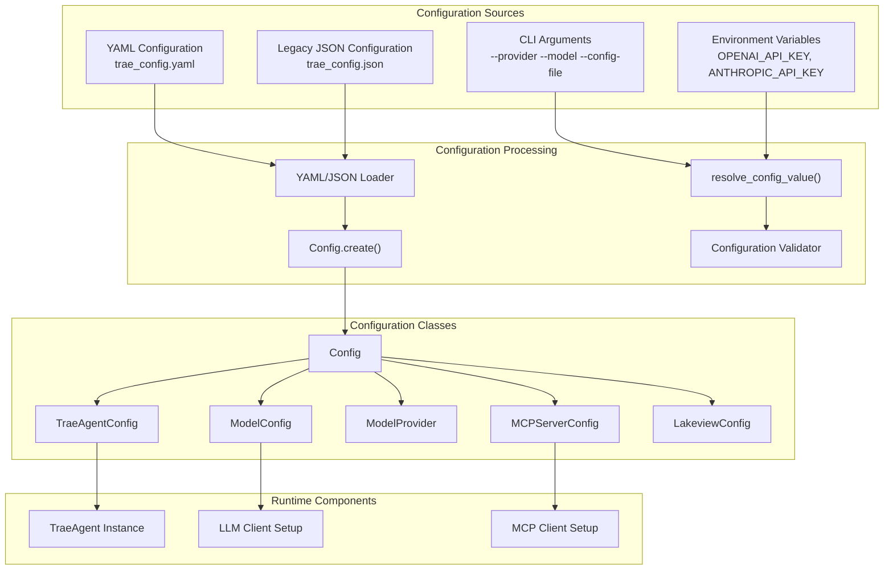
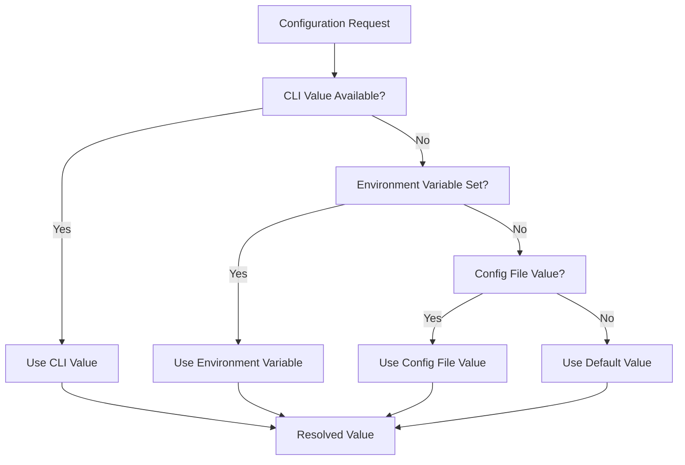
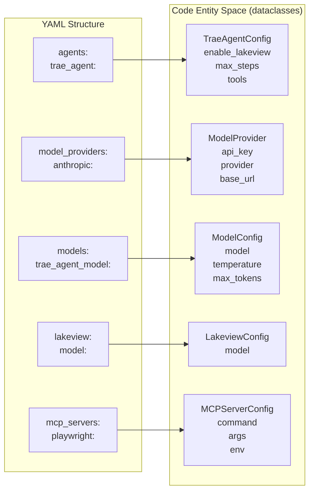
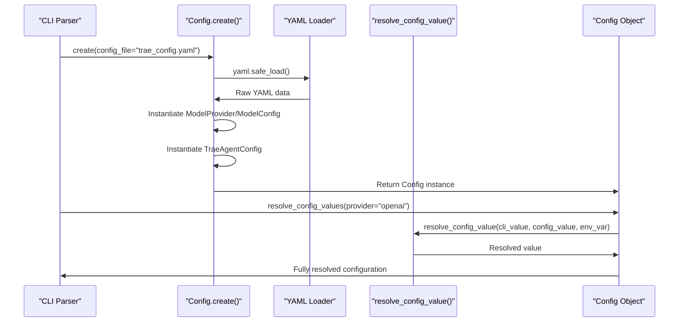

<!-- source: DeepWiki mcp.deepwiki.com · repo bytedance/trae-agent · page 3.2 Configuration · fetched 2026-10-29 -->

# Configuration

<details>
<summary>Relevant source files</summary>

The following files were used as context for generating this wiki page:

- [.gitignore](.gitignore)
- [.vscode/launch.template.json](.vscode/launch.template.json)
- [docs/legacy_config.md](docs/legacy_config.md)
- [tests/utils/test_config.py](tests/utils/test_config.py)
- [trae_agent/utils/config.py](trae_agent/utils/config.py)
- [trae_agent/utils/legacy_config.py](trae_agent/utils/legacy_config.py)
- [trae_config.json.example](trae_config.json.example)
- [trae_config.yaml.example](trae_config.yaml.example)

</details>


This document explains how to configure trae-agent using YAML files, environment variables, and command-line arguments. It covers the configuration system architecture, priority resolution, and the various configuration formats supported.

For the complete reference of all configuration options and their defaults, see [Configuration Reference](). For CLI command syntax and options, see [CLI Commands]().

## Configuration System Overview

The trae-agent configuration system implements a hierarchical approach with multiple sources and automatic resolution. The system supports both modern YAML configuration and legacy JSON formats for backward compatibility.

**Configuration Architecture**



Sources: [trae_agent/utils/config.py:205-230](), [trae_agent/utils/config.py:394-410]()

## Configuration Sources and Priority

The configuration system resolves values using a strict priority hierarchy implemented in the `resolve_config_value` function:

| Priority | Source | Example |
|----------|--------|---------|
| 1 (Highest) | Command-line arguments | `--provider openai --model gpt-4o` |
| 2 | Environment variables | `OPENAI_API_KEY=sk-...` |
| 3 | Configuration file | `trae_config.yaml` or `trae_config.json` |
| 4 (Lowest) | Default values | Built-in defaults |

**Priority Resolution Flow**



Sources: [trae_agent/utils/config.py:394-410](), [docs/legacy_config.md:28-33]()

## YAML Configuration Format

The modern YAML configuration format provides a structured approach to configuring all aspects of trae-agent. The configuration is organized into logical sections for agents, models, providers, and services.

### Basic YAML Structure

```yaml
# Agent configurations
agents:
    trae_agent:
        enable_lakeview: true
        model: trae_agent_model
        max_steps: 200
        tools:
            - bash
            - str_replace_based_edit_tool
            - sequentialthinking
            - task_done

# MCP server configuration
allow_mcp_servers:
    - playwright
mcp_servers:
    playwright:
        command: npx
        args:
            - "@playwright/mcp@0.0.27"

# Lakeview configuration
lakeview:
    model: lakeview_model

# Model provider configurations
model_providers:
    anthropic:
        api_key: your_anthropic_api_key
        provider: anthropic

# Model configurations
models:
    trae_agent_model:
        model_provider: anthropic
        model: claude-4-sonnet
        max_tokens: 4096
        temperature: 0.5
        top_p: 1
        top_k: 0
        max_retries: 10
        parallel_tool_calls: true
```

The YAML configuration is processed by the `Config.create()` method which validates the structure and creates the appropriate configuration objects.

Sources: [trae_config.yaml.example:1-45](), [trae_agent/utils/config.py:205-230]()

### Configuration Classes Mapping

The configuration system uses several `dataclass` definitions to represent the system state.



Sources: [trae_agent/utils/config.py:16-27](), [trae_agent/utils/config.py:29-46](), [trae_agent/utils/config.py:120-143](), [trae_agent/utils/config.py:159-172](), [trae_agent/utils/config.py:185-191]()

## Environment Variables

Environment variables provide a secure way to configure API keys and base URLs without storing them in configuration files. The system automatically maps provider names to environment variable patterns.

### Environment Variable Patterns

| Provider | API Key Variable | Base URL Variable |
|----------|------------------|-------------------|
| OpenAI | `OPENAI_API_KEY` | `OPENAI_BASE_URL` |
| Anthropic | `ANTHROPIC_API_KEY` | `ANTHROPIC_BASE_URL` |
| Google | `GOOGLE_API_KEY` | `GOOGLE_BASE_URL` |
| Azure | `AZURE_API_KEY` | `AZURE_BASE_URL` |
| Doubao | `DOUBAO_API_KEY` | `DOUBAO_BASE_URL` |

The environment variable resolution is implemented in the `resolve_config_values` method of `ModelConfig`:

```python
# Map providers to their environment variable names
env_var_api_key = str(self.model_provider.provider).upper() + "_API_KEY"
env_var_api_base_url = str(self.model_provider.provider).upper() + "_BASE_URL"
```

Sources: [trae_agent/utils/config.py:96-110]()

## Command-line Override

Command-line arguments provide the highest priority configuration mechanism, allowing users to override any configuration file or environment variable setting for common parameters.

### Supported CLI Overrides

| CLI Argument | Configuration Target | Example |
|--------------|---------------------|---------|
| `--provider` | Model provider | `--provider openai` |
| `--model` | Model name | `--model gpt-4o` |
| `--api-key` | API key | `--api-key sk-...` |
| `--model-base-url` | Base URL | `--model-base-url https://api.openai.com/v1` |
| `--max-steps` | Agent max steps | `--max-steps 50` |

The CLI override mechanism works through the `resolve_config_values` method which is called after configuration loading.

Sources: [trae_agent/utils/config.py:66-78](), [trae_agent/utils/config.py:174-182]()

## Legacy JSON Configuration

For backward compatibility, the system supports legacy JSON configuration files through the `LegacyConfig` class. The legacy format is automatically detected and converted to the modern configuration structure.

### Legacy Format Structure

```json
{
  "default_provider": "anthropic",
  "max_steps": 20,
  "enable_lakeview": true,
  "model_providers": {
    "anthropic": {
      "model": "claude-sonnet-4-20250514",
      "api_key": "your-api-key",
      "base_url": "https://api.anthropic.com",
      "max_tokens": 4096,
      "temperature": 0.5,
      "top_p": 1,
      "top_k": 0,
      "parallel_tool_calls": false,
      "max_retries": 10
    }
  }
}
```

The legacy configuration is processed by `Config.create_from_legacy_config()` which converts the flat structure to the modern hierarchical format defined in `trae_agent/utils/config.py`.

Sources: [trae_agent/utils/legacy_config.py:71-166](), [trae_agent/utils/config.py:218-219]()

## Configuration Resolution Process

The configuration resolution process involves loading, validating, and resolving configuration values from multiple sources. This process is coordinated by the `Config` class.

**Configuration Resolution Sequence**



Sources: [trae_agent/utils/config.py:205-300](), [trae_agent/utils/config.py:66-118]()

## MCP Server Configuration

Model Context Protocol (MCP) servers extend trae-agent's capabilities by providing external tools. MCP servers are configured in the `mcp_servers` section and managed by the `MCPServerConfig` class.

### MCP Configuration Structure

The `MCPServerConfig` class supports multiple transport mechanisms:

| Transport | Configuration Fields | Usage |
|-----------|---------------------|--------|
| stdio | `command`, `args`, `env`, `cwd` | Local command execution |
| SSE | `url` | Server-sent events |
| HTTP | `http_url`, `headers` | HTTP streaming |
| WebSocket | `tcp` | TCP socket connection |

Sources: [trae_agent/utils/config.py:120-143](), [trae_config.yaml.example:13-17]()

## Model Provider and Model Configuration

The configuration system separates model providers (authentication and connection details) from model configurations (model-specific parameters).

### Token Parameter Resolution

The system handles different token parameter naming conventions across providers through the `get_max_tokens_param()` and `should_use_max_completion_tokens()` methods in `ModelConfig`:

- **Standard**: `max_tokens` (most providers).
- **Azure OpenAI (new models)**: `max_completion_tokens` is used for `gpt-5`, `o3`, or `o4-mini` models if available.
- **Priority**: `max_completion_tokens` takes precedence over `max_tokens`.

Sources: [trae_agent/utils/config.py:48-64]()

---

