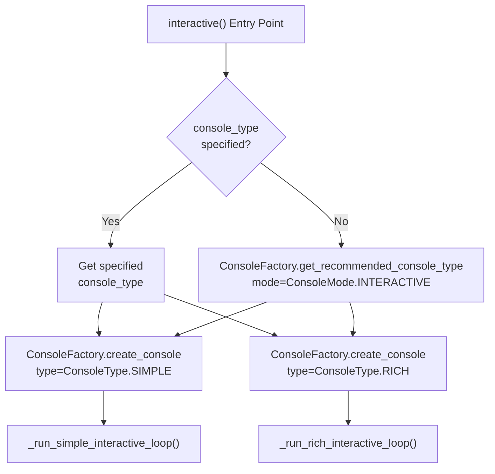
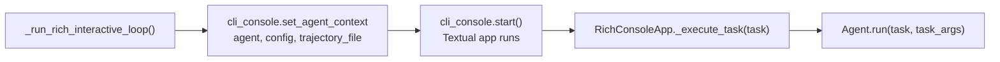
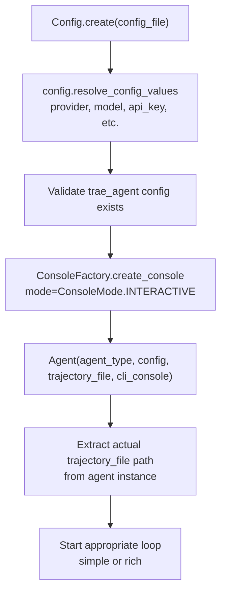

<!-- source: DeepWiki mcp.deepwiki.com · repo bytedance/trae-agent · page 3.3 Interactive Mode · fetched 2026-10-29 -->

# Interactive Mode

<details>
<summary>Relevant source files</summary>

The following files were used as context for generating this wiki page:

- [tests/test_cli.py](tests/test_cli.py)
- [trae_agent/cli.py](trae_agent/cli.py)
- [trae_agent/utils/cli/rich_console.py](trae_agent/utils/cli/rich_console.py)
- [trae_agent/utils/cli/rich_console.tcss](trae_agent/utils/cli/rich_console.tcss)
- [trae_agent/utils/trajectory_recorder.py](trae_agent/utils/trajectory_recorder.py)

</details>


## Purpose and Scope

Interactive Mode provides a REPL (Read-Eval-Print-Loop) interface for iteratively executing software engineering tasks with Trae Agent. This mode enables conversational interaction where users can submit multiple tasks in sequence, check agent status, and maintain context across executions within a single session.

This document covers the interactive command interface, console implementations, and task execution flow. For basic CLI commands and one-shot task execution, see [CLI Commands](). For configuration options that apply to interactive mode, see [Configuration]().

---

## Starting Interactive Mode

Interactive Mode is initiated via the `interactive` command in the CLI [trae_agent/cli.py:440-449](). The command accepts configuration overrides similar to the `run` command.

### Basic Usage

```bash
# Start with default configuration
trae-cli interactive

# Start with specific provider and model
trae-cli interactive --provider openai --model gpt-4o

# Use custom console type
trae-cli interactive --console-type rich
```

### Command-Line Options

| Option | Short | Type | Description |
|--------|-------|------|-------------|
| `--provider` | `-p` | string | LLM provider to use (overrides config) |
| `--model` | `-m` | string | Specific model to use (overrides config) |
| `--model-base-url` | | string | Base URL for model API |
| `--api-key` | `-k` | string | API key for the provider |
| `--config-file` | | string | Path to configuration file (default: `trae_config.yaml`) |
| `--max-steps` | | int | Maximum number of execution steps (default: 20) |
| `--trajectory-file` | `-t` | string | Path to save trajectory file |
| `--console-type` | `-ct` | choice | Console type: `simple` or `rich` (default: `simple`) |
| `--agent-type` | `-at` | choice | Agent type: `trae_agent` (default: `trae_agent`) |

**Sources:** [trae_agent/cli.py:414-449]()

---

## Console Types

Interactive Mode supports two console implementations that provide different user experiences:

### Simple Console

The `simple` console type provides a basic terminal interface with standard input/output. It displays plain text output and uses basic prompts for user input.

**Characteristics:**
- Text-based output with Rich formatting.
- Sequential command execution.
- Manual input for task and working directory [trae_agent/cli.py:526](), [trae_agent/cli.py:546]().
- Basic error handling with stacktraces [trae_agent/cli.py:593-595]().

**Implementation:** [trae_agent/cli.py:516-596]()

### Rich Console

The `rich` console type provides an advanced Terminal User Interface (TUI) using the Textual framework. It offers a more sophisticated interactive experience with visual components.

**Characteristics:**
- Textual-based TUI with panels and widgets [trae_agent/utils/cli/rich_console.py:80-104]().
- Integrated agent context management via `set_agent_context` [trae_agent/cli.py:605]().
- Real-time token usage display via `TokenDisplay` [trae_agent/utils/cli/rich_console.py:30-55]().
- Enhanced visual feedback using `RichLog` [trae_agent/utils/cli/rich_console.py:86]().

**Implementation:** [trae_agent/cli.py:598-612](), [trae_agent/utils/cli/rich_console.py:57-234]()

### Console Selection Flow



**Sources:** [trae_agent/cli.py:476-488](), [trae_agent/cli.py:501-513]()

---

## Interactive Commands

Interactive Mode provides several built-in commands that can be typed at the prompt.

### Available Commands

| Command | Description | Implementation |
|---------|-------------|----------------|
| Task description | Any non-command text is executed as a task | [trae_agent/cli.py:525-586]() |
| `status` | Display agent configuration and current state | [trae_agent/cli.py:548-560]() |
| `help` | Show available commands and usage information | [trae_agent/cli.py:531-544]() |
| `clear` | Clear the terminal screen | [trae_agent/cli.py:562-564]() |
| `exit` or `quit` | End the interactive session | [trae_agent/cli.py:528-529](), [trae_agent/cli.py:591-592]() |

### Status Command Output

When the `status` command is issued, it displays:
- **Provider**: The active LLM provider (e.g., `openai`, `anthropic`).
- **Model**: The model identifier (e.g., `gpt-4o`).
- **Available Tools**: Count of tools available to the agent.
- **Config File**: Path to the active configuration file.
- **Working Directory**: Current working directory path.

**Sources:** [trae_agent/cli.py:548-560]()

---

## Task Execution Flow

### Simple Console Execution

The simple console implementation uses a straightforward event loop that sequentially processes user input.

```mermaid
sequenceDiagram
    participant User
    participant Loop as "_run_simple_interactive_loop"
    participant Console as "CLIConsole"
    participant Agent
    participant AgentImpl as "TraeAgent Implementation"
    
    User->>Loop: Start interactive session
    
    loop Interactive Session
        Loop->>Console: get_task_input()
        Console->>User: Prompt for task
        User-->>Console: Task description
        Console-->>Loop: task
        
        alt Command Processing
            Loop->>Loop: Check if task == "help"
            Loop->>Loop: Check if task == "status"
            Loop->>Loop: Check if task == "clear"
            Loop->>Loop: Check if task == "exit"
        else Task Execution
            Loop->>Console: get_working_dir_input()
            Console->>User: Prompt for working directory
            User-->>Console: Working directory path
            Console-->>Loop: working_dir
            
            Loop->>Loop: Build task_args dict
            
            Note over Loop,Agent: Parallel execution
            Loop->>Console: asyncio.create_task(console.start())
            Loop->>Agent: asyncio.create_task(agent.run(task, task_args))
            
            Agent->>AgentImpl: Execute task
            AgentImpl-->>Agent: AgentExecution result
            Agent-->>Loop: Execution complete
            
            Loop->>Console: Display trajectory file path
        end
    end
    
    User->>Loop: exit/quit
    Loop-->>User: Goodbye!
```

**Key Implementation Details:**

1. **Input Collection**: The loop calls `cli_console.get_task_input()` to retrieve user task descriptions and `get_working_dir_input()` for the working directory [trae_agent/cli.py:526](), [trae_agent/cli.py:546]().
2. **Task Argument Construction**: Task arguments are assembled into a dictionary with `project_path`, `issue`, and `must_patch` keys [trae_agent/cli.py:569-573]().
3. **Concurrent Execution**: Both console output and agent execution run as concurrent asyncio tasks [trae_agent/cli.py:579-584]().
4. **Trajectory Recording**: Each task execution automatically saves to the trajectory file specified during session initialization [trae_agent/cli.py:567](), [trae_agent/cli.py:586]().

**Sources:** [trae_agent/cli.py:516-596]()

### Rich Console Execution

The rich console implementation delegates the entire interaction loop to the `RichConsoleApp` (a Textual `App`), which manages task execution internally.



The rich console receives references to the `Agent` instance and configuration via `set_agent_context` [trae_agent/cli.py:605](). When a task is submitted in the UI, `RichConsoleApp._execute_task` is triggered, which calls `agent.run` [trae_agent/utils/cli/rich_console.py:157-182]().

**Sources:** [trae_agent/cli.py:598-612](), [trae_agent/utils/cli/rich_console.py:157-182]()

---

## Configuration and Initialization

### Configuration Resolution

Interactive Mode follows the same configuration priority as `run` mode:
1. **Command-line arguments** (highest priority) [trae_agent/cli.py:461-467]()
2. **YAML configuration file** [trae_agent/cli.py:456]()
3. **Environment variables**
4. **Default values** (lowest priority)

The configuration is resolved by creating a `Config` object and calling `resolve_config_values()` with CLI-provided overrides [trae_agent/cli.py:459-467]().

### Agent Initialization



**Key Steps:**
1. **Config Creation**: Load configuration from file path with backward compatibility for JSON format [trae_agent/cli.py:456-467]().
2. **Validation**: Ensure `trae_agent` configuration section exists [trae_agent/cli.py:469-473]().
3. **Console Creation**: Factory creates appropriate console with `ConsoleMode.INTERACTIVE` [trae_agent/cli.py:476-488]().
4. **Agent Instantiation**: Create `Agent` wrapper with configuration and console [trae_agent/cli.py:495]().
5. **Trajectory Path Extraction**: Get the auto-generated trajectory file path if not specified [trae_agent/cli.py:498]().

**Sources:** [trae_agent/cli.py:440-513]()

---

## Session State Management

### Trajectory Recording

Each interactive session creates a trajectory file that accumulates data. The `TrajectoryRecorder` handles serialization of `LLMMessage`, `ToolCall`, and `ToolResult` [trae_agent/utils/trajectory_recorder.py:77-189]().

- **Explicit path**: If `--trajectory-file` is provided, that path is used [trae_agent/cli.py:441]().
- **Auto-generated**: If not provided, a timestamped file is created [trae_agent/utils/trajectory_recorder.py:29-31]().

**Sources:** [trae_agent/cli.py:498](), [trae_agent/utils/trajectory_recorder.py:20-51]()

### Agent Context Persistence

The `Agent` instance persists across all tasks in the session. This means:
- Tool initialization happens once at session start.
- LLM client connections are maintained.
- Configuration remains constant.

**Sources:** [trae_agent/cli.py:495-513](), [trae_agent/cli.py:516-596]()

---

## Error Handling

Interactive Mode implements multiple error handling strategies to maintain session continuity:

### Keyboard Interrupts
- **During task execution**: Displays warning message and continues session [trae_agent/cli.py:588-589]().

### EOF Errors
- **Trigger**: User presses Ctrl+D or input stream closes.
- **Behavior**: Gracefully exits with "Goodbye!" message [trae_agent/cli.py:590-592]().

### General Exceptions
- **Simple console**: Displays error message and continues to next prompt [trae_agent/cli.py:593-595]().
- **Rich console**: Errors are logged to the `RichLog` widget [trae_agent/utils/cli/rich_console.py:188-189]().

**Sources:** [trae_agent/cli.py:524-596](), [trae_agent/utils/cli/rich_console.py:187-191]()

---

