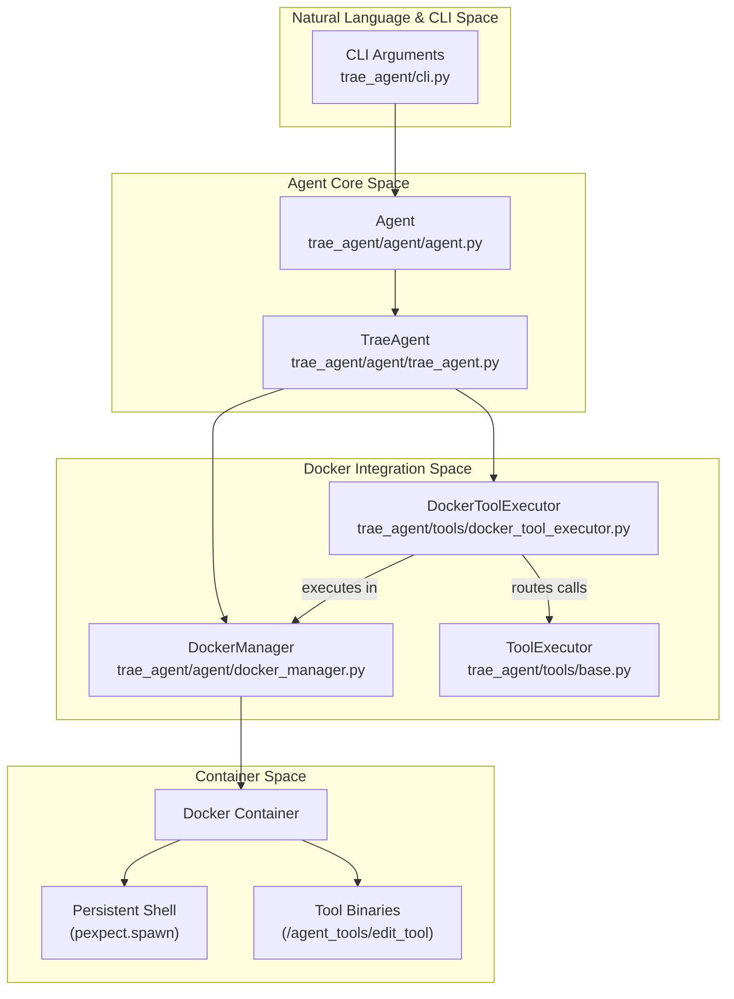
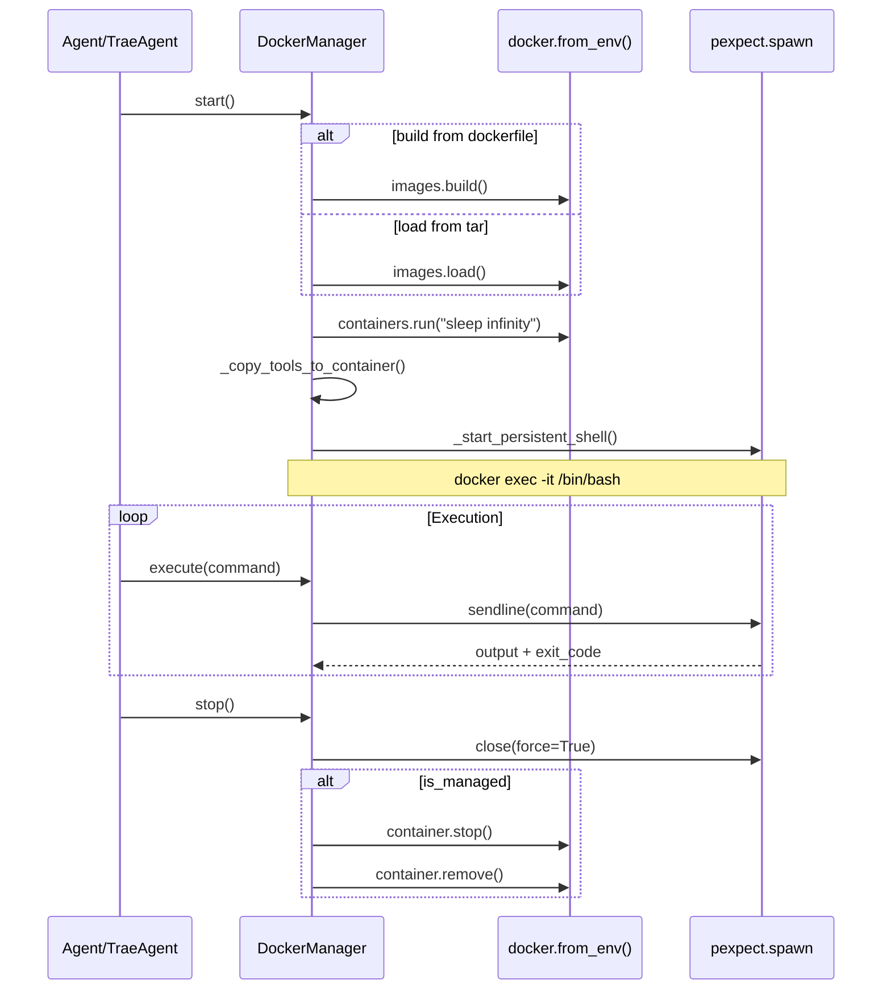
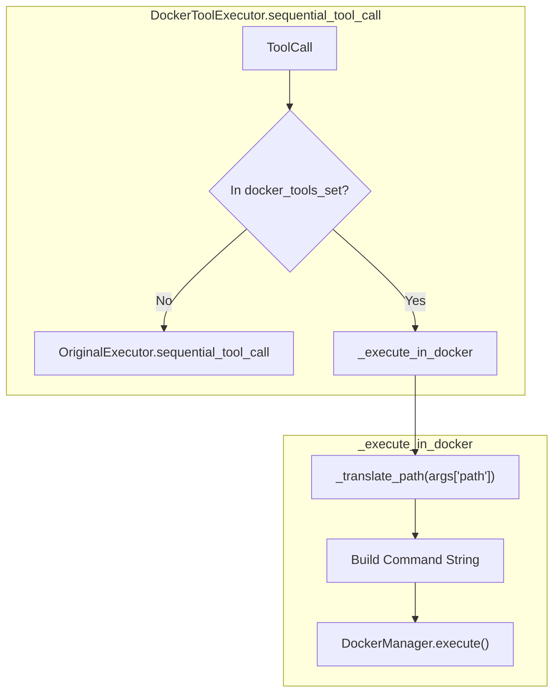

<!-- source: DeepWiki mcp.deepwiki.com · repo bytedance/trae-agent · page 3.4 Docker Mode · fetched 2026-10-29 -->

# Docker Mode

<details>
<summary>Relevant source files</summary>

The following files were used as context for generating this wiki page:

- [tests/test_cli.py](tests/test_cli.py)
- [trae_agent/agent/agent.py](trae_agent/agent/agent.py)
- [trae_agent/agent/docker_manager.py](trae_agent/agent/docker_manager.py)
- [trae_agent/cli.py](trae_agent/cli.py)
- [trae_agent/dist/dist_tools/edit_tool](trae_agent/dist/dist_tools/edit_tool)
- [trae_agent/dist/dist_tools/json_edit_tool](trae_agent/dist/dist_tools/json_edit_tool)
- [trae_agent/tools/docker_tool_executor.py](trae_agent/tools/docker_tool_executor.py)
- [trae_agent/tools/edit_tool_cli.py](trae_agent/tools/edit_tool_cli.py)
- [trae_agent/tools/json_edit_tool_cli.py](trae_agent/tools/json_edit_tool_cli.py)

</details>


## Purpose and Scope

This document covers Docker Mode in Trae Agent, which provides isolated execution environments for tool operations. Docker Mode enables tasks to run inside Docker containers for reproducibility, security, and environment consistency. 

For general agent architecture, see [Agent System](). For detailed tool documentation, see [Tools Reference]().

## Overview

Docker Mode isolates tool execution within Docker containers, providing:

- **Environment Isolation**: Tools run in containerized environments separate from the host.
- **Reproducibility**: Consistent execution environments across different machines.
- **Security**: Potentially unsafe code executes in sandboxed containers.
- **Workspace Mounting**: Host directories can be mounted into containers for file access.

When Docker Mode is enabled, specific tools (by default: `bash`, `str_replace_based_edit_tool`, `json_edit_tool`) execute inside the container while other tools run on the host.

**Sources**: [trae_agent/cli.py:144-175](), [trae_agent/agent/docker_manager.py:10-14]()

## Enabling Docker Mode

Docker Mode is enabled by providing one of four mutually exclusive CLI options:

| Option | Description | Example |
|--------|-------------|---------|
| `--docker-image` | Specify a Docker image to pull/use | `--docker-image python:3.12` |
| `--docker-container-id` | Attach to existing container | `--docker-container-id 91998a56056c` |
| `--dockerfile-path` | Build from a Dockerfile | `--dockerfile-path /path/to/Dockerfile` |
| `--docker-image-file` | Load from tar archive | `--docker-image-file image.tar` |

### CLI Examples

```bash
# Use a pre-built Docker image
trae-cli run "Add tests" --docker-image python:3.11

# Mount workspace directory
trae-cli run "write a script" --docker-image python:3.12 --working-dir test_workdir/

# Attach to existing container
trae-cli run "Update API" --docker-container-id 91998a56056c

# Build from Dockerfile
trae-cli run "Debug auth" --dockerfile-path /abs/path/Dockerfile

# Load from tar file
trae-cli run "Fix bug" --docker-image-file custom_image.tar

# Control container cleanup
trae-cli run "Add tests" --docker-image python:3.11 --docker-keep false
```

**Sources**: [trae_agent/cli.py:144-175]()

## Architecture Overview

The following diagram maps the high-level Docker integration to the specific classes and files in the codebase.



**Docker Mode Architecture**: Shows how CLI arguments flow through the agent system to initialize `DockerManager` and `DockerToolExecutor`.

**Sources**: [trae_agent/cli.py:207-213](), [trae_agent/agent/agent.py:45-47](), [trae_agent/tools/docker_tool_executor.py:9-28]()

## Container Specification Methods

Docker Mode supports four methods for specifying containers, handled in `DockerManager.__init__` [trae_agent/agent/docker_manager.py:18-44]():

### 1. Docker Image (`--docker-image`)
Pulls an existing image and creates a new container. If `workspace_dir` is provided, it is mounted to `/workspace` in `rw` mode [trae_agent/agent/docker_manager.py:93-98]().

### 2. Container ID (`--docker-container-id`)
Attaches to an existing running container. Sets `_is_managed = False` so the container is not destroyed on exit [trae_agent/agent/docker_manager.py:84-88]().

### 3. Dockerfile Path (`--dockerfile-path`)
Builds a new image from a local Dockerfile with a unique tag `trae-agent-custom:{uuid}` [trae_agent/agent/docker_manager.py:48-68]().

### 4. Docker Image File (`--docker-image-file`)
Loads an image from a local `.tar` archive using `client.images.load()` [trae_agent/agent/docker_manager.py:70-82]().

**Sources**: [trae_agent/agent/docker_manager.py:45-121]()

## DockerManager Lifecycle



**DockerManager Lifecycle**: Illustrates the initialization, command execution loop via `pexpect`, and cleanup logic.

**Sources**: [trae_agent/agent/docker_manager.py:45-159]()

### Key Lifecycle Methods

- **`start()`**: Handles image preparation, container creation, tool injection, and shell initialization [trae_agent/agent/docker_manager.py:45-127]().
- **`execute(command, timeout)`**: Uses `_execute_interactive` to send commands to the persistent bash session and capture output using a marker `---CMD_DONE---$?` to extract the exit code [trae_agent/agent/docker_manager.py:128-139]().
- **`stop()`**: Terminates the shell and cleans up the container if it was created by the agent (`_is_managed`) [trae_agent/agent/docker_manager.py:140-159]().

## Tool Execution Routing

The `DockerToolExecutor` routes tool calls based on whether the tool name exists in `_docker_tools_set` [trae_agent/tools/docker_tool_executor.py:61-68]().



**Tool Execution Routing**: Shows the decision logic and path translation step for Docker-bound tools.

**Sources**: [trae_agent/tools/docker_tool_executor.py:57-81]()

### Command Building Logic

The `_execute_in_docker` method translates high-level tool calls into CLI commands executed inside the container:

- **Bash**: Directly executes the provided `command` string [trae_agent/tools/docker_tool_executor.py:97-101]().
- **Edit Tool (`str_replace_based_edit_tool`)**: Invokes the binary at `/agent_tools/edit_tool` with arguments like `--path`, `--old_str`, and `--new_str` [trae_agent/tools/docker_tool_executor.py:104-125]().
- **JSON Edit Tool (`json_edit_tool`)**: Invokes the binary at `/agent_tools/json_edit_tool`, serializing the `value` argument to a JSON string [trae_agent/tools/docker_tool_executor.py:127-142]().

**Sources**: [trae_agent/tools/docker_tool_executor.py:94-155]()

## Path Translation

To ensure the agent can interact with files regardless of the environment, `DockerToolExecutor` performs path translation [trae_agent/tools/docker_tool_executor.py:35-47]().

If a host workspace is configured, it identifies if the provided path is within that workspace and converts it to the corresponding container path (default `/workspace`) [trae_agent/tools/docker_tool_executor.py:40-46]().

**Sources**: [trae_agent/tools/docker_tool_executor.py:35-47]()

## Packaged Tool Binaries

Trae Agent uses PyInstaller to package `edit_tool_cli.py` and `json_edit_tool_cli.py` into standalone binaries [trae_agent/cli.py:89-116](). This avoids dependency issues inside the Docker container.

- **`edit_tool`**: Handles `view`, `create`, `str_replace`, and `insert` operations [trae_agent/tools/edit_tool_cli.py:161-170]().
- **`json_edit_tool`**: Handles JSONPath-based edits using `jsonpath_ng` [trae_agent/tools/json_edit_tool_cli.py:127-210]().

These binaries are copied into the container's `/agent_tools` directory during startup [trae_agent/agent/docker_manager.py:162-180]().

**Sources**: [trae_agent/cli.py:89-116](), [trae_agent/agent/docker_manager.py:162-180]()

---

