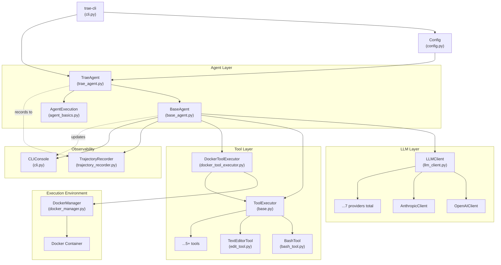
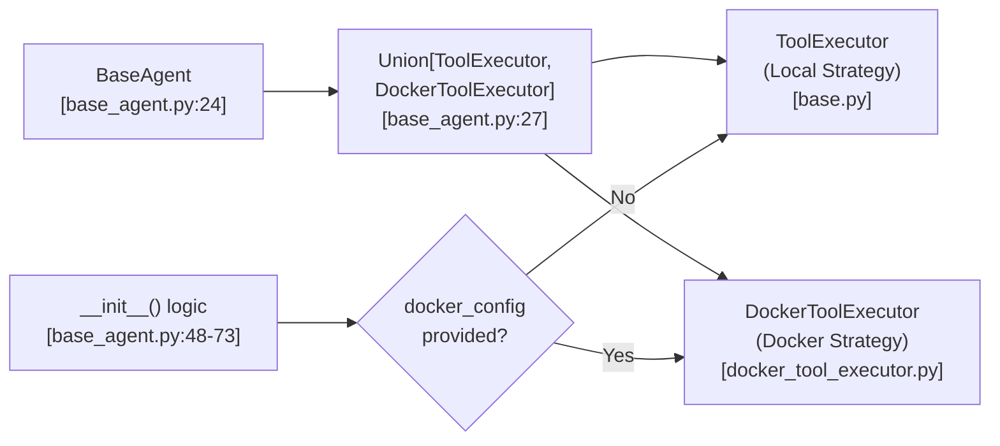
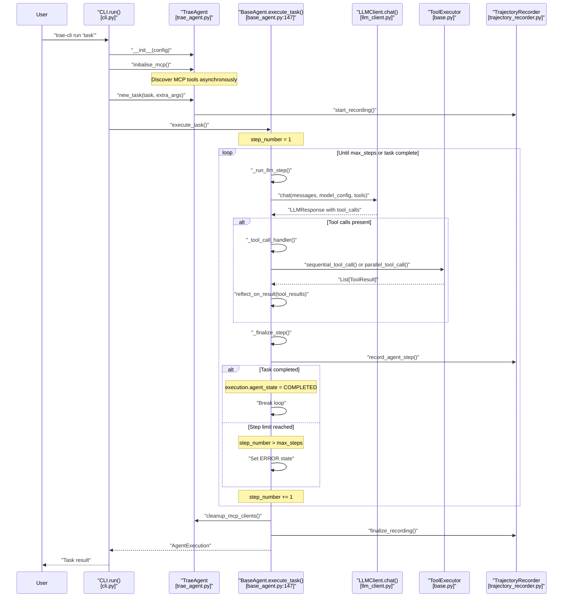
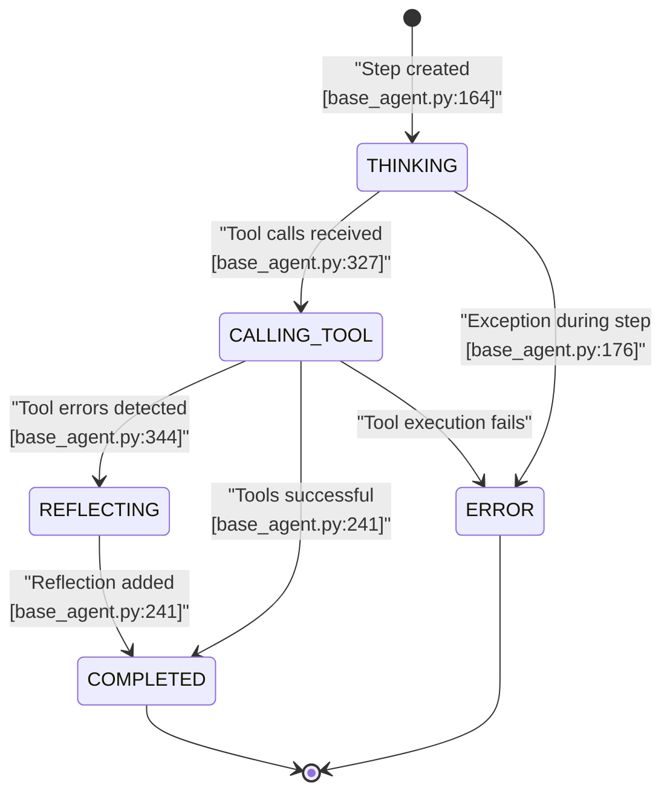
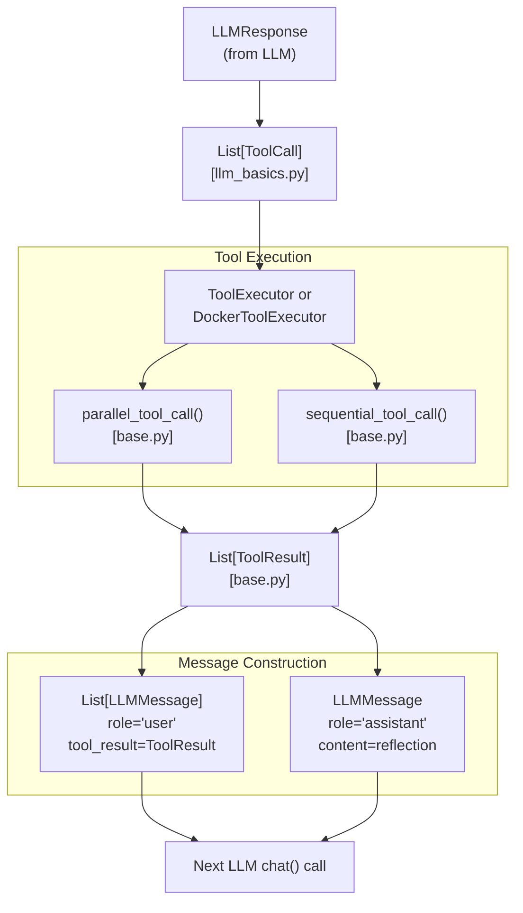
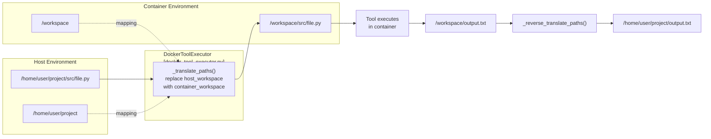
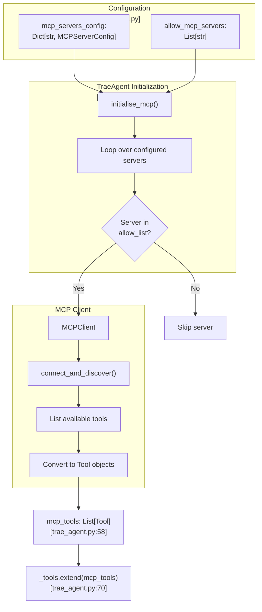
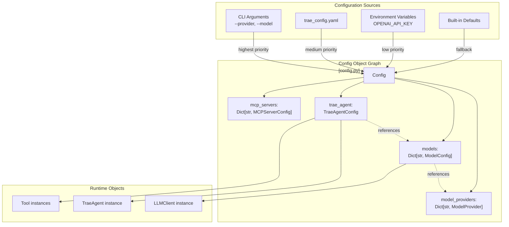

<!-- source: DeepWiki mcp.deepwiki.com · repo bytedance/trae-agent · page 4 Architecture · fetched 2026-10-29 -->

# Architecture

<details>
<summary>Relevant source files</summary>

The following files were used as context for generating this wiki page:

- [README.md](README.md)

</details>


## Purpose and Scope

This document provides a comprehensive overview of Trae Agent's system architecture, design patterns, and component interactions. It explains how the major subsystems work together to enable LLM-based software engineering tasks.

For detailed information on specific subsystems, see:
- Agent execution lifecycle and state management: [Agent System](#4.1)
- Tool framework and execution mechanisms: [Tool System](#4.2)
- Multi-provider LLM abstraction: [LLM Integration](#4.3)
- Container-based execution: [Docker Integration](#4.4)
- External tool discovery: [MCP Integration](#4.5)
- Execution logging and summarization: [Trajectory Recording and Lakeview](#4.6)

## System Overview

Trae Agent follows a layered architecture with clear separation of concerns. The system orchestrates LLM interactions, tool execution, and environment management to solve software engineering tasks autonomously.

### High-Level Architecture



**Sources:** [trae_agent/agent/trae_agent.py:30-40](), [trae_agent/agent/base_agent.py:24-40](), [trae_agent/agent/docker_manager.py:15-30]()

### Key Components

| Component | File Path | Responsibility |
|-----------|-----------|----------------|
| `TraeAgent` | [trae_agent/agent/trae_agent.py]() | Implements software engineering-specific agent logic, MCP integration |
| `BaseAgent` | [trae_agent/agent/base_agent.py]() | Provides abstract agent execution framework and lifecycle management |
| `LLMClient` | [trae_agent/utils/llm_clients/llm_client.py]() | Abstracts LLM provider interactions via unified interface |
| `ToolExecutor` | [trae_agent/tools/base.py]() | Executes tools locally in the host environment |
| `DockerToolExecutor` | [trae_agent/tools/docker_tool_executor.py]() | Routes tool execution to Docker containers |
| `DockerManager` | [trae_agent/agent/docker_manager.py]() | Manages container lifecycle and persistent shell sessions |
| `TrajectoryRecorder` | [trae_agent/utils/trajectory_recorder.py]() | Records complete execution traces for debugging and analysis |
| `CLIConsole` | [trae_agent/utils/cli.py]() | Provides real-time user feedback during execution |

**Sources:** [trae_agent/agent/trae_agent.py:30-50](), [trae_agent/agent/base_agent.py:24-45](), [trae_agent/agent/docker_manager.py:15-30]()

## Core Design Patterns

### Template Method Pattern

`BaseAgent` implements the template method pattern for task execution. The abstract class defines the execution skeleton while allowing subclasses to customize specific behaviors.

```mermaid
graph TB
    subgraph "BaseAgent Template Methods"
        execute_task["execute_task()<br/>[base_agent.py:147-200]"]
        _run_llm_step["_run_llm_step()<br/>[base_agent.py:209-236]"]
        _finalize_step["_finalize_step()<br/>[base_agent.py:238-244]"]
    end
    
    subgraph "Abstract Methods (Override Required)"
        new_task["new_task()<br/>[base_agent.py:137-145]"]
        cleanup_mcp_clients["cleanup_mcp_clients()<br/>[base_agent.py:280-283]"]
    end
    
    subgraph "Hook Methods (Override Optional)"
        reflect_on_result["reflect_on_result()<br/>[base_agent.py:246-257]"]
        llm_indicates_task_completed["llm_indicates_task_completed()<br/>[base_agent.py:259-270]"]
        _is_task_completed["_is_task_completed()<br/>[base_agent.py:272-274]"]
        task_incomplete_message["task_incomplete_message()<br/>[base_agent.py:276-278]"]
    end
    
    subgraph "TraeAgent Overrides"
        trae_new_task["new_task()<br/>[trae_agent.py:103-154]"]
        trae_cleanup["cleanup_mcp_clients()<br/>[trae_agent.py:252-258]"]
        trae_system_prompt["get_system_prompt()<br/>[trae_agent.py:172-174]"]
        trae_task_completed["llm_indicates_task_completed()<br/>[trae_agent.py:229-233]"]
        trae_is_completed["_is_task_completed()<br/>[trae_agent.py:236-244]"]
        trae_incomplete_msg["task_incomplete_message()<br/>[trae_agent.py:247-249]"]
    end
    
    execute_task --> _run_llm_step
    _run_llm_step --> _finalize_step
    
    new_task -.->|implemented by| trae_new_task
    cleanup_mcp_clients -.->|implemented by| trae_cleanup
    llm_indicates_task_completed -.->|overridden by| trae_task_completed
    _is_task_completed -.->|overridden by| trae_is_completed
    task_incomplete_message -.->|overridden by| trae_incomplete_msg
```



**Sources:** [trae_agent/agent/base_agent.py:24-353](), [trae_agent/agent/trae_agent.py:30-259]()

### Strategy Pattern

The system uses the strategy pattern for tool execution, allowing seamless switching between local and Docker-based execution.



The strategy is selected during initialization in [trae_agent/agent/base_agent.py:48-73]():

```python
original_tool_executor = ToolExecutor(self._tools)
if docker_config:
    # ... create DockerManager ...
    self._tool_caller = DockerToolExecutor(
        original_executor=original_tool_executor,
        docker_manager=self.docker_manager,
        docker_tools=["bash", "str_replace_based_edit_tool", "json_edit_tool"],
        host_workspace_dir=docker_config.get("workspace_dir"),
        container_workspace_dir=self.docker_manager.container_workspace,
    )
else:
    self._tool_caller = original_tool_executor
```

**Sources:** [trae_agent/agent/base_agent.py:27-73](), [trae_agent/tools/docker_tool_executor.py]()

### Factory Pattern

`LLMClient` uses the factory pattern to instantiate the appropriate provider client based on configuration.

| Provider | Client Class | Module Path |
|----------|--------------|-------------|
| OpenAI | `OpenAIClient` | [trae_agent/utils/llm_clients/openai_client.py]() |
| Anthropic | `AnthropicClient` | [trae_agent/utils/llm_clients/anthropic_client.py]() |
| Google | `GoogleClient` | [trae_agent/utils/llm_clients/google_client.py]() |
| Azure | `AzureClient` | [trae_agent/utils/llm_clients/azure_client.py]() |
| Ollama | `OllamaClient` | [trae_agent/utils/llm_clients/ollama_client.py]() |
| OpenRouter | `OpenRouterClient` | [trae_agent/utils/llm_clients/openrouter_client.py]() |
| Doubao | `DoubaoClient` | [trae_agent/utils/llm_clients/doubao_client.py]() |

**Sources:** [trae_agent/utils/llm_clients/llm_client.py]()

### Registry Pattern

The `tools_registry` dictionary serves as a central registry for tool discovery and instantiation in [trae_agent/tools/__init__.py]():

```python
tools_registry = {
    "bash": BashTool,
    "str_replace_based_edit_tool": TextEditorTool,
    "sequentialthinking": SequentialThinkingTool,
    "task_done": TaskDoneTool,
    "json_edit_tool": JSONEditTool,
    # ... additional tools
}
```

Tools are instantiated by name in [trae_agent/agent/trae_agent.py:117-119]():

```python
self._tools: list[Tool] = [
    tools_registry[tool_name](model_provider=provider) for tool_name in tool_names
]
```

**Sources:** [trae_agent/tools/__init__.py](), [trae_agent/agent/trae_agent.py:117-119]()

## Task Execution Flow

### Complete Execution Lifecycle



**Sources:** [trae_agent/agent/base_agent.py:147-200](), [trae_agent/agent/trae_agent.py:103-170](), [trae_agent/utils/cli.py]()

### Step State Machine

Each agent step transitions through defined states tracked in `AgentStepState`:



The states are defined in [trae_agent/agent/agent_basics.py]():

| State | Description | File Reference |
|-------|-------------|----------------|
| `THINKING` | Agent is waiting for LLM response | [trae_agent/agent/base_agent.py:213]() |
| `CALLING_TOOL` | Agent is executing tool calls | [trae_agent/agent/base_agent.py:327]() |
| `REFLECTING` | Agent is analyzing tool failures | [trae_agent/agent/base_agent.py:344]() |
| `COMPLETED` | Step finished successfully | [trae_agent/agent/base_agent.py:241]() |
| `ERROR` | Step encountered an error | [trae_agent/agent/base_agent.py:175-177]() |

**Sources:** [trae_agent/agent/agent_basics.py](), [trae_agent/agent/base_agent.py:147-352]()

## Component Interaction Patterns

### Message Flow During Tool Execution



The flow is implemented in [trae_agent/agent/base_agent.py:314-352]():

1. **Tool Call Extraction** [trae_agent/agent/base_agent.py:235](): Extract `tool_calls` from `LLMResponse`
2. **Execution Strategy** [trae_agent/agent/base_agent.py:331-334](): Choose parallel or sequential based on `model_config.parallel_tool_calls`
3. **Result Conversion** [trae_agent/agent/base_agent.py:337-340](): Convert `ToolResult` objects to `LLMMessage` objects with `role="user"`
4. **Reflection** [trae_agent/agent/base_agent.py:342-350](): Optionally add reflection message if tool execution failed
5. **Message Return** [trae_agent/agent/base_agent.py:352](): Return messages to be appended to conversation history

**Sources:** [trae_agent/agent/base_agent.py:314-352](), [trae_agent/utils/llm_clients/llm_basics.py](), [trae_agent/tools/base.py]()

### Docker Path Translation

When using Docker mode, `DockerToolExecutor` translates paths between host and container filesystems:



**Sources:** [trae_agent/tools/docker_tool_executor.py](), [trae_agent/agent/docker_manager.py:40]()

### MCP Tool Discovery

MCP (Model Context Protocol) integration enables dynamic tool discovery from external servers:



The discovery happens asynchronously in [trae_agent/agent/trae_agent.py:65-100]():

```python
async def initialise_mcp(self):
    """Async factory to create and initialize TraeAgent."""
    await self.discover_mcp_tools()
    if self.mcp_tools:
        self._tools.extend(self.mcp_tools)
```

**Sources:** [trae_agent/agent/trae_agent.py:65-100](), [trae_agent/utils/mcp_client.py](), [trae_agent/utils/config.py]()

## Configuration and Extension Points

### Configuration Hierarchy

Configuration flows through multiple layers with clear override semantics:



The priority order is:
1. **CLI Arguments** - Highest priority, used for quick overrides [README.md:123]()
2. **YAML File** - Primary configuration source [README.md:44-81]()
3. **Environment Variables** - For secrets and deployment-specific values [README.md:94-109]()
4. **Defaults** - Fallback values built into the code [README.md:123]()

**Sources:** [trae_agent/utils/config.py](), [trae_agent/utils/cli.py](), [README.md:123]()

### Extension Points

The architecture provides several extension points for customization:

| Extension Point | Interface/Base Class | Purpose | Example |
|-----------------|---------------------|---------|---------|
| **Custom Agent** | `BaseAgent` | Implement domain-specific agent logic | `TraeAgent` extends for software engineering |
| **Custom Tool** | `Tool` | Add new capabilities | Bash, Edit, Sequential Thinking tools |
| **Custom LLM Provider** | Abstract LLM client interface | Support new LLM APIs | Doubao, Ollama implementations |
| **Custom Console** | `CLIConsole` | Change user feedback mechanism | Rich TUI vs Simple console |
| **MCP Servers** | MCP protocol | Add external tools dynamically | Playwright, filesystem servers |

Each extension point is documented in detail in its respective subsection page.

**Sources:** [trae_agent/agent/base_agent.py](), [trae_agent/tools/base.py](), [trae_agent/utils/llm_clients/](), [trae_agent/utils/cli.py]()

## Summary

The Trae Agent architecture achieves flexibility and maintainability through:

- **Layered Design**: Clear separation between agent logic, LLM integration, tool execution, and environment management.
- **Design Patterns**: Template method, strategy, factory, and registry patterns enable extensibility.
- **Abstraction**: Abstract base classes allow swapping implementations (e.g., different LLM providers, execution environments).
- **Configuration**: Hierarchical configuration system supports multiple deployment scenarios.
- **Observability**: Built-in trajectory recording and console feedback support debugging and analysis.

For detailed information on each subsystem, refer to the child pages: [Agent System](#4.1), [Tool System](#4.2), [LLM Integration](#4.3), [Docker Integration](#4.4), [MCP Integration](#4.5), and [Trajectory Recording and Lakeview](#4.6).

---

