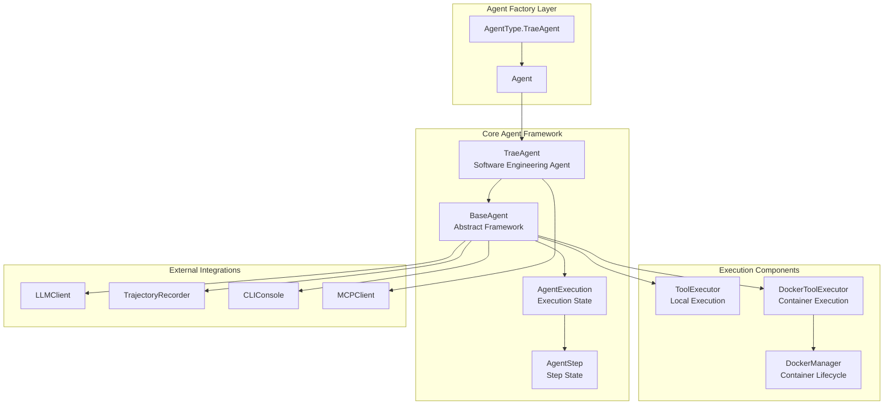
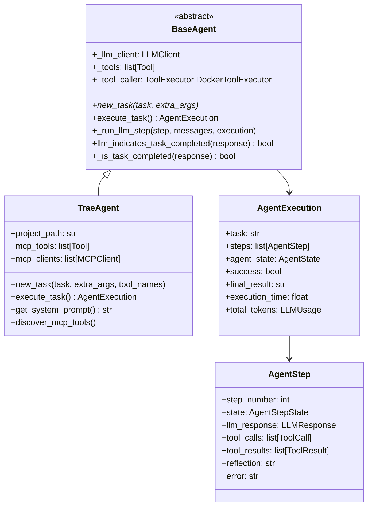
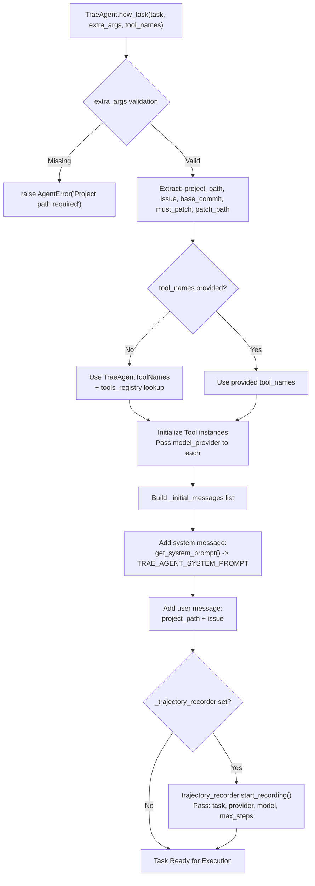
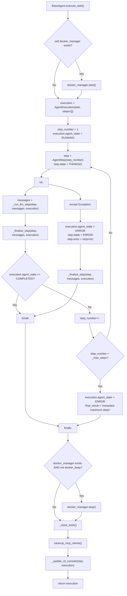
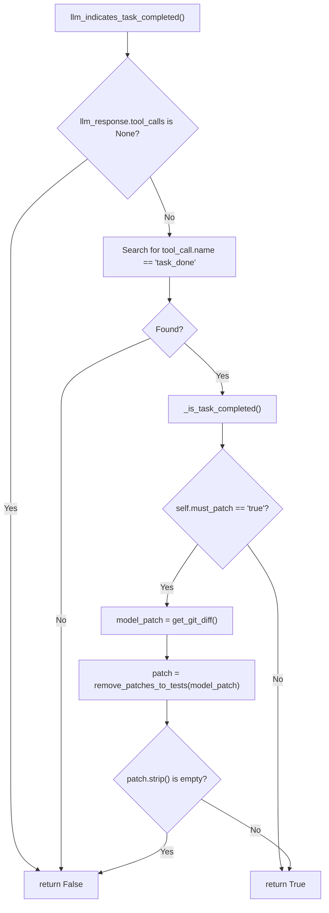
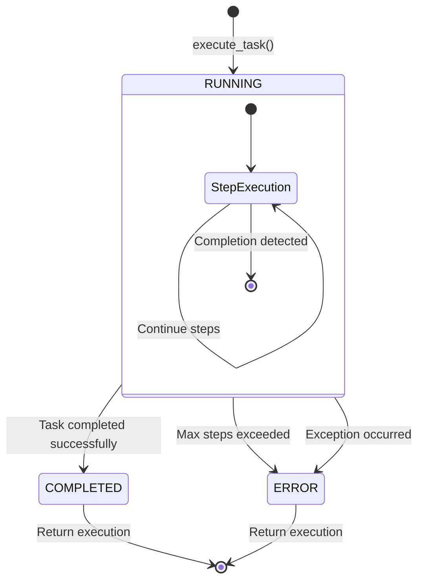
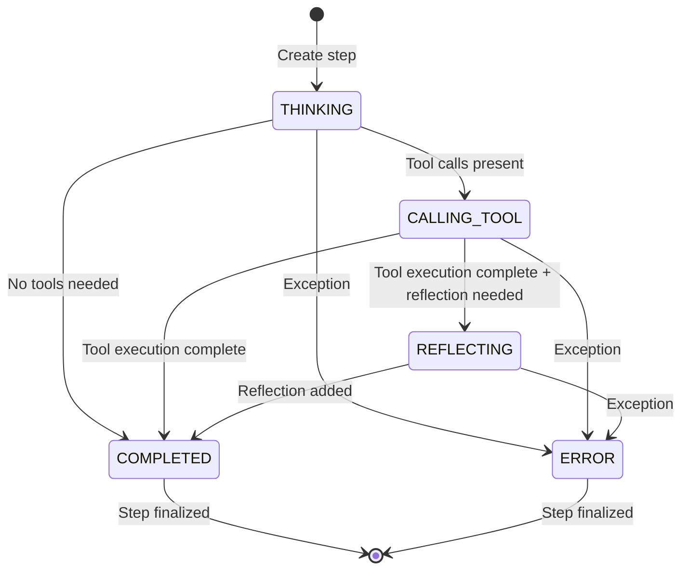
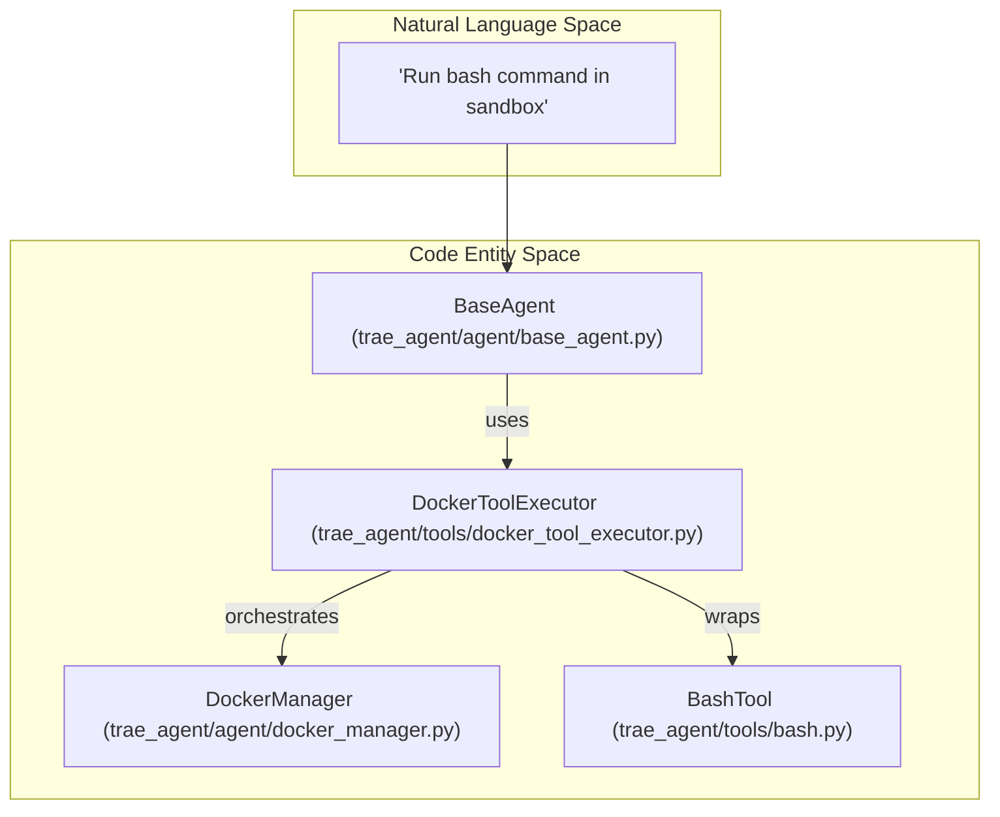
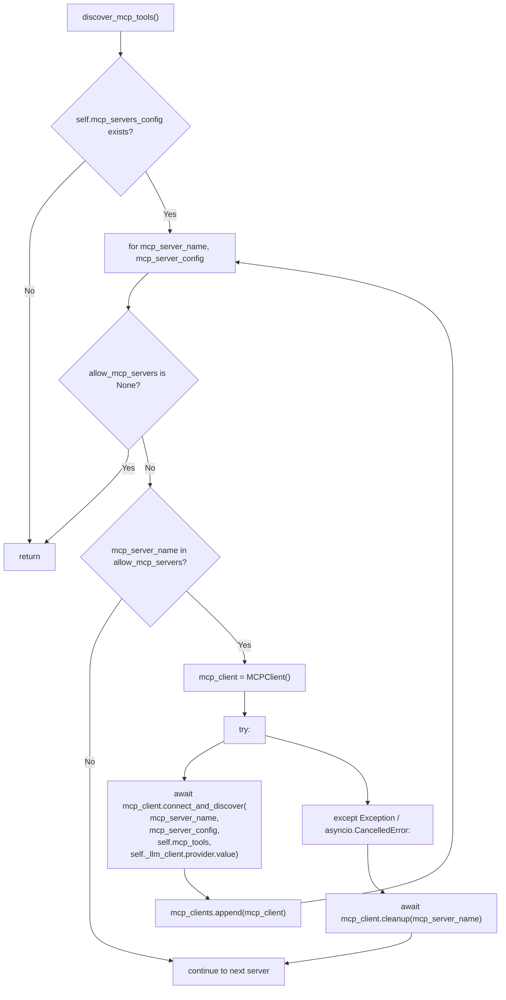

<!-- source: DeepWiki mcp.deepwiki.com · repo bytedance/trae-agent · page 4.1 Agent System · fetched 2026-10-29 -->

# Agent System

Relevant source files

The following files were used as context for generating this wiki page:

- [.github/workflows/pre-commit.yml](.github/workflows/pre-commit.yml)
- [.github/workflows/unit-test.yml](.github/workflows/unit-test.yml)
- [Makefile](Makefile)
- [tests/agent/test_trae_agent.py](tests/agent/test_trae_agent.py)
- [trae_agent/agent/agent_basics.py](trae_agent/agent/agent_basics.py)
- [trae_agent/agent/base_agent.py](trae_agent/agent/base_agent.py)
- [trae_agent/agent/trae_agent.py](trae_agent/agent/trae_agent.py)

## Purpose and Scope

The Agent System provides the core orchestration framework for LLM-based software engineering tasks in `trae-agent`. This system manages the complete lifecycle of agent execution, from task initialization through iterative LLM interactions to completion. It handles state management, tool coordination, and execution environments. [trae_agent/agent/trae_agent.py:4-31]()

For information about the underlying tool framework, see [Tool System](#4.2). For LLM integration details, see [LLM Integration](#4.3). For Docker execution specifics, see [Docker Integration](#4.4).

## Architecture Overview

The agent system follows a layered architecture with clear separation between abstract framework, concrete implementations, and execution environments:

Title: Agent Architecture Layers

**Sources:** [trae_agent/agent/base_agent.py:24-82](), [trae_agent/agent/trae_agent.py:30-64](), [trae_agent/agent/agent_basics.py:19-81]()

## Core Classes and Relationships

### BaseAgent Framework

The `BaseAgent` class provides the abstract foundation for all agent implementations, managing the `LLMClient`, `ToolExecutor`, and execution loop. [trae_agent/agent/base_agent.py:24-29]()

| Component | Type | Purpose |
|-----------|------|---------|
| `BaseAgent` | Abstract Class | Core execution framework and lifecycle management [trae_agent/agent/base_agent.py:24]() |
| `AgentExecution` | State Container | Tracks overall execution progress and results [trae_agent/agent/agent_basics.py:67]() |
| `AgentStep` | State Container | Represents individual execution steps with LLM interactions [trae_agent/agent/agent_basics.py:39]() |
| `AgentStepState` | Enum | Step states: `THINKING`, `CALLING_TOOL`, `REFLECTING`, `COMPLETED`, `ERROR` [trae_agent/agent/agent_basics.py:19]() |
| `AgentState` | Enum | Execution states: `IDLE`, `RUNNING`, `COMPLETED`, `ERROR` [trae_agent/agent/agent_basics.py:29]() |

Title: Class Relationship Diagram

**Sources:** [trae_agent/agent/base_agent.py:24-147](), [trae_agent/agent/agent_basics.py:19-81](), [trae_agent/agent/trae_agent.py:30-170]()

## Task Execution Lifecycle

### Task Initialization

Task initialization occurs through the `new_task()` method in `TraeAgent`, which sets up the execution context, project path, and toolset. [trae_agent/agent/trae_agent.py:103-109]()

Title: Task Initialization Flow

The `TraeAgentToolNames` constant defines the default tool set for software engineering tasks:
- `str_replace_based_edit_tool`
- `sequentialthinking`
- `json_edit_tool`
- `task_done`
- `bash`
[trae_agent/agent/trae_agent.py:21-27]()

**Sources:** [trae_agent/agent/trae_agent.py:103-154](), [trae_agent/agent/base_agent.py:42-45]()

### Execution Loop

The main execution loop in `BaseAgent.execute_task()` implements an iterative LLM interaction pattern until completion or max steps are reached. [trae_agent/agent/base_agent.py:147-163]()

Title: Main Execution Loop

**Sources:** [trae_agent/agent/base_agent.py:147-201]()

### Task Completion Detection

`TraeAgent` overrides the base completion detection to verify that a valid patch has been generated if `must_patch` is set. [trae_agent/agent/trae_agent.py:229-249]()

| Method | Purpose | Implementation Details |
|--------|---------|----------------------|
| `llm_indicates_task_completed()` | Detects completion signals | Checks if any `tool_call.name == "task_done"` in `llm_response.tool_calls`. [trae_agent/agent/trae_agent.py:229]() |
| `_is_task_completed()` | Validates actual completion | If `must_patch == "true"`: calls `get_git_diff()`, applies `remove_patches_to_tests()`, verifies patch is non-empty. [trae_agent/agent/trae_agent.py:240]() |
| `get_git_diff()` | Generates patch | Executes `git --no-pager diff` in project directory. [trae_agent/agent/trae_agent.py:180]() |

Title: Completion Verification Flow

**Sources:** [trae_agent/agent/trae_agent.py:180-249](), [tests/agent/test_trae_agent.py:89-98]()

## State Management

### AgentExecution State

The `AgentExecution` object tracks the complete execution lifecycle. [trae_agent/agent/agent_basics.py:67-82]()

Title: Execution State Machine

### AgentStep State Transitions

Individual steps follow a defined state progression within the loop. [trae_agent/agent/agent_basics.py:19-27]()

Title: Step State Machine

**Sources:** [trae_agent/agent/agent_basics.py:19-82](), [trae_agent/agent/base_agent.py:147-201]()

## Docker Integration

The agent system supports containerized tool execution through `DockerToolExecutor` and `DockerManager`. [trae_agent/agent/base_agent.py:49-71]()

Title: Docker Tool Execution Mapping

**Sources:** [trae_agent/agent/base_agent.py:49-74](), [trae_agent/tools/docker_tool_executor.py:16-65]()

## MCP Integration

`TraeAgent` supports Model Context Protocol (MCP) for external tool discovery. [trae_agent/agent/trae_agent.py:65-71]()

Title: MCP Tool Discovery Flow

**Sources:** [trae_agent/agent/trae_agent.py:72-101]()

## Integration Points

### External System Integration

The agent system integrates with several external components:

| Component | Purpose | Integration Point |
|-----------|---------|------------------|
| `LLMClient` | AI model communication | `BaseAgent._llm_client` [trae_agent/agent/base_agent.py:37]() |
| `TrajectoryRecorder` | Execution logging | `BaseAgent._trajectory_recorder` [trae_agent/agent/base_agent.py:78]() |
| `CLIConsole` | Progress display | `BaseAgent._cli_console` [trae_agent/agent/base_agent.py:75]() |
| `ToolExecutor` | Tool coordination | `BaseAgent._tool_caller` [trae_agent/agent/base_agent.py:73]() |
| `MCPClient` | External tool discovery | `TraeAgent.mcp_clients` [trae_agent/agent/trae_agent.py:59]() |

**Sources:** [trae_agent/agent/base_agent.py:37-82](), [trae_agent/agent/trae_agent.py:52-63]()

---

