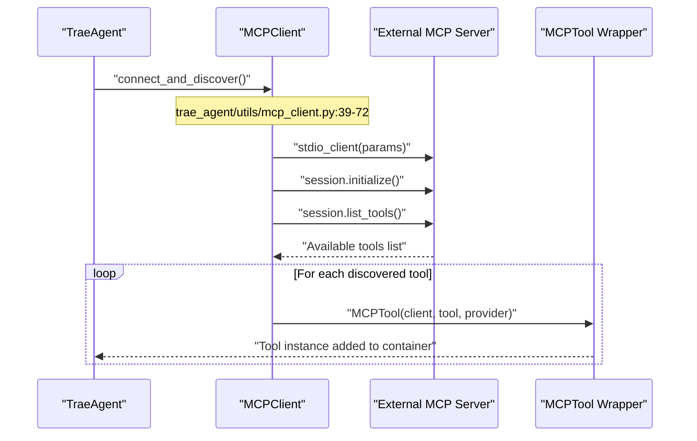
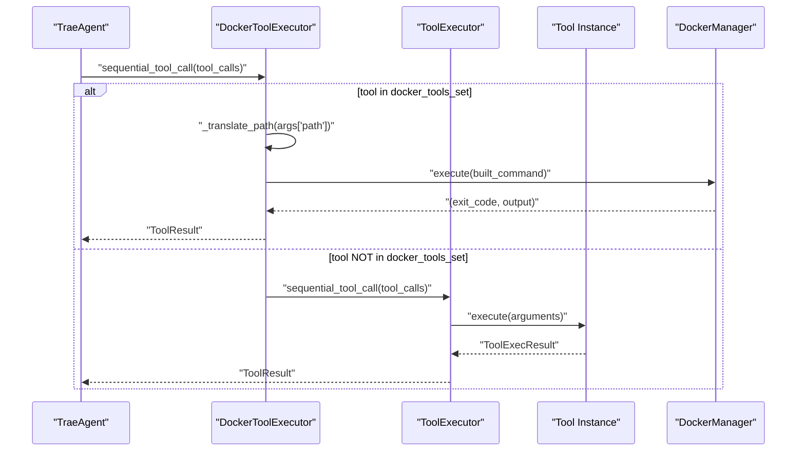

<!-- source: DeepWiki mcp.deepwiki.com · repo bytedance/trae-agent · page 4.2 Tool System · fetched 2026-10-29 -->

# Tool System

<details>
<summary>Relevant source files</summary>

The following files were used as context for generating this wiki page:

- [tests/tools/test_bash_tool.py](tests/tools/test_bash_tool.py)
- [trae_agent/agent/agent.py](trae_agent/agent/agent.py)
- [trae_agent/dist/dist_tools/edit_tool](trae_agent/dist/dist_tools/edit_tool)
- [trae_agent/dist/dist_tools/json_edit_tool](trae_agent/dist/dist_tools/json_edit_tool)
- [trae_agent/tools/__init__.py](trae_agent/tools/__init__.py)
- [trae_agent/tools/base.py](trae_agent/tools/base.py)
- [trae_agent/tools/bash_tool.py](trae_agent/tools/bash_tool.py)
- [trae_agent/tools/docker_tool_executor.py](trae_agent/tools/docker_tool_executor.py)
- [trae_agent/tools/edit_tool.py](trae_agent/tools/edit_tool.py)
- [trae_agent/tools/edit_tool_cli.py](trae_agent/tools/edit_tool_cli.py)
- [trae_agent/tools/json_edit_tool_cli.py](trae_agent/tools/json_edit_tool_cli.py)
- [trae_agent/tools/run.py](trae_agent/tools/run.py)
- [trae_agent/tools/sequential_thinking_tool.py](trae_agent/tools/sequential_thinking_tool.py)
- [trae_agent/tools/task_done_tool.py](trae_agent/tools/task_done_tool.py)
- [trae_agent/utils/cli/simple_console.py](trae_agent/utils/cli/simple_console.py)
- [trae_agent/utils/mcp_client.py](trae_agent/utils/mcp_client.py)

</details>


## Purpose and Scope

The Tool System is the core mechanism that enables the trae-agent to interact with external systems and perform concrete actions during task execution. It provides a standardized framework for registering, discovering, and executing tools that can perform operations such as running shell commands, editing files, structured data manipulation, and reasoning tasks.

The system supports both built-in tools (implemented directly in the codebase) and external tools discovered through the Model Context Protocol (MCP). This hybrid approach allows the agent to leverage both curated, high-performance tools and dynamically discovered external capabilities. Furthermore, it supports execution in isolated environments via the `DockerToolExecutor`.

For information about how tools are integrated into the agent's execution loop, see [Agent System](4.1). For detailed documentation of individual tools and their usage, see [Tools Reference](5).

## Architecture Overview

The Tool System follows a registry-based architecture where tools are registered by name and executed through a centralized `ToolExecutor` or a specialized `DockerToolExecutor`.

### Tool System Architecture

```mermaid
graph TB
    subgraph "Tool Registry and Discovery"
        tools_registry["tools_registry<br/>dict[str, type[Tool]]<br/>trae_agent/tools/__init__.py:27-34"]
        MCPClient["MCPClient<br/>trae_agent/utils/mcp_client.py:26-104"]
        MCPDiscovery["MCP Tool Discovery<br/>connect_and_discover()"]
    end
    
    subgraph "Base Framework"
        Tool["Tool<br/>Abstract Base Class<br/>trae_agent/tools/base.py:74-180"]
        ToolExecutor["ToolExecutor<br/>trae_agent/tools/base.py:182-244"]
        DockerToolExecutor["DockerToolExecutor<br/>trae_agent/tools/docker_tool_executor.py:9-163"]
        ToolParameter["ToolParameter<br/>trae_agent/tools/base.py:63-72"]
    end
    
    subgraph "Built-in Tools"
        BashTool["BashTool<br/>trae_agent/tools/bash_tool.py:162-247<br/>name: 'bash'"]
        TextEditorTool["TextEditorTool<br/>trae_agent/tools/edit_tool.py:27-285<br/>name: 'str_replace_based_edit_tool'"]
        JSONEditTool["JSONEditTool<br/>trae_agent/tools/json_edit_tool_cli.py:49-184<br/>name: 'json_edit_tool'"]
        SequentialThinkingTool["SequentialThinkingTool<br/>trae_agent/tools/sequential_thinking_tool.py:32-212<br/>name: 'sequentialthinking'"]
        TaskDoneTool["TaskDoneTool<br/>trae_agent/tools/task_done_tool.py:14-53<br/>name: 'task_done'"]
        CKGTool["CKGTool<br/>trae_agent/tools/ckg_tool.py<br/>name: 'ckg'"]
    end
    
    subgraph "External Tools"
        MCPTool["MCPTool<br/>Dynamic MCP Wrappers"]
        ExternalMCPServers["External MCP Servers<br/>Playwright, etc."]
    end
    
    subgraph "Execution Pipeline"
        execute_tool_call["execute_tool_call()<br/>trae_agent/tools/base.py:205-236"]
        docker_execute["_execute_in_docker()<br/>trae_agent/tools/docker_tool_executor.py:77-163"]
    end
    
    subgraph "Data Flow"
        ToolCall["ToolCall<br/>trae_agent/tools/base.py:49-60"]
        ToolExecResult["ToolExecResult<br/>trae_agent/tools/base.py:25-31"]
        ToolResult["ToolResult<br/>trae_agent/tools/base.py:34-43"]
    end
    
    tools_registry --> BashTool
    tools_registry --> TextEditorTool
    tools_registry --> JSONEditTool
    tools_registry --> SequentialThinkingTool
    tools_registry --> TaskDoneTool
    tools_registry --> CKGTool
    
    MCPClient --> MCPDiscovery
    MCPDiscovery --> MCPTool
    MCPTool --> ExternalMCPServers
    
    Tool <|-- BashTool
    Tool <|-- TextEditorTool
    Tool <|-- JSONEditTool
    Tool <|-- SequentialThinkingTool
    Tool <|-- TaskDoneTool
    Tool <|-- CKGTool
    Tool <|-- MCPTool
    
    ToolExecutor --> execute_tool_call
    DockerToolExecutor --> docker_execute
    
    ToolCall --> execute_tool_call
    ToolCall --> docker_execute
    execute_tool_call --> ToolResult
    docker_execute --> ToolResult
    Tool --> ToolExecResult
    ToolExecResult --> ToolResult
    
    Tool --> ToolParameter
```

**Sources:** [trae_agent/tools/__init__.py:27-34](), [trae_agent/tools/base.py:74-180](), [trae_agent/tools/base.py:182-244](), [trae_agent/tools/bash_tool.py:162-247](), [trae_agent/utils/mcp_client.py:26-104](), [trae_agent/tools/docker_tool_executor.py:9-163]()

## Tool Discovery and Management

The tool system uses a dual approach for tool discovery and management:

1. **Built-in Tools**: Registered in `tools_registry` dictionary in [trae_agent/tools/__init__.py:27-34]().
2. **External MCP Tools**: Dynamically discovered through the Model Context Protocol.

### Built-in Tool Registry

The `tools_registry` dictionary maps tool names to their implementation classes:

| Tool Name | Tool Class | Purpose | Registry Key |
|-----------|------------|---------|--------------|
| `bash` | `BashTool` | Execute shell commands and scripts | `"bash"` |
| `str_replace_based_edit_tool` | `TextEditorTool` | File viewing, creation, and editing | `"str_replace_based_edit_tool"` |
| `json_edit_tool` | `JSONEditTool` | JSON data manipulation using JSONPath | `"json_edit_tool"` |
| `sequentialthinking` | `SequentialThinkingTool` | Structured problem-solving and reasoning | `"sequentialthinking"` |
| `task_done` | `TaskDoneTool` | Signal task completion with verification | `"task_done"` |
| `ckg` | `CKGTool` | Code knowledge graph analysis | `"ckg"` |

**Sources:** [trae_agent/tools/__init__.py:27-34]()

### MCP Tool Discovery

External tools are discovered through the `MCPClient` system:



**Sources:** [trae_agent/utils/mcp_client.py:39-72](), [trae_agent/utils/mcp_client.py:97-99]()

### Tool Name Normalization

The `ToolExecutor` implements name normalization in `_normalize_name()` to handle variations in tool name formatting by making it lowercase and removing underscores [trae_agent/tools/base.py:195-197](). This allows flexible tool calling while maintaining consistent internal lookup.

## Tool Execution Framework

### ToolExecutor (Local)

The `ToolExecutor` manages local tool instances. It uses a `_tool_map` for fast lookup and handles the conversion from `ToolCall` to `ToolResult`.

- **Lookup**: Normalizes the requested tool name and retrieves the instance from the internal map [trae_agent/tools/base.py:207-217]().
- **Execution**: Calls the tool's `execute` method with provided arguments [trae_agent/tools/base.py:220]().
- **Error Handling**: Catches exceptions during execution and returns a failed `ToolResult` [trae_agent/tools/base.py:219-236]().

### DockerToolExecutor (Isolated)

The `DockerToolExecutor` delegates tool calls to either the local `ToolExecutor` or a Docker container based on a set of `docker_tools` [trae_agent/tools/docker_tool_executor.py:15-28]().

#### Path Translation
When executing in Docker, host paths must be translated to container paths. `_translate_path` calculates the relative path from the host workspace and joins it with the container workspace path [trae_agent/tools/docker_tool_executor.py:35-47]().

#### Docker Execution Logic (`_execute_in_docker`)
1. **Argument Preprocessing**: Automatically translates any argument named `"path"` using `_translate_path` [trae_agent/tools/docker_tool_executor.py:84-91]().
2. **Command Building**:
   - For `bash`: Runs the command directly [trae_agent/tools/docker_tool_executor.py:97-101]().
   - For `str_replace_based_edit_tool` and `json_edit_tool`: Invokes pre-compiled binary versions (e.g., `/edit_tool` or `/json_edit_tool`) located in the container's tools path [trae_agent/tools/docker_tool_executor.py:113-142]().
3. **Execution**: Uses `DockerManager.execute()` to run the built command and captures the exit code and output [trae_agent/tools/docker_tool_executor.py:149-155]().

**Sources:** [trae_agent/tools/docker_tool_executor.py:9-163](), [trae_agent/tools/base.py:182-244]()

## Tool Execution Lifecycle



**Sources:** [trae_agent/tools/docker_tool_executor.py:57-68](), [trae_agent/tools/docker_tool_executor.py:77-163](), [trae_agent/tools/base.py:205-236]()

## Base Classes and Interfaces

### Tool Abstract Base Class

The `Tool` class defines the interface for all tools. It includes metadata methods and the core `execute` logic.

| Method | Description | Source |
|--------|-------------|--------|
| `get_name()` | Returns the unique identifier for the tool. | [trae_agent/tools/base.py:100-103]() |
| `get_description()` | Provides instructions for the LLM on how to use the tool. | [trae_agent/tools/base.py:105-108]() |
| `get_parameters()` | Defines the expected arguments as `ToolParameter` objects. | [trae_agent/tools/base.py:110-113]() |
| `execute()` | Performs the tool's action and returns a `ToolExecResult`. | [trae_agent/tools/base.py:115-118]() |
| `close()` | Cleans up resources (e.g., closing shell sessions). | [trae_agent/tools/base.py:177-179]() |

### Tool Parameter Schema System

Tools define their input parameters using `ToolParameter`. The `get_input_schema()` method converts these into JSON Schema format [trae_agent/tools/base.py:127-175]().

- **OpenAI Strict Mode**: If the provider is `"openai"`, the schema is adjusted to mark all parameters as `required` (making optional ones nullable) and sets `additionalProperties: false` to comply with strict schema requirements [trae_agent/tools/base.py:144-172]().

**Sources:** [trae_agent/tools/base.py:63-72](), [trae_agent/tools/base.py:127-175]()

## Built-in Tool Examples

### BashTool
Maintains a persistent shell session using `_BashSession` [trae_agent/tools/bash_tool.py:19-160](). It uses sentinels to detect command completion and capture exit codes [trae_agent/tools/bash_tool.py:108-141]().

### TextEditorTool
Supports sub-commands: `view`, `create`, `str_replace`, and `insert` [trae_agent/tools/edit_tool.py:18-23](). It validates paths to ensure they are absolute and handles file operations with line-based context [trae_agent/tools/edit_tool.py:134-152]().

### SequentialThinkingTool
A specialized tool for breaking down complex problems. It maintains a `thought_history` and allows the agent to revise or branch thoughts [trae_agent/tools/sequential_thinking_tool.py:154-157]().

**Sources:** [trae_agent/tools/bash_tool.py:162-247](), [trae_agent/tools/edit_tool.py:27-132](), [trae_agent/tools/sequential_thinking_tool.py:32-212]()

---

