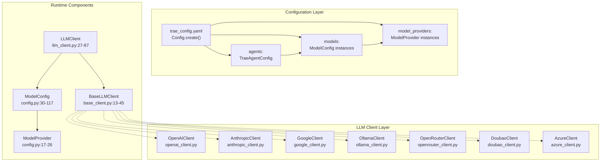
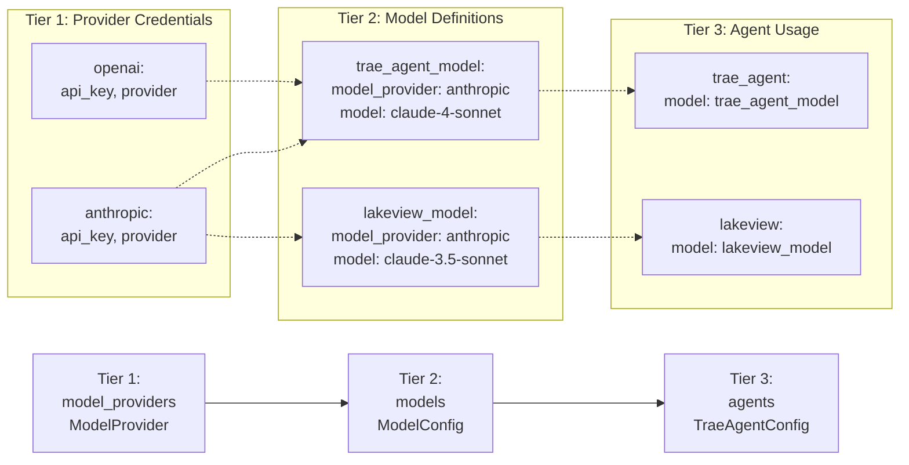
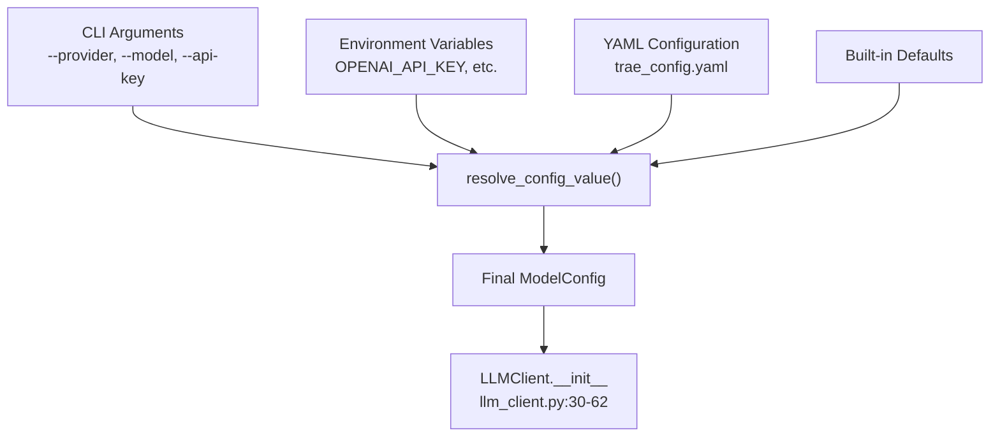
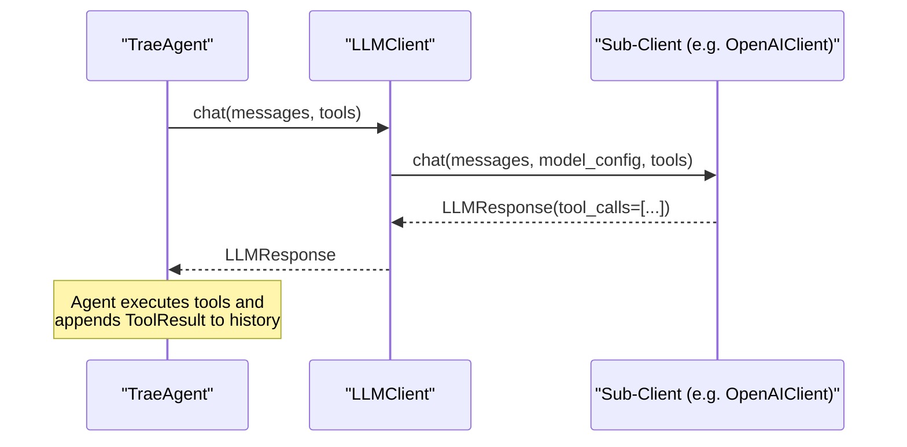

<!-- source: DeepWiki mcp.deepwiki.com · repo bytedance/trae-agent · page 4.3 LLM Integration · fetched 2026-10-29 -->

# LLM Integration

<details>
<summary>Relevant source files</summary>

The following files were used as context for generating this wiki page:

- [tests/utils/test_config.py](tests/utils/test_config.py)
- [trae_agent/utils/config.py](trae_agent/utils/config.py)
- [trae_agent/utils/legacy_config.py](trae_agent/utils/legacy_config.py)
- [trae_agent/utils/llm_clients/base_client.py](trae_agent/utils/llm_clients/base_client.py)
- [trae_agent/utils/llm_clients/llm_basics.py](trae_agent/utils/llm_clients/llm_basics.py)
- [trae_agent/utils/llm_clients/llm_client.py](trae_agent/utils/llm_clients/llm_client.py)
- [trae_config.yaml.example](trae_config.yaml.example)

</details>


## Purpose and Scope

The LLM integration system provides a unified abstraction layer for communicating with multiple Large Language Model providers. This system enables Trae Agent to work with seven different LLM providers through a common interface: OpenAI, Anthropic, Google Gemini, Azure OpenAI, Ollama, OpenRouter, and Doubao.

The integration handles model configuration, API communication, message formatting, and tool calling support. It supports flexible configuration through YAML files, environment variables, and CLI arguments.

For detailed information about individual provider implementations, see [LLM Provider Clients](#4.3.1). For information about how the agent uses LLM responses, see [Agent System](#4.1).

## Architecture Overview

The LLM integration uses a three-tier configuration model that separates provider credentials from model definitions and agent configurations. This design enables model reuse across agents and easy provider switching without code changes.

### LLM Integration System Architecture



Sources: [trae_agent/utils/config.py:17-117](), [trae_agent/utils/llm_clients/llm_client.py:27-87](), [trae_agent/utils/llm_clients/base_client.py:13-45](), [trae_config.yaml.example:1-44]()

## Core Components

### Three-Tier Configuration Model

The LLM integration uses a hierarchical configuration structure that separates concerns and enables flexible model management.

### Three-Tier Configuration Flow



Sources: [trae_config.yaml.example:21-44](), [trae_agent/utils/config.py:194-204]()

### ModelProvider Class

The `ModelProvider` dataclass defined in [trae_agent/utils/config.py:17-26]() contains provider-specific connection and authentication settings.

| Field | Type | Required | Description |
|-------|------|----------|-------------|
| `api_key` | `str` | Yes | Authentication key for the provider |
| `provider` | `str` | Yes | Provider identifier ("openai", "anthropic", "google", "azure", "ollama", "openrouter", "doubao") |
| `base_url` | `str \| None` | No | Custom API endpoint URL (optional for official providers) |
| `api_version` | `str \| None` | No | API version (required for Azure) |

Sources: [trae_agent/utils/config.py:17-26](), [trae_config.yaml.example:21-24]()

### ModelConfig Class

The `ModelConfig` dataclass defined in [trae_agent/utils/config.py:30-117]() encapsulates model parameters and generation settings. It references a `ModelProvider` instance and includes provider-specific parameters.

| Field | Type | Default | Description |
|-------|------|---------|-------------|
| `model` | `str` | Required | Model identifier (e.g., "gpt-4o", "claude-sonnet-4") |
| `model_provider` | `ModelProvider` | Required | Reference to provider configuration |
| `temperature` | `float` | Required | Sampling temperature (0.0-2.0) |
| `top_p` | `float` | Required | Nucleus sampling parameter |
| `top_k` | `int` | Required | Top-k sampling parameter |
| `parallel_tool_calls` | `bool` | Required | Enable parallel tool execution |
| `max_retries` | `int` | Required | Maximum retry attempts on API failures |
| `max_tokens` | `int \| None` | `None` | Legacy maximum tokens parameter |
| `max_completion_tokens` | `int \| None` | `None` | Azure OpenAI-specific maximum tokens |
| `supports_tool_calling` | `bool` | `True` | Whether model supports tool calling |
| `candidate_count` | `int \| None` | `None` | Gemini-specific candidate count |
| `stop_sequences` | `list[str] \| None` | `None` | Custom stop sequences |

**Key Methods:**

- `get_max_tokens_param()` - Returns effective max tokens, prioritizing `max_completion_tokens` over `max_tokens` [trae_agent/utils/config.py:48-56]()
- `should_use_max_completion_tokens()` - Determines if Azure's newer parameter should be used for gpt-5/o3/o4-mini models [trae_agent/utils/config.py:58-64]()
- `resolve_config_values()` - Applies CLI/environment variable overrides to configuration [trae_agent/utils/config.py:66-117]()

Sources: [trae_agent/utils/config.py:30-117](), [trae_config.yaml.example:27-44]()

## Configuration Resolution

The system resolves configuration values using a priority hierarchy, allowing flexible overrides at runtime.

### Configuration Priority and Resolution



### Configuration Resolution Process

The `ModelConfig.resolve_config_values()` method in [trae_agent/utils/config.py:66-117]() implements the priority cascade:

1. **CLI Arguments** (Highest Priority) - Direct overrides via command-line flags.
2. **Environment Variables** - Provider-specific environment variables constructed as `PROVIDER_API_KEY` and `PROVIDER_BASE_URL` [trae_agent/utils/config.py:97-110]().
3. **Configuration File** - Values from `trae_config.yaml` or legacy JSON config [trae_agent/utils/config.py:217-227]().

Sources: [trae_agent/utils/config.py:66-117](), [trae_agent/utils/config.py:217-227]()

## LLM Client Interface

The `LLMClient` class acts as a factory and wrapper for provider-specific implementations. It instantiates the correct `BaseLLMClient` subclass based on the `LLMProvider` enum [trae_agent/utils/llm_clients/llm_client.py:30-62]().

### Common Client Capabilities

All LLM clients provide:

1. **Message-based Communication** - `chat()` method for conversation [trae_agent/utils/llm_clients/llm_client.py:72-80]().
2. **Tool Calling Support** - Checkable via `supports_tool_calling()` [trae_agent/utils/llm_clients/llm_client.py:82-86]().
3. **Trajectory Recording** - Integration with `TrajectoryRecorder` for logging interactions [trae_agent/utils/llm_clients/llm_client.py:64-66]().
4. **History Management** - `set_chat_history()` for stateful interactions [trae_agent/utils/llm_clients/llm_client.py:68-70]().

### Standard Data Formats

The integration uses standardized dataclasses for communication [trae_agent/utils/llm_clients/llm_basics.py:10-53]():
- `LLMMessage`: Standardized message with role, content, and optional tool calls/results.
- `LLMResponse`: Unified response containing text, usage metrics, and tool calls.
- `LLMUsage`: Token consumption tracking including reasoning and cache metrics.

Sources: [trae_agent/utils/llm_clients/llm_client.py:15-87](), [trae_agent/utils/llm_clients/llm_basics.py:10-53](), [trae_agent/utils/llm_clients/base_client.py:13-45]()

## Provider-Specific Configurations

### Multi-Provider Configuration Example

The YAML configuration format enables defining multiple providers and models in a single file, allowing easy switching between providers:

```yaml
model_providers:
    anthropic:
        api_key: your_anthropic_api_key
        provider: anthropic

models:
    trae_agent_model:
        model_provider: anthropic
        model: claude-4-sonnet
        max_tokens: 4096
        temperature: 0.5
        parallel_tool_calls: true
```

### Base URL Customization

Providers support custom base URLs for local execution (Ollama), proxies (OpenRouter), or enterprise endpoints (Azure). The `OpenAIClient` and `AnthropicClient` both support passing a `base_url` to their respective underlying SDKs [tests/utils/test_config.py:72-94](), [tests/utils/test_config.py:117-140]().

Sources: [trae_config.yaml.example:21-44](), [tests/utils/test_config.py:14-140]()

## Tool Calling Support

The LLM integration system supports function/tool calling for models that provide this capability. Tool calling enables the LLM to request tool executions via the `ToolCall` and `ToolResult` structures [trae_agent/utils/llm_clients/llm_basics.py:7-17]().

### Tool Calling Workflow



**Key Considerations:**

- The `parallel_tool_calls` parameter in `ModelConfig` controls whether the model can request multiple tool executions simultaneously [trae_agent/utils/config.py:40]().
- The `supports_tool_calling()` method verifies if the client and model configuration allow tool use [trae_agent/utils/llm_clients/base_client.py:42-44]().

Sources: [trae_agent/utils/llm_clients/llm_client.py:72-86](), [trae_agent/utils/llm_clients/llm_basics.py:10-53](), [trae_agent/utils/config.py:30-46]()

## LLM Provider Clients

For detailed information about individual provider implementations, see the child page:
- [LLM Provider Clients](#4.3.1) — Detail each LLM provider client implementation including OpenAI, Anthropic, Google, Ollama, OpenRouter, Azure, and Doubao.

---

