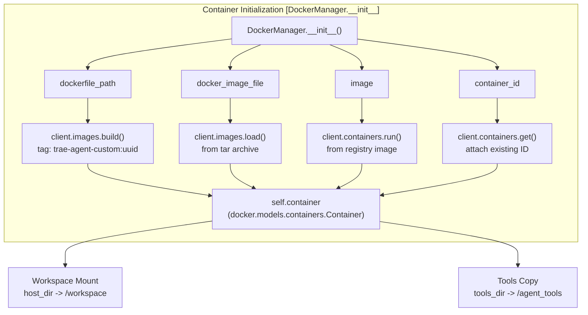
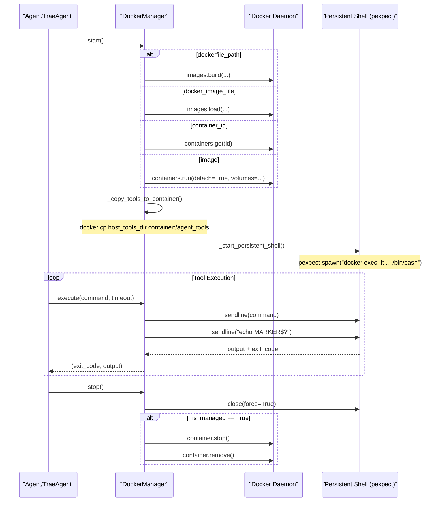
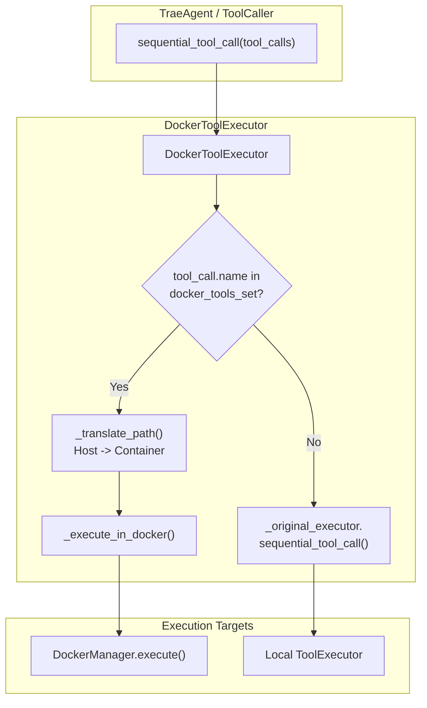
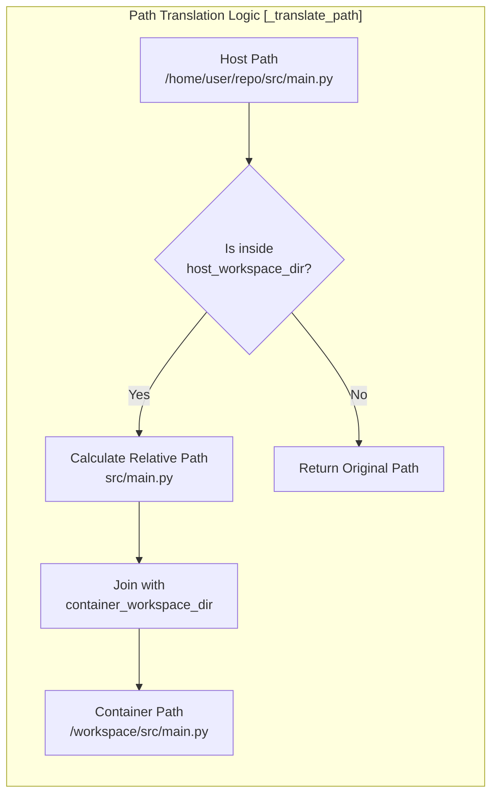

<!-- source: DeepWiki mcp.deepwiki.com · repo bytedance/trae-agent · page 4.4 Docker Integration · fetched 2026-10-29 -->

# Docker Integration

<details>
<summary>Relevant source files</summary>

The following files were used as context for generating this wiki page:

- [trae_agent/agent/agent.py](trae_agent/agent/agent.py)
- [trae_agent/agent/docker_manager.py](trae_agent/agent/docker_manager.py)
- [trae_agent/dist/dist_tools/edit_tool](trae_agent/dist/dist_tools/edit_tool)
- [trae_agent/dist/dist_tools/json_edit_tool](trae_agent/dist/dist_tools/json_edit_tool)
- [trae_agent/tools/docker_tool_executor.py](trae_agent/tools/docker_tool_executor.py)
- [trae_agent/tools/edit_tool_cli.py](trae_agent/tools/edit_tool_cli.py)
- [trae_agent/tools/json_edit_tool_cli.py](trae_agent/tools/json_edit_tool_cli.py)

</details>


## Purpose and Scope

This document describes the Docker integration subsystem in Trae Agent, which provides isolated execution environments for tool operations. Docker mode enables reproducible, secure execution by running tools inside containers with controlled workspace access. This page covers the `DockerManager` class, container lifecycle management, tool execution routing via `DockerToolExecutor`, and path translation mechanisms.

For information about the tool system architecture, see [Tool System](). For CLI usage of Docker mode, see [Docker Mode](). For tool implementations, see [Tools Reference]().

---

## Overview

Docker integration is an optional execution mode that wraps tool execution in isolated containers. When enabled, specific tools (`bash`, `str_replace_based_edit_tool`, `json_edit_tool`) execute inside a Docker container while other tools execute locally. The system manages container lifecycle, maintains persistent shell sessions, and translates file paths between host and container filesystems.

**Key Components:**
- **DockerManager**: Manages container lifecycle and command execution using `docker-py` and `pexpect`. [trae_agent/agent/docker_manager.py:10-14]()
- **DockerToolExecutor**: Routes tool calls and performs path translation between host and container. [trae_agent/tools/docker_tool_executor.py:9-13]()
- **Packaged Tools**: Standalone binaries built from `edit_tool_cli.py` and `json_edit_tool_cli.py` for execution inside the container. [trae_agent/cli.py:89-116]()

**Sources:** [trae_agent/agent/docker_manager.py:1-243](), [trae_agent/tools/docker_tool_executor.py:1-164](), [trae_agent/agent/agent.py:14-58]()

---

## DockerManager Architecture

### Container Initialization Options

The `DockerManager` class supports four methods for specifying or creating containers:



**Initialization Parameters:**

| Parameter | Type | Purpose | Code Location |
|-----------|------|---------|---------------|
| `dockerfile_path` | `str \| None` | Absolute path to Dockerfile for building | [trae_agent/agent/docker_manager.py:35]() |
| `docker_image_file` | `str \| None` | Path to `.tar` image archive | [trae_agent/agent/docker_manager.py:36]() |
| `image` | `str \| None` | Docker registry image name | [trae_agent/agent/docker_manager.py:33]() |
| `container_id` | `str \| None` | Existing container ID to attach | [trae_agent/agent/docker_manager.py:34]() |
| `workspace_dir` | `str \| None` | Host directory to mount as `/workspace` | [trae_agent/agent/docker_manager.py:37]() |
| `tools_dir` | `str \| None` | Host directory containing packaged tools | [trae_agent/agent/docker_manager.py:38]() |

**Sources:** [trae_agent/agent/docker_manager.py:18-43](), [trae_agent/agent/docker_manager.py:48-121]()

---

### Container Lifecycle

The `DockerManager` follows a sequence of building/loading, starting, tool injection, and cleanup:



**Sources:** [trae_agent/agent/docker_manager.py:45-123](), [trae_agent/agent/docker_manager.py:140-158](), [trae_agent/agent/docker_manager.py:162-179]()

---

### Command Execution with Persistent Shell

The `DockerManager` maintains a stateful shell session using `pexpect` to ensure that environment changes (e.g., `cd`, `export`) persist across tool calls:

1.  **Shell Initialization**: `_start_persistent_shell` spawns a `docker exec -it` process and waits for a prompt (`$ ` or `# `). [trae_agent/agent/docker_manager.py:181-205]()
2.  **Command Injection**: `execute` sends the tool command followed by `echo MARKER$?`. [trae_agent/agent/docker_manager.py:213-217]()
3.  **Exit Code Detection**: It expects the pattern `MARKER(\d+)` to extract the command's exit status. [trae_agent/agent/docker_manager.py:218-228]()
4.  **Output Cleaning**: The raw output is stripped of the command echo and the marker line before being returned. [trae_agent/agent/docker_manager.py:229-239]()

**Sources:** [trae_agent/agent/docker_manager.py:128-138](), [trae_agent/agent/docker_manager.py:207-242]()

---

## DockerToolExecutor Integration

### Tool Routing Architecture

`DockerToolExecutor` acts as a proxy, intercepting tool calls and deciding whether to run them locally or inside the container:



**Sources:** [trae_agent/tools/docker_tool_executor.py:57-68](), [trae_agent/tools/docker_tool_executor.py:77-146]()

---

### Tool Execution Translation

When a tool is routed to Docker, `_execute_in_docker` builds the appropriate shell command for the container environment:

| Tool Name | Container Executable Path | Command Construction Logic |
|-----------|---------------------------|----------------------------|
| `bash` | (Direct Shell) | Executes `arguments['command']` directly. [trae_agent/tools/docker_tool_executor.py:97-101]() |
| `str_replace_based_edit_tool` | `/agent_tools/edit_tool` | Appends subcommand and arguments as CLI flags (e.g., `--path`, `--old_str`). [trae_agent/tools/docker_tool_executor.py:104-125]() |
| `json_edit_tool` | `/agent_tools/json_edit_tool` | Serializes the `value` argument to a JSON string for CLI pass-through. [trae_agent/tools/docker_tool_executor.py:127-142]() |

**Sources:** [trae_agent/tools/docker_tool_executor.py:128-142](), [trae_agent/tools/docker_tool_executor.py:113-125]()

---

## Path Translation Mechanism

### Host-to-Container Path Mapping

The `_translate_path` function ensures that the agent (which sees host paths) can interact with the container filesystem (where the workspace is mounted at `/workspace`).



**Implementation Details:**
- It uses `os.path.commonpath` to verify if the requested path is within the configured `host_workspace_dir`. [trae_agent/tools/docker_tool_executor.py:40-43]()
- If within the workspace, it replaces the host prefix with `container_workspace_dir` (defaulting to `/workspace`). [trae_agent/tools/docker_tool_executor.py:44-46]()
- Paths outside the workspace are passed through unchanged. [trae_agent/tools/docker_tool_executor.py:47]()

**Sources:** [trae_agent/tools/docker_tool_executor.py:35-47]()

---

## Packaged Tools for Docker Execution

### PyInstaller-Built Binaries

Trae Agent uses PyInstaller to bundle tool logic into standalone ELF binaries. This avoids the need to install Python dependencies inside the user's Docker container.

- **`edit_tool`**: Compiled from `trae_agent/tools/edit_tool_cli.py`. [trae_agent/cli.py:91-102]()
- **`json_edit_tool`**: Compiled from `trae_agent/tools/json_edit_tool_cli.py`. [trae_agent/cli.py:104-116]()

These binaries are copied into the container's `/agent_tools` directory during the `DockerManager.start()` sequence. [trae_agent/agent/docker_manager.py:16-162]()

**CLI Interface for Container Tools:**
The `edit_tool_cli.py` and `json_edit_tool_cli.py` files provide a standard `argparse` interface so they can be invoked via `docker exec` strings.

- `TextEditorTool` (in `edit_tool_cli.py`) supports `view`, `create`, `str_replace`, and `insert`. [trae_agent/tools/edit_tool_cli.py:161-170]()
- `JSONEditTool` (in `json_edit_tool_cli.py`) supports JSONPath-based editing including `view`, `set`, `add`, and `remove`. [trae_agent/tools/json_edit_tool_cli.py:109-176]()

**Sources:** [trae_agent/tools/edit_tool_cli.py:145-171](), [trae_agent/tools/json_edit_tool_cli.py:72-176](), [trae_agent/agent/docker_manager.py:162-179]()

---

## Resource Management

### Cleanup and Lifecycle

The `Agent` class manages the high-level execution, while `TraeAgent` (via `BaseAgent`) handles the Docker lifecycle.

1.  **Start**: `TraeAgent` calls `docker_manager.start()` before the task loop begins. [trae_agent/agent/trae_agent.py:151-152]()
2.  **Execution**: Tools are routed through `DockerToolExecutor`. [trae_agent/tools/docker_tool_executor.py:57-68]()
3.  **Cleanup**: In the `finally` block of `execute_task`, the agent stops the manager if `docker_keep` is false. [trae_agent/agent/trae_agent.py:183-185]()

```python
# Cleanup logic in trae_agent.py
finally:
    if self.docker_manager and not self.docker_keep:
        self.docker_manager.stop()
```

The `stop()` method in `DockerManager` ensures the `pexpect` shell is closed and managed containers are removed from the Docker daemon. [trae_agent/agent/docker_manager.py:140-158]()

**Sources:** [trae_agent/agent/agent.py:90-100](), [trae_agent/agent/docker_manager.py:140-158](), [trae_agent/agent/trae_agent.py:183-191]()

---

