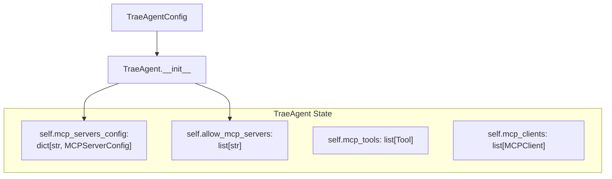
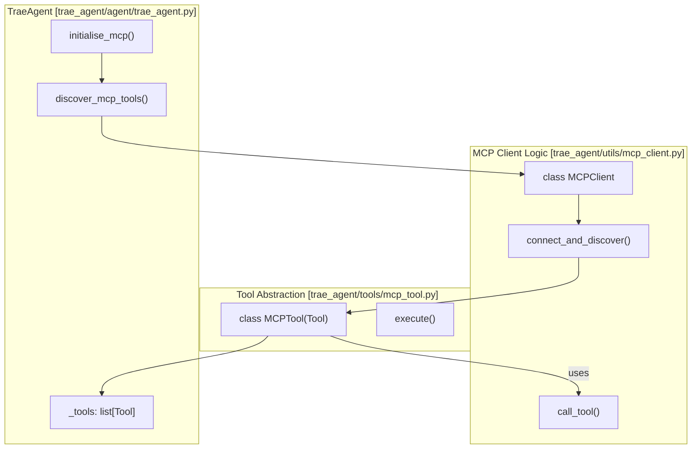
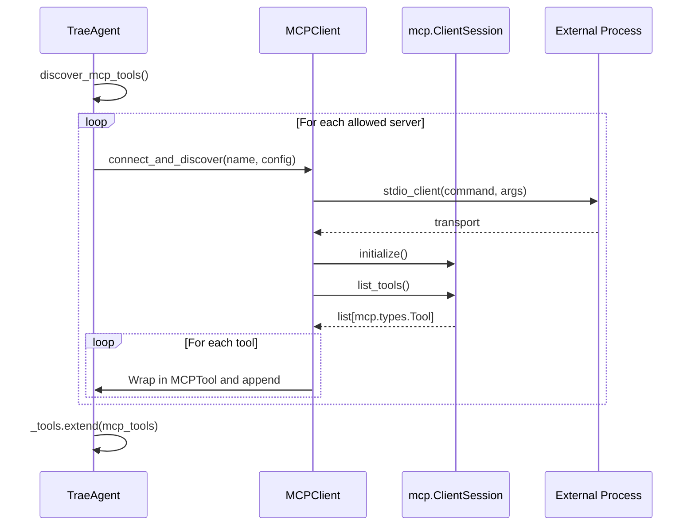

<!-- source: DeepWiki mcp.deepwiki.com · repo bytedance/trae-agent · page 4.5 MCP Integration · fetched 2026-10-29 -->

# MCP Integration

<details>
<summary>Relevant source files</summary>

The following files were used as context for generating this wiki page:

- [tests/tools/test_mcp_tool.py](tests/tools/test_mcp_tool.py)
- [tests/utils/test_mcp_client.py](tests/utils/test_mcp_client.py)
- [trae_agent/agent/trae_agent.py](trae_agent/agent/trae_agent.py)
- [trae_agent/tools/__init__.py](trae_agent/tools/__init__.py)
- [trae_agent/tools/mcp_tool.py](trae_agent/tools/mcp_tool.py)
- [trae_agent/utils/cli/simple_console.py](trae_agent/utils/cli/simple_console.py)
- [trae_agent/utils/mcp_client.py](trae_agent/utils/mcp_client.py)

</details>


## Purpose and Scope

This document explains the Multi-Client Protocol (MCP) integration in Trae Agent, which enables dynamic discovery and execution of external tools from MCP servers. MCP allows Trae Agent to extend its capabilities beyond built-in tools by connecting to external services like Playwright for browser automation or filesystem operations.

For information about the core tool system architecture, see [Tool System](). For details on built-in tools, see [Tools Reference]().

## Overview

MCP is a protocol for exposing tools and resources to LLM-based agents. Trae Agent integrates MCP to dynamically discover tools from external servers at runtime, allowing extensibility without modifying the agent's core code.

The integration currently focuses on `stdio` transport for local processes and handles the full lifecycle of MCP client connections including initialization, tool discovery, and cleanup.

**Sources:** [trae_agent/agent/trae_agent.py:19-27](), [trae_agent/utils/mcp_client.py:26-31]()

## Configuration System

### MCPServerConfig Data Class

MCP servers are configured through the `MCPServerConfig` dataclass. While the protocol supports several transports, the current implementation in `MCPClient` focuses on `stdio`.

| Transport Type | Configuration Fields | Implementation Status |
|----------------|---------------------|-----------------------|
| **stdio** | `command`, `args`, `env`, `cwd` | Fully Supported [trae_agent/utils/mcp_client.py:51-58]() |
| **SSE** | `url` | Not implemented [trae_agent/utils/mcp_client.py:49-50]() |
| **HTTP** | `http_url`, `headers` | Not implemented [trae_agent/utils/mcp_client.py:47-48]() |

**Sources:** [trae_agent/utils/config.py:119-143](), [trae_agent/utils/mcp_client.py:39-64]()

### Configuration Loading

MCP configuration is stored within the `TraeAgentConfig` and passed to the agent during initialization.



**Sources:** [trae_agent/agent/trae_agent.py:52-59](), [trae_agent/utils/config.py:269-272]()

## MCP Integration Architecture

### Component Overview

The integration bridges the gap between the `mcp` library's types and the Trae Agent's internal `Tool` abstractions.



**Sources:** [trae_agent/agent/trae_agent.py:65-71](), [trae_agent/utils/mcp_client.py:26-45](), [trae_agent/tools/mcp_tool.py:8-13]()

## Tool Discovery Process

### Initialization Flow

MCP tool discovery happens asynchronously during agent initialization via `initialise_mcp`.



**Sources:** [trae_agent/agent/trae_agent.py:65-88](), [trae_agent/utils/mcp_client.py:39-70]()

### Discovery Implementation

The `discover_mcp_tools` method iterates through configured servers, checking them against the `allow_mcp_servers` whitelist. For each valid server, it instantiates an `MCPClient` and calls `connect_and_discover`.

```python
# From trae_agent/agent/trae_agent.py:72-88
async def discover_mcp_tools(self):
    if self.mcp_servers_config:
        for mcp_server_name, mcp_server_config in self.mcp_servers_config.items():
            if self.allow_mcp_servers is None:
                return
            if mcp_server_name not in self.allow_mcp_servers:
                continue
            mcp_client = MCPClient()
            try:
                await mcp_client.connect_and_discover(
                    mcp_server_name,
                    mcp_server_config,
                    self.mcp_tools,
                    self._llm_client.provider.value,
                )
                self.mcp_clients.append(mcp_client)
```

**Sources:** [trae_agent/agent/trae_agent.py:72-88]()

## MCPTool Implementation

The `MCPTool` class (defined in `trae_agent/tools/mcp_tool.py`) acts as a wrapper that allows external MCP tools to be treated like native Trae Agent tools.

### Parameter Mapping
`MCPTool.get_parameters()` maps JSON Schema properties from the MCP server to `ToolParameter` objects used by Trae Agent.

```python
# From trae_agent/tools/mcp_tool.py:30-44
def properties_to_parameter():
    parameters = []
    inputSchema = self.tool.inputSchema
    required = inputSchema.get("required", [])
    properties = inputSchema.get("properties", {})
    for name, prop in properties.items():
        tool_para = ToolParameter(
            name=name,
            type=prop["type"],
            items=prop.get("items", None),
            description=prop["description"],
            required=name in required,
        )
        parameters.append(tool_para)
    return parameters
```

### Execution
When the agent executes an `MCPTool`, it delegates the call back to the `MCPClient` which communicates with the external server.

```python
# From trae_agent/tools/mcp_tool.py:49-58
async def execute(self, arguments: ToolCallArguments) -> ToolExecResult:
    try:
        output = await self.client.call_tool(self.get_name(), arguments)
        if output.isError:
            return ToolExecResult(output=None, error=output.content[0].text)
        else:
            return ToolExecResult(output=output.content[0].text)
    except Exception as e:
        return ToolExecResult(error=f"Error running mcp tool: {e}", error_code=-1)
```

**Sources:** [trae_agent/tools/mcp_tool.py:27-58]()

## Lifecycle and State Management

### Server Status
The `MCPClient` tracks the connection status of each server using the `MCPServerStatus` enum.

| Status | Description |
|--------|-------------|
| `DISCONNECTED` | Server is offline or encountered errors [trae_agent/utils/mcp_client.py:12]() |
| `CONNECTING` | Server is currently establishing a connection [trae_agent/utils/mcp_client.py:13]() |
| `CONNECTED` | Server is ready for tool discovery/execution [trae_agent/utils/mcp_client.py:14]() |

**Sources:** [trae_agent/utils/mcp_client.py:11-14](), [trae_agent/utils/mcp_client.py:33-37]()

### Cleanup Process
To prevent resource leaks, TraeAgent maintains a list of active `mcp_clients`. These are cleaned up using an `AsyncExitStack` managed within the `MCPClient`.

```python
# From trae_agent/utils/mcp_client.py:101-105
async def cleanup(self, mcp_server_name):
    """Clean up resources"""
    await self.exit_stack.aclose()
    self.update_mcp_server_status(mcp_server_name, MCPServerStatus.DISCONNECTED)
```

**Sources:** [trae_agent/agent/trae_agent.py:89-98](), [trae_agent/utils/mcp_client.py:30](), [trae_agent/utils/mcp_client.py:101-105]()

## Error Handling

The integration includes robust error handling for the discovery phase:

1.  **Whitelist Enforcement**: Only servers explicitly listed in `allow_mcp_servers` are initialized [trae_agent/agent/trae_agent.py:77-78]().
2.  **Connection Failure Isolation**: If one MCP server fails to connect, the agent catches the exception, cleans up that specific client, and continues to the next server [trae_agent/agent/trae_agent.py:89-93]().
3.  **Async Cancellation**: `asyncio.CancelledError` is specifically handled to ensure cleanup happens even if the initialization task is aborted [trae_agent/agent/trae_agent.py:94-98]().
4.  **Tool Execution Errors**: `MCPTool.execute` wraps external server errors and exceptions into a standard `ToolExecResult` with an error message and code [trae_agent/tools/mcp_tool.py:52-58]().

**Sources:** [trae_agent/agent/trae_agent.py:72-98](), [trae_agent/tools/mcp_tool.py:49-58]()

---

