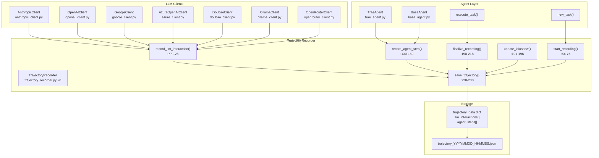
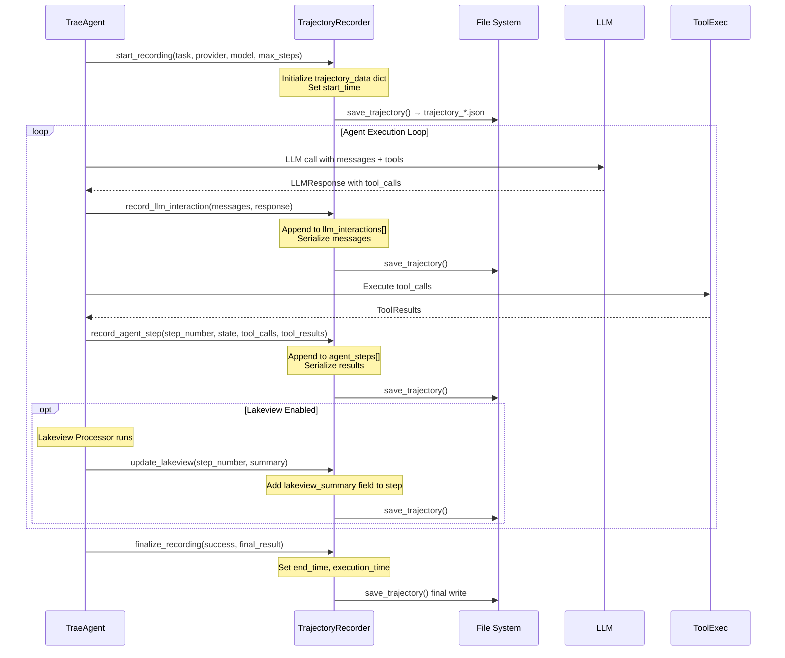
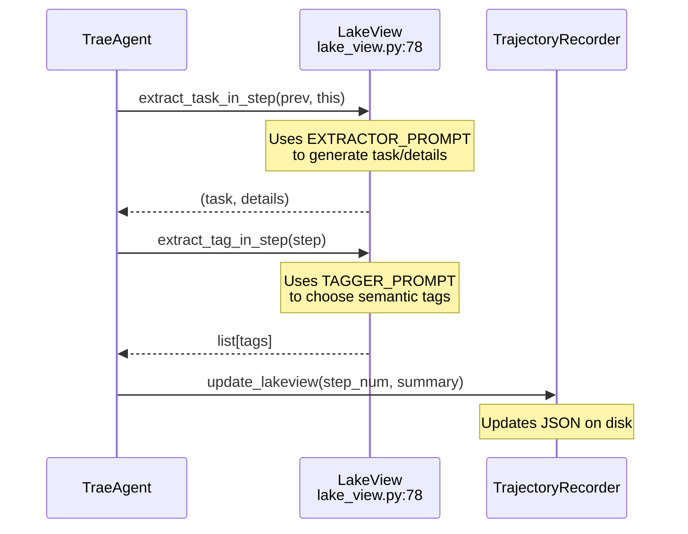

<!-- source: DeepWiki mcp.deepwiki.com · repo bytedance/trae-agent · page 4.6 Trajectory Recording and Lakeview · fetched 2026-10-29 -->

# Trajectory Recording and Lakeview

<details>
<summary>Relevant source files</summary>

The following files were used as context for generating this wiki page:

- [CONTRIBUTING.md](CONTRIBUTING.md)
- [LICENSE](LICENSE)
- [docs/TRAJECTORY_RECORDING.md](docs/TRAJECTORY_RECORDING.md)
- [docs/roadmap.md](docs/roadmap.md)
- [trae_agent/utils/lake_view.py](trae_agent/utils/lake_view.py)
- [trae_agent/utils/trajectory_recorder.py](trae_agent/utils/trajectory_recorder.py)

</details>


The trajectory recording system captures detailed execution traces of agent operations and LLM interactions. The `TrajectoryRecorder` class [trae_agent/utils/trajectory_recorder.py:20-230]() provides comprehensive logging for debugging, analysis, and auditing. The Lakeview feature, implemented via the `LakeView` class [trae_agent/utils/lake_view.py:78-185](), adds step-level summarization and semantic tagging to trajectory data.

For core agent execution, see page 4.1. For tool execution, see page 4.2. For LLM provider integration, see page 4.3.

## Overview

The `TrajectoryRecorder` class captures two primary data streams:

1. **LLM Interactions**: Input messages, responses, token usage statistics, and tool calls from all LLM providers [trae_agent/utils/trajectory_recorder.py:77-128]().
2. **Agent Steps**: State transitions, tool executions, results, reflections, and errors [trae_agent/utils/trajectory_recorder.py:130-189]().

All data is serialized to JSON files with continuous persistence after each recorded event [trae_agent/utils/trajectory_recorder.py:220-230]().

### Integration Architecture



**Sources**: [trae_agent/utils/trajectory_recorder.py:20-230](), [docs/TRAJECTORY_RECORDING.md:15-145]()

### Recording Lifecycle



**Sources**: [trae_agent/utils/trajectory_recorder.py:54-230](), [docs/TRAJECTORY_RECORDING.md:130-145]()

## TrajectoryRecorder Class

The `TrajectoryRecorder` class [trae_agent/utils/trajectory_recorder.py:20-230]() manages trajectory lifecycle and persistence.

### Initialization

```python
class TrajectoryRecorder:
    def __init__(self, trajectory_path: str | None = None)
```

**Constructor behavior** [trae_agent/utils/trajectory_recorder.py:23-52]():
- If `trajectory_path` is `None`, generates default path: `trajectories/trajectory_YYYYMMDD_HHMMSS.json`.
- Creates parent directories with `mkdir(parents=True, exist_ok=True)`.
- Initializes `trajectory_data` dict with keys: `task`, `start_time`, `end_time`, `provider`, `model`, `max_steps`, `llm_interactions`, `agent_steps`, `success`, `final_result`, `execution_time`.

### Core Methods

| Method | Purpose | Key Fields Written |
|--------|---------|-------------------|
| `start_recording()` [trae_agent/utils/trajectory_recorder.py:54-75]() | Initialize metadata | `task`, `start_time`, `provider`, `model`, `max_steps` |
| `record_llm_interaction()` [trae_agent/utils/trajectory_recorder.py:77-128]() | Log LLM IO | Appends to `llm_interactions[]` array |
| `record_agent_step()` [trae_agent/utils/trajectory_recorder.py:130-189]() | Log agent logic | Appends to `agent_steps[]` array |
| `update_lakeview()` [trae_agent/utils/trajectory_recorder.py:191-196]() | Enrich steps | Adds `lakeview_summary` field to existing step |
| `finalize_recording()` [trae_agent/utils/trajectory_recorder.py:198-218]() | Close session | `end_time`, `success`, `final_result`, `execution_time` |
| `save_trajectory()` [trae_agent/utils/trajectory_recorder.py:220-230]() | Persist to disk | Writes `trajectory_data` to JSON file |

**Sources**: [trae_agent/utils/trajectory_recorder.py:23-230]()

### LLM Integration Points

Each LLM client records interactions through `record_llm_interaction()` when a recorder is attached. The pattern is consistent across all providers [docs/TRAJECTORY_RECORDING.md:26-126]().

**Supported providers**:

| Provider | Provider String | Implementation File |
|----------|----------------|---------------------|
| AnthropicClient | `"anthropic"` | `trae_agent/utils/anthropic_client.py` |
| OpenAIClient | `"openai"` | `trae_agent/utils/openai_client.py` |
| GoogleClient | `"google"` | `trae_agent/utils/google_client.py` |
| AzureOpenAIClient | `"azure"` | `trae_agent/utils/azure_client.py` |
| DoubaoClient | `"doubao"` | `trae_agent/utils/doubao_client.py` |
| OllamaClient | `"openai"` | `trae_agent/utils/ollama_client.py` |
| OpenRouterClient | `"openrouter"` | `trae_agent/utils/openrouter_client.py` |

**Sources**: [docs/TRAJECTORY_RECORDING.md:26-126]()

## Lakeview Summarization

Lakeview adds human-readable summaries and semantic labels to agent steps. It uses a separate LLM instance to analyze the agent's actions and categorize them [trae_agent/utils/lake_view.py:78-185]().

### Lakeview Feature Components

1. **Task Extraction**: Summarizes "what task is the agent performing" in two granularities: concise `<task>` and detailed `<details>` [trae_agent/utils/lake_view.py:16-30]().
2. **Semantic Tagging**: Categorizes steps using predefined tags like `WRITE_TEST`, `EXAMINE_CODE`, or `WRITE_FIX` [trae_agent/utils/lake_view.py:32-66]().

### Semantic Tags Reference

| Tag | Emoji | Description |
|-----|-------|-------------|
| `WRITE_TEST` | ☑️ | Writing/modifying reproduction scripts |
| `VERIFY_TEST` | ✅ | Running tests to verify environment |
| `EXAMINE_CODE` | 👁️ | Exploring repository to understand bugs |
| `WRITE_FIX` | 📝 | Modifying source code to fix bugs |
| `VERIFY_FIX` | 🔥 | Running tests to verify the fix |
| `THINK` | 🧠 | Analyzing without concrete actions |

**Sources**: [trae_agent/utils/lake_view.py:32-66]()

### Lakeview Implementation Detail



**Sources**: [trae_agent/utils/lake_view.py:94-185](), [trae_agent/utils/trajectory_recorder.py:191-196]()

## JSON File Format

The trajectory system generates structured JSON documents [docs/TRAJECTORY_RECORDING.md:192-243]().

### llm_interactions[] Entry Structure

Each entry in the `llm_interactions` array captures the raw model interaction [trae_agent/utils/trajectory_recorder.py:94-127]():

```json
{
  "timestamp": "2025-06-12T22:05:47.000000",
  "provider": "anthropic",
  "model": "claude-sonnet-4-20250514",
  "input_messages": [
    { "role": "system", "content": "..." },
    { "role": "user", "content": "..." }
  ],
  "response": {
    "content": "...",
    "usage": {
      "input_tokens": 150,
      "output_tokens": 75,
      "cache_read_input_tokens": 0
    },
    "tool_calls": [
      { "name": "bash", "arguments": { "command": "ls" } }
    ]
  },
  "tools_available": ["bash", "str_replace_based_edit_tool"]
}
```

### agent_steps[] Entry Structure

Each entry in the `agent_steps` array represents a logical execution step [trae_agent/utils/trajectory_recorder.py:153-188]():

```json
{
  "step_number": 1,
  "state": "executing",
  "tool_calls": [...],
  "tool_results": [
    {
      "call_id": "...",
      "success": true,
      "result": "..."
    }
  ],
  "lakeview_summary": "The agent is examining source code. [italic]The agent is searching for function_name...[/italic]"
}
```

**Sources**: [trae_agent/utils/trajectory_recorder.py:94-188](), [docs/TRAJECTORY_RECORDING.md:192-243]()

## Persistence Strategy

The system calls `save_trajectory()` after every recorded event, ensuring data integrity if execution is interrupted [trae_agent/utils/trajectory_recorder.py:220-230]().

### save_trajectory() Implementation

Method [trae_agent/utils/trajectory_recorder.py:220-230]():
- Creates parent directories with `mkdir(parents=True, exist_ok=True)`.
- Writes entire `trajectory_data` dict to file with `json.dump()`.
- Uses `indent=2` for readable formatting.
- Prints warning on failure but does not raise exception (allows execution to continue).

### File Path Resolution

Constructor [trae_agent/utils/trajectory_recorder.py:23-37]():
- Default naming: `trajectories/trajectory_YYYYMMDD_HHMMSS.json`.
- Example: `trajectories/trajectory_20250612_143022.json`.
- Path is resolved to an absolute path using `.resolve()`.

**Sources**: [trae_agent/utils/trajectory_recorder.py:23-37](), [trae_agent/utils/trajectory_recorder.py:220-230]()

---

