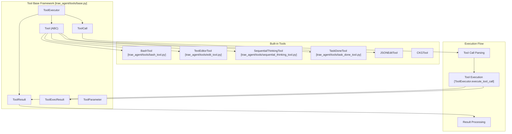
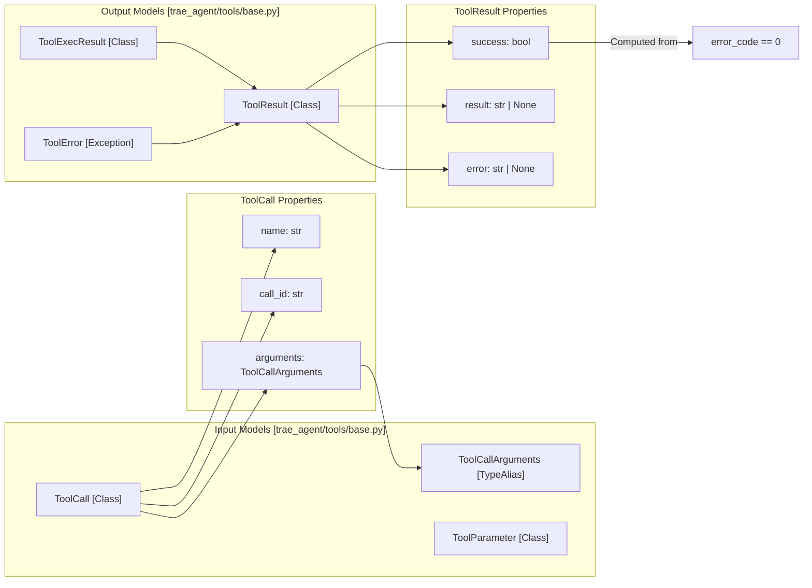

<!-- source: DeepWiki mcp.deepwiki.com · repo bytedance/trae-agent · page 5 Tools Reference · fetched 2026-10-29 -->

# Tools Reference

Relevant source files

The following files were used as context for generating this wiki page:

- [docs/tools.md](docs/tools.md)
- [tests/tools/test_bash_tool.py](tests/tools/test_bash_tool.py)
- [trae_agent/tools/base.py](trae_agent/tools/base.py)
- [trae_agent/tools/bash_tool.py](trae_agent/tools/bash_tool.py)
- [trae_agent/tools/edit_tool.py](trae_agent/tools/edit_tool.py)
- [trae_agent/tools/run.py](trae_agent/tools/run.py)
- [trae_agent/tools/sequential_thinking_tool.py](trae_agent/tools/sequential_thinking_tool.py)
- [trae_agent/tools/task_done_tool.py](trae_agent/tools/task_done_tool.py)

This document provides a comprehensive reference for the `trae-agent` tool system, covering the tool framework architecture, available tools, and their usage patterns. The tool system enables LLM agents to interact with the environment through a standardized interface for executing actions such as file editing, command execution, and structured reasoning.

For detailed information about specific tools, see the individual tool documentation pages. For information about the underlying agent architecture that orchestrates tool usage, see [Agent System](#4.1).

## Tool System Overview

The `trae-agent` tool system is built around a polymorphic architecture centered on the `Tool` abstract base class defined in [trae_agent/tools/base.py:74-180](). Tools are managed by a `ToolExecutor` [trae_agent/tools/base.py:182-235]() that handles tool discovery, validation, and execution.

### Tool Architecture

**Sources:** [trae_agent/tools/base.py:74-176](), [trae_agent/tools/bash_tool.py:162-166](), [trae_agent/tools/edit_tool.py:27-39](), [trae_agent/tools/sequential_thinking_tool.py:32-41](), [trae_agent/tools/task_done_tool.py:9-21]()

The `Tool` class defines the interface that all tools must implement:

| Method | Purpose | Return Type |
|--------|---------|-------------|
| `get_name()` | Tool identifier used by LLM | `str` |
| `get_description()` | Instructions for LLM on when to use | `str` |
| `get_parameters()` | JSON Schema parameter definitions | `list[ToolParameter]` |
| `execute(arguments)` | Core tool logic implementation | `ToolExecResult` |

**Sources:** [trae_agent/tools/base.py:100-118]()

### Tool Data Model

**Sources:** [trae_agent/tools/base.py:16-72]()

## Available Tools

The `trae-agent` system includes several built-in tools optimized for software engineering workflows:

| Tool Name | Purpose | Reference |
|-----------|---------|-----------|
| `bash` | Execute shell commands in a persistent session | [Bash Tool](#5.2) |
| `str_replace_based_edit_tool` | View, create, and edit files via exact string replacement | [Text Editor Tool](#5.3) |
| `sequentialthinking` | Dynamic problem-solving with branching and revisions | [Sequential Thinking Tool](#5.4) |
| `task_done` | Signal task completion after verification | [Task Done Tool](#5.5) |
| `json_edit_tool` | Manipulate JSON files using JSONPath expressions | [JSON Edit Tool](#5.6) |
| `ckg` | Query code structure using Code Knowledge Graphs | [Code Knowledge Graph (CKG) Tool](#5.7) |

**Sources:** [trae_agent/tools/bash_tool.py:162-166](), [trae_agent/tools/edit_tool.py:38-39](), [trae_agent/tools/sequential_thinking_tool.py:40-41](), [trae_agent/tools/task_done_tool.py:20-21]()

## Tool Execution Model

The `ToolExecutor` manages the execution lifecycle. It maps the LLM's requested tool name to the internal implementation using a normalization strategy that removes underscores and converts to lowercase [trae_agent/tools/base.py:195-203]().

### Tool Execution Flow

1. **Normalization**: The `ToolExecutor` normalizes the name in the `ToolCall` [trae_agent/tools/base.py:207-208]().
2. **Lookup**: It retrieves the `Tool` instance from its internal `_tool_map` [trae_agent/tools/base.py:217]().
3. **Execution**: It awaits the `tool.execute(arguments)` method [trae_agent/tools/base.py:220]().
4. **Result Mapping**: It converts the internal `ToolExecResult` into a provider-agnostic `ToolResult` [trae_agent/tools/base.py:221-228]().

**Sources:** [trae_agent/tools/base.py:205-235]()

## Tool Schema Generation

Tools automatically generate JSON schemas compatible with different LLM providers through the `get_input_schema()` method [trae_agent/tools/base.py:127-175]().

- **OpenAI Strict Mode**: If the `model_provider` is set to `"openai"`, the schema generation enforces `additionalProperties: false` and makes optional parameters "nullable" to comply with OpenAI's structured output requirements [trae_agent/tools/base.py:144-151]().
- **Standard Schema**: For other providers, it generates a standard JSON schema based on the `ToolParameter` definitions [trae_agent/tools/base.py:152-160]().

**Sources:** [trae_agent/tools/base.py:127-175]()

## Error Handling

The system distinguishes between different failure modes:
- **Tool Discovery Errors**: Handled in `ToolExecutor` if the tool name is unknown [trae_agent/tools/base.py:209-215]().
- **Logic Errors**: Tools raise `ToolError` or return a non-zero `error_code` in `ToolExecResult` [trae_agent/tools/base.py:16-22](), [trae_agent/tools/base.py:25-31]().
- **Timeout Errors**: Utility functions like `run` in `trae_agent/tools/run.py` enforce timeouts (default 120s) for shell operations [trae_agent/tools/run.py:30-50]().

**Sources:** [trae_agent/tools/base.py:209-235](), [trae_agent/tools/run.py:30-50]()

## Child Pages Reference

For detailed documentation on each component, refer to the following pages:

- [Tool Framework](#5.1): Deep dive into the base classes and how to create custom tools.
- [Bash Tool](#5.2): Persistent shell sessions and platform-specific execution.
- [Text Editor Tool](#5.3): File manipulation via `str_replace`, `insert`, and `view`.
- [Sequential Thinking Tool](#5.4): Branching logic and thought revision for complex reasoning.
- [Task Done Tool](#5.5): Finalizing tasks and the verification requirement.
- [JSON Edit Tool](#5.6): Using JSONPath for structured data manipulation.
- [Code Knowledge Graph (CKG) Tool](#5.7): Querying functions, classes, and methods using tree-sitter.

---

