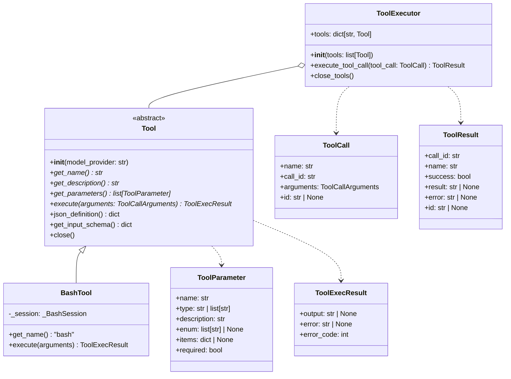
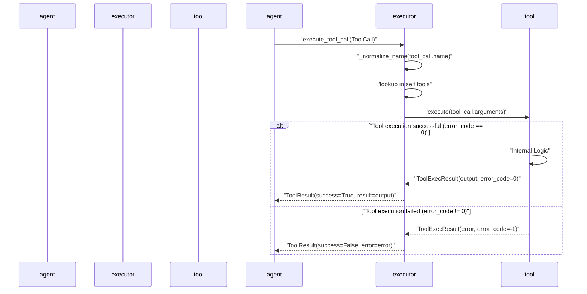
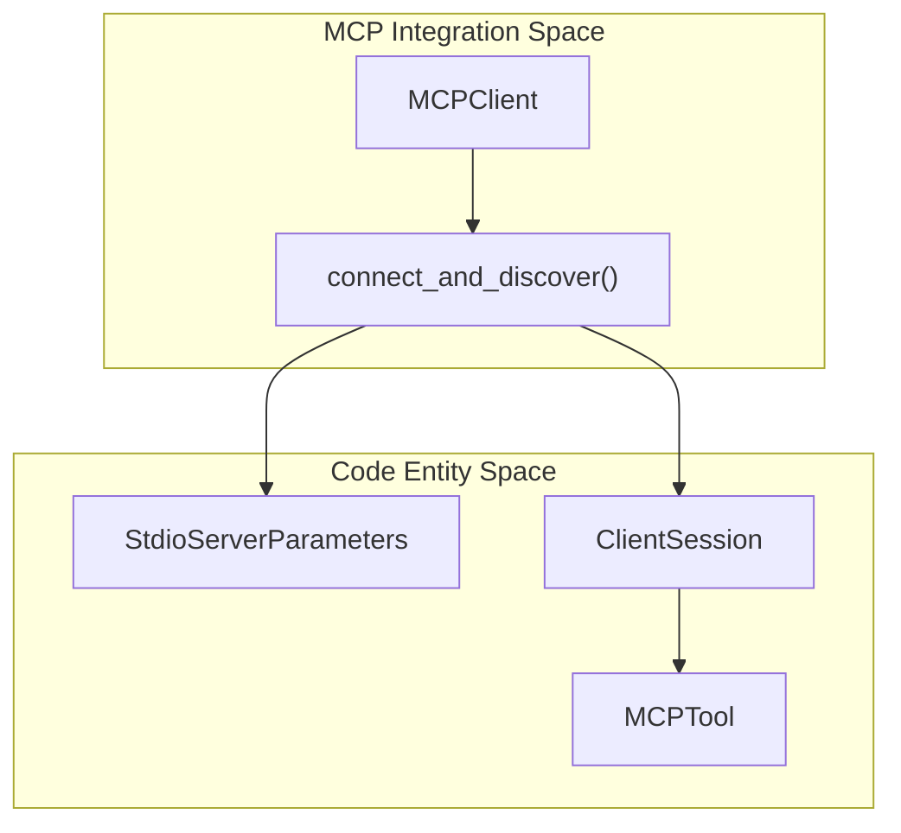

<!-- source: DeepWiki mcp.deepwiki.com · repo bytedance/trae-agent · page 5.1 Tool Framework · fetched 2026-10-29 -->

# Tool Framework

<details>
<summary>Relevant source files</summary>

The following files were used as context for generating this wiki page:

- [tests/tools/test_bash_tool.py](tests/tools/test_bash_tool.py)
- [trae_agent/tools/__init__.py](trae_agent/tools/__init__.py)
- [trae_agent/tools/base.py](trae_agent/tools/base.py)
- [trae_agent/tools/bash_tool.py](trae_agent/tools/bash_tool.py)
- [trae_agent/utils/cli/simple_console.py](trae_agent/utils/cli/simple_console.py)
- [trae_agent/utils/mcp_client.py](trae_agent/utils/mcp_client.py)

</details>


The Tool Framework provides the foundation for all tools available to `trae-agent`, including both built-in tools and external tools discovered via MCP (Model Context Protocol). This framework defines the interfaces, execution patterns, and registration mechanisms that enable the agent to interact with various capabilities in a standardized way. [trae_agent/tools/base.py:4-10]()

This document covers the core tool architecture, base classes, and execution patterns. For specific tool implementations, see individual tool reference pages: [Bash Tool](#5.2), [Text Editor Tool](#5.3), [Sequential Thinking Tool](#5.4), [Task Done Tool](#5.5), [JSON Edit Tool](#5.6), and [Code Knowledge Graph (CKG) Tool](#5.7). For MCP integration details, see [MCP Integration](#4.5).

## Core Architecture

The Tool Framework follows a plugin-based architecture where all tools implement a common interface, enabling uniform execution and integration with different LLM providers. [trae_agent/tools/base.py:74-75]()

### Tool Framework Class Hierarchy

This diagram maps the high-level Natural Language concepts of "Tools" and "Parameters" to the specific Python classes and data structures used in the codebase.


**Sources:** [trae_agent/tools/base.py:24-181](), [trae_agent/tools/bash_tool.py:162-171]()

### Tool Execution Flow

The following sequence shows how a request moves from the `Agent` through the `ToolExecutor` to a concrete `Tool` implementation.


**Sources:** [trae_agent/tools/base.py:205-236](), [trae_agent/tools/bash_tool.py:87-159]()

## Base Classes and Interfaces

### Tool Abstract Base Class

The `Tool` class is an abstract base class (`ABC`) that defines the mandatory interface for all agent capabilities. [trae_agent/tools/base.py:74-75]()

```python
class Tool(ABC):
    def __init__(self, model_provider: str | None = None):
        self._model_provider = model_provider

    @abstractmethod
    def get_name(self) -> str: ...
    
    @abstractmethod 
    def get_description(self) -> str: ...
    
    @abstractmethod
    def get_parameters(self) -> list[ToolParameter]: ...
    
    @abstractmethod
    async def execute(self, arguments: ToolCallArguments) -> ToolExecResult: ...
```
**Sources:** [trae_agent/tools/base.py:74-118]()

The base class provides a `get_input_schema()` method that automatically generates JSON schemas. It includes specific logic for **OpenAI strict mode**, where it ensures all parameters are marked as `required` and uses `nullable` types for optional ones. [trae_agent/tools/base.py:127-175]()

### Data Structures

| Class | Purpose | Key Fields |
|-------|---------|------------|
| `ToolParameter` | Defines a single input parameter schema. | `name`, `type`, `description`, `required`. [trae_agent/tools/base.py:63-71]() |
| `ToolCall` | Represents an LLM's request to run a tool. | `name`, `call_id`, `arguments`. [trae_agent/tools/base.py:49-55]() |
| `ToolExecResult` | The raw output/error from a tool's internal logic. | `output`, `error`, `error_code`. [trae_agent/tools/base.py:25-30]() |
| `ToolResult` | The final formatted result sent back to the LLM. | `success`, `result`, `error`. [trae_agent/tools/base.py:34-42]() |

## Tool Registration System

Tools are registered in a centralized dictionary within `trae_agent/tools/__init__.py`. This registry maps logical tool names to their implementation classes. [trae_agent/tools/__init__.py:27-34]()

```python
tools_registry: dict[str, type[Tool]] = {
    "bash": BashTool,
    "str_replace_based_edit_tool": TextEditorTool,
    "json_edit_tool": JSONEditTool,
    "sequentialthinking": SequentialThinkingTool,
    "task_done": TaskDoneTool,
    "ckg": CKGTool,
}
```

The `ToolExecutor` uses a `_normalize_name` helper to ensure that tool lookups are resilient to minor naming variations (e.g., case sensitivity or underscores). [trae_agent/tools/base.py:195-203]()

## Tool Execution Patterns

### ToolExecutor Class

The `ToolExecutor` is responsible for managing the lifecycle of tools and routing calls. [trae_agent/tools/base.py:182-184]()

*   **Initialization**: It accepts a list of `Tool` instances and builds an internal map for fast lookup. [trae_agent/tools/base.py:185-187]()
*   **Execution**: `execute_tool_call` handles the mapping, execution, and error wrapping if a tool is not found. [trae_agent/tools/base.py:205-236]()
*   **Cleanup**: `close_tools` iterates through all tools and calls their `close()` method to release resources (like shell processes or DB connections). [trae_agent/tools/base.py:189-193]()

### Error Handling

The framework distinguishes between two types of errors:
1.  **Framework Errors**: Raised as `ToolError` for issues like an unstarted session or a timeout. [trae_agent/tools/base.py:16-21](), [trae_agent/tools/bash_tool.py:89-99]()
2.  **Execution Errors**: Captured in `ToolExecResult` (e.g., a bash command returning a non-zero exit code). [trae_agent/tools/base.py:25-30]()

## External Tool Integration

### MCP Tool Integration

The framework supports external tools via the Model Context Protocol (MCP). The `MCPClient` manages connections to external servers via `stdio`. [trae_agent/utils/mcp_client.py:26-30]()


**Sources:** [trae_agent/utils/mcp_client.py:39-73](), [trae_agent/utils/mcp_client.py:83-88]()

MCP tools are dynamically discovered and wrapped in an `MCPTool` instance, which inherits from the base `Tool` class, allowing them to be used by the `ToolExecutor` just like built-in tools. [trae_agent/utils/mcp_client.py:68-70]()

## Creating Custom Tools

To create a custom tool, follow these steps:

1.  **Inherit**: Create a class inheriting from `Tool`. [trae_agent/tools/base.py:74]()
2.  **Define Metadata**: Implement `get_name()`, `get_description()`, and `get_parameters()`. [trae_agent/tools/base.py:101-113]()
3.  **Implement Logic**: Override the `async def execute()` method. Ensure it returns a `ToolExecResult`. [trae_agent/tools/base.py:115-118]()
4.  **Cleanup**: If your tool uses external resources (sockets, files), override `close()`. [trae_agent/tools/base.py:177-179]()
5.  **Register**: Add your tool class to the `tools_registry` in `trae_agent/tools/__init__.py`. [trae_agent/tools/__init__.py:27-34]()

**Sources:** [trae_agent/tools/base.py:74-181](), [trae_agent/tools/bash_tool.py:162-247]()

---

