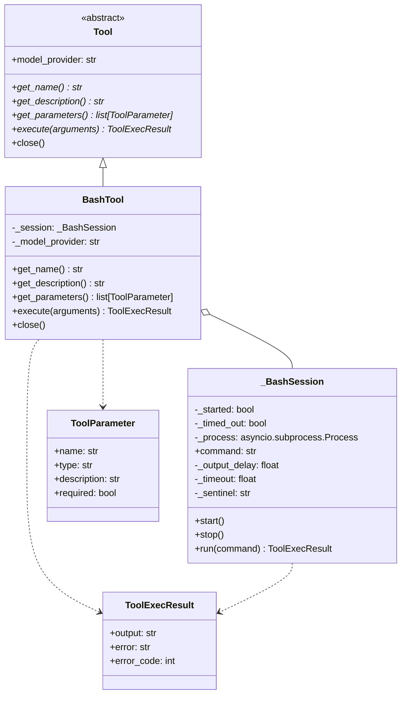
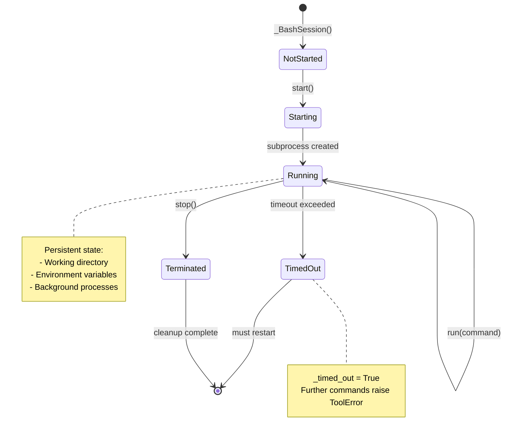
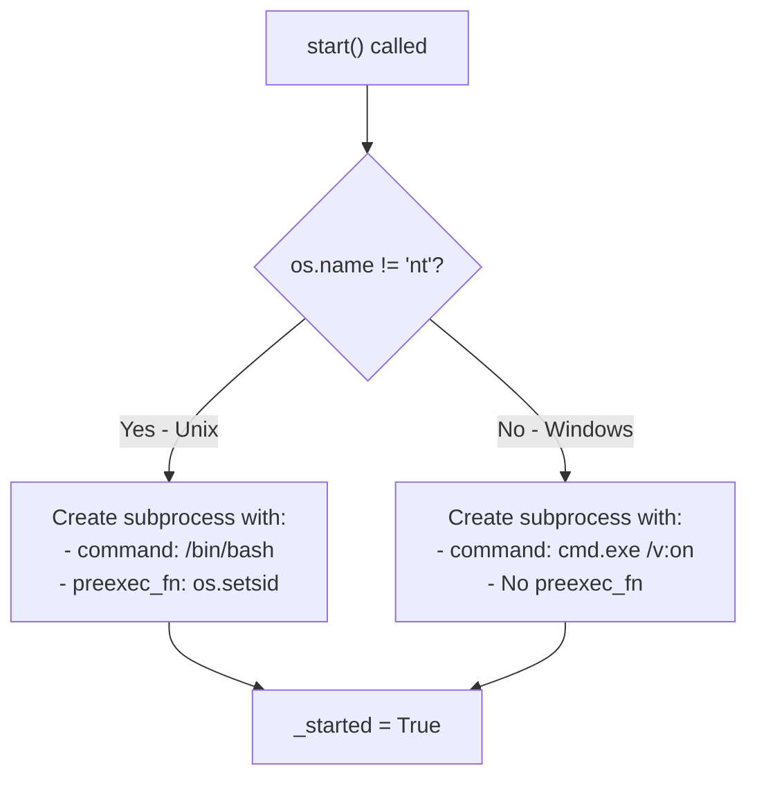
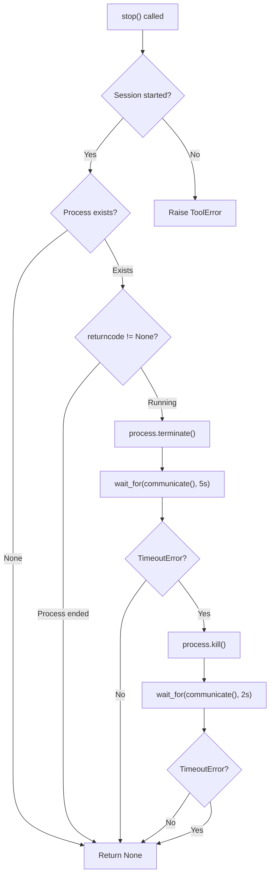
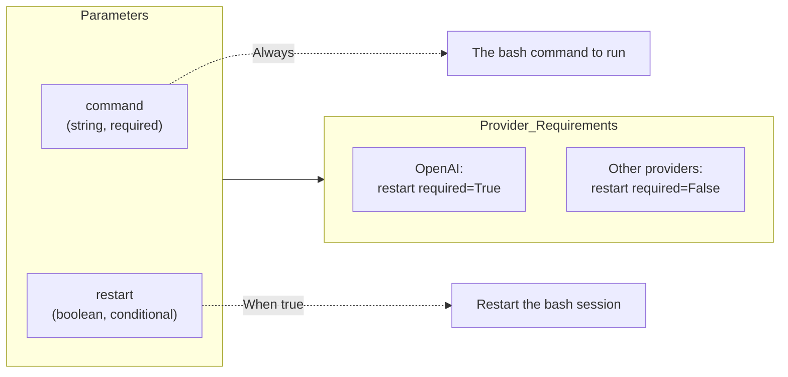
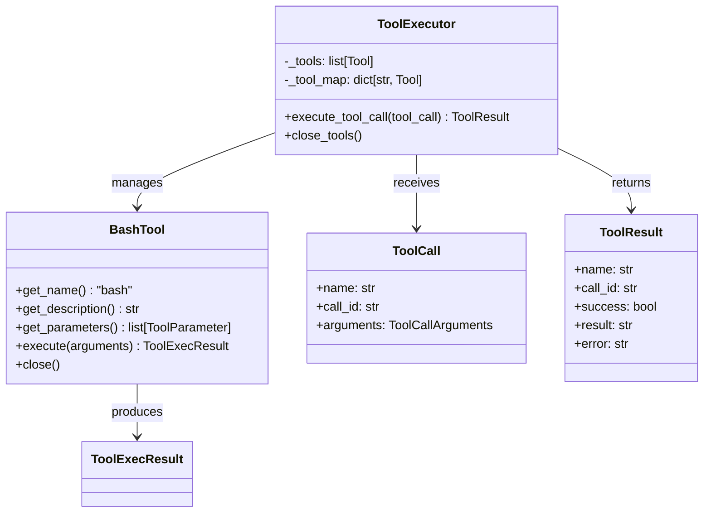

<!-- source: DeepWiki mcp.deepwiki.com · repo bytedance/trae-agent · page 5.2 Bash Tool · fetched 2026-10-29 -->

# Bash Tool

<details>
<summary>Relevant source files</summary>

The following files were used as context for generating this wiki page:

- [tests/tools/test_bash_tool.py](tests/tools/test_bash_tool.py)
- [trae_agent/tools/base.py](trae_agent/tools/base.py)
- [trae_agent/tools/bash_tool.py](trae_agent/tools/bash_tool.py)

</details>


## Overview

The Bash Tool enables LLM agents to execute shell commands in a persistent bash (Unix) or cmd.exe (Windows) session. This tool provides stateful command execution where environment variables, working directories, and session state persist across multiple command invocations. The tool is implemented in [trae_agent/tools/bash_tool.py]() and inherits from the base `Tool` class defined in [trae_agent/tools/base.py]().

For information about the tool framework and how tools are registered, see [Tool Framework](#5.1). For Docker-isolated execution of bash commands, see [Docker Integration](#4.4).

**Sources:** [trae_agent/tools/bash_tool.py:1-247](), [trae_agent/tools/base.py:1-180]()

---

## Class Architecture

The Bash Tool implementation consists of two primary classes: `_BashSession` for managing the underlying shell process, and `BashTool` as the public interface conforming to the Tool framework.

### Class Diagram: BashTool Components



**Sources:** [trae_agent/tools/bash_tool.py:19-247](), [trae_agent/tools/base.py:24-31](), [trae_agent/tools/base.py:62-72](), [trae_agent/tools/base.py:74-120]()

---

## Persistent Shell Session

The `_BashSession` class manages a long-running subprocess that maintains state across command executions. This design allows environment variables, directory changes, and other session state to persist between commands.

### Session Configuration

| Parameter | Value | Purpose |
|-----------|-------|---------|
| `command` | `/bin/bash` (Unix) or `cmd.exe /v:on` (Windows) | Shell executable |
| `_output_delay` | 0.2 seconds | Polling interval for output |
| `_timeout` | 120.0 seconds | Maximum command execution time |
| `_sentinel` | `,,,,bash-command-exit-__ERROR_CODE__-banner,,,,` | Command completion marker |

**Sources:** [trae_agent/tools/bash_tool.py:25-28](), [trae_agent/tools/bash_tool.py:41-59]()

### Session Lifecycle



**Sources:** [trae_agent/tools/bash_tool.py:30-160]()

---

## Command Execution Flow

Command execution in `_BashSession.run()` follows a sentinel-based protocol to reliably detect command completion and capture exit codes.

### Execution Sequence

```mermaid
sequenceDiagram
    participant Agent
    participant BashTool
    participant _BashSession
    participant Process as asyncio.subprocess.Process
    participant Shell as bash/cmd.exe
    
    Agent->>BashTool: execute({"command": "ls -la"})
    BashTool->>BashTool: Check if restart requested
    
    alt Session not initialized
        BashTool->>_BashSession: __init__()
        BashTool->>_BashSession: start()
        _BashSession->>Process: create_subprocess_shell()
        Process->>Shell: spawn process
    end
    
    BashTool->>_BashSession: run("ls -la")
    
    _BashSession->>_BashSession: Check _started and _timed_out flags
    _BashSession->>_BashSession: Wrap command with sentinel echo
    
    Note over _BashSession,Shell: Command format:<br/>(command); echo sentinel-$?-banner
    
    _BashSession->>Process: stdin.write(wrapped_command)
    
    loop Poll until sentinel found (max 120s)
        _BashSession->>_BashSession: sleep(0.2s)
        _BashSession->>Process: Read stdout._buffer
        _BashSession->>_BashSession: Check for sentinel in output
    end
    
    _BashSession->>_BashSession: Parse exit code from sentinel
    _BashSession->>Process: Read stderr._buffer
    _BashSession->>_BashSession: Clear stdout and stderr buffers
    
    _BashSession-->>BashTool: ToolExecResult(output, error, error_code)
    BashTool-->>Agent: ToolExecResult
```

**Sources:** [trae_agent/tools/bash_tool.py:87-160](), [trae_agent/tools/bash_tool.py:213-238]()

### Sentinel Protocol

The sentinel mechanism ensures reliable command completion detection across platforms. Each command is wrapped to emit a unique marker containing the exit code:

```
(
<user_command>
); echo ,,,,bash-command-exit-$?-banner,,,,
```

On Windows, the equivalent uses delayed expansion:
```
(
<user_command>
)& echo ,,,,bash-command-exit-!errorlevel!-banner,,,,
```

The session polls the output buffer `_process.stdout._buffer`, looking for the sentinel pattern. When found, it:
1. Extracts the exit code from between `sentinel_before` and `sentinel_after` markers.
2. Strips the sentinel from the output.
3. Clears the `stdout` and `stderr` buffers for the next command.

**Sources:** [trae_agent/tools/bash_tool.py:106-159]()

---

## Platform Differences

The Bash Tool adapts to platform-specific shell environments and process management capabilities.

### Unix Systems (Linux, macOS)

| Feature | Implementation |
|---------|----------------|
| Shell | `/bin/bash` |
| Process Group | `preexec_fn=os.setsid` creates new session |
| Exit Code | `$?` captures return code |
| Command Separator | `;` semicolon |

The `os.setsid` call on line 49 creates a new session and process group, allowing proper cleanup of child processes.

**Sources:** [trae_agent/tools/bash_tool.py:41-50](), [trae_agent/tools/bash_tool.py:111-112]()

### Windows Systems

| Feature | Implementation |
|---------|----------------|
| Shell | `cmd.exe /v:on` (delayed expansion enabled) |
| Process Group | Not available (no `os.setsid`) |
| Exit Code | `!errorlevel!` with delayed expansion |
| Command Separator | `&` ampersand |

The `/v:on` flag enables delayed environment variable expansion, which is required for `!errorlevel!` to capture the exit code correctly.

**Sources:** [trae_agent/tools/bash_tool.py:51-59](), [trae_agent/tools/bash_tool.py:111-112]()

### Platform Detection Logic



**Sources:** [trae_agent/tools/bash_tool.py:39-61]()

---

## Restart Mechanism

The restart mechanism allows agents to recover from session issues or reset environment state.

### Restart Process

When `execute()` receives `{"restart": True}`:

1. **Stop existing session** - If `_session` exists, call `stop()` to terminate the subprocess.
2. **Create new session** - Instantiate fresh `_BashSession` object.
3. **Start session** - Call `start()` to spawn new shell process.
4. **Return confirmation** - Return `ToolExecResult(output="tool has been restarted.")`.

**Sources:** [trae_agent/tools/bash_tool.py:214-220]()

### Session Stop Procedure

The `stop()` method implements graceful shutdown with fallback to forceful termination:



**Sources:** [trae_agent/tools/bash_tool.py:63-86]()

---

## Timeout and Error Handling

The Bash Tool implements comprehensive error handling for various failure scenarios.

### Timeout Configuration

Commands that exceed the `_timeout` threshold (120 seconds) trigger a timeout error:

```python
async with asyncio.timeout(self._timeout):
    # polling loop
```

When a timeout occurs:
1. `_timed_out` flag is set to `True`.
2. `ToolError` is raised with message: `"timed out: bash has not returned in {self._timeout} seconds and must be restarted"`.
3. Subsequent commands raise `ToolError` until session is restarted.

**Sources:** [trae_agent/tools/bash_tool.py:124-146]()

### Error Scenarios

| Scenario | Error Detection | Response |
|----------|----------------|-----------|
| Session not started | `not self._started` check | Raise `ToolError` |
| Process terminated | `self._process.returncode is not None` | Return error with code -1 |
| Session timed out | `self._timed_out` flag | Raise `ToolError` |
| Command timeout | `asyncio.timeout()` | Set `_timed_out`, raise `ToolError` |
| Invalid command | Non-zero exit code | Return result with error message and code |
| Missing command parameter | `command not in arguments` | Return error with code -1 |

**Sources:** [trae_agent/tools/bash_tool.py:87-100](), [trae_agent/tools/bash_tool.py:222-238]()

### Error Code Handling

The tool captures exit codes through the sentinel protocol:

```python
error_code = int(error_code_str)  # Extracted from sentinel banner
return ToolExecResult(output=output, error=error, error_code=error_code)
```

Exit codes follow standard conventions:
- `0` - Success.
- Non-zero - Error (specific meaning depends on command, e.g., 127 for command not found).
- `-1` - Internal tool error (session issues, missing parameters).

**Sources:** [trae_agent/tools/bash_tool.py:140-159](), [tests/tools/test_bash_tool.py:28-33]()

---

## Tool Parameters

The `BashTool` defines two parameters with platform-specific requirements.

### Parameter Definitions



### OpenAI Compatibility

OpenAI models require all parameters to be marked as required in the schema. The implementation handles this through conditional logic in `get_parameters()`:

```python
restart_required = self.model_provider == "openai"

return [
    ToolParameter(
        name="command",
        type="string",
        description="The bash command to run.",
        required=True,
    ),
    ToolParameter(
        name="restart",
        type="boolean",
        description="Set to true to restart the bash session.",
        required=restart_required,
    ),
]
```

For OpenAI, the base class `get_input_schema()` method transforms non-required parameters to be "nullable" to comply with strict mode requirements.

**Sources:** [trae_agent/tools/bash_tool.py:192-210](), [trae_agent/tools/base.py:144-151]()

---

## Integration with Tool Framework

The `BashTool` class integrates with the broader tool execution system through the `Tool` base class interface.

### Tool Interface Implementation



### Execution Flow Through ToolExecutor

When an agent invokes the bash tool:

1. **LLM generates ToolCall** - LLM response includes bash tool with command argument.
2. **ToolExecutor.execute_tool_call()** - Looks up tool by normalized name.
3. **Tool name normalization** - `"bash"` → `"bash"` (lowercase, underscores removed).
4. **BashTool.execute()** - Runs command in persistent session.
5. **ToolExecResult → ToolResult** - Maps execution result to agent result format.
6. **Success determination** - `success = (tool_exec_result.error_code == 0)`.

**Sources:** [trae_agent/tools/base.py:182-236](), [trae_agent/tools/bash_tool.py:213-238]()

### Cleanup and Resource Management

The `BashTool.close()` method ensures proper subprocess cleanup:

```python
async def close(self):
    """Properly close self._process."""
    if self._session:
        ret = await self._session.stop()
        self._session = None
        return ret
```

This is called by `ToolExecutor.close_tools()` when the agent completes its task, ensuring no zombie processes remain.

**Sources:** [trae_agent/tools/bash_tool.py:240-246](), [trae_agent/tools/base.py:189-193]()

---

## Usage Examples

Based on test cases in `tests/tools/test_bash_tool.py`, common usage patterns include:

### Basic Command Execution

```python
result = await bash_tool.execute({"command": "echo hello world"})
# result.output: "hello world"
# result.error: ""
# result.error_code: 0
```

### Error Handling

```python
result = await bash_tool.execute({"command": "invalid_command_123"})
# result.error: contains "not found" or "not recognized"
# result.error_code: != 0
```

### Session Restart

```python
# First session
await bash_tool.execute({"command": "export MY_VAR=value1"})

# Restart clears environment
restart_result = await bash_tool.execute({"restart": True})
# restart_result.output: "tool has been restarted."

# MY_VAR no longer exists in new session
```

**Sources:** [tests/tools/test_bash_tool.py:28-64]()

---

