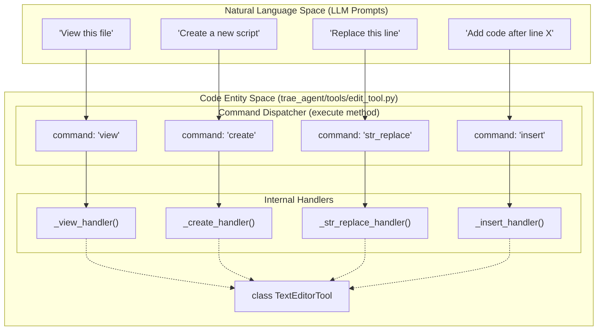
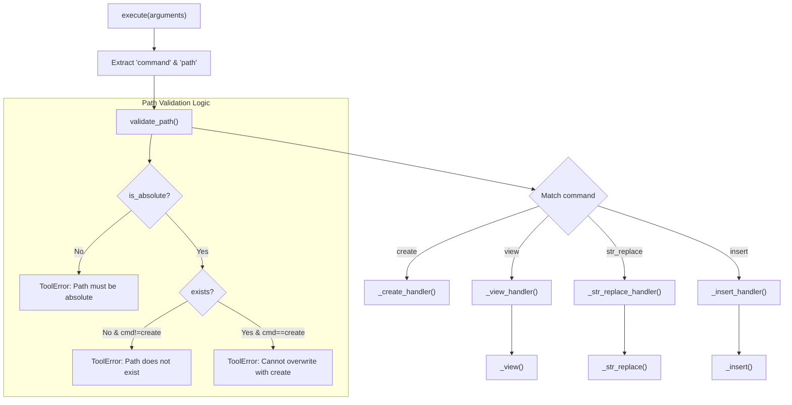

<!-- source: DeepWiki mcp.deepwiki.com · repo bytedance/trae-agent · page 5.3 Text Editor Tool · fetched 2026-10-29 -->

# Text Editor Tool

Relevant source files

The following files were used as context for generating this wiki page:

- [tests/tools/test_edit_tool.py](tests/tools/test_edit_tool.py)
- [trae_agent/tools/edit_tool.py](trae_agent/tools/edit_tool.py)
- [trae_agent/tools/run.py](trae_agent/tools/run.py)
- [trae_agent/tools/sequential_thinking_tool.py](trae_agent/tools/sequential_thinking_tool.py)
- [trae_agent/tools/task_done_tool.py](trae_agent/tools/task_done_tool.py)

This document covers the `TextEditorTool`, a core component of the Trae Agent system that provides file viewing, creation, and editing capabilities. The tool enables the agent to interact with the file system through a controlled interface using string-based replacement and insertion operations.

## Overview

The `TextEditorTool` class (registered as `str_replace_based_edit_tool`) implements a comprehensive file manipulation interface through four primary commands: `view`, `create`, `str_replace`, and `insert` [trae_agent/tools/edit_tool.py:27-40](). It is designed with safety mechanisms to prevent accidental overwrites and ensures precise editing by requiring exact string matches for replacements.

### Natural Language to Code Entity Mapping

The following diagram bridges the gap between the natural language commands used by the LLM and the internal class structure of the `TextEditorTool`.

**Sources:** [trae_agent/tools/edit_tool.py:18-23](), [trae_agent/tools/edit_tool.py:117-126]()

## Command Reference

The tool supports four distinct commands defined in `EditToolSubCommands` [trae_agent/tools/edit_tool.py:18-23]().

| Command | Purpose | Required Parameters | Optional Parameters |
|---------|---------|-------------------|-------------------|
| `view` | Display file content or directory listing | `path` | `view_range` |
| `create` | Create new files | `path`, `file_text` | None |
| `str_replace` | Replace exact string matches | `path`, `old_str` | `new_str` |
| `insert` | Insert content at specific line | `path`, `insert_line`, `new_str` | None |

### Parameter Specifications

Parameters are defined in `get_parameters()` [trae_agent/tools/edit_tool.py:56-98]():

- **`path`**: Absolute path to file or directory (e.g., `/repo/file.py`).
- **`file_text`**: The full content for the `create` command.
- **`old_str`**: The exact string to be replaced. Must be unique in the file [trae_agent/tools/edit_tool.py:49-51]().
- **`new_str`**: The replacement string or content to insert.
- **`insert_line`**: Integer specifying the line number *after* which content is inserted.
- **`view_range`**: Array of two integers `[start, end]`. Use `[start, -1]` for end-of-file [trae_agent/tools/edit_tool.py:93-97]().

**Sources:** [trae_agent/tools/edit_tool.py:56-98]()

## Implementation Details and Data Flow

The `execute` method serves as the entry point, performing initial validation before dispatching to specific handlers [trae_agent/tools/edit_tool.py:101-133]().

### Execution Logic Flow

**Sources:** [trae_agent/tools/edit_tool.py:101-153]()

### View Command Implementation
The `view` command handles directories by listing files (up to 2 levels deep) and files by reading content with line numbers [trae_agent/tools/edit_tool.py:154-196](). If the output is too long, it is truncated using `maybe_truncate` [trae_agent/tools/run.py:21-27]().

### String Replace Logic
The `_str_replace` method ensures precision [trae_agent/tools/edit_tool.py:197-236]():
1. Reads file content and expands tabs.
2. Counts occurrences of `old_str`.
3. If occurrences $\neq 1$, it raises a `ToolError` to prevent ambiguous edits [trae_agent/tools/edit_tool.py:212-215]().
4. Performs replacement and writes back to disk.
5. Returns a snippet of the changed area for agent verification [trae_agent/tools/edit_tool.py:234-236]().

### Insert Logic
The `_insert` method adds `new_str` after `insert_line` [trae_agent/tools/edit_tool.py:238-274](). It splits the file into lines, performs a list insertion, and joins them back. It includes a safety check to ensure `insert_line` is within the file's actual line count [trae_agent/tools/edit_tool.py:255-259]().

**Sources:** [trae_agent/tools/edit_tool.py:197-274](), [trae_agent/tools/run.py:21-27]()

## Path Validation and Safety

The `validate_path` method enforces strict rules to prevent filesystem corruption [trae_agent/tools/edit_tool.py:134-153]():

- **Absolute Paths**: All paths must start with `/`. If a relative path is provided, the tool suggests an absolute alternative [trae_agent/tools/edit_tool.py:136-140]().
- **Create Protection**: The `create` command explicitly fails if the file already exists to prevent accidental data loss [trae_agent/tools/edit_tool.py:144-147]().
- **Directory Restrictions**: Only the `view` command is permitted on directories. `str_replace`, `create`, and `insert` require a file path [trae_agent/tools/edit_tool.py:149-152]().

**Sources:** [trae_agent/tools/edit_tool.py:134-153]()

## Error Handling

The tool uses a custom `ToolError` to provide descriptive feedback to the LLM, allowing it to self-correct.

| Scenario | Code Entity | Resulting Action |
|----------|-------------|------------------|
| Relative Path | `validate_path` | Raises `ToolError` with suggested absolute path [trae_agent/tools/edit_tool.py:139]() |
| Ambiguous Replace | `_str_replace` | Raises `ToolError` listing all line numbers where `old_str` appears [trae_agent/tools/edit_tool.py:214]() |
| Missing File | `validate_path` | Raises `ToolError` "The path ... does not exist" [trae_agent/tools/edit_tool.py:143]() |
| Long Output | `maybe_truncate` | Appends `<response clipped>` and instructions to use `grep` [trae_agent/tools/run.py:17]() |

**Sources:** [trae_agent/tools/edit_tool.py:131-153](), [trae_agent/tools/run.py:17-27]()

---

