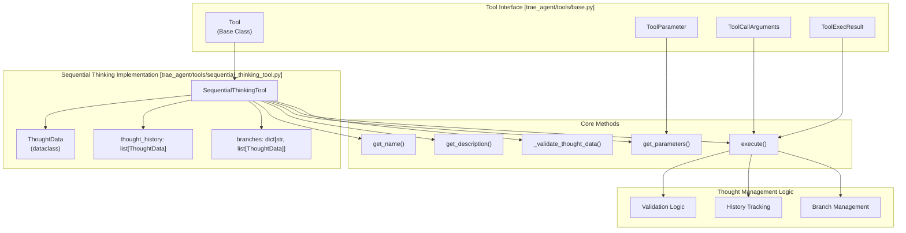
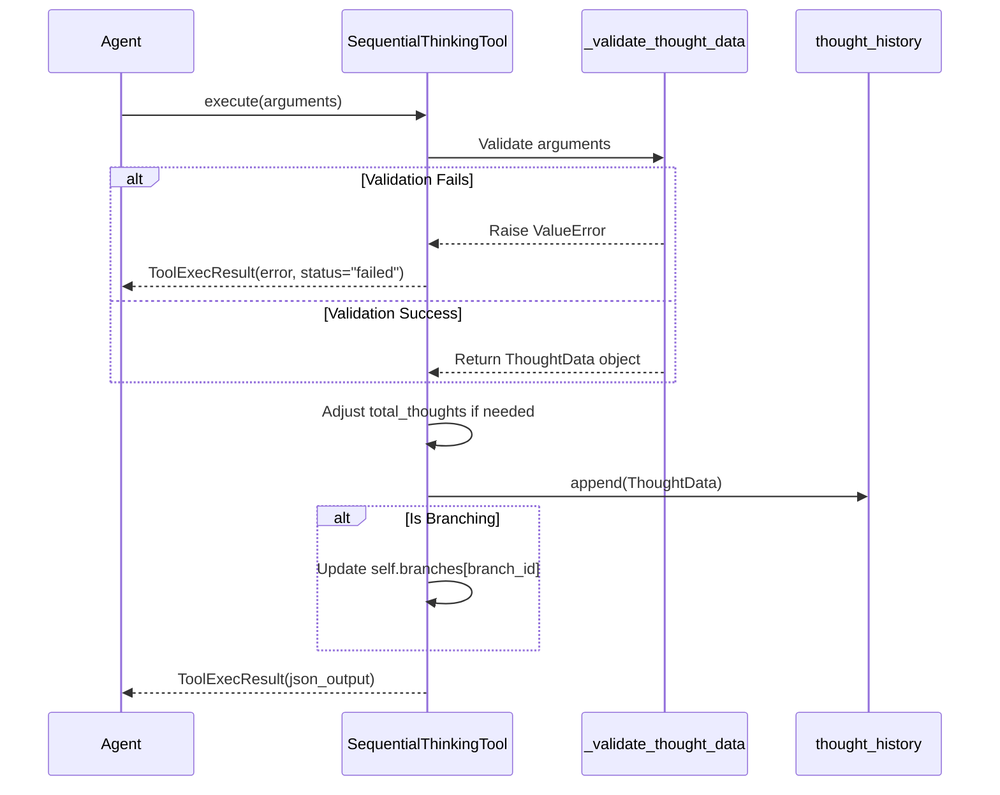
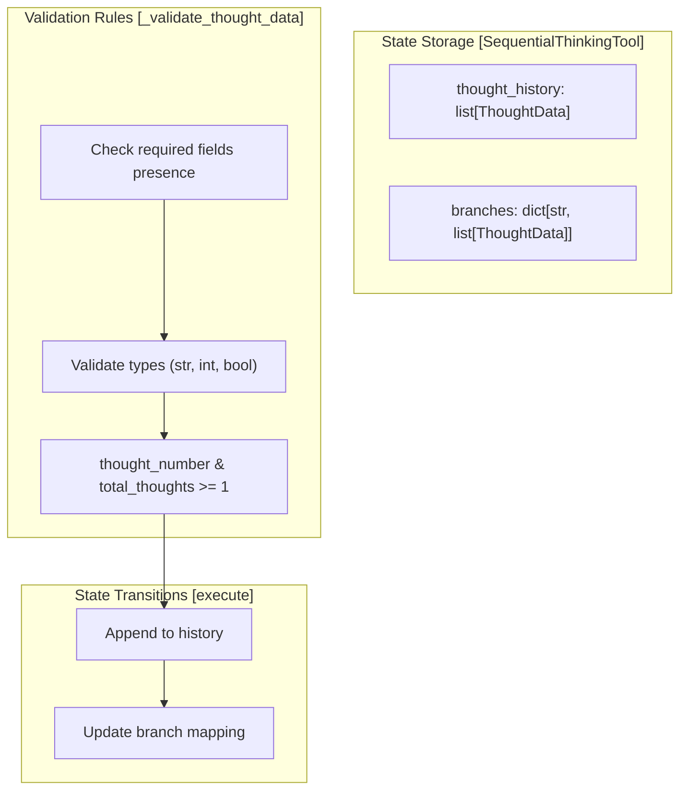

<!-- source: DeepWiki mcp.deepwiki.com · repo bytedance/trae-agent · page 5.4 Sequential Thinking Tool · fetched 2026-10-29 -->

# Sequential Thinking Tool

<details>
<summary>Relevant source files</summary>

The following files were used as context for generating this wiki page:

- [trae_agent/tools/edit_tool.py](trae_agent/tools/edit_tool.py)
- [trae_agent/tools/run.py](trae_agent/tools/run.py)
- [trae_agent/tools/sequential_thinking_tool.py](trae_agent/tools/sequential_thinking_tool.py)
- [trae_agent/tools/task_done_tool.py](trae_agent/tools/task_done_tool.py)

</details>


## Purpose and Scope

The Sequential Thinking Tool is a structured problem-solving tool within the `trae-agent` system that helps break down complex problems into manageable, sequential thoughts. This tool enables dynamic and reflective analysis through a flexible thinking process that can adapt, revise, and evolve as understanding deepens. It is specifically designed to handle tasks where the full scope might not be clear initially or where course correction is required.

This document covers the `SequentialThinkingTool` class implementation, thought management patterns, and integration within the broader tool ecosystem. For information about the overall tool framework, see [Tool Framework](5.1).

Sources: [trae_agent/tools/sequential_thinking_tool.py:32-37](), [trae_agent/tools/sequential_thinking_tool.py:45-56]()

## Architecture Overview

The tool follows the standard `trae-agent` tool architecture, extending the base `Tool` class and utilizing a specialized dataclass for state management.

**Sequential Thinking Tool Architecture**



Sources: [trae_agent/tools/sequential_thinking_tool.py:19-41](), [trae_agent/tools/sequential_thinking_tool.py:154-158](), [trae_agent/tools/base.py:1-50]()

## Core Components

### SequentialThinkingTool Class

The `SequentialThinkingTool` class manages the state of the agent's internal monologue. Unlike stateless tools, it maintains a `thought_history` and a dictionary of `branches` to support non-linear reasoning.

| Method | Purpose | Return Type |
|--------|---------|-------------|
| `get_name()` | Returns tool identifier: `"sequentialthinking"` | `str` |
| `get_description()` | Provides instructions on when to branch, revise, or extend thoughts | `str` |
| `get_parameters()` | Defines the schema for the thinking step | `list[ToolParameter]` |
| `execute()` | Validates arguments, updates history/branches, and returns status | `ToolExecResult` |
| `_validate_thought_data()` | Validates types and constraints of input arguments | `ThoughtData` |

Sources: [trae_agent/tools/sequential_thinking_tool.py:32-41](), [trae_agent/tools/sequential_thinking_tool.py:101-152](), [trae_agent/tools/sequential_thinking_tool.py:154-158](), [trae_agent/tools/sequential_thinking_tool.py:163-247]()

### ThoughtData Structure

The `ThoughtData` dataclass is the internal representation of a single reasoning step.

| Field | Type | Purpose |
|-------|------|---------|
| `thought` | `str` | The actual analytical content or hypothesis |
| `thought_number` | `int` | Current position in the sequence |
| `total_thoughts` | `int` | Estimated total thoughts (can be adjusted dynamically) |
| `next_thought_needed` | `bool` | Signal to the agent to continue thinking |
| `is_revision` | `bool \| None` | True if this thought corrects a previous one |
| `revises_thought` | `int \| None` | Index of the thought being reconsidered |
| `branch_from_thought` | `int \| None` | Index where a new line of reasoning starts |
| `branch_id` | `str \| None` | Identifier for the specific reasoning branch |
| `needs_more_thoughts` | `bool \| None` | Explicit flag to extend the process |

Sources: [trae_agent/tools/sequential_thinking_tool.py:19-30]()

## Thought Processing Flow

When the agent calls the tool, it goes through a validation and state update cycle.

**Sequential Thinking Execution Flow**



Sources: [trae_agent/tools/sequential_thinking_tool.py:277-319]()

## Parameter Configuration

The tool uses `ToolParameter` objects to define its interface to the LLM.

### Required Parameters
*   `thought` (string): The current analytical step.
*   `next_thought_needed` (boolean): Whether to continue the chain.
*   `thought_number` (integer): Current sequence index (min: 1).
*   `total_thoughts` (integer): Estimated total steps (min: 1).

### Optional Parameters
*   `is_revision` (boolean): Indicates if this thought revises previous thinking.
*   `revises_thought` (integer): Which thought number is being reconsidered.
*   `branch_from_thought` (integer): The starting point for a new branch.
*   `branch_id` (string): Identifier for the current branch.
*   `needs_more_thoughts` (boolean): If reaching the end but realizing more steps are needed.

Sources: [trae_agent/tools/sequential_thinking_tool.py:101-152]()

## State Management and Validation

The tool maintains internal state in `self.thought_history` (a list) and `self.branches` (a dictionary).

**Thought State Management Architecture**



Sources: [trae_agent/tools/sequential_thinking_tool.py:154-158](), [trae_agent/tools/sequential_thinking_tool.py:163-247](), [trae_agent/tools/sequential_thinking_tool.py:277-300]()

### Validation Logic
The `_validate_thought_data` method performs strict type checking and constraint validation:
1.  Verifies presence of required keys in `ToolCallArguments`.
2.  Ensures `thought_number` and `total_thoughts` are at least 1.
3.  Validates that `revises_thought` and `branch_from_thought` are integers if provided.
4.  Raises `ValueError` if any constraint is violated, which is caught in `execute` to return a failure status.

Sources: [trae_agent/tools/sequential_thinking_tool.py:163-247]()

## Response Format

The `execute` method returns a `ToolExecResult` containing a JSON-formatted string of the current state. This allows the agent to see its progress and any active branches.

```json
{
  "thought_number": 3,
  "total_thoughts": 5,
  "next_thought_needed": true,
  "branches": ["refactor-attempt-1"],
  "thought_history_length": 3
}
```

If an error occurs during validation, the tool returns:
```json
{
  "error": "Invalid thought_number: must be a number",
  "status": "failed"
}
```

Sources: [trae_agent/tools/sequential_thinking_tool.py:301-319]()

---

