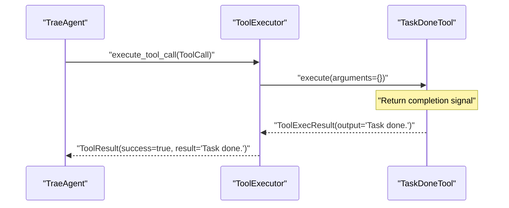
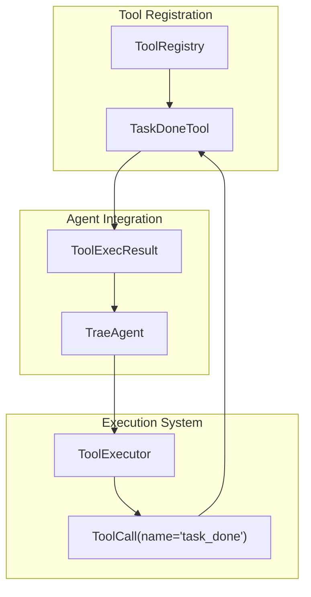

<!-- source: DeepWiki mcp.deepwiki.com · repo bytedance/trae-agent · page 5.5 Task Done Tool · fetched 2026-10-29 -->

# Task Done Tool

<details>
<summary>Relevant source files</summary>

The following files were used as context for generating this wiki page:

- [trae_agent/tools/edit_tool.py](trae_agent/tools/edit_tool.py)
- [trae_agent/tools/run.py](trae_agent/tools/run.py)
- [trae_agent/tools/sequential_thinking_tool.py](trae_agent/tools/sequential_thinking_tool.py)
- [trae_agent/tools/task_done_tool.py](trae_agent/tools/task_done_tool.py)

</details>


This document describes the `TaskDoneTool`, a specialized tool in the Trae Agent system that signals task completion. The `TaskDoneTool` provides a formal mechanism for agents to indicate when they have successfully completed their assigned tasks and performed necessary verification.

For information about the broader tool framework and base classes, see [Tool Framework](#5.1). For details about other available tools, see [Tools Reference](#5). For agent execution lifecycle details, see [Agent System](#4.1).

## Purpose and Functionality

The `TaskDoneTool` serves as a completion signal mechanism within the Trae Agent system. It allows agents to formally declare task completion after performing appropriate verification steps. The tool enforces a verification-first approach by requiring agents to validate their solutions before marking tasks as complete.

The tool is implemented as a minimal, parameter-less tool that returns a simple completion message when invoked. Despite its simplicity, it plays a crucial role in the agent execution lifecycle by providing a clear termination point for task execution.

**Sources:** [trae_agent/tools/task_done_tool.py:9-34]()

## Tool Implementation

### Class Structure

The `TaskDoneTool` class follows the standard tool implementation pattern, inheriting from the base `Tool` class and implementing all required abstract methods:

Title: TaskDoneTool Class Hierarchy
```mermaid
classDiagram
    class "Tool" {
        <<abstract>>
        +get_name() str
        +get_description() str
        +get_parameters() list[ToolParameter]
        +execute(arguments) ToolExecResult
    }
    
    class "TaskDoneTool" {
        +get_name() "task_done"
        +get_description() str
        +get_parameters() list[ToolParameter]
        +execute(arguments) ToolExecResult
    }
    
    "Tool" <|-- "TaskDoneTool"
```

**Tool Properties:**
- **Name**: `task_done` [trae_agent/tools/task_done_tool.py:21-21]()
- **Parameters**: None (empty list) [trae_agent/tools/task_done_tool.py:28-29]()
- **Model Provider**: Configurable via constructor [trae_agent/tools/task_done_tool.py:12-13]()
- **Execution**: Returns simple success message [trae_agent/tools/task_done_tool.py:32-33]()

**Sources:** [trae_agent/tools/task_done_tool.py:9-34]()

### Implementation Details

The tool implementation is minimal but follows all framework conventions:

| Method | Return Value | Purpose |
|--------|--------------|---------|
| `get_name()` | `"task_done"` | Tool identifier for registration [trae_agent/tools/task_done_tool.py:21-21]() |
| `get_description()` | Verification requirement message | Guidance for agent usage [trae_agent/tools/task_done_tool.py:25-25]() |
| `get_parameters()` | `[]` (empty list) | No input parameters required [trae_agent/tools/task_done_tool.py:29-29]() |
| `execute()` | `ToolExecResult(output="Task done.")` | Completion signal [trae_agent/tools/task_done_tool.py:33-33]() |

The tool's description emphasizes the verification requirement: *"Note that you cannot call this tool before any verification is done. You can write reproduce / test script to verify your solution."* [trae_agent/tools/task_done_tool.py:25-25]()

**Sources:** [trae_agent/tools/task_done_tool.py:20-33]()

## Tool Execution Flow

### Standard Execution Path

Title: TaskDoneTool Execution Sequence


The execution flow is straightforward since the tool requires no parameters and performs no complex operations. The tool simply returns a `ToolExecResult` with the output message "Task done." [trae_agent/tools/task_done_tool.py:32-33]()

**Sources:** [trae_agent/tools/task_done_tool.py:32-33]()

### Integration with Tool Framework

The `TaskDoneTool` integrates with the broader tool system through standard registration and execution mechanisms.

Title: System Component Interaction


**Sources:** [trae_agent/tools/task_done_tool.py:9-34](), [trae_agent/tools/base.py:15-16]()

## Usage Patterns

### Agent Workflow Integration

The `TaskDoneTool` is typically used at the end of agent execution workflows after verification steps:

1.  **Problem Analysis**: Agent analyzes the task requirements (often using `SequentialThinkingTool`).
2.  **Solution Implementation**: Agent implements changes using other tools like `TextEditorTool` [trae_agent/tools/edit_tool.py:27-30]() or `BashTool`.
3.  **Verification**: Agent creates and runs test scripts to validate the solution.
4.  **Completion Signal**: Agent calls `task_done` to indicate successful completion [trae_agent/tools/task_done_tool.py:25-25]().

### Verification Enforcement

The tool's description explicitly requires verification before completion. Common verification patterns include:

-   Running existing test suites via shell commands.
-   Creating reproduction scripts to test fixes.
-   Validating file changes with `view` commands in `TextEditorTool` [trae_agent/tools/edit_tool.py:154-156]().

**Sources:** [trae_agent/tools/task_done_tool.py:25-25](), [trae_agent/tools/edit_tool.py:43-53]()

## Tool Schema and Parameters

### JSON Schema Definition

The `TaskDoneTool` generates a minimal JSON schema since it requires no parameters:

```json
{
  "name": "task_done",
  "description": "Report the completion of the task. Note that you cannot call this tool before any verification is done...",
  "parameters": {
    "type": "object",
    "properties": {},
    "required": []
  }
}
```

**Sources:** [trae_agent/tools/task_done_tool.py:21-29]()

## Relationship to Agent Lifecycle

The `TaskDoneTool` serves as a formal termination point in the agent execution lifecycle. It provides a clear signal for task completion that can be used by the orchestrating system to finalize execution and generate results.

For more details on agent execution patterns and lifecycle management, see [Agent System](#4.1). For information about other available tools that agents use before task completion, see [Bash Tool](#5.2), [Text Editor Tool](#5.3), and [Sequential Thinking Tool](#5.4).

**Sources:** [trae_agent/tools/task_done_tool.py:1-34]()

---

