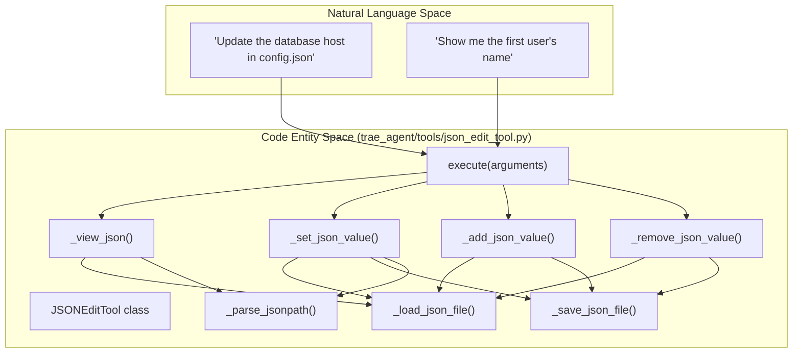
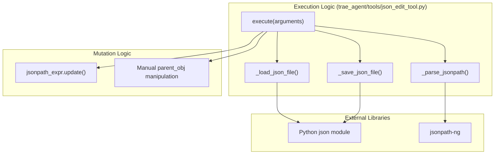

<!-- source: DeepWiki mcp.deepwiki.com · repo bytedance/trae-agent · page 5.6 JSON Edit Tool · fetched 2026-10-29 -->

# JSON Edit Tool

Relevant source files

The following files were used as context for generating this wiki page:

- [tests/tools/test_json_edit_tool.py](tests/tools/test_json_edit_tool.py)
- [trae_agent/prompt/__init__.py](trae_agent/prompt/__init__.py)
- [trae_agent/prompt/agent_prompt.py](trae_agent/prompt/agent_prompt.py)
- [trae_agent/tools/json_edit_tool.py](trae_agent/tools/json_edit_tool.py)

The JSON Edit Tool provides structured editing capabilities for JSON files using JSONPath expressions. This tool enables precise manipulation of JSON data structures through operations including viewing, setting, adding, and removing values. It is implemented as a Python class that leverages the `jsonpath-ng` library for robust path-based targeting.

For information about the base tool framework and creating custom tools, see [Tool Framework](5.1). For other file editing capabilities, see [Text Editor Tool](5.3).

## Tool Overview

The `JSONEditTool` class in [trae_agent/tools/json_edit_tool.py:17-155]() implements the `Tool` interface to provide safe, validated JSON manipulations. It supports targeted modifications to JSON structures while preserving formatting where possible.

**Sources:** [trae_agent/tools/json_edit_tool.py:17-155]()

## Core Operations

The tool supports four primary operations defined in the `get_parameters` method [trae_agent/tools/json_edit_tool.py:64]():

| Operation | Purpose | Requires JSONPath | Requires Value | Modifies File |
|-----------|---------|-------------------|----------------|---------------|
| `view` | Display JSON content or specific paths | Optional | No | No |
| `set` | Update existing values at specified paths | Yes | Yes | Yes |
| `add` | Add new key-value pairs or array elements | Yes | Yes | Yes |
| `remove` | Delete elements at specified paths | Yes | No | Yes |

### View Operation
Implemented in `_view_json()` at [trae_agent/tools/json_edit_tool.py:207-224](). If a `json_path` is provided, it uses `jsonpath_expr.find(data)` to extract specific matches. If no path is provided, it returns the entire formatted JSON content.

### Set Operation
Implemented in `_set_json_value()` at [trae_agent/tools/json_edit_tool.py:226-242](). It uses `jsonpath_expr.update(data, value)` to modify the JSON structure in-place at all locations matching the path. It returns an error if the path does not exist.

### Add Operation
Implemented in `_add_json_value()` at [trae_agent/tools/json_edit_tool.py:244-275](). This operation distinguishes between objects and arrays:
- **Objects**: Uses `jsonpath_ng.Fields` to add a new key-value pair to a parent object.
- **Arrays**: Uses `jsonpath_ng.Index` to insert a value at a specific index in a parent array.

### Remove Operation
Implemented in `_remove_json_value()` at [trae_agent/tools/json_edit_tool.py:277-310](). It processes matches in reverse order to ensure that removing items from an array does not shift the indices of subsequent matches.

**Sources:** [trae_agent/tools/json_edit_tool.py:207-310]()

## JSONPath Syntax Support

The tool utilizes `jsonpath-ng` to parse expressions [trae_agent/tools/json_edit_tool.py:11](). Supported syntax includes:

| Syntax | Description | Example |
|--------|-------------|---------|
| `$` | Root element | `$` |
| `.key` | Object property access | `$.config.host` |
| `[index]` | Array index access | `$.users[0]` |
| `[*]` | Wildcard (all elements) | `$.items[*].price` |
| `..key` | Recursive descent | `$..id` |
| `[start:end]` | Array slicing | `$.users[0:2]` |

**Sources:** [trae_agent/tools/json_edit_tool.py:46-53]()

## Technical Implementation

### Execution Flow
The `execute` method [trae_agent/tools/json_edit_tool.py:93-155]() acts as the primary dispatcher. It validates that the `file_path` is absolute [trae_agent/tools/json_edit_tool.py:105-108]() and ensures that required parameters for specific operations (like `value` for `set` and `add`) are present.

**Sources:** [trae_agent/tools/json_edit_tool.py:93-155](), [trae_agent/tools/json_edit_tool.py:186-205]()

### File Handling and Formatting
- **Loading**: `_load_json_file` [trae_agent/tools/json_edit_tool.py:157-171]() reads the file with UTF-8 encoding and performs `json.loads()`.
- **Saving**: `_save_json_file` [trae_agent/tools/json_edit_tool.py:173-184]() writes back to the file. If `pretty_print` is enabled (default), it uses an indentation of 2 spaces [trae_agent/tools/json_edit_tool.py:182]().

### Error Handling
The tool provides detailed error messages for common failure modes:
- **Path Validation**: `_parse_jsonpath` [trae_agent/tools/json_edit_tool.py:186-194]() catches `JSONPathError` and provides feedback on invalid syntax.
- **File Errors**: Catches `FileNotFoundError`, `JSONDecodeError`, and general `IOError` during file operations [trae_agent/tools/json_edit_tool.py:168-171]().
- **Operation Errors**: Validates that `json_path` exists before attempting `set` or `remove` operations [trae_agent/tools/json_edit_tool.py:231-232]().

**Sources:** [trae_agent/tools/json_edit_tool.py:157-194]()

## Parameters Reference

The tool defines the following parameters in `get_parameters` [trae_agent/tools/json_edit_tool.py:56-90]():

- **`operation`** (string, required): One of `view`, `set`, `add`, `remove`.
- **`file_path`** (string, required): The **ABSOLUTE** path to the JSON file.
- **`json_path`** (string, optional): The JSONPath expression targeting the data.
- **`value`** (object, optional): The JSON-serializable value to set or add.
- **`pretty_print`** (boolean, optional): Whether to format output with indentation (defaults to `true`).

**Sources:** [trae_agent/tools/json_edit_tool.py:58-90](), [trae_agent/prompt/agent_prompt.py:6-9]()

---

