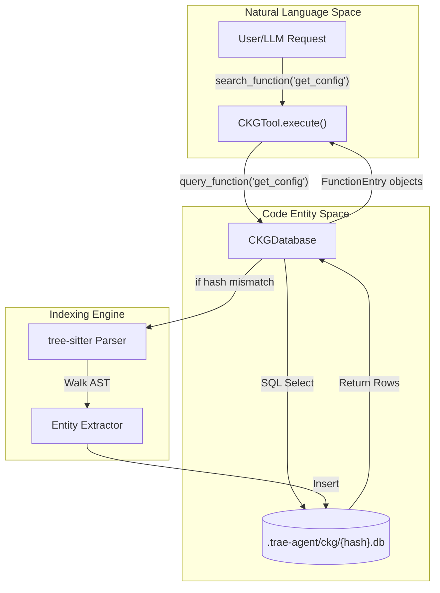
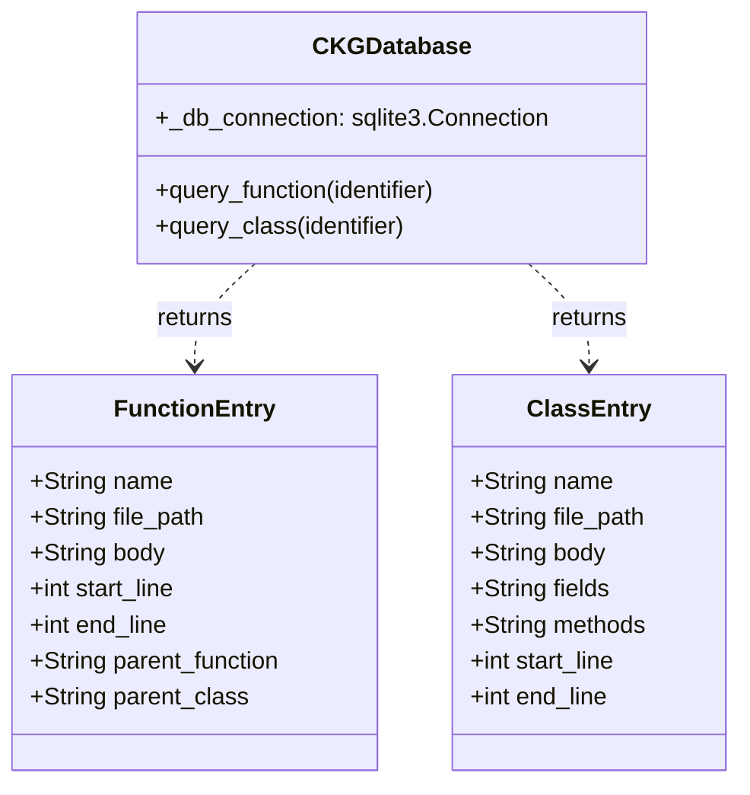

<!-- source: DeepWiki mcp.deepwiki.com · repo bytedance/trae-agent · page 5.7 Code Knowledge Graph (CKG) Tool · fetched 2026-10-29 -->

# Code Knowledge Graph (CKG) Tool

Relevant source files

The following files were used as context for generating this wiki page:

- [trae_agent/tools/ckg/base.py](trae_agent/tools/ckg/base.py)
- [trae_agent/tools/ckg/ckg_database.py](trae_agent/tools/ckg/ckg_database.py)
- [trae_agent/tools/ckg_tool.py](trae_agent/tools/ckg_tool.py)
- [trae_agent/utils/constants.py](trae_agent/utils/constants.py)

The Code Knowledge Graph (CKG) tool enables the agent to perform structural queries across a codebase. Unlike simple text searches, the CKG tool uses `tree-sitter` to parse source code into Abstract Syntax Trees (ASTs), allowing it to identify and index specific code entities such as functions, classes, and methods [trae_agent/tools/ckg_tool.py:14-15](). This structural understanding allows the agent to navigate complex codebases more effectively by retrieving exact definitions and their metadata.

## Overview and Purpose

The `CKGTool` serves as a high-level interface for querying a SQLite-backed knowledge graph [trae_agent/tools/ckg_tool.py:20-27](). It is designed to help the agent:
- Locate function definitions across multiple files.
- Understand class structures, including their fields and methods.
- Retrieve the implementation body of specific code symbols without reading entire files.
- Maintain a persistent index of the codebase that survives across different tool calls [trae_agent/tools/ckg_tool.py:40-40]().

### Supported Languages
The tool supports structural parsing for the following languages via `extension_to_language` mapping [trae_agent/tools/ckg/base.py:40-54]():
- **Python**: `.py`
- **Java**: `.java`
- **C/C++**: `.c`, `.h`, `.cpp`, `.hpp`, `.cc`, etc.
- **TypeScript/JavaScript**: `.ts`, `.tsx`, `.js`, `.jsx`

## Architecture and Data Flow

The CKG system consists of the tool interface, a database manager, and a parsing engine.

### Data Flow: From Source to Query
The following diagram illustrates how natural language requests for code entities are transformed into structural queries within the `CKGDatabase`.

**Structural Code Retrieval Flow**

Sources: [trae_agent/tools/ckg_tool.py:81-131](), [trae_agent/tools/ckg/ckg_database.py:148-189]()

## Key Components

### CKGTool Class
The `CKGTool` manages the interaction between the agent and the underlying databases. It handles argument validation and formats the output for the LLM, including truncation if the output exceeds `MAX_RESPONSE_LEN` [trae_agent/tools/ckg_tool.py:155-160]().

**Commands:**
- `search_function`: Finds functions by name [trae_agent/tools/ckg_tool.py:135-162]().
- `search_class`: Finds classes and lists their fields/methods [trae_agent/tools/ckg_tool.py:164-194]().
- `search_class_method`: Finds specific methods within classes [trae_agent/tools/ckg_tool.py:196-223]().

### CKGDatabase Class
The `CKGDatabase` handles the persistence and indexing logic. It uses a snapshot hashing strategy to determine if the codebase has changed and needs re-indexing [trae_agent/tools/ckg/ckg_database.py:172-186]().

**Storage Details:**
- **Path**: Databases are stored in `~/.trae-agent/ckg/` [trae_agent/tools/ckg/ckg_database.py:18](), [trae_agent/utils/constants.py:6-6]().
- **Schema**: Two primary tables: `functions` and `classes` [trae_agent/tools/ckg/ckg_database.py:122-145]().
- **Caching**: Databases older than 7 days are automatically cleared [trae_agent/tools/ckg/ckg_database.py:20-20](), [trae_agent/tools/ckg/ckg_database.py:107-120]().

### Snapshot Hashing
To ensure the graph is up-to-date, the system calculates a `codebase_snapshot_hash` [trae_agent/tools/ckg/ckg_database.py:97-104]():
1. **Git Strategy**: If the path is a git repository, it combines the `HEAD` commit hash with a porcelain status hash (to detect uncommitted changes) [trae_agent/tools/ckg/ckg_database.py:51-76]().
2. **Metadata Strategy**: For non-git directories, it generates an MD5 hash based on file names, modification times (`mtime`), and sizes [trae_agent/tools/ckg/ckg_database.py:83-94]().

## Entity Mapping

The tool maps AST nodes to internal dataclasses before storing them in SQLite.

**Entity Mapping Diagram**

Sources: [trae_agent/tools/ckg/base.py:9-37](), [trae_agent/tools/ckg/ckg_database.py:148-150]()

## Implementation Details

### Database Schema
The SQLite database uses the following schema to store code structure [trae_agent/tools/ckg/ckg_database.py:122-145]():

| Table | Columns |
| :--- | :--- |
| `functions` | `id`, `name`, `file_path`, `body`, `start_line`, `end_line`, `parent_function`, `parent_class` |
| `classes` | `id`, `name`, `file_path`, `body`, `fields`, `methods`, `start_line`, `end_line` |

### Query Logic
When a query is performed, the `CKGDatabase` executes SQL selects against these tables. For example, `query_function` retrieves `FunctionEntry` objects which include the full source code `body` and line ranges [trae_agent/tools/ckg_tool.py:148-151]().

### Known Limitations
- **Subdirectory Redundancy**: If a subdirectory of an already indexed codebase is queried, the tool may rebuild the CKG for that subdirectory [trae_agent/tools/ckg/ckg_database.py:25-25]().
- **JS/TS Parsing**: The current AST implementation may miss anonymous functions or complex arrow function patterns in JavaScript and TypeScript [trae_agent/tools/ckg/ckg_database.py:27-28]().

Sources: [trae_agent/tools/ckg_tool.py:1-223](), [trae_agent/tools/ckg/ckg_database.py:1-189](), [trae_agent/tools/ckg/base.py:1-54](), [trae_agent/utils/constants.py:1-7]()

---

