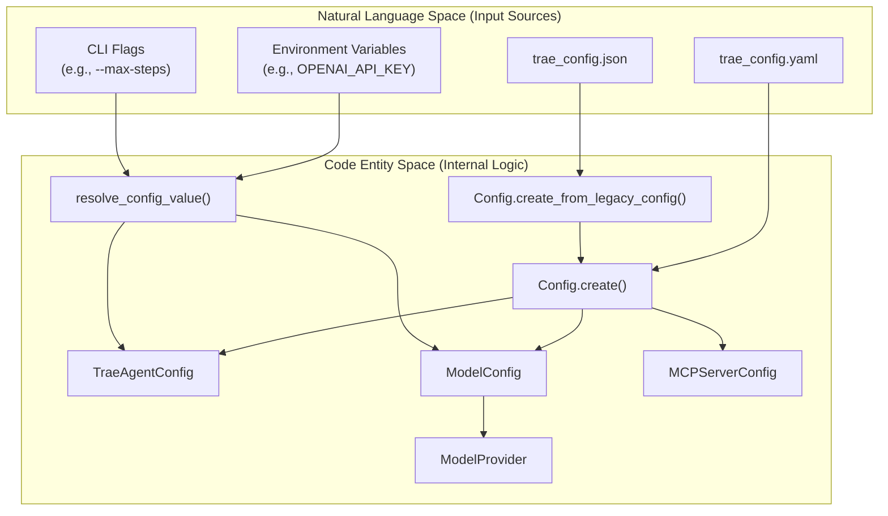
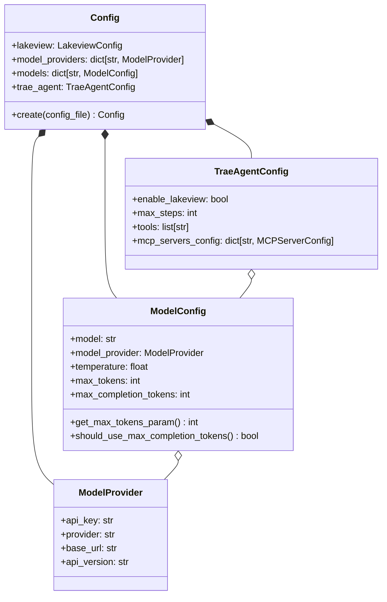

<!-- source: DeepWiki mcp.deepwiki.com · repo bytedance/trae-agent · page 6 Configuration Reference · fetched 2026-10-29 -->

# Configuration Reference

Relevant source files

The following files were used as context for generating this wiki page:

- [.gitignore](.gitignore)
- [.vscode/launch.template.json](.vscode/launch.template.json)
- [docs/legacy_config.md](docs/legacy_config.md)
- [tests/utils/test_config.py](tests/utils/test_config.py)
- [trae_agent/utils/config.py](trae_agent/utils/config.py)
- [trae_agent/utils/legacy_config.py](trae_agent/utils/legacy_config.py)
- [trae_config.json.example](trae_config.json.example)
- [trae_config.yaml.example](trae_config.yaml.example)

This document provides a comprehensive reference for all configuration options available in `trae-agent`. It covers configuration file formats, environment variables, CLI parameter overrides, and the resolution priority system used to determine final configuration values.

## Configuration File Formats

trae-agent supports two configuration file formats, managed by the `Config` and `LegacyConfig` classes.

### YAML Configuration (Recommended)
The primary configuration format uses YAML files, typically named `trae_config.yaml`. This format provides better readability and structured definitions for models and providers separately.

### Legacy JSON Configuration
The system maintains backward compatibility with JSON configuration files (e.g., `trae_config.json`). If a `.json` file is provided to `Config.create`, it invokes `Config.create_from_legacy_config` to map old fields to the new dataclass structure.

Sources: [trae_agent/utils/config.py:205-230](), [trae_agent/utils/legacy_config.py:71-166](), [docs/legacy_config.md:1-5]()

## Configuration Loading and Resolution Flow

The following diagram illustrates how raw configuration data from various sources is ingested into the system's internal dataclasses.

### Data Flow: From Source to Code Entities

Sources: [trae_agent/utils/config.py:205-230](), [trae_agent/utils/config.py:324-392](), [trae_agent/utils/config.py:394-411]()

## Configuration Structure

The configuration system is strictly typed using Python dataclasses.

### Configuration Class Diagram

Sources: [trae_agent/utils/config.py:16-57](), [trae_agent/utils/config.py:145-172](), [trae_agent/utils/config.py:194-203]()

## Configuration Sections

### Agents Section
The `agents` section (specifically `trae_agent`) defines the operational limits and toolset for the agent.

| Field | Type | Default | Description |
|-------|------|---------|-------------|
| `enable_lakeview` | bool | `True` | Whether to enable the Lakeview trajectory summarizer. |
| `max_steps` | int | Required | The maximum number of steps the agent can take per task. |
| `tools` | list[str] | `["bash", ...]` | List of tool names available to the agent. |
| `model` | str | Required | Reference to a key in the `models` section. |

Sources: [trae_agent/utils/config.py:158-172](), [trae_config.yaml.example:2-10]()

### Model Providers Section
Defines connection credentials for LLM backends.

| Field | Type | Required | Description |
|-------|------|----------|-------------|
| `api_key` | str | Yes | API credential. Can be overridden by env vars. |
| `provider` | str | Yes | Backend type (e.g., `openai`, `anthropic`, `azure`, `doubao`). |
| `base_url` | str | No | Custom endpoint URL. |
| `api_version` | str | No | Specific to Azure OpenAI. |

Sources: [trae_agent/utils/config.py:17-27](), [trae_config.yaml.example:21-25]()

### Models Section
Configures generation parameters for specific model instances.

| Field | Type | Default | Description |
|-------|------|---------|-------------|
| `model` | str | Required | The model string (e.g., `gpt-4o`). |
| `temperature` | float | Required | Sampling temperature. |
| `max_tokens` | int | `4096` | Legacy token limit. |
| `max_completion_tokens`| int | `None` | Preferred token limit for newer Azure/O-series models. |
| `parallel_tool_calls` | bool | Required | Whether the model supports multiple tool calls in one turn. |

Sources: [trae_agent/utils/config.py:30-64](), [trae_config.yaml.example:26-44]()

### MCP Servers Section
Configures external tools via the Model Context Protocol.

| Field | Type | Description |
|-------|------|-------------|
| `command` | str | The executable to run for stdio transport. |
| `args` | list[str] | Arguments passed to the command. |
| `env` | dict | Environment variables for the server process. |
| `url` | str | URL for SSE transport. |

Sources: [trae_agent/utils/config.py:120-143](), [trae_config.yaml.example:13-17]()

## Environment Variables

Environment variables follow a strict naming convention: `{PROVIDER_NAME}_API_KEY` and `{PROVIDER_NAME}_BASE_URL`. These are resolved in `ModelConfig.resolve_config_values`.

| Variable | Target |
|----------|--------|
| `OPENAI_API_KEY` | OpenAI Provider |
| `ANTHROPIC_API_KEY` | Anthropic Provider |
| `AZURE_API_KEY` | Azure Provider |
| `DOUBAO_API_KEY` | Doubao Provider |
| `GOOGLE_API_KEY` | Google Provider |

Sources: [trae_agent/utils/config.py:96-117](), [trae_config.json.example:13-82]()

## Configuration Resolution Priority

The `resolve_config_value` function determines which value takes precedence when multiple sources define the same parameter.

1.  **CLI Arguments** (Highest): Values passed via command line flags.
2.  **Environment Variables**: System-level variables (e.g., `ANTHROPIC_API_KEY`).
3.  **Configuration File**: Values defined in `trae_config.yaml` or `trae_config.json`.
4.  **Default Values** (Lowest): Hardcoded defaults within the dataclasses.

Sources: [trae_agent/utils/config.py:394-411](), [docs/legacy_config.md:28-33]()

---

