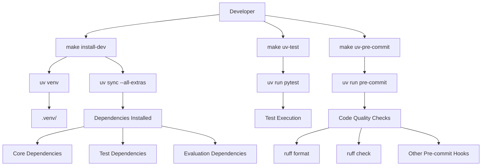
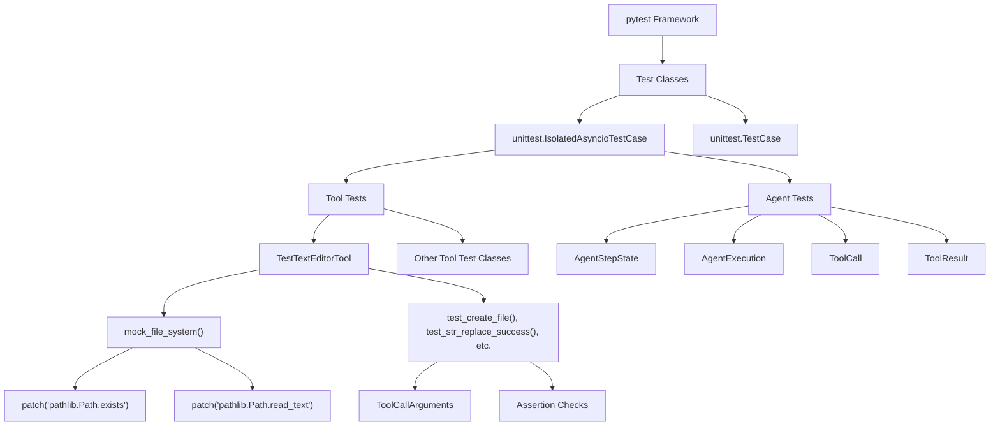
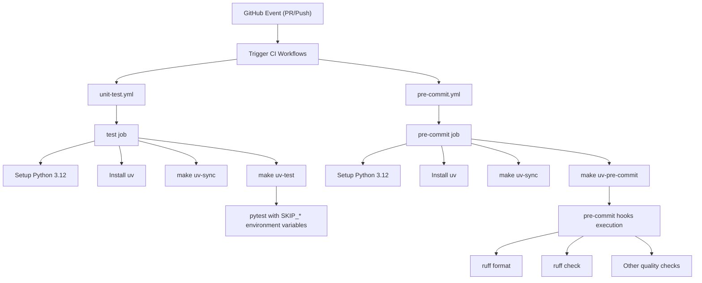

<!-- source: DeepWiki mcp.deepwiki.com · repo bytedance/trae-agent · page 7 Development · fetched 2026-10-29 -->

# Development

<details>
<summary>Relevant source files</summary>

The following files were used as context for generating this wiki page:

- [.github/workflows/pre-commit.yml](.github/workflows/pre-commit.yml)
- [.github/workflows/unit-test.yml](.github/workflows/unit-test.yml)
- [CONTRIBUTING.md](CONTRIBUTING.md)
- [Makefile](Makefile)
- [docs/TRAJECTORY_RECORDING.md](docs/TRAJECTORY_RECORDING.md)
- [docs/roadmap.md](docs/roadmap.md)
- [tests/tools/test_edit_tool.py](tests/tools/test_edit_tool.py)
- [trae_agent/agent/agent_basics.py](trae_agent/agent/agent_basics.py)

</details>


This guide provides developers with the essential information needed to contribute to or extend the `trae-agent` codebase. It covers development environment setup, build system usage, testing practices, and CI/CD integration.

For detailed contribution guidelines and workflows, see [Contributing](#7.1). For an in-depth explanation of the repository structure and package organization, see [Project Structure](#7.2). For comprehensive testing documentation and best practices, see [Testing](#7.3).

## Development Environment Setup

The `trae-agent` project uses modern Python tooling with `uv` as the primary package manager and build tool. The development environment setup is streamlined through `make` targets defined in the project's `Makefile`.

### Prerequisites

- **Python**: Version 3.12 or higher [CONTRIBUTING.md:84-84]()
- **uv**: Fast Python package installer and resolver [Makefile:19-22]()
- **Docker**: Optional, for containerized tool execution and testing

### Quick Setup

The recommended development setup uses the `install-dev` make target:

```bash
make install-dev
```

This command creates a virtual environment and installs all dependencies including test and evaluation extras. Under the hood, it executes `uv venv` followed by `uv sync --all-extras` [Makefile:18-23]().

**Development Build System Overview**



Sources: [Makefile:18-23](), [.github/workflows/unit-test.yml:30-36]()

## Build System and Make Targets

The project uses a `Makefile` to standardize development commands. All primary development tasks are accessible through make targets:

| Command | Purpose | Implementation |
|---------|---------|----------------|
| `make install-dev` | Complete development setup | `uv venv && uv sync --all-extras` [Makefile:23-23]() |
| `make uv-test` | Run test suite with skips | `uv run pytest` with `SKIP_*` env vars [Makefile:41-42]() |
| `make uv-pre-commit` | Run code quality checks | `uv run pre-commit run --all-files` [Makefile:26-27]() |
| `make fix-format` | Auto-fix formatting issues | `ruff format . && ruff check --fix .` [Makefile:36-38]() |
| `make clean` | Clean build artifacts | Remove build, cache, and temporary files [Makefile:47-57]() |

### Test Environment Configuration

The test runner automatically skips external service tests to ensure consistent CI/CD execution without requiring external API keys:

```bash
SKIP_OLLAMA_TEST=true SKIP_OPENROUTER_TEST=true SKIP_GOOGLE_TEST=true uv run pytest tests/ -v --tb=short --continue-on-collection-errors
```

Sources: [Makefile:1-58](), [Makefile:42-44]()

## Testing Framework Architecture

The project uses `pytest` as the test runner and leverages `unittest.IsolatedAsyncioTestCase` for testing asynchronous components like tools and agents.

**Testing Framework Structure**



Sources: [tests/tools/test_edit_tool.py:1-132](), [trae_agent/agent/agent_basics.py:19-101]()

### Testing Patterns

The codebase demonstrates several key testing patterns:

1. **Async Test Structure**: Tests inherit from `unittest.IsolatedAsyncioTestCase` for async tool execution [tests/tools/test_edit_tool.py:12-12]().
2. **Mock File System**: Helper methods like `mock_file_system()` abstract common mocking patterns for `pathlib.Path` operations [tests/tools/test_edit_tool.py:19-35]().
3. **Tool Testing**: Uses `ToolCallArguments` to simulate tool execution with structured parameters [tests/tools/test_edit_tool.py:39-41]().
4. **Error Testing**: Validates both success and error cases with specific error codes and messages [tests/tools/test_edit_tool.py:66-72]().

Example test pattern from `TestTextEditorTool`:

```python
async def test_str_replace_success(self):
    self.mock_file_system(content="old_content\nline2")
    result = await self.tool.execute(
        ToolCallArguments({
            "command": "str_replace",
            "path": str(self.test_file),
            "old_str": "old_content",
            "new_str": "new_content",
        })
    )
    self.mock_write.assert_called_once()
    self.assertIn("edited", result.output)
```

Sources: [tests/tools/test_edit_tool.py:88-101]()

## Continuous Integration Pipeline

The project implements a comprehensive CI/CD pipeline using GitHub Actions with two primary workflows: unit testing and code quality checks.

**CI/CD Pipeline Architecture**



Sources: [.github/workflows/unit-test.yml:1-37](), [.github/workflows/pre-commit.yml:1-40]()

### Workflow Configuration

Both workflows share common setup patterns:
- Target `ubuntu-latest` runner [unit-test.yml:16]().
- Use Python 3.12 [unit-test.yml:25]().
- Install `uv` via `astral-sh/setup-uv@v6` [unit-test.yml:28]().
- Execute through `make` targets for consistency across local and CI environments [unit-test.yml:36]().

The workflows only run for the official `bytedance/trae-agent` repository to manage resource usage [unit-test.yml:15]().

## Core Development Data Structures

Understanding the core data structures is essential for extending the agent system. The `trae_agent/agent/agent_basics.py` module defines the fundamental types used throughout the codebase.

### Agent Execution Model

The agent execution model uses several key enums and dataclasses to track state and progress:

| Type | Purpose | Key Values |
|------|---------|------------|
| `AgentStepState` | Step-level execution states | `THINKING`, `CALLING_TOOL`, `REFLECTING`, `COMPLETED`, `ERROR` [trae_agent/agent/agent_basics.py:19-26]() |
| `AgentState` | Overall agent lifecycle states | `IDLE`, `RUNNING`, `COMPLETED`, `ERROR` [trae_agent/agent/agent_basics.py:29-35]() |
| `AgentStep` | Individual execution step record | Contains `step_number`, `state`, `tool_calls`, `tool_results`, `llm_response` [trae_agent/agent/agent_basics.py:39-56]() |
| `AgentExecution` | Complete task summary | Contains `task`, `steps`, `final_result`, `success`, `total_tokens` [trae_agent/agent/agent_basics.py:67-81]() |

### Trajectory Recording

For debugging and analysis, the agent system supports trajectory recording. This system captures:
- **Raw LLM interactions**: Messages and responses for all providers [docs/TRAJECTORY_RECORDING.md:9-9]().
- **Agent execution steps**: State transitions and tool interactions [docs/TRAJECTORY_RECORDING.md:10-10]().
- **Metadata**: Timestamps and token usage [docs/TRAJECTORY_RECORDING.md:11-11]().

The `TrajectoryRecorder` class handles the serialization of these events to JSON files [docs/TRAJECTORY_RECORDING.md:15-17]().

Sources: [trae_agent/agent/agent_basics.py:19-101](), [docs/TRAJECTORY_RECORDING.md:1-25]()

## Code Quality Standards

The project enforces strict code quality through automated tooling:

- **Formatting**: `ruff format` ensures consistent code style [Makefile:37-37]().
- **Linting**: `ruff check` enforces best practices and identifies potential bugs [Makefile:38-38]().
- **Type Hints**: Developers are encouraged to use type hints throughout the codebase [CONTRIBUTING.md:79-80]().
- **Pre-commit Hooks**: Automated execution of checks before every commit via `make pre-commit-install` [CONTRIBUTING.md:30-30]().

Developers can fix formatting issues automatically using `make fix-format` [Makefile:36-38]().

Sources: [Makefile:36-38](), [CONTRIBUTING.md:78-85]()

---

