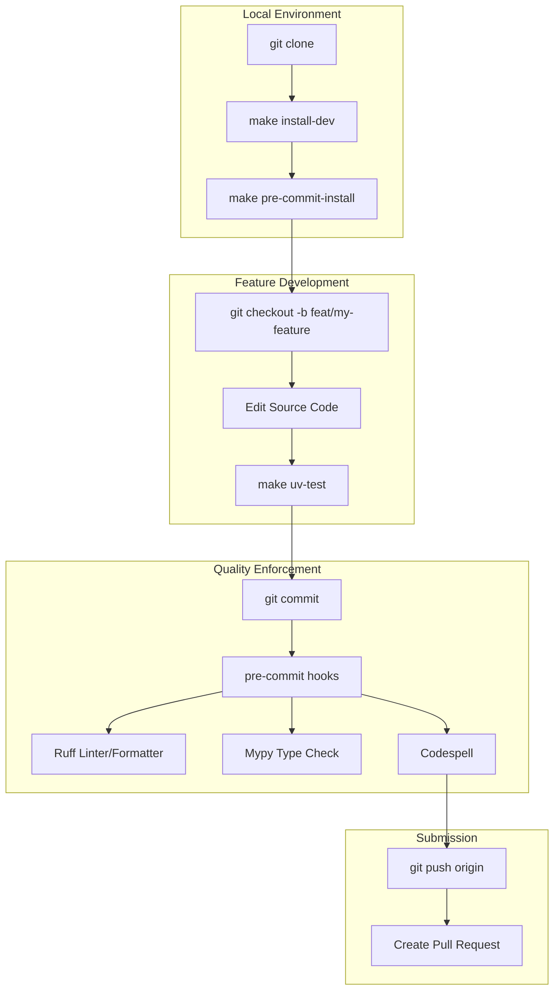
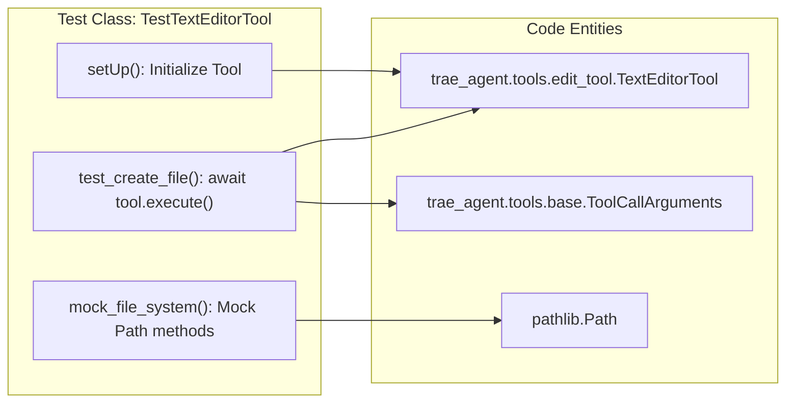

<!-- source: DeepWiki mcp.deepwiki.com · repo bytedance/trae-agent · page 7.1 Contributing · fetched 2026-10-29 -->

# Contributing

<details>
<summary>Relevant source files</summary>

The following files were used as context for generating this wiki page:

- [.github/ISSUE_TEMPLATE/bug-report.yml](.github/ISSUE_TEMPLATE/bug-report.yml)
- [.github/ISSUE_TEMPLATE/config.yml](.github/ISSUE_TEMPLATE/config.yml)
- [.github/ISSUE_TEMPLATE/feature-request.yml](.github/ISSUE_TEMPLATE/feature-request.yml)
- [.github/ISSUE_TEMPLATE/proposal.yml](.github/ISSUE_TEMPLATE/proposal.yml)
- [.github/ISSUE_TEMPLATE/question.yml](.github/ISSUE_TEMPLATE/question.yml)
- [.github/pull_request_template.md](.github/pull_request_template.md)
- [.pre-commit-config.yaml](.pre-commit-config.yaml)
- [tests/tools/test_edit_tool.py](tests/tools/test_edit_tool.py)

</details>


This document provides comprehensive guidelines for contributing to the Trae Agent project. It covers development environment setup, code quality standards, testing practices, and the pull request workflow.

For information about the project structure and module organization, see [Project Structure](#7.2). For details on the testing framework and CI/CD pipelines, see [Testing](#7.3).

## Issue Reporting and Proposals

Before contributing code, please engage with the community through the appropriate channels.

| Template Type | Purpose | Labels |
| :--- | :--- | :--- |
| **Bug Report** | Report reproducible errors or unexpected behavior. | `type/bug`, `status/need_triage` |
| **Feature Request** | Suggest a new feature or update to an existing one. | `type/feature`, `status/need-triage` |
| **Feature Proposal** | Provide a detailed implementation plan for a new feature. | `type/feature`, `status/need-triage` |
| **Question** | Ask for clarification or help regarding Trae Agent. | `type/question`, `status/need-triage` |

**Sources:** [.github/ISSUE_TEMPLATE/bug-report.yml:1-4](), [.github/ISSUE_TEMPLATE/feature-request.yml:1-3](), [.github/ISSUE_TEMPLATE/proposal.yml:1-3](), [.github/ISSUE_TEMPLATE/question.yml:1-3]()

## Development Environment Setup

### Prerequisites

Trae Agent uses modern Python tooling for fast, reliable dependency management and development workflows:

- **Python 3.12+**: Required for all development work.
- **uv**: Fast Python package installer and resolver.
- **pre-commit**: Git hook framework for code quality checks.

### Initial Setup

The project provides a `Makefile` with convenient commands for development tasks:

```bash
# Create virtual environment and install all dependencies
make install-dev

# Or step by step:
make uv-venv    # Create .venv using uv
make uv-sync    # Install dependencies with all extras
```

**Sources:** [Makefile:1-58]()

### Development Workflow

The following diagram illustrates the lifecycle of a contribution from local setup to Pull Request.

**Contribution Lifecycle**


**Sources:** [Makefile:1-58](), [.pre-commit-config.yaml:1-35]()

## Code Quality Standards

### Linting and Formatting

Trae Agent uses **Ruff** for both linting and formatting. The project enforces strict rules to maintain a clean codebase.

- **Ruff**: Configured to run with `--fix` to automatically resolve linting issues and format code. [.pre-commit-config.yaml:12-17]()
- **Mypy**: Performs static type checking, excluding specific directories like `evaluation/patch_selection`. [.pre-commit-config.yaml:28-32]()
- **Codespell**: Checks for common misspellings, excluding `.jsonl` files. [.pre-commit-config.yaml:19-26]()

### Pre-commit Hooks

Pre-commit hooks are mandatory and ensure that code meets quality standards before it enters the repository.

```bash
# Install hooks
make pre-commit-install

# Run manually on all files
make pre-commit-run
```

**Hooks included:**
- Trailing whitespace removal. [.pre-commit-config.yaml:5]()
- YAML and TOML syntax validation. [.pre-commit-config.yaml:7-8]()
- Large file detection and private key detection. [.pre-commit-config.yaml:9-10]()

**Sources:** [.pre-commit-config.yaml:1-35](), [Makefile:25-38]()

## Testing Standards

### Writing Unit Tests

Contributors are expected to write tests for all new features. The project utilizes `unittest.IsolatedAsyncioTestCase` for testing asynchronous components like tools.

**Testing Implementation Pattern (Example: `TextEditorTool`)**


**Sources:** [tests/tools/test_edit_tool.py:8-14](), [tests/tools/test_edit_tool.py:19-35]()

### Key Testing Practices:
1. **Mocking**: Use `unittest.mock.patch` to isolate tests from the filesystem or network. [tests/tools/test_edit_tool.py:19-35]()
2. **Async Testing**: Use `await self.tool.execute(...)` for testing tool logic. [tests/tools/test_edit_tool.py:39-47]()
3. **Error Codes**: Validate that invalid inputs return the correct error codes (e.g., `-1`). [tests/tools/test_edit_tool.py:70]()

## Pull Request Process

### Submission Guidelines

When opening a Pull Request (PR), use the provided template to ensure all necessary information is captured.

1. **Description**: Briefly explain what the PR does and why it is needed. [.github/pull_request_template.md:1-3]()
2. **Validation**: Detail the steps taken to test the changes. [.github/pull_request_template.md:9-11]()
3. **Linked Issues**: Reference any issues that this PR resolves using keywords like `Closes #123`. [.github/pull_request_template.md:13-29]()

### CI/CD Integration

Every PR triggers a suite of automated checks.

- **Unit Tests**: Runs the test suite via `make uv-test`. [.github/workflows/unit-test.yml:34-36]()
- **Pre-commit**: Runs linting and formatting checks. [.github/workflows/pre-commit.yml:36-39]()

Both workflows verify the repository origin to prevent unauthorized execution on forks. [.github/workflows/unit-test.yml:15](), [.github/workflows/pre-commit.yml:16]()

**Sources:** [.github/pull_request_template.md:1-30](), [.github/workflows/unit-test.yml:1-37](), [.github/workflows/pre-commit.yml:1-40]()

---

