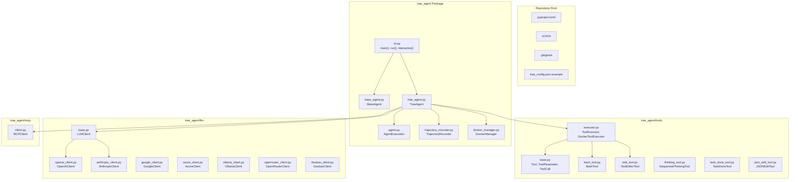
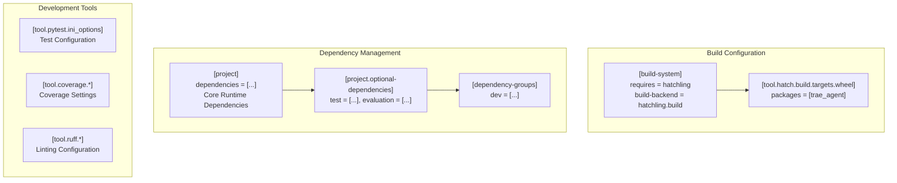
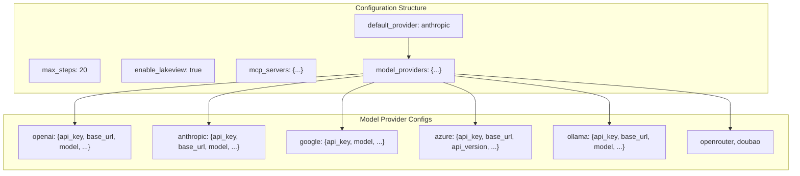

<!-- source: DeepWiki mcp.deepwiki.com · repo bytedance/trae-agent · page 7.2 Project Structure · fetched 2026-10-29 -->

# Project Structure

<details>
<summary>Relevant source files</summary>

The following files were used as context for generating this wiki page:

- [.gitignore](.gitignore)
- [.vscode/launch.template.json](.vscode/launch.template.json)
- [pyproject.toml](pyproject.toml)
- [trae_agent/__init__.py](trae_agent/__init__.py)
- [trae_agent/agent/__init__.py](trae_agent/agent/__init__.py)
- [trae_config.json.example](trae_config.json.example)
- [uv.lock](uv.lock)

</details>


This document explains the repository structure, package organization, and build system configuration for the trae-agent project. It covers the directory layout, dependency management, configuration files, and development tooling setup.

## Package Organization

The trae-agent repository follows standard Python packaging conventions with a modular design centered around the `trae_agent` package.

**Directory Layout**
```text
trae-agent/
├── trae_agent/              # Main Python package
│   ├── __init__.py
│   ├── cli.py              # CLI entry point (trae-cli command)
│   ├── base_agent.py       # BaseAgent abstract base class
│   ├── trae_agent.py       # TraeAgent implementation
│   ├── agent.py            # AgentExecution state management
│   ├── config.py           # Configuration system
│   ├── trajectory_recorder.py  # TrajectoryRecorder for execution logging
│   ├── console.py          # CLIConsole user feedback
│   ├── docker_manager.py   # DockerManager container lifecycle
│   ├── tools/              # Tool ecosystem
│   │   ├── __init__.py
│   │   ├── base.py         # Tool, ToolParameter, ToolCall, ToolResult
│   │   ├── bash_tool.py    # BashTool shell execution
│   │   ├── edit_tool.py    # TextEditorTool file manipulation
│   │   ├── thinking_tool.py # SequentialThinkingTool reasoning
│   │   ├── task_done_tool.py # TaskDoneTool completion signal
│   │   ├── json_edit_tool.py # JSONEditTool JSONPath operations
│   │   ├── executor.py     # ToolExecutor and DockerToolExecutor
│   │   └── registry.py     # Tool registration system
│   ├── llm/                # LLM provider integration
│   │   ├── __init__.py
│   │   ├── base.py         # LLMClient abstract interface
│   │   ├── openai_client.py    # OpenAI API client
│   │   ├── anthropic_client.py # Anthropic API client
│   │   ├── google_client.py    # Google Gemini client
│   │   ├── azure_client.py     # Azure OpenAI client
│   │   ├── ollama_client.py    # Ollama local LLM client
│   │   ├── openrouter_client.py # OpenRouter API client
│   │   └── doubao_client.py    # Doubao API client
│   └── mcp/                # Model Context Protocol integration
│       ├── __init__.py
│       └── client.py       # MCP client for dynamic tool discovery
├── tests/                  # Test suite
│   ├── unit/              # Unit tests
│   └── integration/       # Integration tests
├── pyproject.toml         # Package definition and dependencies
├── uv.lock                # Locked dependency versions
├── trae_config.json.example # Configuration template
└── .gitignore             # Version control exclusions
```

**Package Structure Diagram**

Title: Trae Agent Package and Module Organization


**CLI Entry Point**
The `trae-cli` command is defined as `trae-cli = trae_agent.cli:main` in [pyproject.toml:45](), mapping to the `main()` function in `cli.py`.

Sources: [pyproject.toml:1-102](), [trae_agent/__init__.py:1-14](), [trae_agent/agent/__init__.py:1-11]()

## Core Module Breakdown

The `trae_agent` package is organized into several key modules with distinct responsibilities:

| Module | Key Classes/Functions | Purpose |
|--------|----------------------|---------|
| `cli.py` | `main()` | Command-line interface entry point [pyproject.toml:45]() |
| `base_agent.py` | `BaseAgent` | Abstract base class for agent implementations [trae_agent/__init__.py:8]() |
| `trae_agent.py` | `TraeAgent` | Software engineering agent implementation [trae_agent/__init__.py:9]() |
| `agent.py` | `Agent` | Agent execution state and results [trae_agent/agent/__init__.py:6]() |
| `tools/base.py` | `Tool`, `ToolExecutor` | Tool framework abstractions [trae_agent/__init__.py:10]() |
| `llm_clients/llm_client.py` | `LLMClient` | Abstract LLM provider interface [trae_agent/__init__.py:11]() |

**Tool Implementations**
- `tools/bash_tool.py`: `BashTool` for shell command execution.
- `tools/edit_tool.py`: `TextEditorTool` supporting file manipulation.
- `tools/thinking_tool.py`: `SequentialThinkingTool` for branching reasoning.
- `tools/task_done_tool.py`: `TaskDoneTool` for task completion signaling.
- `tools/json_edit_tool.py`: `JSONEditTool` for JSONPath-based JSON manipulation.

**LLM Provider Implementations**
- `llm/openai_client.py`: `OpenAIClient` for OpenAI API.
- `llm/anthropic_client.py`: `AnthropicClient` for Anthropic Claude API.
- `llm/google_client.py`: `GoogleClient` for Google Gemini API.
- `llm/azure_client.py`: `AzureClient` for Azure OpenAI API.
- `llm/ollama_client.py`: `OllamaClient` for local Ollama models.
- `llm/openrouter_client.py`: `OpenRouterClient` for OpenRouter gateway.
- `llm/doubao_client.py`: `DoubaoClient` for Doubao API.

Sources: [trae_agent/__init__.py:1-14](), [trae_agent/agent/__init__.py:1-11]()

## Build System Configuration

The project uses modern Python packaging tools with hatchling as the build backend and uv for dependency management.

Title: Build and Packaging Configuration


**Build System Details**
- **Build Backend**: Uses `hatchling.build` as specified in [pyproject.toml:48-49]().
- **Package Selection**: Only the `trae_agent` package is included in wheels via [pyproject.toml:52]().
- **Entry Points**: The `trae-cli` command maps to `trae_agent.cli:main` function [pyproject.toml:45]().

Sources: [pyproject.toml:47-53]()

## Dependency Architecture

The project has a comprehensive dependency structure supporting LLM providers, development tools, and optional features.

| Category | Dependencies | Purpose |
|----------|-------------|---------|
| **LLM Providers** | `openai`, `anthropic`, `google-genai`, `ollama` | Multi-provider LLM integration [pyproject.toml:8-17]() |
| **CLI Framework** | `click`, `asyncclick`, `rich`, `textual` | Command-line interface and TUI [pyproject.toml:10-25]() |
| **Data Processing** | `pydantic`, `jsonpath-ng`, `pyyaml` | Configuration and data validation [pyproject.toml:12-24]() |
| **External Tools** | `mcp`, `tree-sitter`, `tree-sitter-languages` | MCP protocol and code analysis [pyproject.toml:19-22]() |
| **Development** | `ruff`, `pyinstaller` | Code quality and packaging [pyproject.toml:21-26]() |

**Optional Dependencies**
- **Testing**: `pytest`, `pytest-asyncio`, `pytest-mock`, `pytest-cov`, `pre-commit` [pyproject.toml:30-36]().
- **Evaluation**: `datasets`, `docker`, `pexpect`, `unidiff` [pyproject.toml:37-42]().

Sources: [pyproject.toml:7-42]()

## Configuration System Structure

The project supports multiple configuration formats and sources with a hierarchical precedence system.

Title: Configuration Template Structure


**Ignored Configuration Files**
The `.gitignore` excludes actual configuration files to prevent accidental commit of sensitive data:
- `trae-config-local.json` [.gitignore:176]()
- `trae_config.json` [.gitignore:177]()
- `trae_config.yaml` [.gitignore:178]()

Sources: [trae_config.json.example:1-88](), [.gitignore:176-178]()

## Development Environment Setup

The project includes comprehensive development tooling configuration for code quality, testing, and debugging.

**Development Tool Configuration**
- **Ruff**: Line length 100, comprehensive linting rules [pyproject.toml:86-96]().
- **Pytest**: Async support, multiple test markers [pyproject.toml:54-65]().
- **Coverage**: Source tracking for `trae_agent` package, excludes test files [pyproject.toml:67-83]().

**VS Code Integration**
The template launch configuration enables debugging of the CLI module directly:
- Module target: `trae_agent.cli` [.vscode/launch.template.json:11]().
- Environment: `PYTHONPATH` set to workspace root [.vscode/launch.template.json:17-18]().

Sources: [pyproject.toml:54-96](), [.vscode/launch.template.json:1-21](), [.gitignore:1-189]()

---

