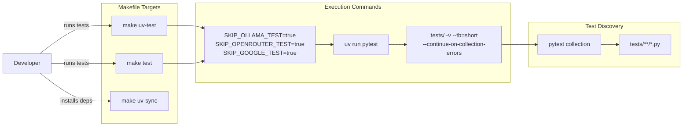
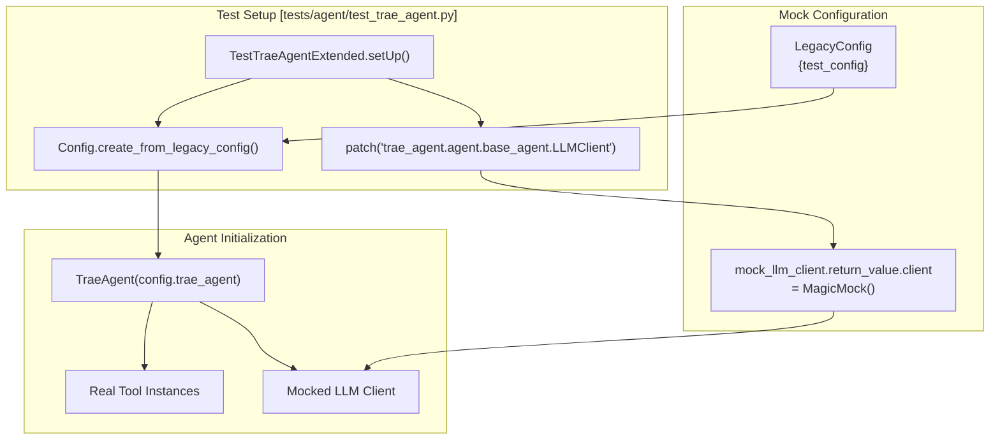
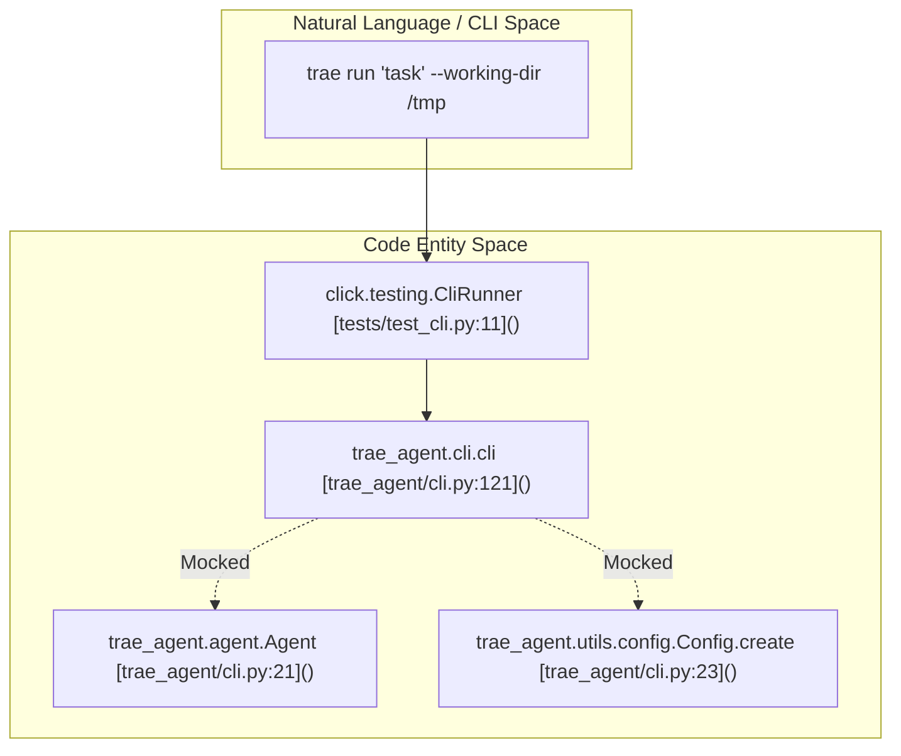
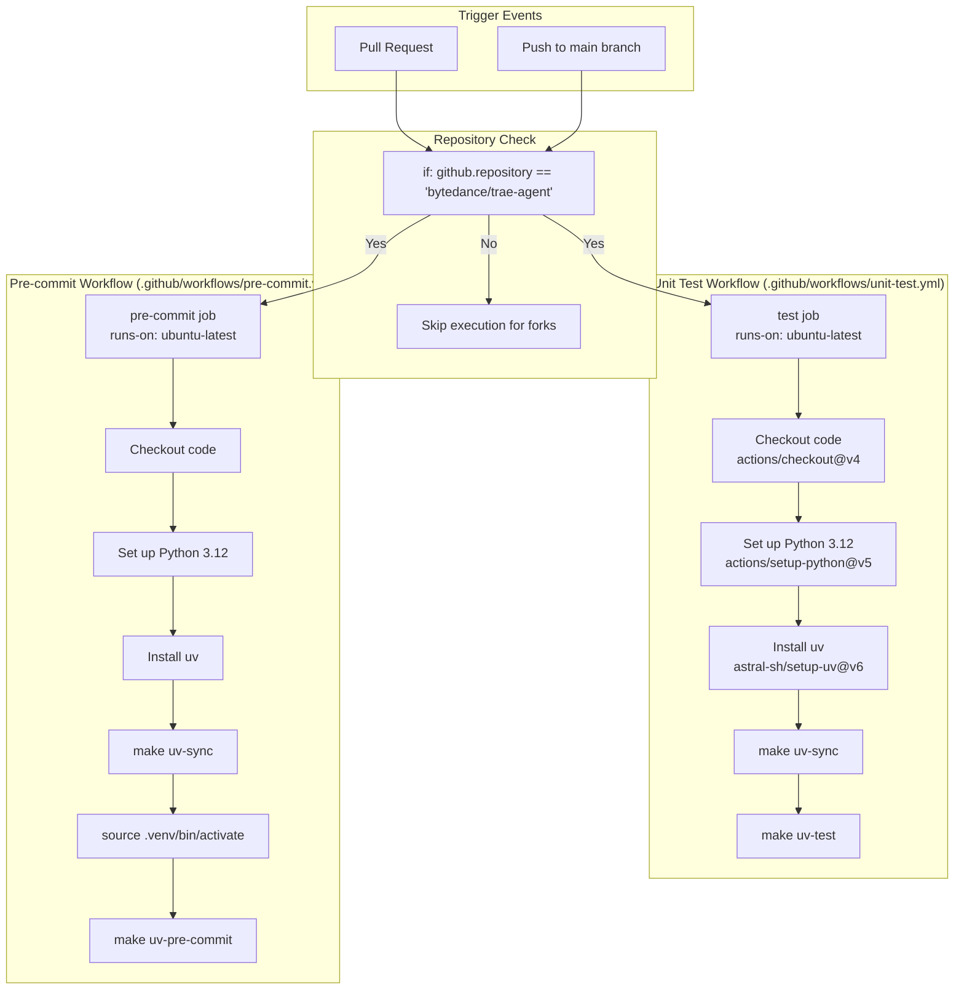

<!-- source: DeepWiki mcp.deepwiki.com · repo bytedance/trae-agent · page 7.3 Testing · fetched 2026-10-29 -->

# Testing

<details>
<summary>Relevant source files</summary>

The following files were used as context for generating this wiki page:

- [.github/workflows/pre-commit.yml](.github/workflows/pre-commit.yml)
- [.github/workflows/unit-test.yml](.github/workflows/unit-test.yml)
- [Makefile](Makefile)
- [tests/agent/test_trae_agent.py](tests/agent/test_trae_agent.py)
- [tests/test_cli.py](tests/test_cli.py)
- [tests/utils/test_ollama_client_utils.py](tests/utils/test_ollama_client_utils.py)
- [trae_agent/agent/agent_basics.py](trae_agent/agent/agent_basics.py)
- [trae_agent/cli.py](trae_agent/cli.py)

</details>


## Purpose and Scope

This document explains the testing framework, test organization, and CI/CD pipelines for the Trae Agent codebase. It covers how to run tests locally, write new tests, and understand the automated testing infrastructure.

For information about contributing code and following coding standards, see [Contributing](#7.1). For details about the project structure, see [Project Structure](#7.2).

---

## Testing Framework

Trae Agent uses a combination of **pytest** as the test runner and Python's standard **unittest** framework for test implementation. This hybrid approach provides pytest's powerful test discovery and execution features while maintaining compatibility with unittest's rich assertion and mocking capabilities.

### Core Testing Dependencies

| Package | Purpose |
|---------|---------|
| `pytest` | Test runner with advanced features (markers, fixtures, parameterization) |
| `unittest` | Standard library test framework for test class structure |
| `unittest.mock` | Mocking framework for isolating components under test |
| `pytest-cov` | Code coverage analysis and reporting |

The test infrastructure uses `unittest.IsolatedAsyncioTestCase` for testing asynchronous code, ensuring proper async context management and event loop handling.

**Sources:** [Makefile:40-45](), [tests/agent/test_trae_agent.py:4-14](), [tests/utils/test_ollama_client_utils.py:12-17]()

---

## Test Organization

### Directory Structure

```
tests/
├── agent/
│   └── test_trae_agent.py          # TraeAgent unit tests [tests/agent/test_trae_agent.py:8-151]()
├── utils/
│   └── test_ollama_client_utils.py  # Ollama client tests [tests/utils/test_ollama_client_utils.py:17-126]()
├── test_cli.py                     # CLI command tests [tests/test_cli.py:9-170]()
└── ...                              # Additional test modules
```

Test files follow the naming convention `test_*.py` to enable automatic discovery by pytest. Each test module corresponds to a specific component or module in the source code.

### Test Class Structure

Tests are organized into classes that inherit from `unittest.TestCase` or `unittest.IsolatedAsyncioTestCase`:

```python
class TestTraeAgentExtended(unittest.TestCase):
    def setUp(self):
        # Initialize test fixtures [tests/agent/test_trae_agent.py:15-45]()
        
    def tearDown(self):
        # Clean up resources [tests/agent/test_trae_agent.py:46-48]()
        
    def test_specific_functionality(self):
        # Test implementation
```

The `setUp()` method creates test fixtures before each test, while `tearDown()` performs cleanup. This ensures test isolation and repeatability.

**Sources:** [tests/agent/test_trae_agent.py:14-152](), [tests/test_cli.py:9-170]()

### Test Categories and Markers

The test suite uses environment variables and pytest configurations to categorize tests:

| Variable | Purpose | Usage |
|--------|---------|-------|
| `SKIP_OLLAMA_TEST` | Skips Ollama local LLM tests | Used in `TestOllamaClient` [tests/utils/test_ollama_client_utils.py:22-25]() |
| `SKIP_OPENROUTER_TEST` | Skips OpenRouter API tests | Defined in `Makefile` [Makefile:42]() |
| `SKIP_GOOGLE_TEST` | Skips Google Gemini API tests | Defined in `Makefile` [Makefile:42]() |

Tests can be run selectively using pytest expressions:

```bash
pytest tests/ -v              # Run all discovered tests
pytest -k "cli"               # Run only tests matching "cli"
```

**Sources:** [Makefile:40-45](), [tests/utils/test_ollama_client_utils.py:22-25]()

---

## Running Tests Locally

### Using Makefile Commands

The project provides convenient Makefile targets for common testing workflows:

**Test Execution Logic**
Title: Local Test Execution Flow


**Test Execution Commands:**

```bash
# Install dependencies first [Makefile:21-23]()
make uv-sync

# Run all tests (skips external service tests) [Makefile:41-42]()
make uv-test

# Alternative test command [Makefile:43-44]()
make test

# Run tests with custom pytest options
uv run pytest tests/ -v --tb=short -k "test_specific"
```

**Sources:** [Makefile:40-45](), [.github/workflows/unit-test.yml:34-36]()

---

## Test Patterns and Best Practices

### Mocking LLM Clients

Since tests should not make actual API calls to LLM providers, the test suite uses mocking to isolate the agent logic.

**Agent Mocking Strategy**
Title: TraeAgent Mocking Architecture


The test setup at [tests/agent/test_trae_agent.py:35-37]() demonstrates the mocking pattern:

1. A patch is created for the `LLMClient` class in the base agent module.
2. The mocked client returns a `MagicMock` instance instead of making real API calls.
3. The agent is initialized with this mocked client, allowing tests to verify agent behavior without external dependencies.

**Sources:** [tests/agent/test_trae_agent.py:15-48]()

### CLI Testing Pattern

The `TestCli` class at [tests/test_cli.py:9-170]() uses `click.testing.CliRunner` to simulate command-line interactions.

**CLI Execution Mocking**
Title: CLI Command Space to Code Entity Mapping


Key CLI testing patterns:
- **File System Isolation**: Using `self.runner.isolated_filesystem()` [tests/test_cli.py:75-77]() to test file-based tasks.
- **Dependency Mocking**: Patching `asyncio.run` and `Agent.run` [tests/test_cli.py:15-24]() to prevent actual execution during CLI unit tests.
- **Error Handling**: Verifying exit codes and error messages for invalid inputs like non-existent files [tests/test_cli.py:89-94]().

**Sources:** [tests/test_cli.py:9-170](), [trae_agent/cli.py:121-213]()

---

## CI/CD Pipelines

### GitHub Actions Workflow Architecture

Title: CI/CD Pipeline Flow


**Sources:** [.github/workflows/unit-test.yml:1-37](), [.github/workflows/pre-commit.yml:1-40]()

### Workflow Details

1. **Unit Tests**: Executes on `ubuntu-latest` using Python 3.12 [.github/workflows/unit-test.yml:16-25](). It utilizes `uv` for fast dependency synchronization via `make uv-sync` [.github/workflows/unit-test.yml:32]() and runs tests via `make uv-test` [.github/workflows/unit-test.yml:36]().
2. **Pre-commit**: Runs linting and formatting checks. It specifically executes `make uv-pre-commit` [.github/workflows/pre-commit.yml:39]() which maps to `uv run pre-commit run --all-files` [Makefile:27]().
3. **Security**: Workflows only execute if the repository is `bytedance/trae-agent` [.github/workflows/unit-test.yml:15](), preventing unauthorized CI usage from forks.

**Sources:** [.github/workflows/unit-test.yml:1-37](), [.github/workflows/pre-commit.yml:1-40](), [Makefile:1-58]()

---

## Summary of Test Coverage

The test suite covers several critical areas:

- **Agent Logic**: Initialization, task setup, git diff generation, and completion detection [tests/agent/test_trae_agent.py:49-115]().
- **CLI Interface**: Argument parsing, configuration resolution, and error messaging [tests/test_cli.py:18-170]().
- **LLM Clients**: Basic initialization and chat history management for providers like Ollama [tests/utils/test_ollama_client_utils.py:27-123]().
- **Access Control**: Enforcement of protected attribute restrictions within agent classes [tests/agent/test_trae_agent.py:116-134]().

**Sources:** [tests/agent/test_trae_agent.py:1-152](), [tests/test_cli.py:1-170](), [tests/utils/test_ollama_client_utils.py:1-127]()

---

