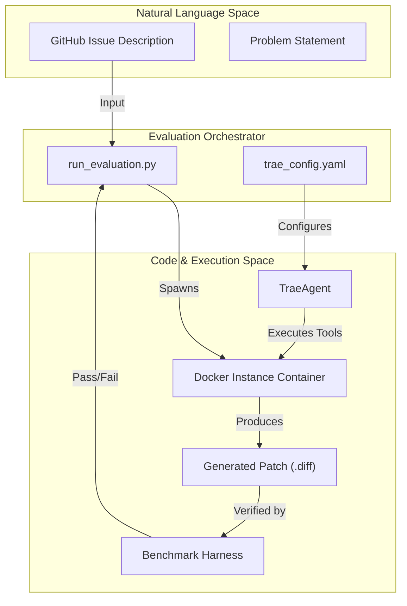
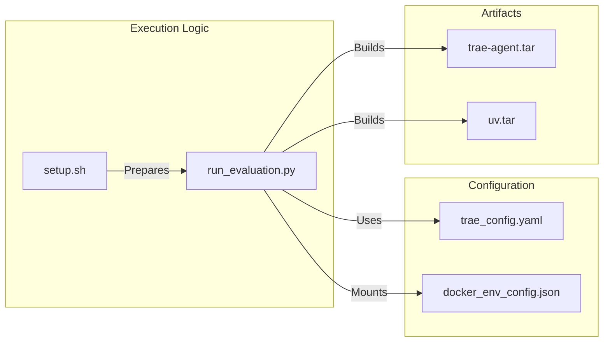

<!-- source: DeepWiki mcp.deepwiki.com · repo bytedance/trae-agent · page 8 Evaluation Framework · fetched 2026-10-29 -->

# Evaluation Framework

Relevant source files

The following files were used as context for generating this wiki page:

- [evaluation/README.md](evaluation/README.md)
- [evaluation/__init__.py](evaluation/__init__.py)

The Trae Agent evaluation framework provides a standardized system for benchmarking the agent's performance on real-world software engineering tasks. It supports industry-standard benchmarks including **SWE-bench**, **SWE-bench-Live**, and **Multi-SWE-bench**, allowing for rigorous testing of the agent's ability to resolve GitHub issues across multiple programming languages.

## Framework Overview

The evaluation system is designed to automate the lifecycle of benchmark execution, from environment preparation to patch verification. It utilizes Docker to ensure isolated and reproducible execution environments for each task instance.

### Core Benchmarks
*   **SWE-bench**: Real-world software engineering tasks from popular Python repositories [evaluation/README.md:7-7]().
*   **SWE-bench-Live**: A live benchmark updated monthly to provide up-to-date task instances and prevent model contamination [evaluation/README.md:9-9]().
*   **Multi-SWE-bench**: A multilingual benchmark spanning 7 languages (Java, TypeScript, JavaScript, Go, Rust, C, and C++) [evaluation/README.md:11-11]().

### Evaluation Workflow
The process follows a three-stage pipeline managed by the evaluation scripts:
1.  **Setup**: Automated environment preparation using `setup.sh` to clone harnesses and install dependencies [evaluation/README.md:37-44]().
2.  **Execution**: Running the agent on specific task instances to generate patches [evaluation/README.md:15-15]().
3.  **Evaluation**: Testing generated patches against ground-truth unit tests using the benchmark harness [evaluation/README.md:16-16]().

### System Architecture: Evaluation Flow
The following diagram illustrates how the evaluation script interacts with Docker and the benchmark harness to bridge the gap between natural language issue descriptions and verifiable code patches.

**Evaluation Execution Pipeline**

Sources: [evaluation/README.md:112-123](), [evaluation/README.md:188-205]()

---

## SWE-bench Evaluation

The primary entry point for running benchmarks is `run_evaluation.py` [evaluation/README.md:112-112](). This script manages the execution modes and parallelization of tasks.

### Execution Modes
The framework supports three distinct modes of operation [evaluation/README.md:143-147]():
*   **`expr` (Expression)**: Generates patches only; no evaluation is performed.
*   **`eval` (Evaluation)**: Evaluates existing patches against the harness.
*   **`e2e` (End-to-End)**: Performs both generation and evaluation in a single run.

For detailed instructions on setup, Docker image preparation, and running specific datasets like `SWE-bench_Verified` or `Multi-SWE-bench-flash`, see **[SWE-bench Evaluation](#8.1)**.

Sources: [evaluation/README.md:143-158]()

---

## Patch Selection

To improve success rates, the framework supports ensemble-based patch selection. Instead of relying on a single agent trajectory, multiple trajectories can be generated, and a specialized **Selector Agent** is used to determine the best candidate patch.

### Selection Strategies
*   **Majority Voting**: Selecting the patch most frequently generated across different seeds.
*   **Group-based Selection**: Analyzing patches in groups to find commonalities.
*   **Sandbox Execution**: Running candidate patches in a sandbox to verify they at least compile or pass basic checks before final selection.

For details on the Selector Agent implementation, input formats, and analysis tools, see **[Patch Selection](#8.2)**.

---

## Evaluation Components Mapping

This diagram maps the high-level evaluation concepts to the specific files and configurations used within the `evaluation/` directory.

**Evaluation Component Map**

Sources: [evaluation/README.md:39-43](), [evaluation/README.md:58-60](), [evaluation/README.md:94-96](), [evaluation/README.md:197-199]()

| File | Purpose |
| :--- | :--- |
| `run_evaluation.py` | Main orchestrator for running benchmark instances [evaluation/README.md:112-112](). |
| `setup.sh` | Automates the cloning and installation of benchmark harnesses [evaluation/README.md:39-43](). |
| `trae_config.yaml` | Defines the agent's model, tools (e.g., `bash`, `str_replace_based_edit_tool`), and limits [evaluation/README.md:58-70](). |
| `docker_env_config.json` | (Optional) Custom environment variables for Docker containers [evaluation/README.md:94-106](). |

Sources: [evaluation/README.md:39-112]()

---

