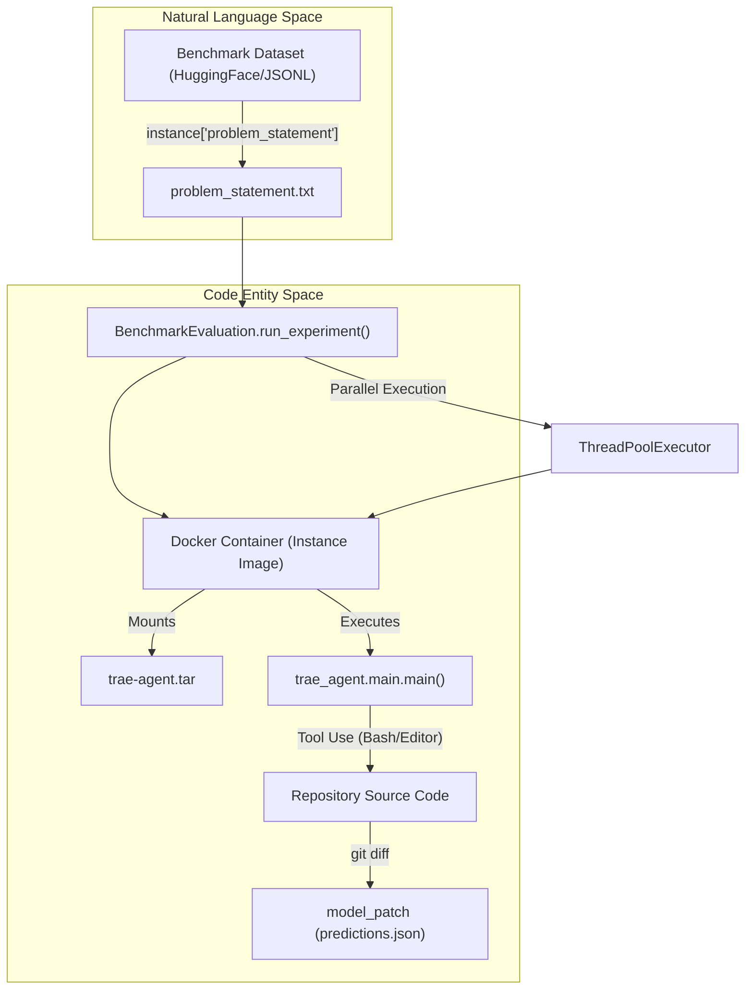
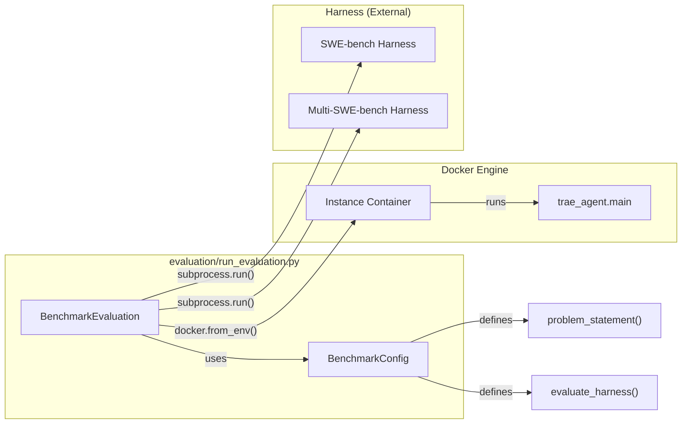

<!-- source: DeepWiki mcp.deepwiki.com · repo bytedance/trae-agent · page 8.1 SWE-bench Evaluation · fetched 2026-10-29 -->

# SWE-bench Evaluation

<details>
<summary>Relevant source files</summary>

The following files were used as context for generating this wiki page:

- [evaluation/run_evaluation.py](evaluation/run_evaluation.py)
- [evaluation/setup.sh](evaluation/setup.sh)
- [evaluation/utils.py](evaluation/utils.py)

</details>


This page describes the evaluation framework for benchmarking Trae Agent on software engineering benchmarks including **SWE-bench**, **SWE-bench-Live**, and **Multi-SWE-bench**. The framework handles the end-to-end lifecycle of an evaluation run: environment preparation, agent execution, patch generation, and result verification using official benchmark harnesses.

## Overview

Trae Agent is evaluated by its ability to resolve real-world GitHub issues. The evaluation system uses Docker to ensure isolated and reproducible environments for each benchmark instance. It supports three primary execution modes:
- **expr (Experiment):** Runs the agent to generate patches for a set of instances.
- **eval (Evaluation):** Takes existing patches and runs them through the benchmark's test harness to calculate pass rates.
- **e2e (End-to-End):** Performs both `expr` and `eval` in a single sequence.

Sources: [evaluation/run_evaluation.py:23-40](), [evaluation/run_evaluation.py:304-320]()

## Setup and Installation

Before running evaluations, the environment must be prepared by cloning the respective benchmark repositories and setting up their Python virtual environments.

### 1. Benchmark Harness Setup
The `evaluation/setup.sh` script automates the installation of the official harnesses:
```bash
# Setup SWE-bench
bash evaluation/setup.sh swe_bench

# Setup SWE-bench-Live
bash evaluation/setup.sh swe_bench_live

# Setup Multi-SWE-bench
bash evaluation/setup.sh multi_swe_bench
```
Sources: [evaluation/setup.sh:6-36]()

### 2. Docker Image Preparation
The evaluation suite requires specific Docker images for each instance (e.g., `swebench/sweb.eval.x86_64.<instance_id>`). The `BenchmarkEvaluation` class automatically checks for these images and pulls missing ones during initialization.
Sources: [evaluation/run_evaluation.py:106-139]()

## Execution Flow

The evaluation logic is encapsulated in the `BenchmarkEvaluation` class. It manages a `ThreadPoolExecutor` to run multiple instances in parallel.

### Data Flow: Natural Language to Code Patch
The following diagram illustrates how a benchmark instance (Natural Language Problem Statement) is processed by the `BenchmarkEvaluation` and `TraeAgent` to produce a code patch.

**Evaluation Data Flow**

Sources: [evaluation/run_evaluation.py:23-40](), [evaluation/run_evaluation.py:159-179](), [evaluation/run_evaluation.py:215-235]()

### Key Components and Classes

| Class/Function | Responsibility |
| :--- | :--- |
| `BenchmarkEvaluation` | Orchestrates the entire evaluation process, including image pulling, workspace setup, and parallel execution. |
| `BenchmarkConfig` | Dataclass defining benchmark-specific behaviors (image naming, dataset loading, harness execution). |
| `BENCHMARK_CONFIG` | A registry mapping benchmark names (`SWE-bench`, `Multi-SWE-bench`, etc.) to their configurations. |
| `docker_exec` | Utility to run commands inside a Docker container and return status/output. |

Sources: [evaluation/run_evaluation.py:23-27](), [evaluation/utils.py:15-30](), [evaluation/utils.py:170-181]()

## Implementation Details

### Workspace Preparation
For every instance, the evaluator creates a dedicated directory in the `working_dir`. It builds a "Trae Agent" artifact (a tarball containing the source and dependencies via `uv`) and mounts it into the instance's Docker container. This ensures the agent runs in the same environment as the code it is fixing.
Sources: [evaluation/run_evaluation.py:140-179]()

### Execution Modes

#### Experiment Mode (`expr`)
1. Prepares the problem statement file.
2. Starts the Docker container for the instance.
3. Installs the Trae Agent artifact inside the container.
4. Executes `python3 -m trae_agent.main` with the task instructions.
5. Extracts the final `git diff` as the `model_patch`.

Sources: [evaluation/run_evaluation.py:215-265]()

#### Evaluation Mode (`eval`)
This mode invokes the specific harness for the benchmark. For `SWE-bench`, it typically runs `python -m swebench.harness.run_evaluation`. The results are then post-processed to a standard `results.json` format.
Sources: [evaluation/run_evaluation.py:280-302](), [evaluation/utils.py:32-53]()

### System Integration Diagram
This diagram shows the relationship between the `BenchmarkEvaluation` class and the code entities it interacts with during a run.

**System Integration**

Sources: [evaluation/run_evaluation.py:64](), [evaluation/run_evaluation.py:290-302](), [evaluation/utils.py:170-179]()

## Result Interpretation

Results are stored in the `results/<task_id>` directory. Key artifacts include:
- `predictions.json`: A list of dictionaries containing `instance_id` and the generated `model_patch`.
- `results.json`: The final report generated by the benchmark harness, indicating which instances passed or failed.
- `logs/`: Individual execution logs for each instance for debugging.

Sources: [evaluation/run_evaluation.py:87-90](), [evaluation/utils.py:32-36]()

## Supported Benchmarks

| Benchmark | Datasets | Image Pattern |
| :--- | :--- | :--- |
| **SWE-bench** | Verified, Lite, Full | `swebench/sweb.eval.x86_64.<id>` |
| **SWE-bench-Live** | Latest GitHub issues | `swebench/sweb.live.x86_64.<id>` |
| **Multi-SWE-bench** | Multiple issues per instance | `multi-swe-bench/<id>` |

Sources: [evaluation/utils.py:182-225]()

---

