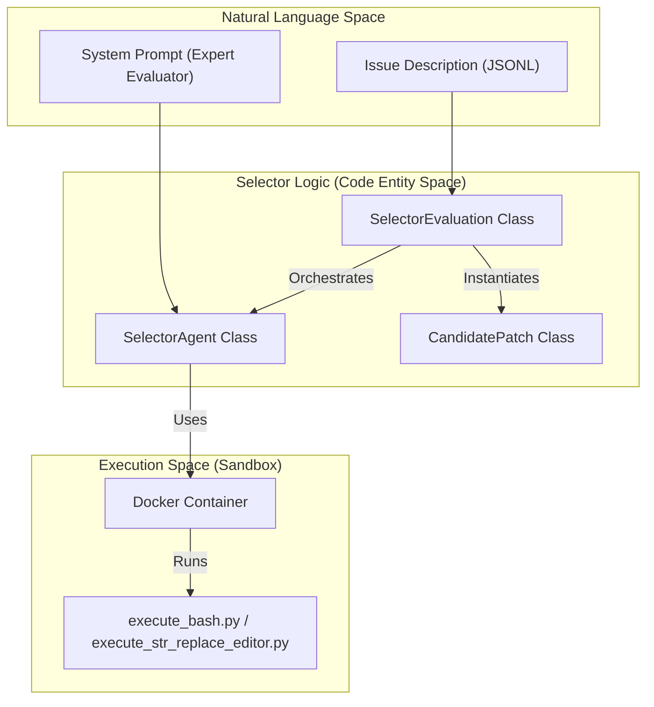
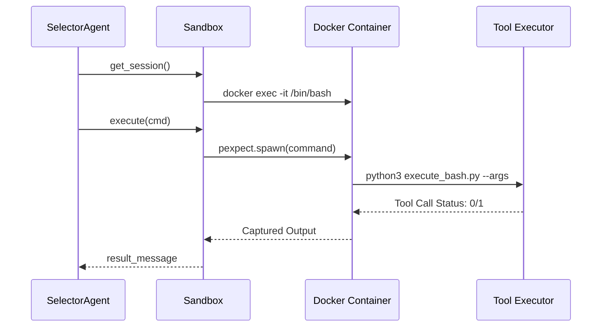

<!-- source: DeepWiki mcp.deepwiki.com · repo bytedance/trae-agent · page 8.2 Patch Selection · fetched 2026-10-29 -->

# Patch Selection

Relevant source files

The following files were used as context for generating this wiki page:

- [evaluation/patch_selection/README.md](evaluation/patch_selection/README.md)
- [evaluation/patch_selection/analysis.py](evaluation/patch_selection/analysis.py)
- [evaluation/patch_selection/example/example.jsonl](evaluation/patch_selection/example/example.jsonl)
- [evaluation/patch_selection/selector.py](evaluation/patch_selection/selector.py)
- [evaluation/patch_selection/trae_selector/__init__.py](evaluation/patch_selection/trae_selector/__init__.py)
- [evaluation/patch_selection/trae_selector/sandbox.py](evaluation/patch_selection/trae_selector/sandbox.py)
- [evaluation/patch_selection/trae_selector/selector_agent.py](evaluation/patch_selection/trae_selector/selector_agent.py)
- [evaluation/patch_selection/trae_selector/selector_evaluation.py](evaluation/patch_selection/trae_selector/selector_evaluation.py)
- [evaluation/patch_selection/trae_selector/tools/tools/base.py](evaluation/patch_selection/trae_selector/tools/tools/base.py)
- [evaluation/patch_selection/trae_selector/utils.py](evaluation/patch_selection/trae_selector/utils.py)

The Selector Agent is an ensemble-based reasoning system designed to identify the optimal solution from a set of candidate patches generated for a repository-level issue [evaluation/patch_selection/README.md:1-5](). It treats patch selection as a search problem, utilizing modular agents for generation, pruning, and final selection to handle large ensemble spaces and complex codebase understanding [evaluation/patch_selection/README.md:4-6]().

## System Architecture

The selection process is orchestrated by the `SelectorEvaluation` class, which manages the lifecycle of multiple `SelectorAgent` instances across different issue groups [evaluation/patch_selection/selector.py:81-98]().

### Patch Selection Data Flow

The diagram below illustrates how natural language issue descriptions and candidate code patches are processed through the selector system.

**Natural Language to Code Entity Mapping**

Sources: [evaluation/patch_selection/trae_selector/selector_agent.py:14-20](), [evaluation/patch_selection/trae_selector/selector_agent.py:153-164](), [evaluation/patch_selection/trae_selector/selector_evaluation.py:18-33](), [evaluation/patch_selection/trae_selector/selector_agent.py:61-75]()

## Input Format and Preparation

Patch candidates are provided in a JSON line (`.jsonl`) file [evaluation/patch_selection/README.md:20-22](). Each entry must contain the `instance_id`, the original `issue`, a list of `patches` (diff strings), and a `success_id` array for ground-truth verification [evaluation/patch_selection/README.md:24-47]().

### Regression Testing
If regression test results are available (e.g., from Agentless), they are included in the `regressions` field [evaluation/patch_selection/README.md:12-15](). An empty array `[]` indicates a patch passed all regression tests, while non-empty values trigger pruning of that candidate [evaluation/patch_selection/trae_selector/selector_evaluation.py:173-189]().

## Selection Mechanism

The selection logic follows a structured workflow to minimize the search space and ensure correctness.

### 1. Group-Based Selection
When dealing with a large number of candidates (e.g., 50), the system divides them into smaller sets based on the `--group_size` parameter [evaluation/patch_selection/selector.py:27-29](). A selection is made for each group, and the final patch is chosen from these group winners [evaluation/patch_selection/README.md:70-71]().

### 2. Majority Voting
Enabled via the `--majority_voting` flag, this mode conducts multiple selection trials for a single group [evaluation/patch_selection/selector.py:36-36](). The patch with the highest selection frequency across trials is chosen as the final answer [evaluation/patch_selection/README.md:72-73]().

### 3. Pruning and Deduplication
Before the LLM analyzes patches, the `run_instance_by_group` function performs:
*   **Regression Filtering**: Candidates that failed regression tests are removed if any candidates passed [evaluation/patch_selection/trae_selector/selector_evaluation.py:185-189]().
*   **Deduplication**: Patches are "cleaned" by removing comments and whitespace via `clean_patch` to identify logically identical candidates [evaluation/patch_selection/trae_selector/utils.py:33-74](), [evaluation/patch_selection/trae_selector/selector_evaluation.py:194-200]().

## Sandbox Execution

The `Sandbox` class manages isolated environments using Docker to validate patches [evaluation/patch_selection/trae_selector/sandbox.py:8-18]().

**Sandbox and Tool Interaction**

Sources: [evaluation/patch_selection/trae_selector/sandbox.py:44-52](), [evaluation/patch_selection/trae_selector/sandbox.py:61-88](), [evaluation/patch_selection/trae_selector/selector_agent.py:61-87]()

### Tool Integration
The agent uses specialized tools within the sandbox:
*   `bash`: Executed via `execute_bash.py` [evaluation/patch_selection/trae_selector/selector_agent.py:71-74]().
*   `str_replace_based_edit_tool`: Executed via `execute_str_replace_editor.py` [evaluation/patch_selection/trae_selector/selector_agent.py:69-70]().

These tools require a Python 3.12 environment pre-installed in the container at `/home/swe-bench/py312` [evaluation/patch_selection/README.md:18-19]().

## Analysis and Statistics

After execution, results are stored in four directories: `log` (LLM history), `output` (stdout/stderr), `patch` (the selected diff), and `statistics` (success/failure data) [evaluation/patch_selection/README.md:78-96]().

The `analysis.py` script visualizes these results, calculating metrics such as:
*   **Completion Rate**: Percentage of instances processed [evaluation/patch_selection/analysis.py:140]().
*   **Success Rate in Need to Select**: Performance on instances where candidates were not all identical or all failing [evaluation/patch_selection/analysis.py:146-149]().
*   **Success Rate Among All**: Overall performance across the entire benchmark set [evaluation/patch_selection/analysis.py:150]().

Sources: [evaluation/patch_selection/analysis.py:110-151](), [evaluation/patch_selection/trae_selector/utils.py:116-143]()

---

