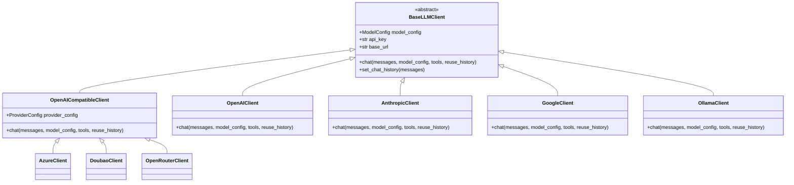
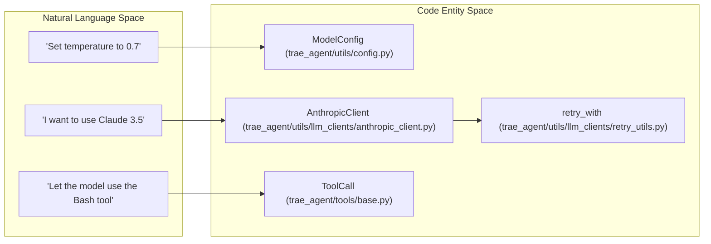
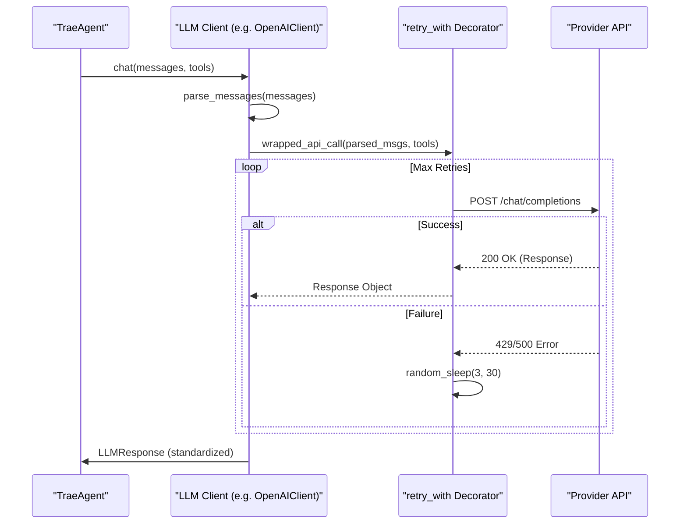

<!-- source: DeepWiki mcp.deepwiki.com · repo bytedance/trae-agent · extra page LLM Provider Clients · fetched 2026-10-29 -->

# LLM Provider Clients

<details>
<summary>Relevant source files</summary>

The following files were used as context for generating this wiki page:

- [tests/utils/test_google_client.py](tests/utils/test_google_client.py)
- [tests/utils/test_ollama_client_utils.py](tests/utils/test_ollama_client_utils.py)
- [tests/utils/test_openrouter_client_utils.py](tests/utils/test_openrouter_client_utils.py)
- [trae_agent/utils/llm_clients/anthropic_client.py](trae_agent/utils/llm_clients/anthropic_client.py)
- [trae_agent/utils/llm_clients/azure_client.py](trae_agent/utils/llm_clients/azure_client.py)
- [trae_agent/utils/llm_clients/doubao_client.py](trae_agent/utils/llm_clients/doubao_client.py)
- [trae_agent/utils/llm_clients/google_client.py](trae_agent/utils/llm_clients/google_client.py)
- [trae_agent/utils/llm_clients/ollama_client.py](trae_agent/utils/llm_clients/ollama_client.py)
- [trae_agent/utils/llm_clients/openai_client.py](trae_agent/utils/llm_clients/openai_client.py)
- [trae_agent/utils/llm_clients/openai_compatible_base.py](trae_agent/utils/llm_clients/openai_compatible_base.py)
- [trae_agent/utils/llm_clients/openrouter_client.py](trae_agent/utils/llm_clients/openrouter_client.py)
- [trae_agent/utils/llm_clients/retry_utils.py](trae_agent/utils/llm_clients/retry_utils.py)

</details>


This document details the individual LLM provider client implementations within the `trae-agent` system. These clients provide a standardized interface for communicating with various language model providers, handling authentication, request formatting, response parsing, and tool-calling abstractions.

## Architecture Overview

The LLM provider clients follow a hierarchical architecture that promotes code reuse while allowing provider-specific specializations. Most modern providers utilize the `OpenAICompatibleClient` base, while unique APIs like Anthropic and Google Gemini have dedicated implementations.

### Client Class Hierarchy



Sources: [trae_agent/utils/llm_clients/openai_compatible_base.py:65-68](), [trae_agent/utils/llm_clients/openai_client.py:27-30](), [trae_agent/utils/llm_clients/anthropic_client.py:19-22](), [trae_agent/utils/llm_clients/google_client.py:21-24](), [trae_agent/utils/llm_clients/ollama_client.py:28-30]()

### Natural Language to Code Entity Mapping

The following diagram bridges high-level provider concepts to specific code entities responsible for their execution.



Sources: [trae_agent/utils/llm_clients/anthropic_client.py:19](), [trae_agent/utils/llm_clients/retry_utils.py:13](), [trae_agent/tools/base.py:27]()

## OpenAI Compatible Base Architecture

Many providers (Azure, Doubao, OpenRouter) share the OpenAI API structure. The `OpenAICompatibleClient` uses a `ProviderConfig` strategy pattern to inject provider-specific logic like headers and service names.

### Provider Strategy Pattern

| Provider | Class | Service Name | Trajectory Provider ID |
|----------|-------|--------------|------------------------|
| Azure | `AzureProvider` | "Azure OpenAI" | "azure" |
| Doubao | `DoubaoProvider` | "Doubao" | "doubao" |
| OpenRouter | `OpenRouterProvider` | "OpenRouter" | "openrouter" |

Sources: [trae_agent/utils/llm_clients/azure_client.py:15-37](), [trae_agent/utils/llm_clients/doubao_client.py:15-31](), [trae_agent/utils/llm_clients/openrouter_client.py:17-32]()

## Provider Specific Implementations

### Anthropic Client
The `AnthropicClient` handles the unique Anthropic Message API. It specifically supports the `text_editor_20250429` and `bash_20250124` tool types natively.

- **Tool Handling**: Maps `str_replace_based_edit_tool` to `text_editor_20250429` [trae_agent/utils/llm_clients/anthropic_client.py:76-82]().
- **System Prompt**: Handled separately from message history via the `system` parameter [trae_agent/utils/llm_clients/anthropic_client.py:46]().

### Google Gemini Client
The `GoogleClient` utilizes the `google-genai` SDK. It distinguishes between `system_instruction` and standard chat `contents`.

- **History Management**: Separates system instructions during message parsing [trae_agent/utils/llm_clients/google_client.py:171-179]().
- **Tool Mapping**: Wraps tool schemas in `types.FunctionDeclaration` [trae_agent/utils/llm_clients/google_client.py:82-88]().

### Ollama Client
The `OllamaClient` provides local inference support. While it uses an OpenAI-compatible client for some operations, it wraps the `ollama.chat` function for primary inference to support local tool calling structures.

- **Default URL**: Defaults to `http://localhost:11434/v1` [trae_agent/utils/llm_clients/ollama_client.py:37]().
- **ID Generation**: Uses `uuid.uuid4()` to generate `call_id` for local tool calls [trae_agent/utils/llm_clients/ollama_client.py:113-122]().

## Resilience and Retries

All clients wrap their core API calls with the `retry_with` decorator. This provides a uniform retry mechanism across all providers.

```python
# Example from OpenAICompatibleClient
retry_decorator = retry_with(
    func=self._create_response,
    provider_name=self.provider_config.get_service_name(),
    max_retries=model_config.max_retries,
)
response = retry_decorator(model_config, tool_schemas, extra_headers)
```
Sources: [trae_agent/utils/llm_clients/openai_compatible_base.py:142-147]()

### Backoff Logic
The `retry_with` utility implements a randomized backoff strategy, sleeping between 3 to 30 seconds between attempts to avoid synchronized retry storms.

Sources: [trae_agent/utils/llm_clients/retry_utils.py:44-50]()

## Data Flow: Chat Request



Sources: [trae_agent/utils/llm_clients/openai_client.py:62-101](), [trae_agent/utils/llm_clients/retry_utils.py:34-50]()

## Testing and Verification

Provider clients are verified through unit tests that mock the underlying SDKs or check configuration parameters.

- **Ollama Testing**: Verifies initialization and tool calling support detection [tests/utils/test_ollama_client_utils.py:27-51, 100-123]().
- **OpenRouter Testing**: Validates API key handling and base URL configuration [tests/utils/test_openrouter_client_utils.py:32-50]().
- **Google Testing**: Uses `unittest.mock.patch` to verify `genai.Client` interaction without live keys [tests/utils/test_google_client.py:28-44]().

Sources: [tests/utils/test_ollama_client_utils.py](), [tests/utils/test_openrouter_client_utils.py](), [tests/utils/test_google_client.py]()

---

