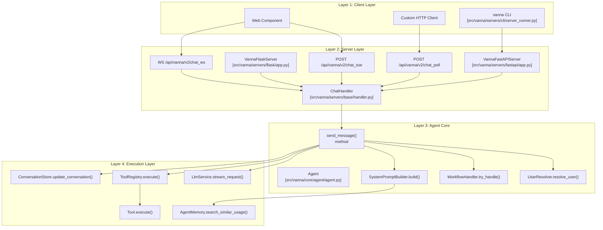
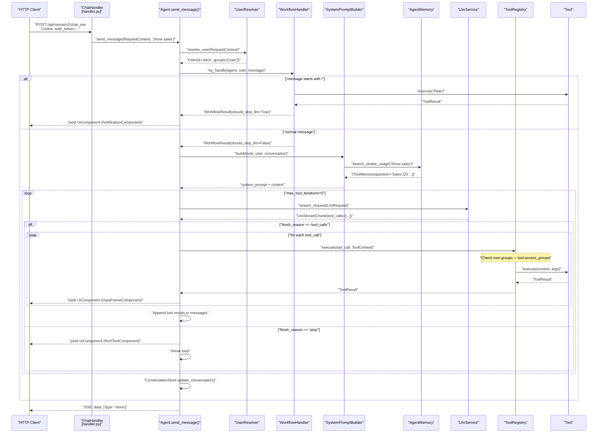
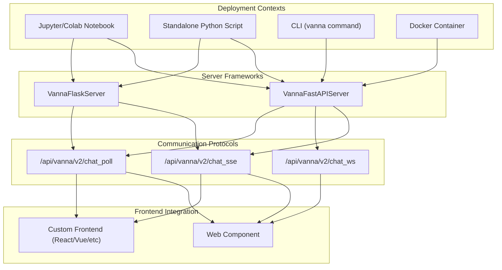

<!-- source: DeepWiki mcp.deepwiki.com · repo vanna-ai/vanna · page 1 Overview · fetched 2026-10-29 -->

# Overview

<details>
<summary>Relevant source files</summary>

The following files were used as context for generating this wiki page:

- [MIGRATION_GUIDE.md](MIGRATION_GUIDE.md)
- [README.md](README.md)
- [img/architecture.png](img/architecture.png)
- [img/vanna2.svg](img/vanna2.svg)
- [notebooks/quickstart.ipynb](notebooks/quickstart.ipynb)
- [pyproject.toml](pyproject.toml)
- [src/vanna/__init__.py](src/vanna/__init__.py)
- [src/vanna/integrations/anthropic/llm.py](src/vanna/integrations/anthropic/llm.py)
- [src/vanna/integrations/openai/llm.py](src/vanna/integrations/openai/llm.py)
- [src/vanna/servers/fastapi/app.py](src/vanna/servers/fastapi/app.py)
- [src/vanna/servers/flask/app.py](src/vanna/servers/flask/app.py)

</details>


Vanna is a Python framework for building LLM-powered agents that process natural language queries and execute tools to retrieve data. The framework is distributed via PyPI as the `vanna` package (version 2.0.2) and licensed under MIT. This documentation covers the internal architecture and implementation of Vanna 2.0, which represents a complete redesign from the legacy 0.x `VannaBase` class system.

The codebase is organized into several top-level directories:
- `src/vanna/core/`: Core abstractions (`Agent`, `Tool`, `LlmService`, etc.)
- `src/vanna/integrations/`: Concrete implementations for LLM providers, vector stores, and databases
- `src/vanna/servers/`: FastAPI and Flask server implementations
- `src/vanna/tools/`: Built-in tool implementations
- `src/vanna/capabilities/`: Shared capabilities like `SqlRunner` and `AgentMemory`

Sources: [pyproject.toml:5-13](), [src/vanna/__init__.py:1-10](), [README.md:1-16]()

## Core Architecture

The Vanna framework is built on a modular architecture where an `Agent` [src/vanna/core/agent/agent.py]() orchestrates five required service interfaces to process user messages. Each interface is designed for pluggability, allowing implementations to be swapped without modifying application code.

**Required Service Interfaces:**

| Interface | Abstract Base Class | Purpose | Key Methods |
|-----------|---------------------|---------|-------------|
| `LlmService` | [src/vanna/core/llm/service.py]() | Communicate with LLM providers | `send_request()`, `stream_request()`, `validate_tools()` |
| `ToolRegistry` | [src/vanna/core/tool/registry.py]() | Register and execute tools | `register()`, `get_schemas()`, `execute()` |
| `UserResolver` | [src/vanna/core/user/resolver.py]() | Extract user identity from HTTP context | `resolve_user()` |
| `AgentMemory` | [src/vanna/capabilities/agent_memory/models.py]() | Store and retrieve tool usage patterns | `save_tool_usage()`, `search_similar_usage()` |
| `ConversationStore` | [src/vanna/core/conversation/store.py]() | Persist conversation history | `get_conversation()`, `update_conversation()` |

The `Agent` class is instantiated with implementations of these interfaces and exposes a single public method: `send_message()`. This method accepts a `RequestContext` (HTTP request metadata), a message string, and an optional conversation ID. It returns an `AsyncGenerator[UiComponent, None]` that streams UI components to the client.

**Agent Class Dependencies:**

```mermaid
graph TB
    Agent["Agent<br/>[src/vanna/core/agent/agent.py]"]
    
    subgraph "Required Services"
        LlmService["LlmService<br/>[src/vanna/core/llm/service.py]"]
        ToolRegistry["ToolRegistry<br/>[src/vanna/core/tool/registry.py]"]
        UserResolver["UserResolver<br/>[src/vanna/core/user/resolver.py]"]
        AgentMemory["AgentMemory<br/>[src/vanna/capabilities/agent_memory]"]
        ConversationStore["ConversationStore<br/>[src/vanna/core/conversation]"]
    end
    
    subgraph "Optional Services"
        WorkflowHandler["WorkflowHandler<br/>[src/vanna/core/workflow]"]
        SystemPromptBuilder["SystemPromptBuilder<br/>[src/vanna/core/system_prompt]"]
        ObservabilityProvider["ObservabilityProvider<br/>[src/vanna/core/observability]"]
    end
    
    subgraph "Configuration"
        AgentConfig["AgentConfig<br/>[src/vanna/core/agent/config.py]"]
    end
    
    Agent --> LlmService
    Agent --> ToolRegistry
    Agent --> UserResolver
    Agent --> AgentMemory
    Agent --> ConversationStore
    Agent -.optional.-> WorkflowHandler
    Agent -.optional.-> SystemPromptBuilder
    Agent -.optional.-> ObservabilityProvider
    Agent --> AgentConfig
```



The `Agent` coordinates these services in the `send_message()` method: it resolves the user, loads conversation history, optionally checks for workflow commands, builds a system prompt with context from `AgentMemory`, sends requests to the LLM, executes any tool calls through the `ToolRegistry`, and persists the conversation. Each tool execution may generate multiple `UiComponent` objects that are streamed back to the client in real-time.

Sources: [src/vanna/core/agent/agent.py](), [src/vanna/__init__.py:12-83](), [pyproject.toml:20-31]()

## System Layers

The Vanna framework is organized into four distinct layers that handle the flow from HTTP requests to tool execution. Each layer has well-defined responsibilities and interfaces.

**Four-Layer Architecture:**



**Layer 1: Client Layer** - Generates HTTP requests with authentication credentials (cookies, JWT tokens, headers). The `<vanna-chat>` web component is a custom element that handles streaming responses via Server-Sent Events or WebSocket.

**Layer 2: Server Layer** - `VannaFastAPIServer` and `VannaFlaskServer` [src/vanna/servers/fastapi/app.py:16-81](), [src/vanna/servers/flask/app.py:16-58]() expose three communication protocols:
- `/api/vanna/v2/chat_sse`: Server-Sent Events for streaming
- `/api/vanna/v2/chat_poll`: HTTP polling for compatibility
- `/api/vanna/v2/chat_ws`: WebSocket for bidirectional communication (FastAPI only)

The `ChatHandler` [src/vanna/servers/base/handler.py]() extracts `RequestContext` from HTTP requests and calls `Agent.send_message()`.

**Layer 3: Agent Core** - The `Agent` [src/vanna/core/agent/agent.py]() orchestrates the processing pipeline:
1. `UserResolver.resolve_user()` extracts user identity from `RequestContext`
2. `WorkflowHandler.try_handle()` checks for deterministic commands (`/help`, `/memories`, etc.)
3. `SystemPromptBuilder.build()` constructs the system prompt, optionally enriched with similar past patterns from `AgentMemory`
4. `send_message()` enters a loop that alternates between LLM requests and tool executions

**Layer 4: Execution Layer** - Tool execution is delegated to the `ToolRegistry`, which validates permissions and arguments before calling the tool's `execute()` method. Results are wrapped in `UiComponent` objects and streamed back through all layers to the client.

Sources: [src/vanna/servers/fastapi/app.py:16-81](), [src/vanna/servers/flask/app.py:16-58](), [src/vanna/servers/base/handler.py](), [src/vanna/core/agent/agent.py](), [pyproject.toml:33-43]()

## Message Processing Pipeline

The `Agent.send_message()` method [src/vanna/core/agent/agent.py]() implements a multi-stage pipeline that processes user messages through authentication, workflow interception, LLM interaction, and tool execution. The method is an async generator that yields `UiComponent` objects for streaming to the client.

**send_message() Execution Flow:**



**Pipeline Stages:**

1. **User Resolution** - `UserResolver.resolve_user()` extracts `User` from `RequestContext`. The `User` object contains `id`, `email`, and `group_memberships` (e.g., `['user', 'admin']`) which control tool access throughout the pipeline.

2. **Workflow Interception** - `WorkflowHandler.try_handle()` checks if the message matches a command pattern (e.g., `/help`, `/memories`). Commands execute immediately without LLM overhead and return `WorkflowResult(should_skip_llm=True)`.

3. **Context Enhancement** - `SystemPromptBuilder.build()` calls `AgentMemory.search_similar_usage()` to retrieve similar past tool executions. These are injected into the system prompt as examples for the LLM.

4. **LLM Interaction Loop** - The agent enters a loop (max iterations controlled by `AgentConfig.max_tool_iterations`) that alternates between LLM requests and tool executions:
   - Send `LlmRequest` with conversation history, system prompt, and available tools
   - LLM responds with either text content or `tool_calls`
   - If `tool_calls` present, execute each via `ToolRegistry.execute()`
   - Append tool results to conversation and repeat

5. **Tool Execution** - `ToolRegistry.execute()` [src/vanna/core/tool/registry.py]() performs three checks:
   - Permission: `user.group_memberships ∩ tool.access_groups != ∅`
   - Validation: Parse and validate arguments via Pydantic `BaseModel`
   - Execution: Call `Tool.execute(ToolContext, args)` which returns `ToolResult`

6. **Component Streaming** - Each `ToolResult` contains a list of `ui_components` (e.g., `DataFrameComponent`, `ChartComponent`) that are immediately yielded to the client. This provides real-time feedback as tools execute.

7. **Conversation Persistence** - After the loop completes, `ConversationStore.update_conversation()` saves the final state including all messages and metadata.

Sources: [src/vanna/core/agent/agent.py](), [src/vanna/servers/base/handler.py](), [src/vanna/core/tool/registry.py](), [src/vanna/core/workflow/handler.py]()

## Complete Example

The following example demonstrates a minimal but complete Vanna agent with SQLite database access, user authentication, and a FastAPI server. This code can be run directly with `python filename.py`.

```python
from vanna import Agent, AgentConfig
from vanna.core.registry import ToolRegistry
from vanna.core.user import UserResolver, User, RequestContext
from vanna.integrations.anthropic import AnthropicLlmService
from vanna.tools import RunSqlTool
from vanna.integrations.sqlite import SqliteRunner
from vanna.servers.fastapi import VannaFastAPIServer

# Step 1: Define user resolution logic
class SimpleUserResolver(UserResolver):
    async def resolve_user(self, request_context: RequestContext) -> User:
        # Extract user ID from cookie (in production, validate JWT/session)
        user_id = request_context.get_cookie('user_id') or 'demo_user'
        user_email = request_context.get_cookie('user_email')
        
        # Determine group memberships (controls tool access)
        groups = ['admin'] if user_email == 'admin@example.com' else ['user']
        
        return User(id=user_id, email=user_email, group_memberships=groups)

# Step 2: Instantiate LLM service
llm = AnthropicLlmService(
    model="claude-sonnet-4-5",
    api_key="sk-ant-..."  # Or set ANTHROPIC_API_KEY env var
)

# Step 3: Register tools with access control
tools = ToolRegistry()
sql_runner = SqliteRunner(database_path="./chinook.db")
tools.register(
    RunSqlTool(sql_runner=sql_runner),
    access_groups=['user', 'admin']  # Both groups can execute SQL
)

# Step 4: Create agent
agent = Agent(
    llm_service=llm,
    tool_registry=tools,
    user_resolver=SimpleUserResolver(),
    config=AgentConfig(
        max_tool_iterations=5,
        stream_responses=True,
        temperature=0.7
    )
)

# Step 5: Create and run server
server = VannaFastAPIServer(agent)
app = server.create_app()

# Run with: uvicorn filename:app --host 0.0.0.0 --port 8000
# Or: python filename.py (calls server.run() below)

if __name__ == "__main__":
    server.run(host="0.0.0.0", port=8000)
```

**Key Components:**

- **UserResolver**: Custom implementation that extracts `user_id` and `user_email` from request cookies. In production, this would validate JWT tokens or session IDs. The returned `User` object includes `group_memberships` which control tool access.

- **LlmService**: `AnthropicLlmService` configured with model and API key. Alternatives include `OpenAILlmService`, `GeminiLlmService`, etc.

- **SqlRunner**: `SqliteRunner` connects to a local SQLite database. Alternatives include `PostgresRunner`, `SnowflakeRunner`, `BigQueryRunner`, etc.

- **ToolRegistry**: Registers `RunSqlTool` with `access_groups=['user', 'admin']`, meaning both user groups can execute this tool. Tools can also be restricted to specific groups (e.g., `['admin']` only).

- **AgentConfig**: Configures agent behavior with `max_tool_iterations=5` (limits LLM-tool loop), `stream_responses=True` (enables component streaming), and `temperature=0.7` (LLM sampling temperature).

- **VannaFastAPIServer**: Exposes HTTP endpoints at `/api/vanna/v2/chat_sse` (SSE streaming), `/api/vanna/v2/chat_poll` (polling), and `/api/vanna/v2/chat_ws` (WebSocket). The root URL serves the `<vanna-chat>` web component.

**Deployment:**
- Development: Run `python filename.py` to start the server on port 8000
- Production: Deploy with `uvicorn filename:app --host 0.0.0.0 --port 8000 --workers 4`

Sources: [notebooks/quickstart.ipynb:46-138](), [src/vanna/servers/fastapi/app.py:16-82](), [README.md:145-198]()

## Plugin Ecosystem

The Vanna framework provides a plugin architecture where implementations of core interfaces can be swapped without modifying application code. The framework includes 30+ pre-built integrations across LLM providers, vector databases, and SQL databases.

### LLM Provider Implementations

The `LlmService` abstract base class [src/vanna/core/llm/service.py]() defines three abstract methods:
- `send_request(request: LlmRequest) -> LlmResponse`: Non-streaming request
- `stream_request(request: LlmRequest) -> AsyncGenerator[LlmStreamChunk, None]`: Streaming request
- `validate_tools(tools: List[ToolSchema]) -> List[str]`: Validate tool schemas

Each implementation handles provider-specific authentication, payload formatting, and response parsing. For example, `AnthropicLlmService` [src/vanna/integrations/anthropic/llm.py:27-271]() converts `LlmMessage` objects to Anthropic's content block format, while `OpenAILlmService` [src/vanna/integrations/openai/llm.py:27-268]() uses OpenAI's message format with `tool_calls` arrays.

**Available LLM Integrations:**

| Provider | Implementation Class | Config File Location | Installation |
|----------|---------------------|----------------------|--------------|
| Anthropic | `AnthropicLlmService` | [src/vanna/integrations/anthropic/llm.py:27-271]() | `pip install vanna[anthropic]` |
| OpenAI | `OpenAILlmService` | [src/vanna/integrations/openai/llm.py:27-268]() | `pip install vanna[openai]` |
| Azure OpenAI | `AzureOpenAILlmService` | [src/vanna/integrations/azureopenai/]() | `pip install vanna[azureopenai]` |
| Google Gemini | `GeminiLlmService` | [src/vanna/integrations/gemini/]() | `pip install vanna[gemini]` |
| Ollama | `OllamaLlmService` | [src/vanna/integrations/ollama/]() | `pip install vanna[ollama]` |
| Mistral AI | `MistralLlmService` | [src/vanna/integrations/mistralai/]() | `pip install vanna[mistralai]` |

Switching LLM providers requires only changing the instantiation:
```python
# Anthropic
llm = AnthropicLlmService(model="claude-sonnet-4-5", api_key="sk-ant-...")

# OpenAI
llm = OpenAILlmService(model="gpt-4", api_key="sk-...")
```

Sources: [src/vanna/integrations/anthropic/llm.py:27-64](), [src/vanna/integrations/openai/llm.py:27-66](), [pyproject.toml:56-69]()

### Vector Database Implementations

The `AgentMemory` abstract base class [src/vanna/capabilities/agent_memory/models.py]() defines methods for storing and retrieving tool usage patterns:
- `save_tool_usage(question, tool_name, tool_args, success, metadata)`: Store a tool execution
- `search_similar_usage(question, limit)`: Search for similar past executions
- `save_text_memory(text, metadata)`: Store arbitrary text
- `search_text_memories(query, limit)`: Search text memories

Implementations use vector embeddings to enable semantic similarity search. For example, `ChromaAgentMemory` [src/vanna/integrations/chromadb/agent_memory.py]() uses ChromaDB's persistent collections, while `DemoAgentMemory` [src/vanna/integrations/local/agent_memory.py]() uses in-memory storage with Jaccard similarity.

**Available Memory Integrations:**

| Vector Database | Implementation Class | Storage Type | Installation |
|----------------|---------------------|--------------|--------------|
| ChromaDB | `ChromaAgentMemory` | Local persistent | `pip install vanna[chromadb]` |
| Qdrant | `QdrantAgentMemory` | Local or cloud | `pip install vanna[qdrant]` |
| FAISS | `FAISSAgentMemory` | Local in-memory | `pip install vanna[faiss-cpu]` |
| Pinecone | `PineconeAgentMemory` | Managed cloud | `pip install vanna[pinecone]` |
| Weaviate | `WeaviateAgentMemory` | Local or cloud | `pip install vanna[weaviate]` |
| Milvus | `MilvusAgentMemory` | Distributed | `pip install vanna[milvus]` |
| DemoAgentMemory | `DemoAgentMemory` | In-memory (no persistence) | Built-in |

Sources: [src/vanna/integrations/chromadb/agent_memory.py](), [pyproject.toml:55-76]()

### SQL Database Connectors

The `SqlRunner` abstract base class [src/vanna/capabilities/sql_runner/models.py]() defines a single method: `run_sql(sql: str) -> pd.DataFrame`. Implementations handle database-specific connection pooling, query execution, and result formatting.

The `RunSqlTool` [src/vanna/tools/run_sql.py]() wraps any `SqlRunner` implementation and exposes SQL execution to the LLM. The tool performs query parsing via `sqlparse`, truncates results to a configurable limit, and formats output as a pandas DataFrame wrapped in a `DataFrameComponent`.

**Available Database Connectors:**

| Database | Implementation Class | Connection Method | Installation |
|----------|---------------------|-------------------|--------------|
| PostgreSQL | `PostgresRunner` | `psycopg2.connect()` | `pip install vanna[postgres]` |
| MySQL | `MySQLRunner` | `pymysql.connect()` | `pip install vanna[mysql]` |
| SQLite | `SqliteRunner` | `sqlite3.connect()` | Built-in |
| Snowflake | `SnowflakeRunner` | `snowflake.connector.connect()` | `pip install vanna[snowflake]` |
| BigQuery | `BigQueryRunner` | `google.cloud.bigquery.Client()` | `pip install vanna[bigquery]` |
| ClickHouse | `ClickHouseRunner` | `clickhouse_connect.get_client()` | `pip install vanna[clickhouse]` |
| DuckDB | `DuckDBRunner` | `duckdb.connect()` | `pip install vanna[duckdb]` |

Sources: [pyproject.toml:45-81]()

## Deployment Options

Vanna 2.0+ supports multiple deployment contexts with flexible server and frontend options.

**Deployment Architecture**



### Server Options

Both `VannaFastAPIServer` and `VannaFlaskServer` expose the same `Agent` via multiple communication protocols:

- **Server-Sent Events (SSE)**: Streaming responses for text and components (`/api/vanna/v2/chat_sse`)
- **WebSocket**: Bidirectional streaming (FastAPI only, `/api/vanna/v2/chat_ws`)
- **HTTP Polling**: Simple request-response (`/api/vanna/v2/chat_poll`)

The CLI includes `ExampleAgentLoader` for running pre-configured demo agents. See [Server Implementations](5) for details.

Sources: [README.md:307-373](), [pyproject.toml:33-34](), [pyproject.toml:41-43]()

### Web Component

The `<vanna-chat>` web component provides a framework-agnostic frontend that works with any server:

```html
<vanna-chat
  api-endpoint="/api/vanna/v2/chat_sse"
  initial-message="What can I help you with?"
  theme="dark">
</vanna-chat>
```

The component automatically handles authentication by forwarding cookies/JWTs to the server. See [Web Component Integration](5.3) for details.

Sources: [README.md:133-149]()

## Key Features and Benefits

Vanna offers several advantages that make it a valuable tool for SQL generation:

1. **High accuracy on complex datasets**: Performance improves with more training data
2. **Secure and private**: Database contents are never sent to the LLM
3. **Self-learning**: Can auto-train on successfully executed queries
4. **Universal SQL support**: Compatible with any SQL database
5. **Flexible interfaces**: Deploy in various environments

For a deeper dive into Vanna's core concepts and capabilities, see [Core Concepts](#1.2).

Sources: [README.md:242-259]()

---

