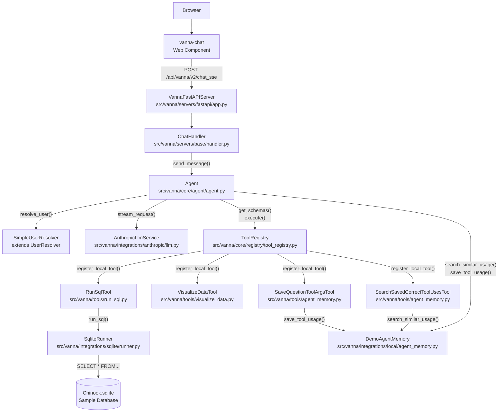

<!-- source: DeepWiki mcp.deepwiki.com · repo vanna-ai/vanna · page 1.1 Getting Started · fetched 2026-10-29 -->

# Getting Started

<details>
<summary>Relevant source files</summary>

The following files were used as context for generating this wiki page:

- [MIGRATION_GUIDE.md](MIGRATION_GUIDE.md)
- [README.md](README.md)
- [img/architecture.png](img/architecture.png)
- [img/vanna2.svg](img/vanna2.svg)
- [notebooks/quickstart.ipynb](notebooks/quickstart.ipynb)
- [pyproject.toml](pyproject.toml)
- [src/vanna/__init__.py](src/vanna/__init__.py)
- [src/vanna/integrations/anthropic/llm.py](src/vanna/integrations/anthropic/llm.py)
- [src/vanna/integrations/openai/llm.py](src/vanna/integrations/openai/llm.py)
- [src/vanna/servers/fastapi/app.py](src/vanna/servers/fastapi/app.py)
- [src/vanna/servers/flask/app.py](src/vanna/servers/flask/app.py)

</details>


This page provides a quick installation guide, basic setup instructions, and a walkthrough of the quickstart notebook to get your first Vanna agent running. By the end of this guide, you will have a working agent that can answer natural language questions about a SQLite database using Claude or another LLM provider.

For conceptual understanding of the framework components (Agent, LlmService, Tool, etc.), see [Core Concepts](#1.2). For detailed architecture information, see [Architecture Overview](#1.3).

---

## Installation

Vanna is distributed via PyPI and uses optional dependencies to keep installations minimal. The core package includes only essential dependencies.

### Basic Installation

```bash
pip install vanna
```

The core dependencies include: `pydantic>=2.0.0`, `click>=8.0.0`, `pandas`, `httpx>=0.28.0`, `PyYAML`, `plotly`, `tabulate`, `sqlparse`, `sqlalchemy`, `requests` ([pyproject.toml:20-31]()).

### Installation with Optional Dependencies

Vanna uses a modular dependency system. Install only what you need:

| Install Command | Purpose | Includes |
|----------------|---------|----------|
| `pip install 'vanna[openai]'` | OpenAI LLM integration | `openai` package |
| `pip install 'vanna[anthropic]'` | Anthropic Claude integration | `anthropic` package |
| `pip install 'vanna[gemini]'` | Google Gemini integration | `google-genai` package |
| `pip install 'vanna[ollama]'` | Local Ollama models | `ollama`, `httpx` |
| `pip install 'vanna[postgres]'` | PostgreSQL database | `psycopg2-binary`, `db-dtypes` |
| `pip install 'vanna[mysql]'` | MySQL database | `PyMySQL` |
| `pip install 'vanna[snowflake]'` | Snowflake warehouse | `snowflake-connector-python` |
| `pip install 'vanna[bigquery]'` | Google BigQuery | `google-cloud-bigquery` |
| `pip install 'vanna[chromadb]'` | ChromaDB vector store | `chromadb>=1.1.0` |
| `pip install 'vanna[fastapi]'` | FastAPI server | `fastapi>=0.68.0`, `uvicorn>=0.15.0` |
| `pip install 'vanna[flask]'` | Flask server | `flask>=2.0.0`, `flask-cors>=4.0.0` |
| `pip install 'vanna[servers]'` | Both servers | Flask + FastAPI dependencies |

**Common combinations:**

```bash
# For the quickstart (Anthropic + Flask)
pip install 'vanna[flask,anthropic]'

# For production with FastAPI + OpenAI + PostgreSQL
pip install 'vanna[fastapi,openai,postgres,chromadb]'

# For local development with Ollama
pip install 'vanna[fastapi,ollama]'

# Install everything (development)
pip install 'vanna[all]'
```

**Sources:** [pyproject.toml:40-81]()

---

## Quickstart Example

The fastest way to get started is to follow the quickstart notebook pattern. This example creates an agent that can answer questions about the Chinook sample database.

### Component Overview Diagram

This diagram shows the concrete classes and their relationships in the quickstart example:



**Sources:** [notebooks/quickstart.ipynb:49-138](), [src/vanna/servers/fastapi/app.py:16-80](), [src/vanna/integrations/anthropic/llm.py:27-63]()

---

## Step-by-Step Setup

### Step 1: Download Sample Database

The quickstart uses the Chinook SQLite database, which contains music store data (artists, albums, tracks, customers, invoices).

```python
import httpx

with open("Chinook.sqlite", "wb") as f:
    with httpx.stream("GET", "https://vanna.ai/Chinook.sqlite") as response:
        for chunk in response.iter_bytes():
            f.write(chunk)
```

**Sources:** [notebooks/quickstart.ipynb:27-39]()

### Step 2: Import Required Components

```python
from vanna import Agent, AgentConfig
from vanna.servers.fastapi import VannaFastAPIServer
from vanna.core.registry import ToolRegistry
from vanna.core.user import UserResolver, User, RequestContext
from vanna.integrations.anthropic import AnthropicLlmService
from vanna.tools import RunSqlTool, VisualizeDataTool
from vanna.integrations.sqlite import SqliteRunner
from vanna.tools.agent_memory import SaveQuestionToolArgsTool, SearchSavedCorrectToolUsesTool
from vanna.integrations.local.agent_memory import DemoAgentMemory
```

**Sources:** [notebooks/quickstart.ipynb:49-64]()

### Step 3: Define User Authentication

Vanna is user-aware at every layer. You must implement a `UserResolver` to extract user identity from requests. The `UserResolver` is an abstract base class defined in [src/vanna/core/user/resolver.py]() with a single method `resolve_user(request_context: RequestContext) -> User`.

For quickstart, we use a simple cookie-based resolver:

```python
class SimpleUserResolver(UserResolver):
    async def resolve_user(self, request_context: RequestContext) -> User:
        # In production, validate cookies/JWTs here
        user_email = request_context.get_cookie('vanna_email')
        if not user_email:
            raise ValueError("Missing 'vanna_email' cookie for user identification")
        
        print(f"Resolving user for email: {user_email}")

        if user_email == "admin@example.com":
            return User(id="admin1", email=user_email, group_memberships=['admin'])
        
        return User(id="user1", email=user_email, group_memberships=['user'])
```

The `User` model (defined in [src/vanna/core/user/models.py]()) includes:
- `id`: Unique user identifier (string)
- `email`: User's email address (string)
- `group_memberships`: List of groups for access control (e.g., `['admin']`, `['user']`)
- `metadata`: Optional dictionary for additional user context

The `RequestContext` (defined in [src/vanna/servers/base/models.py]()) provides methods:
- `get_cookie(name: str) -> Optional[str]`: Extract cookie value
- `get_header(name: str) -> Optional[str]`: Extract HTTP header
- `get_query_param(name: str) -> Optional[str]`: Extract query parameter

**Sources:** [notebooks/quickstart.ipynb:76-94](), [README.md:162-172]()

### Step 4: Register Tools with Access Control

Tools are registered in a `ToolRegistry` with access control groups. Only users with matching `group_memberships` can execute tools. The `ToolRegistry` (defined in [src/vanna/core/registry/tool_registry.py]()) validates permissions using set intersection: `user.group_memberships ∩ tool.access_groups`.

```python
tools = ToolRegistry()
tools.register_local_tool(
    RunSqlTool(sql_runner=SqliteRunner(database_path="./Chinook.sqlite")), 
    access_groups=['admin', 'user']
)
tools.register_local_tool(
    VisualizeDataTool(), 
    access_groups=['admin', 'user']
)
agent_memory = DemoAgentMemory(max_items=1000)
tools.register_local_tool(
    SaveQuestionToolArgsTool(), 
    access_groups=['admin']
)
tools.register_local_tool(
    SearchSavedCorrectToolUsesTool(), 
    access_groups=['admin', 'user']
)
```

**Tool Registration Details:**

| Tool Class | Source File | Purpose | Access Groups |
|------------|-------------|---------|---------------|
| `RunSqlTool` | [src/vanna/tools/run_sql.py]() | Executes SQL queries against the database via `SqlRunner.run_sql()` | `['admin', 'user']` |
| `VisualizeDataTool` | [src/vanna/tools/visualize_data.py]() | Creates Plotly charts from pandas DataFrames | `['admin', 'user']` |
| `SaveQuestionToolArgsTool` | [src/vanna/tools/agent_memory.py]() | Calls `AgentMemory.save_tool_usage()` to store successful patterns | `['admin']` only |
| `SearchSavedCorrectToolUsesTool` | [src/vanna/tools/agent_memory.py]() | Calls `AgentMemory.search_similar_usage()` to find past patterns | `['admin', 'user']` |

**Key components:**
- `SqliteRunner`: Implements the `SqlRunner` interface ([src/vanna/integrations/sqlite/runner.py]()) for executing SQL against SQLite databases
- `DemoAgentMemory`: In-memory implementation of `AgentMemory` interface ([src/vanna/integrations/local/agent_memory.py]()) using Jaccard similarity for pattern matching

**Sources:** [notebooks/quickstart.ipynb:104-115]()

### Step 5: Create and Configure Agent

```python
# Set up LLM
llm = AnthropicLlmService(model="claude-sonnet-4-5", api_key="sk-ant-...")

# Create agent with your options
agent = Agent(
    llm_service=llm,
    tool_registry=tools,
    user_resolver=SimpleUserResolver(),
    config=AgentConfig(),
    agent_memory=agent_memory
)
```

The `Agent` class (defined in [src/vanna/core/agent/agent.py]()) orchestrates the complete request lifecycle:

**Constructor Parameters:**

| Parameter | Type | Required | Description |
|-----------|------|----------|-------------|
| `llm_service` | `LlmService` | Yes | LLM provider implementation (OpenAI, Anthropic, etc.) |
| `tool_registry` | `ToolRegistry` | Yes | Registered tools with access control |
| `user_resolver` | `UserResolver` | Yes | Extracts user identity from requests |
| `config` | `AgentConfig` | No | Configuration (defaults: see below) |
| `agent_memory` | `AgentMemory` | No | Optional memory for learning patterns |
| `conversation_store` | `ConversationStore` | No | Optional conversation persistence |
| `system_prompt_builder` | `SystemPromptBuilder` | No | Optional custom prompt builder |
| `workflow_handler` | `WorkflowHandler` | No | Optional command handler (defaults to `DefaultWorkflowHandler`) |

**Core Agent Methods:**
- `send_message(request_context, message)`: Main entry point, returns `AsyncGenerator[UiComponent]`
- `_process_llm_response()`: Internal tool execution loop
- `_build_tool_context()`: Creates `ToolContext` with user and memory references

**Sources:** [notebooks/quickstart.ipynb:118-138]()

### Step 6: Run the Server

```python
# Create and run server
server = VannaFastAPIServer(agent)
server.run()
```

The `VannaFastAPIServer` class (defined in [src/vanna/servers/fastapi/app.py]()) provides:

**Initialization** (`__init__`):
```python
server = VannaFastAPIServer(
    agent=agent,
    config={
        "cors": {"enabled": True, "allow_origins": ["*"]},
        "dev_mode": False,
        "static_folder": "static"
    }
)
```

**Server Lifecycle** (`run()` method in [src/vanna/servers/fastapi/app.py:82-164]()):

1. **Environment Detection**: Checks for running event loops (Jupyter, Colab, IPython)
2. **nest_asyncio Application**: Applies `nest_asyncio.apply()` if in async environment
3. **App Creation**: Calls `create_app()` to build FastAPI instance
4. **Route Registration**: Registers endpoints via `register_chat_routes()` from [src/vanna/servers/fastapi/routes.py]()
5. **Port Display**: Shows accessible URL, sets up Colab forwarding if detected
6. **Server Start**: Uses `uvicorn.run()` or `asyncio.run(server.serve())` depending on environment

**Registered Routes** (from `register_chat_routes()` in [src/vanna/servers/fastapi/routes.py]()):

| Route | Method | Protocol | Purpose |
|-------|--------|----------|---------|
| `/api/vanna/v2/chat_sse` | POST | Server-Sent Events | Streaming chat endpoint (recommended) |
| `/api/vanna/v2/chat_ws` | WebSocket | WebSocket | Real-time bidirectional chat |
| `/api/vanna/v2/chat_poll` | POST | HTTP Polling | Non-streaming fallback |
| `/` | GET | HTTP | Web UI (if `dev_mode=True`) |
| `/health` | GET | HTTP | Health check endpoint |

**Default server settings:**
- Host: `0.0.0.0` (all interfaces)
- Port: `8000` (FastAPI), `5000` (Flask)
- CORS: Enabled for all origins by default
- Log level: `info`

**Sources:** [notebooks/quickstart.ipynb:135-138](), [src/vanna/servers/fastapi/app.py:82-164]()

---

## Request Flow Diagram

This sequence diagram shows the exact method calls and class interactions for a typical question:

```mermaid
sequenceDiagram
    participant Browser
    participant FastAPI["FastAPI<br/>/api/vanna/v2/chat_sse"]
    participant ChatHandler["ChatHandler"]
    participant Agent["Agent.send_message()"]
    participant UserResolver["SimpleUserResolver.resolve_user()"]
    participant WorkflowHandler["DefaultWorkflowHandler.try_handle()"]
    participant LLM["AnthropicLlmService.stream_request()"]
    participant ToolRegistry["ToolRegistry"]
    participant RunSqlTool["RunSqlTool.execute()"]
    participant SqliteRunner["SqliteRunner.run_sql()"]
    participant DB[("Chinook.sqlite")]
    participant AgentMemory["DemoAgentMemory"]
    
    Browser->>FastAPI: "POST message='Show top customers'<br/>Cookie: vanna_email=admin@example.com"
    FastAPI->>ChatHandler: "handle_chat_request(ChatRequest)"
    ChatHandler->>Agent: "send_message(request_context, message)"
    
    Agent->>UserResolver: "resolve_user(request_context)"
    UserResolver->>UserResolver: "request_context.get_cookie('vanna_email')"
    UserResolver-->>Agent: "User(id='admin1', group_memberships=['admin'])"
    
    Agent->>WorkflowHandler: "try_handle(agent, user, message)"
    WorkflowHandler-->>Agent: "WorkflowResult(should_skip_llm=False)"
    
    Agent->>AgentMemory: "search_similar_usage(question, limit=5)"
    AgentMemory-->>Agent: "List[ToolUsageRecord]"
    
    Agent->>ToolRegistry: "get_schemas(user)"
    Note over ToolRegistry: Check user.group_memberships ∩ tool.access_groups<br/>for each registered tool
    ToolRegistry-->>Agent: "List[ToolSchema] (4 tools accessible)"
    
    Agent->>LLM: "stream_request(LlmRequest)"
    Note over LLM: messages=[system_prompt, user_message]<br/>tools=[run_sql, visualize_data, ...]
    LLM-->>Agent: "LlmStreamChunk(tool_calls=[ToolCall(name='run_sql', args=...)])"
    
    Agent->>Browser: "Yield ProgressBarComponent('Executing run_sql')"
    
    Agent->>ToolRegistry: "execute(tool_call, ToolContext(user, agent_memory, ...))"
    ToolRegistry->>ToolRegistry: "Validate: 'admin' in ['admin', 'user']"
    ToolRegistry->>RunSqlTool: "execute(context, RunSqlToolArgs(sql='SELECT...'))"
    RunSqlTool->>SqliteRunner: "run_sql('SELECT customer_name, SUM(total)...')"
    SqliteRunner->>DB: "Execute SQL query"
    DB-->>SqliteRunner: "List[Dict] (query results)"
    SqliteRunner-->>RunSqlTool: "pd.DataFrame"
    RunSqlTool->>RunSqlTool: "Format DataFrame as markdown"
    RunSqlTool-->>ToolRegistry: "ToolResult(success=True,<br/>ui_components=[DataFrameComponent])"
    ToolRegistry-->>Agent: "ToolResult"
    
    Agent->>Browser: "Yield DataFrameComponent(df)"
    
    Agent->>LLM: "stream_request(with tool_result in messages)"
    LLM-->>Agent: "LlmStreamChunk(content='Here are the top customers...')"
    Agent->>Browser: "Yield SimpleTextComponent"
    
    Agent->>AgentMemory: "save_tool_usage(question, tool_name, args, success=True)"
    AgentMemory->>AgentMemory: "Append to in-memory list"
```

**Key Classes and Methods:**

- **FastAPI Route**: Registered by `register_chat_routes()` in [src/vanna/servers/fastapi/routes.py]()
- **ChatHandler**: Defined in [src/vanna/servers/base/handler.py](), wraps `Agent.send_message()`
- **Agent.send_message()**: Core orchestration loop in [src/vanna/core/agent/agent.py:200-400]()
- **ToolRegistry.execute()**: Validates permissions and dispatches in [src/vanna/core/registry/tool_registry.py:100-200]()
- **SqliteRunner.run_sql()**: Executes SQL with sqlite3 in [src/vanna/integrations/sqlite/runner.py:20-60]()
- **AnthropicLlmService.stream_request()**: Streams from Anthropic API in [src/vanna/integrations/anthropic/llm.py:92-122]()

**Sources:** [src/vanna/servers/fastapi/app.py:16-80](), [src/vanna/integrations/anthropic/llm.py:92-122](), [notebooks/quickstart.ipynb:1-170]()

---

## Accessing the Web Interface

After running `server.run()`, the server displays:

```
Your app is running at:
http://localhost:8000
```

Navigate to this URL to access the built-in web interface. The interface includes:
- Chat input for natural language questions
- Real-time streaming of status updates
- SQL code display (for admin users)
- Interactive data tables
- Plotly visualizations
- Natural language summaries

### Setting User Cookie

The quickstart uses cookie-based authentication. Set your user email cookie:

**In browser console:**
```javascript
document.cookie = "vanna_email=admin@example.com; path=/";
```

**For regular user:**
```javascript
document.cookie = "vanna_email=user@example.com; path=/";
```

**Admin vs. User Differences:**
- **Admin users** (`admin@example.com`): Can see SQL code, save memories, access all tools
- **Regular users**: Cannot see SQL code, cannot save memories, limited tool access

**Sources:** [notebooks/quickstart.ipynb:76-94]()

---

## Example Questions

Once the server is running, try these questions:

| Question | Expected Behavior |
|----------|-------------------|
| "Show me the top 5 customers by total purchases" | Executes SQL query, displays table and chart |
| "What are the most popular genres?" | Queries genre sales data |
| "List all albums by AC/DC" | Searches artists and albums tables |
| "Show me sales by year" | Aggregates invoice data with time series chart |
| "/help" | Shows available commands (workflow handler) |
| "/status" | Shows agent configuration and available tools |

**Sources:** [README.md:59-71]()

---

## Component Configuration Options

### AgentConfig Options

The `AgentConfig` class (defined in [src/vanna/core/agent/config.py]()) supports:

| Option | Type | Default | Description |
|--------|------|---------|-------------|
| `stream_responses` | bool | `True` | Enable streaming UI components via SSE |
| `max_tool_iterations` | int | `10` | Maximum LLM→tool execution loop iterations before forced termination |
| `temperature` | float | `0.0` | LLM temperature (0.0 = deterministic, 1.0 = creative) |
| `max_tokens` | int | `None` | Maximum tokens per LLM response (provider-specific) |
| `ui_features` | `UiFeatures` | `UiFeatures()` | Feature flags for UI component access control |
| `audit_config` | `AuditConfig` | `AuditConfig()` | Audit logging configuration |

**Additional Configuration Objects:**

**UiFeatures** (controls what UI features users can access):
```python
from vanna.core.ui import UiFeatures

ui_features = UiFeatures(
    show_sql_code_to_groups=['admin'],  # Only admins see SQL
    show_detailed_results_to_groups=['admin', 'analyst'],
    show_admin_panel_to_groups=['admin']
)
```

**AuditConfig** (controls audit logging):
```python
from vanna.core.audit import AuditConfig

audit = AuditConfig(
    enabled=True,
    log_tool_calls=True,
    log_llm_requests=True,
    log_user_queries=True
)
```

Example with full configuration:
```python
config = AgentConfig(
    stream_responses=True,
    max_tool_iterations=5,
    temperature=0.1,
    ui_features=ui_features,
    audit_config=audit
)
agent = Agent(
    llm_service=llm, 
    tool_registry=tools, 
    user_resolver=resolver, 
    config=config
)
```

**Sources:** [notebooks/quickstart.ipynb:118-138]()

### Server Configuration

Both `VannaFastAPIServer` and `VannaFlaskServer` accept optional configuration:

```python
server_config = {
    "cors": {
        "enabled": True,
        "allow_origins": ["https://your-domain.com"],
        "allow_credentials": True
    },
    "dev_mode": True,  # Enable static file serving
    "static_folder": "static"
}
server = VannaFastAPIServer(agent, config=server_config)
```

**Sources:** [src/vanna/servers/fastapi/app.py:19-80]()

---

## CLI Alternative

Instead of running the server programmatically, you can use the `vanna` CLI command (installed automatically with the package via [pyproject.toml:33-34]()):

```bash
# Run an example agent from the examples directory
vanna examples/quickstart --port 8000

# Or specify a custom agent configuration file
vanna path/to/your/agent_config.yaml --port 8000
```

The CLI entry point is defined in [pyproject.toml:33-34]() as:
```toml
[project.scripts]
vanna = "vanna.servers.cli.server_runner:main"
```

The `server_runner.py` module (located at [src/vanna/servers/cli/server_runner.py]()) uses:
- **Click** framework for command-line parsing
- **ExampleAgentLoader** to load pre-configured example agents
- **YAML configuration** files for agent setup (LLM, tools, database connections)

**Sources:** [pyproject.toml:33-34]()

---

## Notebook Environments

### Google Colab

The server automatically detects Google Colab and:
1. Applies `nest_asyncio` to handle existing event loops
2. Sets up port forwarding with `google.colab.output.serve_kernel_port_as_window()`
3. Displays the forwarded URL

**Sources:** [src/vanna/servers/fastapi/app.py:134-152]()

### Jupyter Notebook / JupyterLab

The server detects running event loops (Jupyter environments) and:
1. Installs `nest_asyncio` if not available
2. Applies `nest_asyncio.apply()` before starting the server
3. Uses `asyncio.run()` with uvicorn.Server instead of `uvicorn.run()`

**Sources:** [src/vanna/servers/fastapi/app.py:98-123]()

---

## Next Steps

Now that you have a working agent:

1. **Customize the LLM**: Switch to OpenAI ([OpenAI](#5.2)), use local models with Ollama ([Ollama](#5.6)), or try other providers ([LLM Integrations](#5))
   
2. **Connect Your Database**: Replace `SqliteRunner` with your database connector ([PostgreSQL](#6.2), [Snowflake/BigQuery](#6.4), [Other Databases](#6))

3. **Add Custom Tools**: Create tools specific to your use case ([Creating Custom Tools](#7.2), [Tool System](#7))

4. **Implement Production Auth**: Replace `SimpleUserResolver` with JWT validation, OAuth, or your auth system ([UserResolver and Authentication](#3.1))

5. **Add Memory**: Use persistent vector storage instead of `DemoAgentMemory` ([ChromaDB](#4.5), [Qdrant](#4.6), [Other Vector Stores](#4.9))

6. **Deploy to Production**: Configure CORS, set up HTTPS, add monitoring ([Server and Deployment](#8))

7. **Understand Core Concepts**: Learn about Agent, Tool, LlmService, and other framework components ([Core Concepts](#1.2))

**Sources:** [README.md:32-199](), [notebooks/quickstart.ipynb:1-170]()

---

