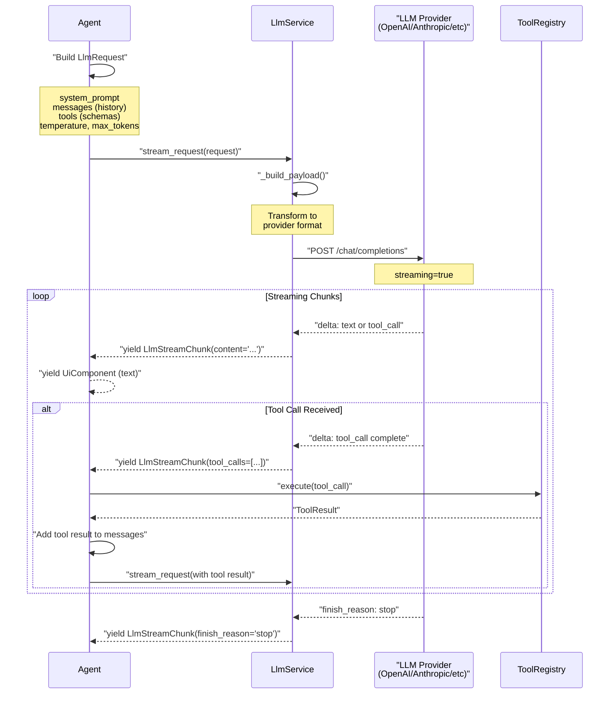
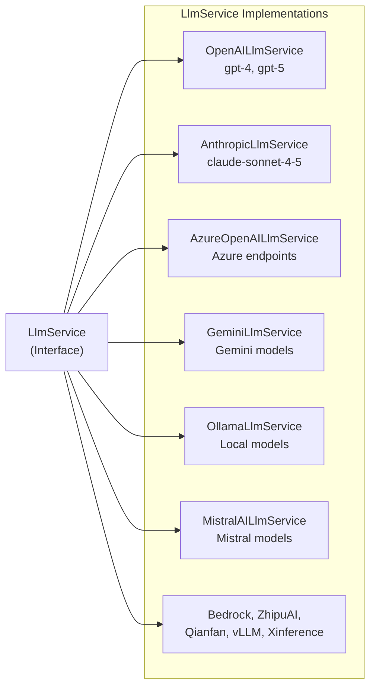
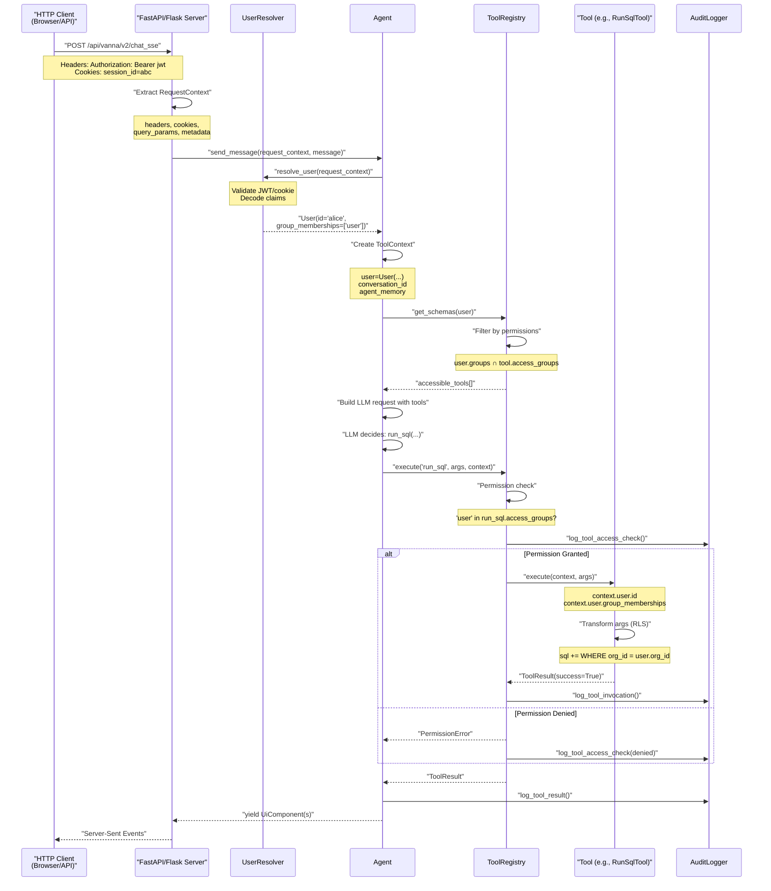
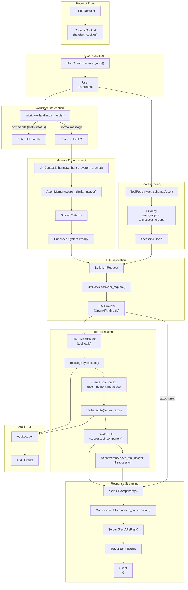

<!-- source: DeepWiki mcp.deepwiki.com · repo vanna-ai/vanna · page 1.2 Core Concepts · fetched 2026-10-29 -->

# Core Concepts

<details>
<summary>Relevant source files</summary>

The following files were used as context for generating this wiki page:

- [MIGRATION_GUIDE.md](MIGRATION_GUIDE.md)
- [README.md](README.md)
- [img/architecture.png](img/architecture.png)
- [img/vanna2.svg](img/vanna2.svg)
- [notebooks/quickstart.ipynb](notebooks/quickstart.ipynb)
- [pyproject.toml](pyproject.toml)
- [src/vanna/__init__.py](src/vanna/__init__.py)
- [src/vanna/core/__init__.py](src/vanna/core/__init__.py)
- [src/vanna/core/agent/agent.py](src/vanna/core/agent/agent.py)
- [src/vanna/core/workflow/__init__.py](src/vanna/core/workflow/__init__.py)
- [src/vanna/examples/default_workflow_handler_example.py](src/vanna/examples/default_workflow_handler_example.py)
- [src/vanna/integrations/anthropic/llm.py](src/vanna/integrations/anthropic/llm.py)
- [src/vanna/integrations/local/__init__.py](src/vanna/integrations/local/__init__.py)
- [src/vanna/integrations/local/file_system_conversation_store.py](src/vanna/integrations/local/file_system_conversation_store.py)
- [src/vanna/integrations/openai/llm.py](src/vanna/integrations/openai/llm.py)
- [src/vanna/servers/fastapi/app.py](src/vanna/servers/fastapi/app.py)
- [src/vanna/servers/flask/app.py](src/vanna/servers/flask/app.py)
- [src/vanna/tools/agent_memory.py](src/vanna/tools/agent_memory.py)

</details>


## Purpose and Scope

This page explains the fundamental concepts of the Vanna Agents framework: the **Agent** orchestrator, **Tools** system, **AgentMemory** learning capabilities, **LLM Services** abstraction, **User-Awareness** model, and supporting infrastructure. These concepts form the foundation for building intelligent, user-scoped data analysis agents.

For implementation details of specific components, see:
- Agent system deep dive: [Agent System](#2.1)
- Tool creation guide: [Tool System](#7)
- Memory backends: [Agent Memory System](#4)
- LLM integrations: [LLM Integrations](#5)
- Security and permissions: [Security and Access Control](#3)

---

## The Agent: Central Orchestrator

The `Agent` class ([src/vanna/core/agent/agent.py:56-141]()) is the main orchestrator that coordinates all interactions between users, LLM services, tools, and conversation history.

### Agent Responsibilities

| Responsibility | Description | Key Methods |
|---------------|-------------|-------------|
| **Message Processing** | Receives user messages and orchestrates responses | `send_message()` |
| **User Resolution** | Extracts user identity and permissions from requests | Uses `UserResolver` |
| **Workflow Handling** | Intercepts commands before LLM invocation | Uses `WorkflowHandler` |
| **Tool Orchestration** | Manages tool discovery, validation, and execution | Uses `ToolRegistry` |
| **LLM Communication** | Streams requests/responses to language models | Uses `LlmService` |
| **Memory Enhancement** | Retrieves past patterns to inform decisions | Uses `AgentMemory` |
| **Conversation Persistence** | Saves and loads conversation history | Uses `ConversationStore` |
| **UI Streaming** | Yields structured UI components in real-time | Yields `UiComponent` |

### Agent Initialization

```python
agent = Agent(
    llm_service=llm_service,          # LLM provider (OpenAI, Anthropic, etc.)
    tool_registry=tool_registry,      # Available tools
    user_resolver=user_resolver,      # User authentication
    agent_memory=agent_memory,        # Learning/memory backend
    conversation_store=store,         # Optional conversation persistence
    config=AgentConfig(),             # Configuration parameters
    workflow_handler=handler,         # Optional workflow interceptor
    # Extensibility hooks:
    lifecycle_hooks=[],               # Before/after message/tool hooks
    llm_middlewares=[],               # Request/response transformers
    context_enrichers=[],             # ToolContext enhancers
    llm_context_enhancer=None,        # System prompt enhancer
    conversation_filters=[],          # History filters
    observability_provider=None,      # Telemetry/metrics
    audit_logger=None                 # Security audit logging
)
```

Sources: [src/vanna/core/agent/agent.py:56-141]()

### AgentConfig

Configuration parameters control agent behavior ([src/vanna/core/agent/config.py]()):

| Parameter | Type | Description |
|-----------|------|-------------|
| `stream_responses` | `bool` | Enable streaming responses (default: `True`) |
| `max_tool_iterations` | `int` | Max tool execution loops (default: `10`) |
| `temperature` | `float` | LLM temperature (default: `0.0`) |
| `max_tokens` | `Optional[int]` | Max LLM output tokens |
| `include_thinking_indicators` | `bool` | Show "thinking..." indicators |
| `auto_save_conversations` | `bool` | Persist conversations automatically |
| `ui_features` | `UiFeatures` | Access control for UI features |
| `audit_config` | `AuditConfig` | Audit logging configuration |

Sources: [src/vanna/core/agent/config.py]()

---

## Tools: Modular Capabilities

Tools are the fundamental building blocks that give agents capabilities. Each tool is a self-contained unit with a clear interface, schema, and execution logic.

### Tool Architecture Diagram

```mermaid
graph TB
    subgraph "Tool Interface"
        Tool["Tool[T]<br/>(Abstract Base Class)"]
        Tool --> |defines| name["name: str<br/>(property)"]
        Tool --> |defines| description["description: str<br/>(property)"]
        Tool --> |defines| access_groups["access_groups: List[str]<br/>(property)"]
        Tool --> |defines| get_args_schema["get_args_schema()<br/>→ Type[T]"]
        Tool --> |defines| execute["execute(context, args)<br/>→ ToolResult"]
    end
    
    subgraph "Built-in Tools"
        RunSqlTool["RunSqlTool<br/>(RunSqlToolArgs)"]
        VisualizeDataTool["VisualizeDataTool<br/>(VisualizeDataArgs)"]
        SaveQuestionToolArgsTool["SaveQuestionToolArgsTool<br/>(SaveQuestionToolArgsParams)"]
        SearchSavedCorrectToolUsesTool["SearchSavedCorrectToolUsesTool<br/>(SearchSavedCorrectToolUsesParams)"]
    end
    
    subgraph "Tool Registry"
        ToolRegistry["ToolRegistry"]
        ToolRegistry --> |register| tools_dict["tools: Dict[str, Tool]"]
        ToolRegistry --> |register| access_map["access_groups: Dict[str, List[str]]"]
        ToolRegistry --> |methods| get_schemas["get_schemas(user)<br/>→ List[ToolSchema]"]
        ToolRegistry --> |methods| execute_tool["execute(name, args, context)<br/>→ ToolResult"]
    end
    
    subgraph "Execution Context"
        ToolContext["ToolContext"]
        ToolContext --> user_field["user: User"]
        ToolContext --> memory_field["agent_memory: AgentMemory"]
        ToolContext --> metadata_field["metadata: Dict[str, Any]"]
        ToolContext --> request_id["request_id: str"]
        ToolContext --> conversation_id["conversation_id: str"]
    end
    
    subgraph "Execution Result"
        ToolResult["ToolResult"]
        ToolResult --> success["success: bool"]
        ToolResult --> result_for_llm["result_for_llm: str"]
        ToolResult --> ui_component["ui_component: Optional[UiComponent]"]
        ToolResult --> error_field["error: Optional[str]"]
    end
    
    Tool --> |implemented by| RunSqlTool
    Tool --> |implemented by| VisualizeDataTool
    Tool --> |implemented by| SaveQuestionToolArgsTool
    Tool --> |implemented by| SearchSavedCorrectToolUsesTool
    
    ToolRegistry --> |manages| Tool
    ToolRegistry --> |creates| ToolContext
    ToolRegistry --> |receives| ToolResult
    
    Tool --> |receives| ToolContext
    Tool --> |returns| ToolResult
```



Sources: [src/vanna/core/tool/base.py](), [src/vanna/core/tool/models.py](), [src/vanna/core/registry.py](), [src/vanna/tools/]()

### Tool Interface

Every tool inherits from `Tool[T]` ([src/vanna/core/tool/base.py]()) where `T` is a Pydantic model defining the tool's arguments:

```python
class MyTool(Tool[MyToolArgs]):
    @property
    def name(self) -> str:
        return "my_tool"
    
    @property
    def description(self) -> str:
        return "Description for LLM"
    
    @property
    def access_groups(self) -> list[str]:
        return ["user", "admin"]  # Groups that can use this tool
    
    def get_args_schema(self) -> Type[MyToolArgs]:
        return MyToolArgs
    
    async def execute(self, context: ToolContext, args: MyToolArgs) -> ToolResult:
        # Tool logic here
        return ToolResult(success=True, result_for_llm="Done")
```

Sources: [src/vanna/core/tool/base.py](), [README.md:203-242]()

### ToolContext and ToolResult

**ToolContext** ([src/vanna/core/tool/models.py:12-49]()) carries execution context:

| Field | Type | Description |
|-------|------|-------------|
| `user` | `User` | Current user with permissions |
| `conversation_id` | `str` | Conversation identifier |
| `request_id` | `str` | Unique request identifier |
| `agent_memory` | `AgentMemory` | Memory interface for learning |
| `observability_provider` | `Optional[ObservabilityProvider]` | Telemetry integration |
| `metadata` | `Dict[str, Any]` | Additional context data |

**ToolResult** ([src/vanna/core/tool/models.py:52-89]()) represents execution outcomes:

| Field | Type | Description |
|-------|------|-------------|
| `success` | `bool` | Execution success status |
| `result_for_llm` | `str` | Text summary for LLM |
| `ui_component` | `Optional[UiComponent]` | Rich UI to display |
| `error` | `Optional[str]` | Error message if failed |

Sources: [src/vanna/core/tool/models.py:12-89]()

### ToolRegistry

The `ToolRegistry` ([src/vanna/core/registry.py]()) manages tool lifecycle:

```python
registry = ToolRegistry()

# Register tool with access control
registry.register(RunSqlTool(sql_runner=runner), access_groups=["user", "admin"])

# Get tools available to a user
schemas = await registry.get_schemas(user)  # Only returns accessible tools

# Execute tool (with permission check)
result = await registry.execute(
    tool_name="run_sql",
    args={"sql": "SELECT * FROM users"},
    context=tool_context
)
```

**Permission Checking**: The registry filters tools based on `user.group_memberships ∩ tool.access_groups` ([src/vanna/core/registry.py]()).

Sources: [src/vanna/core/registry.py](), [README.md:220-242]()

---

## Agent Memory: Learning System

`AgentMemory` ([src/vanna/capabilities/agent_memory.py]()) provides the learning capability that allows agents to improve over time by remembering successful tool usage patterns.

### Memory Architecture

```mermaid
graph TB
    subgraph "AgentMemory Interface"
        AgentMemory["AgentMemory<br/>(Abstract Base)"]
        AgentMemory --> save_tool_usage["save_tool_usage()<br/>question, tool_name, args"]
        AgentMemory --> search_similar["search_similar_usage()<br/>question, filters"]
        AgentMemory --> save_text["save_text_memory()<br/>content"]
        AgentMemory --> search_text["search_text_memory()<br/>query"]
    end
    
    subgraph "Memory Types"
        ToolMemory["ToolMemory<br/>(Structured)"]
        ToolMemory --> question_field["question: str"]
        ToolMemory --> tool_name_field["tool_name: str"]
        ToolMemory --> args_field["args: Dict[str, Any]"]
        ToolMemory --> success_field["success: bool"]
        ToolMemory --> timestamp_field["timestamp: datetime"]
        
        TextMemory["TextMemory<br/>(Unstructured)"]
        TextMemory --> content_field["content: str"]
        TextMemory --> timestamp_text["timestamp: datetime"]
    end
    
    subgraph "Memory-Enabled Tools"
        SaveQuestionTool["SaveQuestionToolArgsTool<br/>(Admin Only)"]
        SearchTool["SearchSavedCorrectToolUsesTool<br/>(All Users)"]
        SaveTextTool["SaveTextMemoryTool<br/>(Admin Only)"]
    end
    
    subgraph "Vector Store Backends"
        DemoMemory["DemoAgentMemory<br/>(In-Memory)"]
        ChromaMemory["ChromaAgentMemory<br/>(ChromaDB)"]
        QdrantMemory["QdrantAgentMemory<br/>(Qdrant)"]
        FAISSMemory["FAISSAgentMemory<br/>(FAISS)"]
        PineconeMemory["PineconeAgentMemory<br/>(Pinecone)"]
        OtherMemory["9+ Other Backends"]
    end
    
    subgraph "Usage in Agent"
        LlmContextEnhancer["DefaultLlmContextEnhancer"]
        LlmContextEnhancer --> enhance_system_prompt["enhance_system_prompt()<br/>adds similar patterns"]
        Agent_Memory["Agent.send_message()"]
        Agent_Memory --> search_phase["Search Phase<br/>(before LLM)"]
        Agent_Memory --> save_phase["Save Phase<br/>(after success)"]
    end
    
    AgentMemory --> |implements| DemoMemory
    AgentMemory --> |implements| ChromaMemory
    AgentMemory --> |implements| QdrantMemory
    AgentMemory --> |implements| FAISSMemory
    AgentMemory --> |implements| PineconeMemory
    AgentMemory --> |implements| OtherMemory
    
    AgentMemory --> |stores| ToolMemory
    AgentMemory --> |stores| TextMemory
    
    SaveQuestionTool --> |uses| save_tool_usage
    SearchTool --> |uses| search_similar
    SaveTextTool --> |uses| save_text
    
    LlmContextEnhancer --> |queries| AgentMemory
    Agent_Memory --> |uses| LlmContextEnhancer
    search_phase --> |retrieves| ToolMemory
    save_phase --> |stores| ToolMemory
```



Sources: [src/vanna/capabilities/agent_memory.py](), [src/vanna/tools/agent_memory.py](), [src/vanna/integrations/]()

### Learning Loop

The agent memory system enables continuous improvement through a three-phase cycle:

#### Phase 1: Context Retrieval (Passive)

Before LLM invocation, `DefaultLlmContextEnhancer` ([src/vanna/core/enhancer/default.py]()) searches for similar past interactions:

```python
# In DefaultLlmContextEnhancer.enhance_system_prompt()
search_results = await agent_memory.search_similar_usage(
    question=user_message,
    context=tool_context,
    limit=5,
    similarity_threshold=0.7
)

# Inject results into system prompt
if search_results:
    enhanced_prompt += "\n\nSimilar successful patterns:\n"
    for result in search_results:
        enhanced_prompt += f"- Question: {result.memory.question}\n"
        enhanced_prompt += f"  Tool: {result.memory.tool_name}\n"
        enhanced_prompt += f"  Args: {result.memory.args}\n"
```

Sources: [src/vanna/core/enhancer/default.py](), [src/vanna/core/agent/agent.py:604-627]()

#### Phase 2: Tool Execution

LLM makes tool decisions informed by historical patterns:

```python
# Agent decides to use run_sql based on similar pattern
llm_response = await llm_service.stream_request(request)
# LLM returns: run_sql(sql="SELECT region, SUM(sales) FROM...")
```

Sources: [src/vanna/core/agent/agent.py:652-657]()

#### Phase 3: Pattern Storage (Active)

Successful executions are saved via `SaveQuestionToolArgsTool` ([src/vanna/tools/agent_memory.py:60-118]()):

```python
# In SaveQuestionToolArgsTool.execute()
await context.agent_memory.save_tool_usage(
    question="Show Q4 sales by region",
    tool_name="run_sql",
    args={"sql": "SELECT region, SUM(sales)..."},
    context=context,
    success=True
)
```

This creates a feedback loop: better patterns → better LLM decisions → better new patterns.

Sources: [src/vanna/tools/agent_memory.py:60-118](), [src/vanna/capabilities/agent_memory.py]()

### Memory Implementations

| Backend | Class | Use Case |
|---------|-------|----------|
| In-Memory | `DemoAgentMemory` | Testing, demos |
| ChromaDB | `ChromaAgentMemory` | Local development |
| Qdrant | `QdrantAgentMemory` | Cloud-native vector search |
| FAISS | `FAISSAgentMemory` | High-performance local |
| Pinecone | `PineconeAgentMemory` | Managed cloud service |
| Milvus, Weaviate, OpenSearch, Azure AI Search, Marqo | Various | Enterprise deployments |

Sources: [src/vanna/integrations/](), [pyproject.toml:55-78]()

---

## LLM Services: Provider Abstraction

The `LlmService` interface ([src/vanna/core/llm/base.py]()) abstracts communication with language model providers, enabling seamless switching between OpenAI, Anthropic, Gemini, and others.

### LLM Service Flow



Sources: [src/vanna/core/llm/base.py](), [src/vanna/core/agent/agent.py:652-857]()

### LlmService Interface

Key methods ([src/vanna/core/llm/base.py]():

| Method | Purpose | Returns |
|--------|---------|---------|
| `send_request(request)` | Non-streaming request | `LlmResponse` |
| `stream_request(request)` | Streaming request | `AsyncGenerator[LlmStreamChunk]` |
| `validate_tools(tools)` | Check tool schemas | `List[str]` (errors) |

### Request/Response Models

**LlmRequest** ([src/vanna/core/llm/models.py:7-38]()):

```python
class LlmRequest:
    messages: List[LlmMessage]           # Conversation history
    tools: Optional[List[ToolSchema]]    # Available tools
    temperature: Optional[float]         # Creativity (0.0 - 1.0)
    max_tokens: Optional[int]            # Max output length
    system_prompt: Optional[str]         # System instructions
```

**LlmStreamChunk** ([src/vanna/core/llm/models.py:72-93]()):

```python
class LlmStreamChunk:
    content: Optional[str]               # Text delta
    tool_calls: Optional[List[ToolCall]] # Tool invocations
    finish_reason: Optional[str]         # Completion reason
```

Sources: [src/vanna/core/llm/models.py]()

### Provider Implementations



Sources: [src/vanna/integrations/openai/llm.py](), [src/vanna/integrations/anthropic/llm.py](), [pyproject.toml:56-78]()

### Example Usage

```python
from vanna.integrations.anthropic import AnthropicLlmService

llm = AnthropicLlmService(
    model="claude-sonnet-4-5",
    api_key="sk-ant-..."  # or env: ANTHROPIC_API_KEY
)

# Use in agent
agent = Agent(llm_service=llm, ...)
```

Sources: [src/vanna/integrations/anthropic/llm.py:27-64](), [notebooks/quickstart.ipynb:123-138]()

---

## User-Awareness: Identity and Permissions

Every interaction in Vanna is scoped to a `User` with specific permissions. This enables multi-tenant applications, access control, and audit trails.

### User-Aware Request Flow



Sources: [src/vanna/core/agent/agent.py:249-262](), [src/vanna/core/user/resolver.py](), [src/vanna/core/registry.py]()

### User Model

The `User` class ([src/vanna/core/user/models.py]()) represents authenticated users:

```python
class User:
    id: str                              # Unique identifier
    username: Optional[str]              # Username
    email: Optional[str]                 # Email address
    group_memberships: List[str] = []    # Groups for access control
    metadata: Dict[str, Any] = {}        # Additional user data
```

**Group Memberships** determine tool access:
- `["admin"]` → Access admin-only tools
- `["user"]` → Access user-level tools
- `["admin", "analyst"]` → Union of permissions

Sources: [src/vanna/core/user/models.py]()

### UserResolver

Custom `UserResolver` implementations extract user identity from HTTP requests ([src/vanna/core/user/resolver.py]()):

```python
class MyUserResolver(UserResolver):
    async def resolve_user(self, request_context: RequestContext) -> User:
        # Extract JWT from Authorization header
        token = request_context.get_header('Authorization')
        claims = self.validate_jwt(token)
        
        return User(
            id=claims['sub'],
            email=claims['email'],
            group_memberships=claims['groups']  # e.g., ['user', 'admin']
        )
```

**RequestContext** ([src/vanna/core/user/request_context.py]()) provides access to:

| Method | Returns | Description |
|--------|---------|-------------|
| `get_header(name)` | `Optional[str]` | HTTP header value |
| `get_cookie(name)` | `Optional[str]` | Cookie value |
| `get_query_param(name)` | `Optional[str]` | Query parameter |
| `metadata` | `Dict[str, Any]` | Additional context |

Sources: [src/vanna/core/user/resolver.py](), [src/vanna/core/user/request_context.py](), [notebooks/quickstart.ipynb:81-94]()

### Permission Enforcement

**Tool-Level Access Control** ([src/vanna/core/registry.py]()):

```python
# In ToolRegistry
async def get_schemas(self, user: User) -> List[ToolSchema]:
    schemas = []
    for tool_name, tool in self.tools.items():
        access_groups = self.access_groups.get(tool_name, [])
        
        # Check: user.groups ∩ tool.access_groups
        if not access_groups or any(g in user.group_memberships for g in access_groups):
            schemas.append(tool.get_schema())
    
    return schemas  # Only return accessible tools
```

**Row-Level Security** via `transform_args()` (see [Security and Access Control](#3.4)).

Sources: [src/vanna/core/registry.py](), [README.md:220-234]()

---

## Conversation Management

The `ConversationStore` interface ([src/vanna/core/storage/base.py]()) manages conversation history across sessions.

### Conversation Model

```mermaid
graph TB
    subgraph "Conversation"
        Conversation["Conversation"]
        Conversation --> id_field["id: str"]
        Conversation --> user_field["user: User"]
        Conversation --> messages_field["messages: List[Message]"]
        Conversation --> created_at["created_at: datetime"]
        Conversation --> updated_at["updated_at: datetime"]
    end
    
    subgraph "Message"
        Message["Message"]
        Message --> role_field["role: str<br/>(user/assistant/tool)"]
        Message --> content_field["content: str"]
        Message --> tool_calls_field["tool_calls: Optional[List[ToolCall]]"]
        Message --> tool_call_id_field["tool_call_id: Optional[str]"]
    end
    
    subgraph "ConversationStore Implementations"
        MemoryStore["MemoryConversationStore<br/>(In-Memory)"]
        FileStore["FileSystemConversationStore<br/>(Disk-based)"]
    end
    
    subgraph "ConversationStore Interface"
        Store["ConversationStore"]
        Store --> create["create_conversation()"]
        Store --> get["get_conversation(id, user)"]
        Store --> update["update_conversation()"]
        Store --> delete["delete_conversation(id, user)"]
        Store --> list_method["list_conversations(user)"]
    end
    
    Conversation --> |contains| Message
    Store --> |implements| MemoryStore
    Store --> |implements| FileStore
    Store --> |manages| Conversation
```

Sources: [src/vanna/core/storage/base.py](), [src/vanna/core/storage/models.py](), [src/vanna/integrations/local/storage.py](), [src/vanna/integrations/local/file_system_conversation_store.py]()

### Message Roles

| Role | Purpose | Fields |
|------|---------|--------|
| `user` | User messages | `content` |
| `assistant` | LLM responses | `content`, optionally `tool_calls` |
| `tool` | Tool execution results | `content`, `tool_call_id` |

**Tool Call Flow**:
1. User: "Show sales data"
2. Assistant: `tool_calls=[ToolCall(name="run_sql", args={...})]`
3. Tool: `tool_call_id="call_abc"`, `content="[{...}]"`
4. Assistant: "Here's your sales data..."

Sources: [src/vanna/core/storage/models.py]()

### Storage Implementations

**MemoryConversationStore** ([src/vanna/integrations/local/storage.py:10-53]()):
- In-memory dictionary
- Useful for testing/development
- Data lost on restart

**FileSystemConversationStore** ([src/vanna/integrations/local/file_system_conversation_store.py:19-165]()):
- Directory structure: `conversations/{id}/metadata.json` and `messages/*.json`
- Persistent across restarts
- Human-readable JSON format

Sources: [src/vanna/integrations/local/storage.py](), [src/vanna/integrations/local/file_system_conversation_store.py]()

---

## UI Components: Rich Streaming Responses

Unlike traditional chatbots that return plain text, Vanna streams structured `UiComponent` objects that render as tables, charts, code blocks, and status cards.

### UI Component Hierarchy

```mermaid
graph TB
    subgraph "UiComponent Container"
        UiComponent["UiComponent"]
        UiComponent --> simple["simple_component:<br/>SimpleComponent"]
        UiComponent --> rich["rich_component:<br/>RichComponent"]
    end
    
    subgraph "Simple Components (Fallback)"
        SimpleText["SimpleTextComponent<br/>type='text'"]
        SimpleImage["SimpleImageComponent<br/>type='image'"]
        SimpleLink["SimpleLinkComponent<br/>type='link'"]
    end
    
    subgraph "Rich Components (Primary)"
        subgraph "Feedback"
            StatusCard["StatusCardComponent<br/>title, status, icon"]
            Notification["NotificationComponent<br/>message, severity"]
            ProgressBar["ProgressBarComponent<br/>value, max"]
            LogViewer["LogViewerComponent<br/>logs[]"]
        end
        
        subgraph "Data Display"
            DataFrame["DataFrameComponent<br/>data, columns"]
            Chart["ChartComponent<br/>plotly_json"]
            Card["CardComponent<br/>title, content"]
            Artifact["ArtifactComponent<br/>type, content"]
        end
        
        subgraph "Interactive"
            TaskList["TaskListComponent<br/>tasks[]"]
            Button["ButtonComponent<br/>label, action"]
            ButtonGroup["ButtonGroupComponent<br/>buttons[]"]
        end
        
        subgraph "Update Components"
            StatusBarUpdate["StatusBarUpdateComponent<br/>status, message"]
            TaskTrackerUpdate["TaskTrackerUpdateComponent<br/>add/update task"]
            ChatInputUpdate["ChatInputUpdateComponent<br/>placeholder, disabled"]
        end
    end
    
    UiComponent --> SimpleText
    UiComponent --> SimpleImage
    UiComponent --> SimpleLink
    
    UiComponent --> StatusCard
    UiComponent --> Notification
    UiComponent --> ProgressBar
    UiComponent --> LogViewer
    
    UiComponent --> DataFrame
    UiComponent --> Chart
    UiComponent --> Card
    UiComponent --> Artifact
    
    UiComponent --> TaskList
    UiComponent --> Button
    UiComponent --> ButtonGroup
    
    UiComponent --> StatusBarUpdate
    UiComponent --> TaskTrackerUpdate
    UiComponent --> ChatInputUpdate
```



Sources: [src/vanna/components/](), [src/vanna/core/components.py]()

### Streaming Example

When a tool executes, it can yield UI components:

```python
# In RunSqlTool.execute()
result = await sql_runner.run(args.sql)

# Return structured result
return ToolResult(
    success=True,
    result_for_llm=f"Query returned {len(result)} rows",
    ui_component=UiComponent(
        rich_component=DataFrameComponent(
            data=result,
            columns=list(result[0].keys()),
            title="Query Results"
        ),
        simple_component=SimpleTextComponent(text=str(result))
    )
)
```

The agent streams these components to the client via Server-Sent Events (SSE).

Sources: [src/vanna/tools/sql.py](), [src/vanna/components/]()

### Component Categories

| Category | Components | Purpose |
|----------|-----------|---------|
| **Feedback** | StatusCard, Notification, ProgressBar, LogViewer | System status updates |
| **Data** | DataFrame, Chart, Card, Artifact | Display query results |
| **Interactive** | TaskList, Button, ButtonGroup | User interactions |
| **Control** | StatusBarUpdate, TaskTrackerUpdate, ChatInputUpdate | UI state management |

Sources: [src/vanna/components/]()

---

## System Integration

All core concepts work together in the agent's message processing lifecycle:



Sources: [src/vanna/core/agent/agent.py:231-857](), all referenced interfaces

---

## Key Takeaways

| Concept | Interface/Class | Responsibility |
|---------|----------------|----------------|
| **Agent** | `Agent` | Orchestrates message processing, tool execution, LLM communication |
| **Tools** | `Tool[T]`, `ToolRegistry` | Modular capabilities with schemas, execution, and access control |
| **Memory** | `AgentMemory` | Stores/retrieves tool usage patterns for learning |
| **LLM** | `LlmService` | Provider abstraction for OpenAI, Anthropic, etc. |
| **User** | `User`, `UserResolver` | Identity, permissions, and access control |
| **Conversation** | `ConversationStore` | Persistent conversation history |
| **UI** | `UiComponent` | Structured streaming responses (tables, charts, status) |

These concepts combine to create an intelligent, user-aware agent system that learns from experience and provides rich, context-aware responses.

Sources: All files referenced throughout document

---

