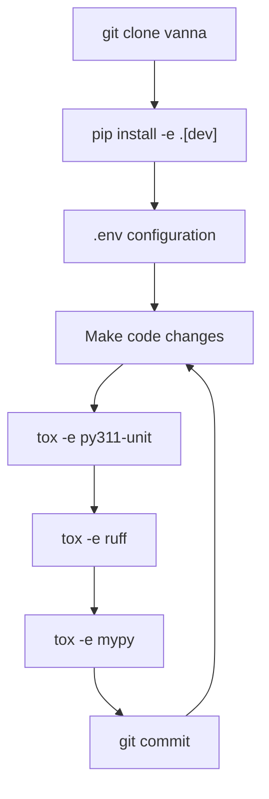
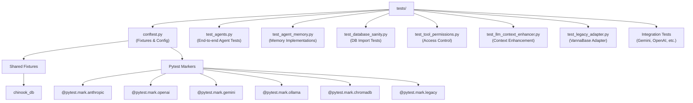
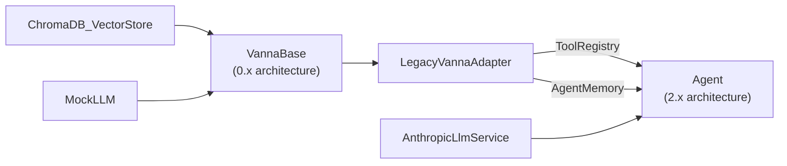
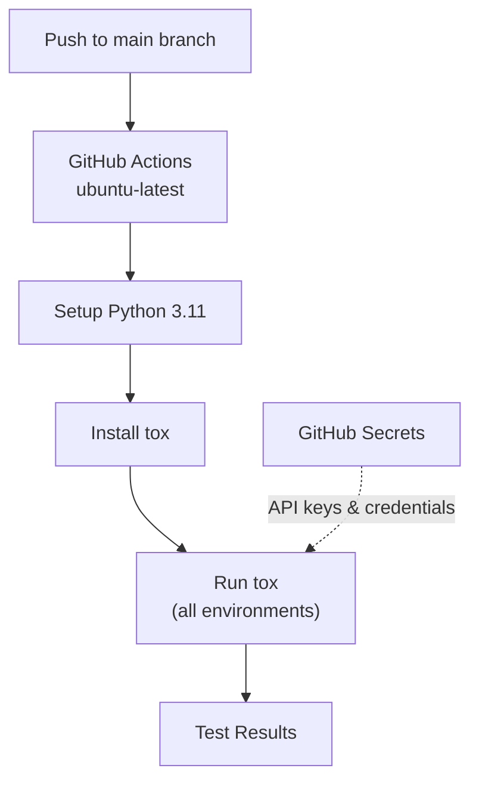

<!-- source: DeepWiki mcp.deepwiki.com · repo vanna-ai/vanna · page 10 Development and Testing · fetched 2026-10-29 -->

# Development and Testing

<details>
<summary>Relevant source files</summary>

The following files were used as context for generating this wiki page:

- [.github/workflows/tests.yml](.github/workflows/tests.yml)
- [.gitignore](.gitignore)
- [src/vanna/integrations/azureopenai/__init__.py](src/vanna/integrations/azureopenai/__init__.py)
- [src/vanna/integrations/azureopenai/llm.py](src/vanna/integrations/azureopenai/llm.py)
- [tests/conftest.py](tests/conftest.py)
- [tests/test_agent_memory_sanity.py](tests/test_agent_memory_sanity.py)
- [tests/test_agents.py](tests/test_agents.py)
- [tests/test_azureopenai_llm.py](tests/test_azureopenai_llm.py)
- [tests/test_legacy_adapter.py](tests/test_legacy_adapter.py)
- [tox.ini](tox.ini)

</details>


This guide covers setting up a local development environment for Vanna and understanding the testing infrastructure. The Vanna testing suite validates the core Agent framework, LLM integrations, database connectors, vector store implementations, and legacy adapter compatibility.

Tests are organized into three categories:
- **Unit tests**: Test core logic without external dependencies
- **Integration tests**: Validate integrations with real LLM providers and databases (require API keys)
- **Sanity tests**: Verify that integrations can be imported without actual service connections

All tests use `pytest` with `pytest-asyncio` for async support, orchestrated via `tox` for environment isolation.

**Sources**: [tox.ini:1-26](), [tests/conftest.py:1-12]()

## Development Environment Setup

### Prerequisites

- Python 3.11+
- Git
- (Optional) Virtual environment tool (`venv`, `virtualenv`, or `conda`)

### Cloning the Repository

```bash
git clone https://github.com/vanna-ai/vanna.git
cd vanna
```

**Sources**: Repository structure

### Installing Dependencies

#### Minimal Installation (Core Only)

```bash
pip install -e .
```

This installs the core framework without optional integrations.

#### Full Development Installation

```bash
pip install -e ".[dev]"
```

This includes development tools:
- `pytest` and `pytest-asyncio` for testing
- `ruff` for formatting and linting
- `mypy` for type checking
- `tox` for test orchestration

**Sources**: [pyproject.toml]() (dependency declarations)

#### Integration-Specific Installation

Install specific integrations as needed:

```bash
# LLM providers
pip install -e ".[openai]"
pip install -e ".[anthropic]"
pip install -e ".[gemini]"

# Vector stores
pip install -e ".[chromadb]"
pip install -e ".[qdrant]"

# Database connectors
pip install -e ".[postgres]"
pip install -e ".[snowflake]"

# Multiple integrations
pip install -e ".[openai,postgres,chromadb]"
```

**Sources**: [pyproject.toml]() (optional dependencies)

### Environment Variables

Create a `.env` file in the project root for API keys and credentials. This file is git-ignored:

```bash
# LLM Provider API Keys
OPENAI_API_KEY=sk-...
ANTHROPIC_API_KEY=sk-ant-...
GEMINI_API_KEY=...
MISTRAL_API_KEY=...

# Azure OpenAI
AZURE_OPENAI_API_KEY=...
AZURE_OPENAI_ENDPOINT=https://....openai.azure.com
AZURE_OPENAI_MODEL=gpt-4o-deployment
AZURE_OPENAI_API_VERSION=2024-10-21

# Database Credentials
SNOWFLAKE_ACCOUNT=...
SNOWFLAKE_USERNAME=...
SNOWFLAKE_PASSWORD=...

# Optional: Ollama
OLLAMA_HOST=http://localhost:11434

# Optional: Vanna Cloud
VANNA_API_KEY=...
```

**Sources**: [.gitignore:14](), [.github/workflows/tests.yml:26-35]()

### Running Locally

#### Running Example Agents

```bash
# Run the quickstart example
python notebooks/quickstart.py

# Or use Jupyter notebooks
jupyter notebook notebooks/
```

#### Starting a Development Server

```bash
# FastAPI server (async, recommended)
python -m vanna.servers.fastapi.server

# Flask server (sync)
python -m vanna.servers.flask.server
```

**Sources**: [src/vanna/servers/]()

### Development Workflow



**Sources**: Development best practices

## Testing Infrastructure

### Test Organization



**Sources**: [tests/conftest.py:1-77](), [tests/test_agents.py:1-173](), [tests/test_gemini_integration.py:1-189](), [tests/test_legacy_adapter.py:1-164]()

### Test Categories by Type

| Test Type | Example File | Dependencies | Purpose |
|-----------|--------------|--------------|---------|
| Unit | `test_tool_permissions.py` | None | Test core logic (permissions, context enhancement) |
| Sanity | `test_agent_memory_sanity.py` | Package imports only | Verify imports work without service connections |
| Integration | `test_agents.py` | API keys, databases | End-to-end validation with real services |
| E2E Agent | `test_agents.py:test_anthropic_top_artist` | LLM API + Chinook DB | Complete agent workflows |

**Sources**: [tox.ini:32-44](), [tests/test_agents.py:55-106]()

### Tox-Based Test Orchestration

Tox provides isolated virtual environments for each test suite:

```bash
# Install tox
pip install tox

# Run all tests (requires all dependencies and API keys)
tox

# Run only unit tests (no external dependencies)
tox -e py311-unit

# Run linting and type checking
tox -e ruff
tox -e mypy
```

**Sources**: [tox.ini:1-26]()

### Unit Tests

Unit tests validate core framework logic without external dependencies:

```bash
tox -e py311-unit
```

This runs tests from [tests/test_tool_permissions.py](), [tests/test_llm_context_enhancer.py](), [tests/test_workflow.py](), and [tests/test_memory_tools.py]().

**Test Scope**:
- Tool permission validation
- LLM context enhancement
- Workflow handler logic
- Memory tool operations

**Sources**: [tox.ini:30-33](), [tests/test_tool_permissions.py](), [tests/test_workflow.py]()

### Sanity Tests

Sanity tests verify that integration modules can be imported without connecting to actual services:

```bash
# Test all AgentMemory implementations
tox -e py311-agent-memory-sanity

# Test database connectors
tox -e py311-postgres-sanity
tox -e py311-sqlite-sanity
```

The sanity test suite validates:
1. Import statements succeed
2. Class instantiation works
3. Required methods exist
4. Interface contracts are satisfied

Example from [tests/test_agent_memory_sanity.py:213-276]():

```python
def test_chromadb_import(self):
    """Test that ChromaAgentMemory can be imported."""
    from vanna.integrations.chromadb import ChromaAgentMemory
    assert ChromaAgentMemory is not None

def test_chromadb_implements_agent_memory(self):
    """Test that ChromaAgentMemory implements AgentMemory."""
    from vanna.integrations.chromadb import ChromaAgentMemory
    from vanna.capabilities.agent_memory import AgentMemory
    assert issubclass(ChromaAgentMemory, AgentMemory)
```

**Sources**: [tox.ini:35-44](), [tests/test_agent_memory_sanity.py:1-708]()

### Code Quality Tools

#### Ruff (Formatting and Linting)

```bash
tox -e ruff
```

Runs formatting checks and linting on `src/vanna/` and `tests/` directories. Configuration in `pyproject.toml`.

**Sources**: [tox.ini:231-236]()

#### Mypy (Type Checking)

```bash
tox -e mypy
```

Runs strict type checking on core modules:
- `src/vanna/tools`
- `src/vanna/core`
- `src/vanna/capabilities`
- `src/vanna/agents`
- `src/vanna/utils`
- `src/vanna/web_components`
- `src/vanna/components`

**Sources**: [tox.ini:238-242]()

## Integration Testing Matrix

Integration tests validate Vanna against real external services. These tests require API keys and service credentials.

### LLM Provider Tests

Test agents with different LLM providers:

| Tox Environment | Provider | Model | Required Env Var |
|-----------------|----------|-------|------------------|
| `py311-anthropic` | Anthropic Claude | `claude-sonnet-4-5` | `ANTHROPIC_API_KEY` |
| `py311-openai` | OpenAI GPT | `gpt-5` | `OPENAI_API_KEY` |
| `py311-gemini` | Google Gemini | `gemini-2.5-pro` | `GOOGLE_API_KEY` or `GEMINI_API_KEY` |
| `py311-ollama` | Ollama (local) | `gpt-oss:20b-cloud` | `OLLAMA_HOST` (optional) |

```bash
# Run Anthropic integration tests
tox -e py311-anthropic

# Run OpenAI integration tests
tox -e py311-openai
```

Each test:
1. Verifies import succeeds
2. Creates an agent with the LLM service
3. Sends a natural language question
4. Validates the agent generates SQL and returns results

**Sources**: [tox.ini:46-78](), [tests/test_agents.py:108-183]()

### Database Connector Tests

Sanity tests verify database connector imports:

| Tox Environment | Database | Implementation Class | Required Extras |
|-----------------|----------|---------------------|-----------------|
| `py311-postgres-sanity` | PostgreSQL | `PostgresRunner` | `postgres` |
| `py311-sqlite-sanity` | SQLite | `SqliteRunner` | (built-in) |
| `py311-snowflake-sanity` | Snowflake | `SnowflakeRunner` | `snowflake` |
| `py311-mysql-sanity` | MySQL | `MySQLRunner` | `mysql` |
| `py311-clickhouse-sanity` | ClickHouse | `ClickHouseRunner` | `clickhouse` |
| `py311-oracle-sanity` | Oracle | `OracleRunner` | `oracle` |
| `py311-bigquery-sanity` | BigQuery | `BigQueryRunner` | `bigquery` |
| `py311-duckdb-sanity` | DuckDB | `DuckDBRunner` | `duckdb` |
| `py311-mssql-sanity` | MS SQL Server | `MSSQLRunner` | `mssql` |
| `py311-presto-sanity` | Presto | `PrestoRunner` | `presto` |
| `py311-hive-sanity` | Apache Hive | `HiveRunner` | `hive` |

```bash
# Test PostgreSQL connector import
tox -e py311-postgres-sanity

# Test all database connectors
tox -e py311-postgres-sanity,py311-mysql-sanity,py311-snowflake-sanity
```

Each environment runs an import test:
```python
python -c "from vanna.integrations.postgres import PostgresRunner; print('✓ PostgresRunner import successful')"
```

**Sources**: [tox.ini:122-229](), [tests/test_database_sanity.py]()

### Vector Store / Memory Tests

Test `AgentMemory` implementations:

| Tox Environment | Vector Store | Implementation Class | Test Type |
|-----------------|--------------|---------------------|-----------|
| `py311-chromadb` | ChromaDB | `ChromaAgentMemory` | Local persistence |
| `py311-qdrant` | Qdrant | `QdrantAgentMemory` | Local/in-memory |
| `py311-faiss` | FAISS | `FAISSAgentMemory` | Local persistence |

```bash
# Test ChromaDB memory implementation
tox -e py311-chromadb

# Test Qdrant memory implementation
tox -e py311-qdrant

# Test FAISS memory implementation
tox -e py311-faiss
```

These tests verify:
- `save_tool_usage()` and `search_similar_usage()`
- `save_text_memory()` and `search_text_memories()`
- Persistence and retrieval accuracy
- Memory scoping per user/context

**Sources**: [tox.ini:90-109](), [tests/test_agent_memory.py]()

### Legacy Adapter Tests

Tests validate backward compatibility with Vanna 0.x:

```bash
tox -e py311-legacy
```

Tests wrap a legacy `VannaBase` instance (using multiple inheritance from `ChromaDB_VectorStore` and `MockLLM`) with `LegacyVannaAdapter` and use it with a new `Agent`:



**Sources**: [tox.ini:80-88](), [tests/test_legacy_adapter.py:27-164]()

### Test Fixtures and Utilities

#### Pytest Markers

Tests use markers to categorize by integration type:

| Marker | Usage | Required Env Var |
|--------|-------|------------------|
| `@pytest.mark.anthropic` | Anthropic tests | `ANTHROPIC_API_KEY` |
| `@pytest.mark.openai` | OpenAI tests | `OPENAI_API_KEY` |
| `@pytest.mark.gemini` | Gemini tests | `GOOGLE_API_KEY` or `GEMINI_API_KEY` |
| `@pytest.mark.ollama` | Ollama tests | `OLLAMA_HOST` (optional) |
| `@pytest.mark.chromadb` | ChromaDB tests | None (local) |
| `@pytest.mark.legacy` | Legacy adapter tests | Varies |

Tests are automatically skipped if required API keys are missing:

Example from [tests/test_agents.py:108-118]():

```python
@pytest.mark.anthropic
@pytest.mark.asyncio
async def test_anthropic_top_artist(chinook_db):
    """Test Anthropic agent finding the top artist by sales."""
    from vanna.integrations.anthropic import AnthropicLlmService
    
    api_key = os.getenv("ANTHROPIC_API_KEY")
    llm = AnthropicLlmService(api_key=api_key, model="claude-sonnet-4-5")
    
    agent = create_agent(llm, chinook_db)
    await test_agent_top_artist(agent)
```

If `ANTHROPIC_API_KEY` is not set, this test is automatically skipped by the `pytest_collection_modifyitems` hook in [tests/conftest.py:29-67]().

**Sources**: [tests/conftest.py:14-67](), [tests/test_agents.py:108-131]()

#### chinook_db Fixture

The `chinook_db` fixture provides a session-scoped `SqliteRunner` connected to the Chinook sample database (a music store database with artists, albums, tracks, and sales data).

Implementation from [tests/conftest.py:69-88]():

```python
@pytest.fixture(scope="session")
def chinook_db(tmp_path_factory):
    """Downloads the Chinook SQLite database and returns a SqliteRunner."""
    import httpx
    from vanna.integrations.sqlite import SqliteRunner
    
    tmp_path = tmp_path_factory.mktemp("data")
    db_path = tmp_path / "Chinook.sqlite"
    
    response = httpx.get("https://vanna.ai/Chinook.sqlite")
    response.raise_for_status()
    db_path.write_bytes(response.content)
    
    return SqliteRunner(database_path=str(db_path))
```

The fixture downloads the database once per test session and reuses it for all tests. This is used by integration tests that need a real SQL database.

**Sources**: [tests/conftest.py:69-88]()

### Common Testing Patterns

#### End-to-End Agent Testing

Tests in `test_agents.py` follow a common pattern for validating agent behavior across different LLM providers:

1. **Create Agent**: Helper function `create_agent()` builds an Agent with:
   - LLM service (varies by test)
   - `RunSqlTool` with SQL runner
   - Memory tools (`SaveQuestionToolArgsTool`, `SearchSavedCorrectToolUsesTool`)
   - `DemoAgentMemory` for learning
   - `SimpleUserResolver` for user resolution

2. **Send Message**: Call `agent.send_message()` with a natural language question

3. **Collect Components**: Iterate over the async generator to collect UI components

4. **Validate Response**: Check that components contain expected data

Example pattern from [tests/test_agents.py:23-52]():

```python
def create_agent(llm_service, sql_runner):
    """Helper to create a configured agent."""
    tools = ToolRegistry()
    
    db_tool = RunSqlTool(sql_runner=sql_runner, file_system=LocalFileSystem())
    tools.register_local_tool(db_tool, access_groups=["user"])
    
    agent_memory = DemoAgentMemory(max_items=1000)
    tools.register_local_tool(SaveQuestionToolArgsTool(), access_groups=["user"])
    tools.register_local_tool(SearchSavedCorrectToolUsesTool(), access_groups=["user"])
    
    return Agent(
        llm_service=llm_service,
        tool_registry=tools,
        user_resolver=SimpleUserResolver(),
        agent_memory=agent_memory,
        config=AgentConfig(),
    )
```

And the common test logic [tests/test_agents.py:55-106]():

```python
async def test_agent_top_artist(agent, expected_artist="Iron Maiden"):
    """Common test logic for testing agent responses about top artist by sales."""
    request_context = RequestContext(cookies={}, headers={})
    
    # Collect all components from the async generator
    components = []
    async for component in agent.send_message(
        request_context, "Who is the top artist by sales?"
    ):
        components.append(component)
    
    # Validate we got components
    assert len(components) > 0, "Should receive at least one component"
    
    # Look for the expected artist in any component
    found_artist = False
    for component in components:
        if hasattr(component, "rich_component") and hasattr(
            component.rich_component, "content"
        ):
            if expected_artist in component.rich_component.content:
                found_artist = True
                break
    
    assert found_artist, f"Response should mention '{expected_artist}'"
```

**Sources**: [tests/test_agents.py:23-106]()

## CI/CD Pipeline

The GitHub Actions workflow at [.github/workflows/tests.yml:1-36]() runs the full test suite on every push to `main`.

### Pipeline Configuration



**Sources**: [.github/workflows/tests.yml:1-36]()

### Workflow Steps

From [.github/workflows/tests.yml:14-35]():

1. **Checkout**: Clone repository with `actions/checkout@v4`
2. **Setup Python**: Install Python 3.11 with `actions/setup-python@v5`
3. **Install pip and tox**: Update pip, install tox
4. **Run tests**: Execute `tox` (runs all defined environments)

### Environment Variables from Secrets

The workflow injects credentials from GitHub Secrets:

| Environment Variable | Purpose |
|---------------------|---------|
| `VANNA_API_KEY` | Vanna Cloud API key |
| `OPENAI_API_KEY` | OpenAI API key |
| `MISTRAL_API_KEY` | Mistral AI API key |
| `ANTHROPIC_API_KEY` | Anthropic Claude API key |
| `GEMINI_API_KEY` | Google Gemini API key |
| `SNOWFLAKE_ACCOUNT` | Snowflake account identifier |
| `SNOWFLAKE_USERNAME` | Snowflake username |
| `SNOWFLAKE_PASSWORD` | Snowflake password |
| `PROTOCOL_BUFFERS_PYTHON_IMPLEMENTATION` | Set to `python` for compatibility |

**Sources**: [.github/workflows/tests.yml:25-35]()

### Quality Gates

The CI pipeline enforces quality gates:

1. **Code formatting**: `tox -e ruff` checks formatting compliance
2. **Linting**: `tox -e ruff` runs linting rules
3. **Type checking**: `tox -e mypy` validates type annotations
4. **Unit tests**: Must pass without external dependencies
5. **Integration tests**: Must pass with provided credentials

A failing test or quality check blocks the pipeline and prevents merging.

**Sources**: [tox.ini:231-242](), [.github/workflows/tests.yml:24-35]()

### Test Execution Strategy

The CI pipeline runs tox environments sequentially:

1. Code quality checks (`ruff`, `mypy`)
2. Unit tests (`py311-unit`)
3. Sanity tests (all database and memory implementations)
4. Integration tests (LLM providers with real API calls)
5. Legacy adapter tests

This ordering ensures fast feedback (unit tests run first) before expensive integration tests.

**Sources**: [tox.ini:2-23]()

## Test Coverage Summary

| Component | Unit Tests | Sanity Tests | Integration Tests |
|-----------|------------|--------------|-------------------|
| Agent Core | ✓ | ✓ | ✓ |
| Tool Permissions | ✓ | - | - |
| LLM Context Enhancement | ✓ | - | - |
| Anthropic LLM | - | ✓ (import) | ✓ (API calls) |
| OpenAI LLM | - | ✓ (import) | ✓ (API calls) |
| Gemini LLM | - | ✓ (import) | ✓ (API calls) |
| Ollama LLM | - | ✓ (import) | ✓ (local) |
| ChromaDB Memory | - | ✓ (import) | ✓ (local) |
| Qdrant Memory | - | ✓ (import) | ✓ (local) |
| FAISS Memory | - | ✓ (import) | ✓ (local) |
| PostgreSQL | - | ✓ (import) | - |
| SQLite | - | ✓ (import) | ✓ (chinook) |
| Snowflake | - | ✓ (import) | - |
| MySQL | - | ✓ (import) | - |
| ClickHouse | - | ✓ (import) | - |
| Oracle | - | ✓ (import) | - |
| BigQuery | - | ✓ (import) | - |
| DuckDB | - | ✓ (import) | - |
| MSSQL | - | ✓ (import) | - |
| Presto | - | ✓ (import) | - |
| Hive | - | ✓ (import) | - |
| Legacy Adapter | - | ✓ (import) | ✓ (with LLM) |

**Sources**: [tox.ini:1-245]()

For detailed documentation on:
- Test infrastructure internals and pytest configuration, see [Testing Infrastructure](#9.1)
- CI/CD pipeline configuration and GitHub Actions workflow, see [CI/CD Pipeline](#9.2)

---

