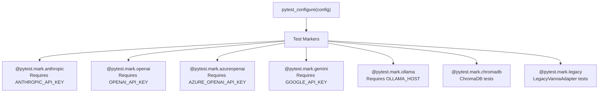
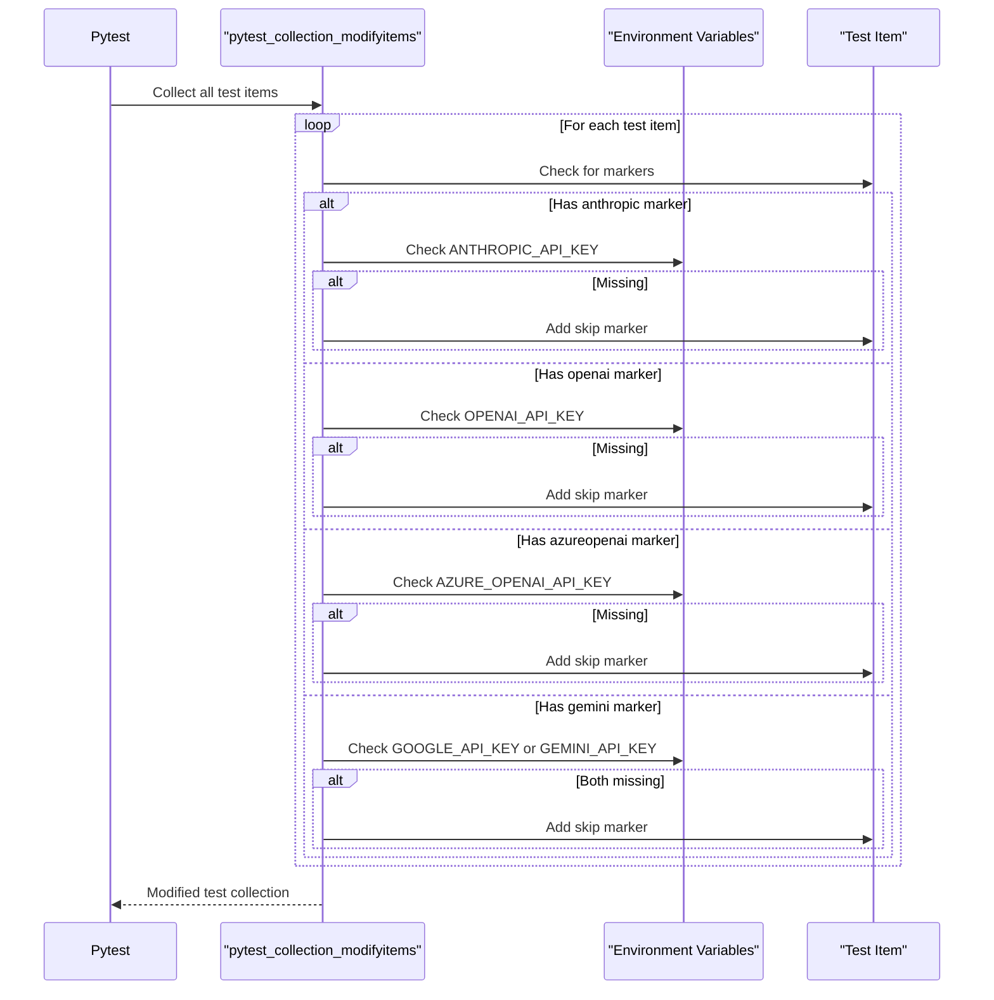
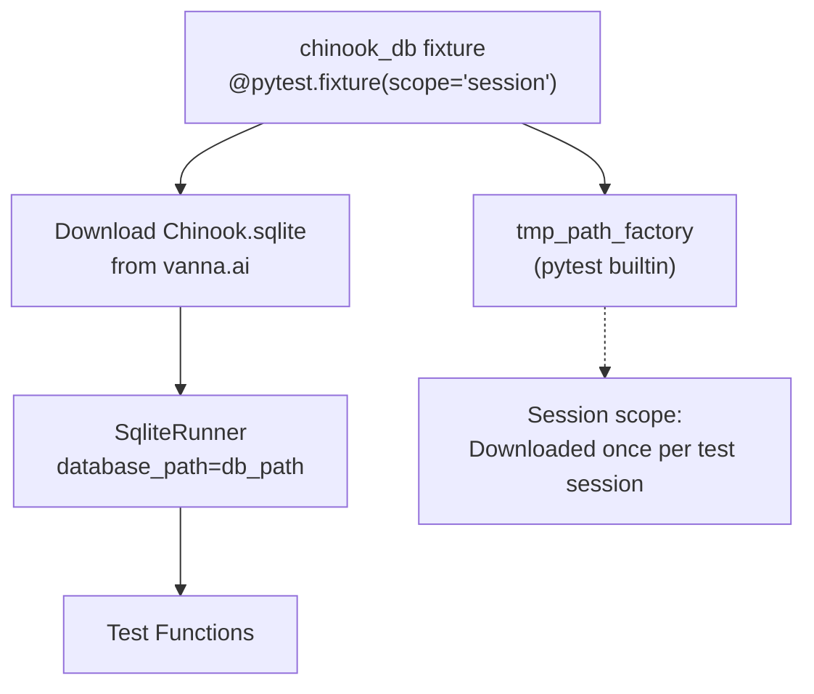
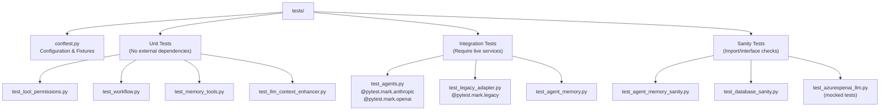
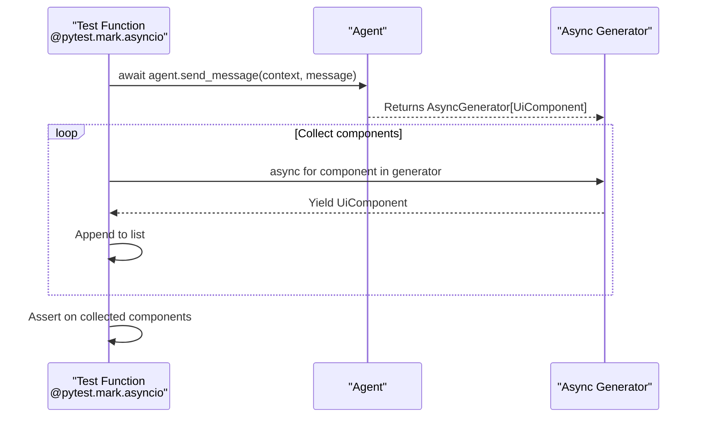
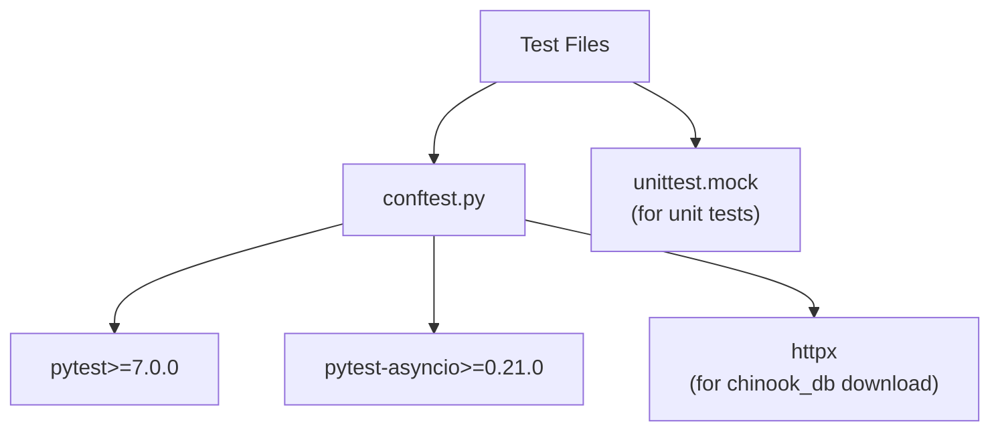

<!-- source: DeepWiki mcp.deepwiki.com · repo vanna-ai/vanna · page 10.2 Testing Infrastructure · fetched 2026-10-29 -->

# Testing Infrastructure

<details>
<summary>Relevant source files</summary>

The following files were used as context for generating this wiki page:

- [.github/workflows/tests.yml](.github/workflows/tests.yml)
- [.gitignore](.gitignore)
- [src/vanna/integrations/azureopenai/__init__.py](src/vanna/integrations/azureopenai/__init__.py)
- [src/vanna/integrations/azureopenai/llm.py](src/vanna/integrations/azureopenai/llm.py)
- [tests/conftest.py](tests/conftest.py)
- [tests/test_agent_memory_sanity.py](tests/test_agent_memory_sanity.py)
- [tests/test_agents.py](tests/test_agents.py)
- [tests/test_azureopenai_llm.py](tests/test_azureopenai_llm.py)
- [tests/test_legacy_adapter.py](tests/test_legacy_adapter.py)
- [tox.ini](tox.ini)

</details>


## Purpose and Scope

This document describes the pytest-based testing infrastructure that enables Vanna's comprehensive test suite. It covers pytest configuration, shared fixtures, test markers, and automatic environment-based test skipping. For information about the 20+ tox test environments, see [Integration Testing Matrix](#10.3). For CI/CD automation, see [CI/CD Pipeline](#10.4).

The testing infrastructure supports three test categories:
- **Unit tests**: Core logic with no external dependencies
- **Integration tests**: Tests requiring live LLM/database/vector store services
- **Sanity tests**: Import and interface compliance checks without service connections

---

## Pytest Configuration System

### Configuration Hook

The `pytest_configure` hook registers custom markers for different integration types:



**Sources**: [tests/conftest.py:14-26]()

The configuration is defined in [tests/conftest.py:14-26]():

| Marker | Purpose | Required Environment Variable |
|--------|---------|------------------------------|
| `anthropic` | Anthropic Claude integration tests | `ANTHROPIC_API_KEY` |
| `openai` | OpenAI integration tests | `OPENAI_API_KEY` |
| `azureopenai` | Azure OpenAI integration tests | `AZURE_OPENAI_API_KEY` |
| `gemini` | Google Gemini integration tests | `GOOGLE_API_KEY` or `GEMINI_API_KEY` |
| `ollama` | Ollama local model tests | `OLLAMA_HOST` |
| `chromadb` | ChromaDB-specific tests | None |
| `legacy` | Legacy adapter compatibility tests | Varies |

### Async Test Support

The pytest-asyncio plugin is configured via `pytest_plugins`:

```python
pytest_plugins = ["pytest_asyncio"]
```

This enables `@pytest.mark.asyncio` decorator for async test functions, which is essential for testing Vanna's async agent pipeline.

**Sources**: [tests/conftest.py:11]()

---

## Automatic Test Skipping

### Skip Logic Implementation

The `pytest_collection_modifyitems` hook automatically skips tests when required API keys are missing:



**Sources**: [tests/conftest.py:29-66]()

This approach provides several benefits:
- **Developer-friendly**: Tests automatically skip when services aren't configured
- **CI-ready**: All tests run in CI where secrets are injected
- **No test failures**: Missing credentials cause skips, not failures
- **Selective execution**: Developers can set only the keys they need

### Skip Condition Examples

From [tests/conftest.py:32-47](), the Anthropic skip logic:

```python
if "anthropic" in item.keywords:
    if not os.getenv("ANTHROPIC_API_KEY"):
        item.add_marker(
            pytest.mark.skip(
                reason="ANTHROPIC_API_KEY environment variable not set"
            )
        )
```

For Gemini tests, multiple environment variables are checked [tests/conftest.py:59-66]():

```python
if "gemini" in item.keywords:
    if not (os.getenv("GOOGLE_API_KEY") or os.getenv("GEMINI_API_KEY")):
        item.add_marker(
            pytest.mark.skip(
                reason="GOOGLE_API_KEY or GEMINI_API_KEY environment variable not set"
            )
        )
```

**Sources**: [tests/conftest.py:29-66]()

---

## Shared Fixtures

### The `chinook_db` Fixture

The most important shared fixture is `chinook_db`, which provides a `SqliteRunner` connected to the Chinook sample database:



**Sources**: [tests/conftest.py:69-88]()

Implementation details from [tests/conftest.py:69-88]():

| Aspect | Detail |
|--------|--------|
| **Scope** | `session` - database is downloaded once per test session |
| **Download URL** | `https://vanna.ai/Chinook.sqlite` |
| **Storage** | Temporary directory created by `tmp_path_factory` |
| **Return Type** | `SqliteRunner` instance |
| **Dependencies** | `httpx` for downloading, `vanna.integrations.sqlite` for runner |

Usage example from [tests/test_agents.py:55-65]():

```python
async def test_agent_top_artist(agent, expected_artist="Iron Maiden"):
    """Test logic using chinook_db fixture."""
    # chinook_db is already injected into the agent
    request_context = RequestContext(cookies={}, headers={})
    
    async for component in agent.send_message(
        request_context, "Who is the top artist by sales?"
    ):
        # Process components
        pass
```

**Sources**: [tests/conftest.py:69-88](), [tests/test_agents.py:55-65]()

---

## Test Organization Patterns

### Test File Structure



**Sources**: [tox.ini:30-44](), [tests/test_agents.py:1-196](), [tests/test_agent_memory_sanity.py:1-708]()

### Unit Test Pattern

Unit tests use mocking to avoid external dependencies. Example from [tests/test_azureopenai_llm.py:52-69]():

```python
@patch("vanna.integrations.azureopenai.llm.AzureOpenAI")
def test_init_with_all_params(self, mock_azure_openai):
    """Test initialization with all parameters provided."""
    service = AzureOpenAILlmService(
        model="gpt-4o",
        api_key="test-key",
        azure_endpoint="https://test.openai.azure.com",
        api_version="2024-10-21",
    )
    
    assert service.model == "gpt-4o"
    
    # Verify mock was called correctly
    mock_azure_openai.assert_called_once()
```

**Sources**: [tests/test_azureopenai_llm.py:48-69]()

### Integration Test Pattern

Integration tests use real services and require API keys. Example from [tests/test_agents.py:108-118]():

```python
@pytest.mark.anthropic
@pytest.mark.asyncio
async def test_anthropic_top_artist(chinook_db):
    """Test Anthropic agent finding the top artist by sales."""
    from vanna.integrations.anthropic import AnthropicLlmService
    
    api_key = os.getenv("ANTHROPIC_API_KEY")
    llm = AnthropicLlmService(api_key=api_key, model="claude-sonnet-4-5")
    
    agent = create_agent(llm, chinook_db)
    await test_agent_top_artist(agent)
```

**Sources**: [tests/test_agents.py:108-118]()

### Sanity Test Pattern

Sanity tests validate imports and interface compliance without requiring service connections. Example from [tests/test_agent_memory_sanity.py:213-233]():

```python
class TestChromaDBAgentMemory:
    """Sanity tests for ChromaDB AgentMemory implementation."""
    
    def test_chromadb_import(self):
        """Test that ChromaAgentMemory can be imported."""
        try:
            from vanna.integrations.chromadb import ChromaAgentMemory
            assert ChromaAgentMemory is not None
        except ImportError:
            pytest.skip("ChromaDB not installed")
    
    def test_chromadb_implements_agent_memory(self):
        """Test that ChromaAgentMemory implements AgentMemory."""
        try:
            from vanna.integrations.chromadb import ChromaAgentMemory
            from vanna.capabilities.agent_memory import AgentMemory
            
            assert issubclass(ChromaAgentMemory, AgentMemory)
        except ImportError:
            pytest.skip("ChromaDB not installed")
```

**Sources**: [tests/test_agent_memory_sanity.py:213-233]()

---

## Writing Tests for Vanna

### Using Test Markers

Mark integration tests with appropriate markers:

```python
@pytest.mark.anthropic  # Requires ANTHROPIC_API_KEY
@pytest.mark.asyncio    # Async test function
async def test_my_anthropic_feature():
    """Test description."""
    api_key = os.getenv("ANTHROPIC_API_KEY")
    # Test implementation
```

### Async Test Pattern

All agent tests use async patterns since `Agent.send_message()` returns an async generator:



**Sources**: [tests/test_agents.py:55-105]()

Example from [tests/test_agents.py:60-68]():

```python
# Collect all components from the async generator
components = []
async for component in agent.send_message(
    request_context, "Who is the top artist by sales?"
):
    components.append(component)

# Validate we got components
assert len(components) > 0, "Should receive at least one component"
```

### Using the `chinook_db` Fixture

The fixture is injected by declaring it as a parameter:

```python
@pytest.mark.openai
@pytest.mark.asyncio
async def test_openai_top_artist(chinook_db):  # Fixture injection
    """Test OpenAI agent finding the top artist by sales."""
    from vanna.integrations.openai import OpenAILlmService
    
    api_key = os.getenv("OPENAI_API_KEY")
    llm = OpenAILlmService(api_key=api_key, model="gpt-5")
    
    # Use chinook_db when creating agent
    agent = create_agent(llm, chinook_db)
    await test_agent_top_artist(agent)
```

**Sources**: [tests/test_agents.py:121-131]()

### Creating Test Helpers

Common test logic can be extracted into helper functions. From [tests/test_agents.py:23-52]():

```python
def create_agent(llm_service, sql_runner):
    """Helper to create a configured agent."""
    from vanna import Agent, AgentConfig
    from vanna.core.registry import ToolRegistry
    from vanna.tools import RunSqlTool
    # ... setup code ...
    
    return Agent(
        llm_service=llm_service,
        tool_registry=tools,
        user_resolver=SimpleUserResolver(),
        agent_memory=agent_memory,
        config=AgentConfig(),
    )
```

This pattern reduces duplication across multiple test functions.

**Sources**: [tests/test_agents.py:23-52]()

---

## Test Execution Examples

### Running All Tests

```bash
pytest tests/ -v
```

Tests without required API keys automatically skip.

### Running Specific Integration Tests

```bash
# Run only Anthropic tests
pytest tests/ -v -m anthropic

# Run only OpenAI tests
pytest tests/ -v -m openai

# Run multiple integrations
pytest tests/ -v -m "anthropic or openai"
```

### Running Unit Tests Only

```bash
# From tox configuration
pytest tests/test_tool_permissions.py tests/test_workflow.py -v
```

### Running with Coverage

```bash
pytest tests/ --cov=src/vanna --cov-report=html
```

**Sources**: [tox.ini:30-33]()

---

## Key Testing Infrastructure Components

### Component Summary Table

| Component | Location | Purpose |
|-----------|----------|---------|
| `pytest_configure` | [tests/conftest.py:14-26]() | Register custom markers |
| `pytest_collection_modifyitems` | [tests/conftest.py:29-66]() | Auto-skip tests without credentials |
| `chinook_db` fixture | [tests/conftest.py:69-88]() | Provide sample SQLite database |
| Test markers | [tests/conftest.py:16-26]() | Tag tests by integration type |
| `SimpleUserResolver` | [tests/test_agents.py:14-20]() | Mock user resolver for tests |
| `create_agent` helper | [tests/test_agents.py:23-52]() | Common agent setup |

### Test Infrastructure Dependencies



**Sources**: [tox.ini:26-28](), [tests/conftest.py:1-9]()

---

## Related Documentation

- For the 20+ tox test environments, see [Integration Testing Matrix](#10.3)
- For GitHub Actions configuration, see [CI/CD Pipeline](#10.4)
- For development setup, see [Development Environment Setup](#10.1)

**Sources**: [tox.ini:1-243](), [.github/workflows/tests.yml:1-36]()

---

