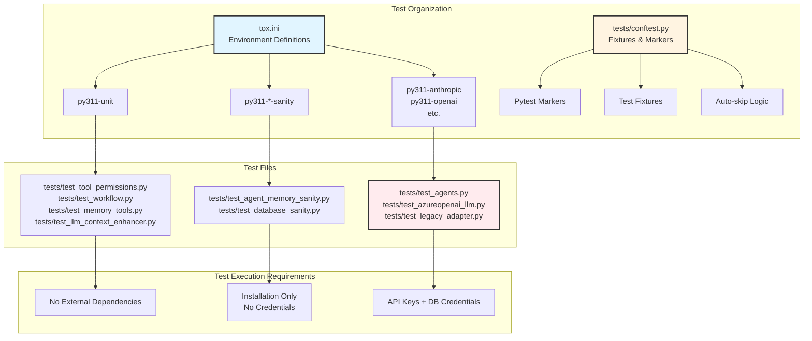
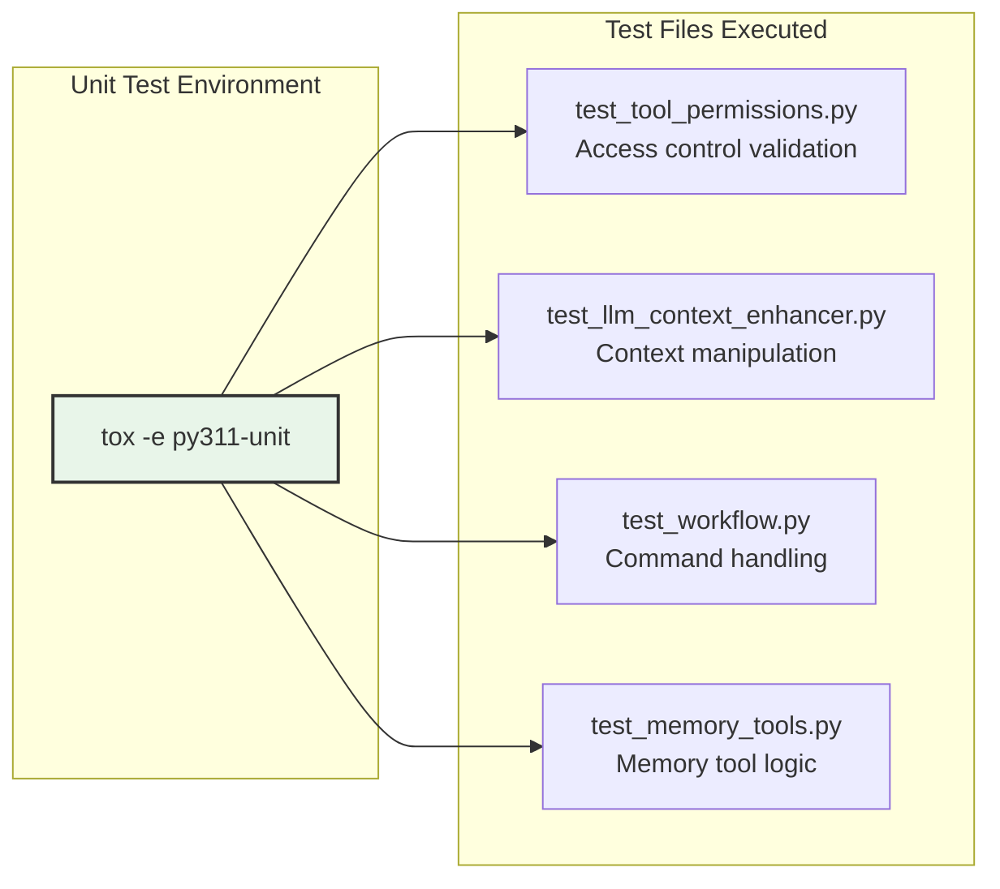
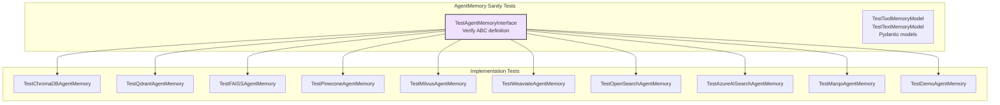
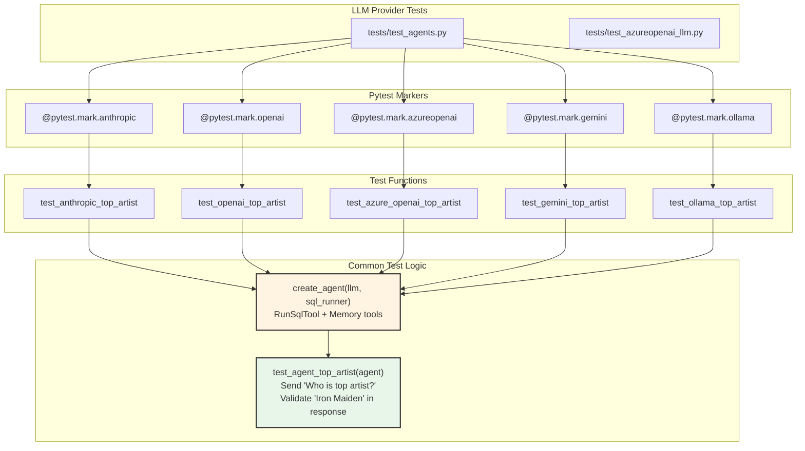
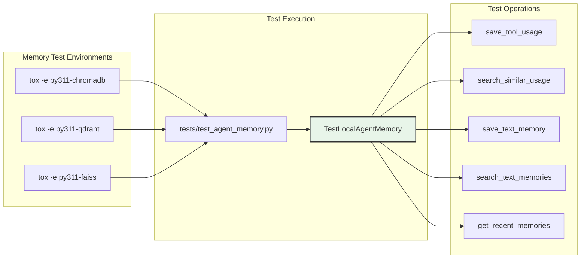
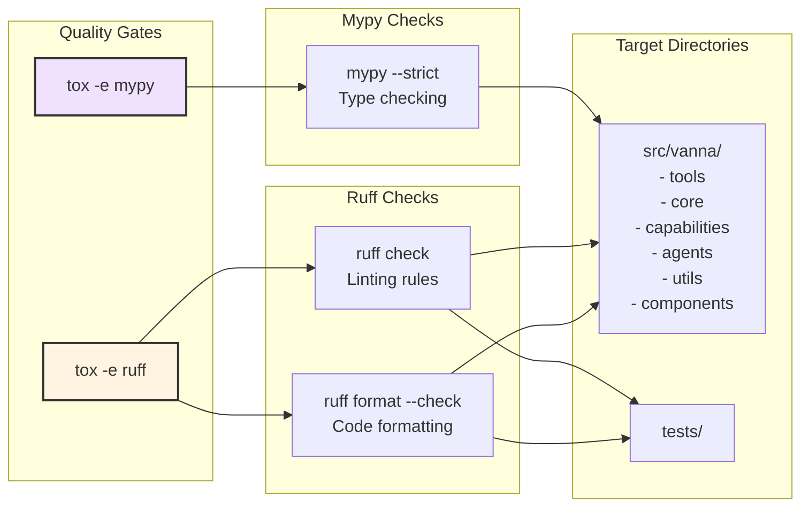
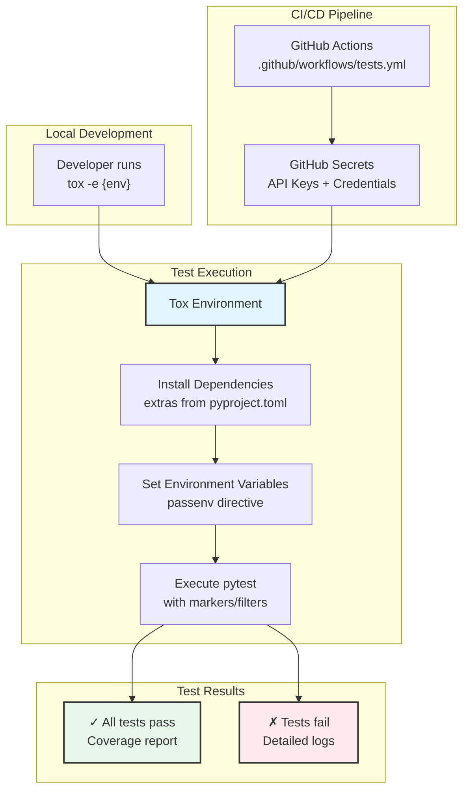

<!-- source: DeepWiki mcp.deepwiki.com · repo vanna-ai/vanna · page 10.3 Integration Testing Matrix · fetched 2026-10-29 -->

# Integration Testing Matrix

<details>
<summary>Relevant source files</summary>

The following files were used as context for generating this wiki page:

- [src/vanna/integrations/azureopenai/__init__.py](src/vanna/integrations/azureopenai/__init__.py)
- [src/vanna/integrations/azureopenai/llm.py](src/vanna/integrations/azureopenai/llm.py)
- [tests/conftest.py](tests/conftest.py)
- [tests/test_agent_memory_sanity.py](tests/test_agent_memory_sanity.py)
- [tests/test_agents.py](tests/test_agents.py)
- [tests/test_azureopenai_llm.py](tests/test_azureopenai_llm.py)
- [tests/test_legacy_adapter.py](tests/test_legacy_adapter.py)
- [tox.ini](tox.ini)

</details>


## Purpose and Scope

The Integration Testing Matrix defines a comprehensive test suite that validates Vanna's interoperability with multiple LLM providers (7+), database systems (11+), and vector stores (9+). This matrix ensures that each integration correctly implements the core interfaces (`LlmService`, `SqlRunner`, `AgentMemory`) and can handle real-world operations. The tests are organized in `tox.ini` as separate environments, enabling selective execution based on available credentials and dependencies.

For information about the overall testing infrastructure and development environment setup, see [Development Environment Setup](#10.1) and [Testing Infrastructure](#10.2). For CI/CD automation of these tests, see [CI/CD Pipeline](#10.4).

## Test Matrix Architecture

The integration test matrix is structured into three tiers: **unit tests** (no external dependencies), **sanity tests** (import verification and basic instantiation), and **integration tests** (real API calls requiring credentials). This layered approach allows developers to run fast local tests while CI/CD runs the full matrix with secret credentials.



**Sources**: [tox.ini:1-243](), [tests/conftest.py:1-89]()

## Tox Environment Structure

The `tox.ini` file at the repository root defines 24+ test environments organized by category. Each environment specifies Python version, dependencies, environment variables, and commands.

| Environment Pattern | Purpose | Dependencies | Env Vars Required |
|---------------------|---------|--------------|-------------------|
| `py311-unit` | Core logic tests | pytest, pytest-asyncio | None |
| `py311-agent-memory-sanity` | Memory implementation imports | extras: chromadb, qdrant | None |
| `py311-anthropic` | Anthropic integration | extras: anthropic | `ANTHROPIC_API_KEY` |
| `py311-openai` | OpenAI integration | extras: openai | `OPENAI_API_KEY` |
| `py311-legacy` | Legacy adapter | extras: anthropic, chromadb | `ANTHROPIC_API_KEY` |
| `py311-{db}-sanity` | Database imports | extras: {db} | None |
| `py311-chromadb` | ChromaDB memory | extras: chromadb | None |
| `py311-qdrant` | Qdrant memory | extras: qdrant | None |
| `py311-faiss` | FAISS memory | faiss-cpu package | None |
| `ruff` | Code formatting | extras: dev | None |
| `mypy` | Type checking | extras: dev | None |

**Sources**: [tox.ini:1-43](), [tox.ini:25-29]()

### Test Environment Declaration Pattern

Each tox environment follows a consistent declaration pattern:

```
[testenv:py311-{category}]
description = Human-readable purpose
extras = dependency1, dependency2
passenv = ENV_VAR_NAME
commands =
    python -c "import check"
    pytest tests/path -v -m marker
```

**Example - OpenAI Integration Tests**:
```
[testenv:py311-openai]
description = Test with OpenAI
extras = openai
passenv = OPENAI_API_KEY
commands =
    python -c "from vanna.integrations.openai import OpenAILlmService; print('✓ OpenAI import successful')"
    pytest tests/ -v -m openai
```

This pattern validates that:
1. The integration package installs correctly
2. The main service class can be imported
3. Pytest runs all tests marked with the corresponding marker

**Sources**: [tox.ini:54-60]()

## Unit Tests (No External Dependencies)

Unit tests validate core framework logic without requiring LLM services, databases, or vector stores. These tests execute quickly (<5 seconds) and run on every commit.



**Test Coverage**:
- `test_tool_permissions.py`: Group-based access control, `transform_args` validation
- `test_llm_context_enhancer.py`: Message manipulation middleware
- `test_workflow.py`: `WorkflowHandler` command interception, `/help`, `/status` commands
- `test_memory_tools.py`: Memory tool argument schemas, access patterns

**Command**: `tox -e py311-unit`

**Sources**: [tox.ini:30-33]()

## Sanity Tests (Import Verification)

Sanity tests verify that integration packages install correctly and classes can be instantiated without connecting to actual services. These tests use in-memory implementations or mock objects.

### Agent Memory Sanity Tests

The `test_agent_memory_sanity.py` file validates all 9+ `AgentMemory` implementations:



**Each implementation test validates**:
1. `from vanna.integrations.{provider} import {Provider}AgentMemory` succeeds
2. `issubclass({Provider}AgentMemory, AgentMemory)` is True
3. All 9 abstract methods are implemented (not abstract)
4. Basic instantiation works (in-memory mode when possible)

**Example - ChromaDB Sanity Test**:
```python
def test_chromadb_instantiation(self):
    from vanna.integrations.chromadb import ChromaAgentMemory
    import tempfile
    
    temp_dir = tempfile.mkdtemp()
    memory = ChromaAgentMemory(
        persist_directory=temp_dir,
        collection_name="test"
    )
    
    assert memory is not None
    assert memory.persist_directory == temp_dir
```

**Command**: `tox -e py311-agent-memory-sanity`

**Sources**: [tests/test_agent_memory_sanity.py:1-708](), [tox.ini:35-44]()

### Database Sanity Tests

Database sanity tests validate that each `SqlRunner` implementation can be imported and instantiated without actual database connections. These tests are split by database type:

| Tox Environment | Test Class | Integration Module |
|-----------------|------------|-------------------|
| `py311-postgres-sanity` | `TestPostgresRunner` | `vanna.integrations.postgres.PostgresRunner` |
| `py311-sqlite-sanity` | `TestSqliteRunner` | `vanna.integrations.sqlite.SqliteRunner` |
| `py311-snowflake-sanity` | `TestSnowflakeRunner` | `vanna.integrations.snowflake.SnowflakeRunner` |
| `py311-mysql-sanity` | `TestMySQLRunner` | `vanna.integrations.mysql.MySQLRunner` |
| `py311-clickhouse-sanity` | `TestClickHouseRunner` | `vanna.integrations.clickhouse.ClickHouseRunner` |
| `py311-oracle-sanity` | `TestOracleRunner` | `vanna.integrations.oracle.OracleRunner` |
| `py311-bigquery-sanity` | `TestBigQueryRunner` | `vanna.integrations.bigquery.BigQueryRunner` |
| `py311-duckdb-sanity` | `TestDuckDBRunner` | `vanna.integrations.duckdb.DuckDBRunner` |
| `py311-mssql-sanity` | `TestMSSQLRunner` | `vanna.integrations.mssql.MSSQLRunner` |
| `py311-presto-sanity` | `TestPrestoRunner` | `vanna.integrations.presto.PrestoRunner` |
| `py311-hive-sanity` | `TestHiveRunner` | `vanna.integrations.hive.HiveRunner` |

**Pattern - PostgreSQL Example**:
```
[testenv:py311-postgres-sanity]
description = Sanity tests for PostgreSQL implementation
extras = postgres
commands =
    python -c "from vanna.integrations.postgres import PostgresRunner; print('✓ PostgresRunner import successful')"
    pytest tests/test_database_sanity.py::TestPostgresRunner -v
```

**Sources**: [tox.ini:122-130](), [tox.ini:132-229]()

## LLM Provider Integration Tests

LLM provider tests execute real agent conversations using the Chinook SQLite database fixture. Each test validates that the provider can handle tool calling, streaming, and multi-turn conversations.



**Sources**: [tests/test_agents.py:1-196](), [tests/conftest.py:14-27]()

### Common Test Pattern

All LLM provider tests share a common structure:

**1. Agent Creation** ([tests/test_agents.py:23-52]()):
```python
def create_agent(llm_service, sql_runner):
    tools = ToolRegistry()
    
    # Add SQL tool
    db_tool = RunSqlTool(sql_runner=sql_runner, file_system=LocalFileSystem())
    tools.register_local_tool(db_tool, access_groups=["user"])
    
    # Add memory tools
    agent_memory = DemoAgentMemory(max_items=1000)
    tools.register_local_tool(SaveQuestionToolArgsTool(), access_groups=["user"])
    tools.register_local_tool(SearchSavedCorrectToolUsesTool(), access_groups=["user"])
    
    return Agent(
        llm_service=llm_service,
        tool_registry=tools,
        user_resolver=SimpleUserResolver(),
        agent_memory=agent_memory,
        config=AgentConfig(),
    )
```

**2. Test Execution** ([tests/test_agents.py:55-106]()):
```python
async def test_agent_top_artist(agent, expected_artist="Iron Maiden"):
    request_context = RequestContext(cookies={}, headers={})
    
    components = []
    async for component in agent.send_message(
        request_context, "Who is the top artist by sales?"
    ):
        components.append(component)
    
    # Validate response mentions expected artist
    found_artist = False
    for component in components:
        if hasattr(component, "rich_component") and hasattr(component.rich_component, "content"):
            if expected_artist in component.rich_component.content:
                found_artist = True
    
    assert found_artist, f"Response should mention '{expected_artist}'"
```

**3. Provider-Specific Test** ([tests/test_agents.py:108-118]()):
```python
@pytest.mark.anthropic
@pytest.mark.asyncio
async def test_anthropic_top_artist(chinook_db):
    from vanna.integrations.anthropic import AnthropicLlmService
    
    api_key = os.getenv("ANTHROPIC_API_KEY")
    llm = AnthropicLlmService(api_key=api_key, model="claude-sonnet-4-5")
    
    agent = create_agent(llm, chinook_db)
    await test_agent_top_artist(agent)
```

### Azure OpenAI Unit Tests

The `test_azureopenai_llm.py` file provides comprehensive unit tests for Azure OpenAI without requiring API calls:

**Test Classes**:
- `TestReasoningModelDetection`: Validates `_is_reasoning_model()` logic for GPT-5, o1, o3 models ([tests/test_azureopenai_llm.py:13-46]())
- `TestAzureOpenAILlmServiceInitialization`: Tests initialization with API keys, Azure AD, environment variables ([tests/test_azureopenai_llm.py:48-159]())
- `TestAzureOpenAILlmServicePayloadBuilding`: Tests temperature exclusion for reasoning models, system prompt injection, tool formatting ([tests/test_azureopenai_llm.py:161-274]())

**Key Validation - Reasoning Model Temperature Exclusion**:
```python
def test_build_payload_excludes_temperature_for_reasoning_model(self):
    service = AzureOpenAILlmService(
        model="gpt-5",  # Reasoning model
        api_key="test-key",
        azure_endpoint="https://test.openai.azure.com",
    )
    
    request = LlmRequest(
        messages=[LlmMessage(role="user", content="test")],
        user=User(...),
        temperature=0.8,
    )
    
    payload = service._build_payload(request)
    
    assert "temperature" not in payload  # Excluded for reasoning models
```

**Sources**: [tests/test_azureopenai_llm.py:1-298](), [src/vanna/integrations/azureopenai/llm.py:24-42]()

## Memory Implementation Integration Tests

Memory integration tests validate vector search operations against actual vector store backends. These tests use local/in-memory modes when possible (ChromaDB, Qdrant, FAISS) or require service credentials for cloud providers.



**Test Commands**:
- ChromaDB: `tox -e py311-chromadb` → `pytest tests/test_agent_memory.py::TestLocalAgentMemory -k chromadb -v`
- Qdrant: `tox -e py311-qdrant` → `pytest tests/test_agent_memory.py::TestLocalAgentMemory -k qdrant -v`
- FAISS: `tox -e py311-faiss` → `pytest tests/test_agent_memory.py::TestLocalAgentMemory -k faiss -v`

**Sources**: [tox.ini:90-109]()

## Legacy Adapter Integration Tests

Legacy adapter tests validate that v0.x `VannaBase` instances can be wrapped with `LegacyVannaAdapter` and used with the new Agent framework.

**Test Structure** ([tests/test_legacy_adapter.py:27-96]()):
```python
@pytest.mark.legacy
@pytest.mark.asyncio
async def test_legacy_adapter_with_anthropic():
    # Create legacy VannaBase instance with multiple inheritance
    class MyVanna(ChromaDB_VectorStore, MockLLM):
        def __init__(self, config=None):
            ChromaDB_VectorStore.__init__(self, config=config)
            MockLLM.__init__(self, config=config)
    
    vn = MyVanna()
    vn.connect_to_sqlite("https://vanna.ai/Chinook.sqlite")
    vn.add_question_sql(question="...", sql="...")
    
    # Wrap with adapter
    legacy_adapter = LegacyVannaAdapter(vn)
    
    # Use in new Agent framework
    agent = Agent(
        llm_service=AnthropicLlmService(...),
        tool_registry=legacy_adapter,  # Adapter implements ToolRegistry
        agent_memory=legacy_adapter,  # Adapter implements AgentMemory
        user_resolver=SimpleUserResolver(),
        config=AgentConfig(),
    )
    
    # Test agent conversation
    components = []
    async for component in agent.send_message(request_context, "Who is the top artist by sales?"):
        components.append(component)
```

**Memory Operations Test** ([tests/test_legacy_adapter.py:98-164]()):
Validates that `LegacyVannaAdapter` correctly maps legacy methods (`add_question_sql`, `get_similar_question_sql`) to new `AgentMemory` interface (`save_tool_usage`, `search_similar_usage`).

**Command**: `tox -e py311-legacy`

**Sources**: [tests/test_legacy_adapter.py:1-164](), [tox.ini:80-88]()

## Test Fixtures and Configuration

### Chinook Database Fixture

The `chinook_db` fixture provides a session-scoped SQLite database for testing SQL execution:

```python
@pytest.fixture(scope="session")
def chinook_db(tmp_path_factory):
    """
    Downloads the Chinook SQLite database and returns a SqliteRunner.
    Uses session scope so the database is only downloaded once.
    """
    import httpx
    from vanna.integrations.sqlite import SqliteRunner
    
    tmp_path = tmp_path_factory.mktemp("data")
    db_path = tmp_path / "Chinook.sqlite"
    
    # Download the database
    response = httpx.get("https://vanna.ai/Chinook.sqlite")
    response.raise_for_status()
    db_path.write_bytes(response.content)
    
    return SqliteRunner(database_path=str(db_path))
```

This fixture is used by all LLM provider tests and provides:
- **11 tables**: Artist, Album, Track, Invoice, InvoiceLine, Customer, Employee, Genre, MediaType, Playlist, PlaylistTrack
- **Sample queries**: Top artist by sales, customer purchase history, genre statistics
- **Session scope**: Downloaded once per test session (~60KB)

**Sources**: [tests/conftest.py:69-88]()

### Pytest Markers

Custom markers enable selective test execution:

```python
def pytest_configure(config):
    config.addinivalue_line("markers", "anthropic: marks tests requiring Anthropic API key")
    config.addinivalue_line("markers", "openai: marks tests requiring OpenAI API key")
    config.addinivalue_line("markers", "azureopenai: marks tests requiring Azure OpenAI API key")
    config.addinivalue_line("markers", "gemini: marks tests requiring Google API key")
    config.addinivalue_line("markers", "ollama: marks tests requiring Ollama")
    config.addinivalue_line("markers", "chromadb: marks tests requiring ChromaDB")
    config.addinivalue_line("markers", "legacy: marks tests for LegacyVannaAdapter")
```

**Auto-skip Logic**: Tests are automatically skipped if required API keys are missing:

```python
def pytest_collection_modifyitems(config, items):
    for item in items:
        if "anthropic" in item.keywords:
            if not os.getenv("ANTHROPIC_API_KEY"):
                item.add_marker(pytest.mark.skip(reason="ANTHROPIC_API_KEY environment variable not set"))
        # Similar logic for other providers...
```

**Sources**: [tests/conftest.py:14-27](), [tests/conftest.py:29-67]()

## Required Environment Variables

Integration tests require API keys and credentials passed via environment variables. These are configured in CI/CD via GitHub Secrets and locally via `.env` files.

| Provider | Environment Variable(s) | Test Environment | Purpose |
|----------|------------------------|------------------|---------|
| Anthropic | `ANTHROPIC_API_KEY` | `py311-anthropic`, `py311-legacy` | Claude API access |
| OpenAI | `OPENAI_API_KEY` | `py311-openai` | GPT model access |
| Azure OpenAI | `AZURE_OPENAI_API_KEY`<br/>`AZURE_OPENAI_ENDPOINT`<br/>`AZURE_OPENAI_MODEL`<br/>`AZURE_OPENAI_API_VERSION` | `py311-azureopenai` | Azure deployment access |
| Google Gemini | `GOOGLE_API_KEY` or `GEMINI_API_KEY` | `py311-gemini` | Gemini API access |
| Ollama | `OLLAMA_HOST` | `py311-ollama` | Local Ollama server URL |

**Tox Environment Variable Passing** ([tox.ini:49-50](), [tox.ini:57-58]()):
```
[testenv:py311-anthropic]
passenv = ANTHROPIC_API_KEY
commands =
    pytest tests/ -v -m anthropic
```

**Pytest Auto-skip on Missing Variables** ([tests/conftest.py:32-39]()):
```python
if "anthropic" in item.keywords:
    if not os.getenv("ANTHROPIC_API_KEY"):
        item.add_marker(pytest.mark.skip(reason="ANTHROPIC_API_KEY environment variable not set"))
```

**Sources**: [tox.ini:46-79](), [tests/conftest.py:29-67]()

## Running Integration Tests

### Local Execution

**Install tox**:
```bash
pip install tox
```

**List all environments**:
```bash
tox -l
```

**Run specific test environment**:
```bash
# Unit tests (fast, no credentials)
tox -e py311-unit

# Sanity tests (import verification)
tox -e py311-agent-memory-sanity
tox -e py311-postgres-sanity

# Integration tests (requires API keys)
export ANTHROPIC_API_KEY="your-key-here"
tox -e py311-anthropic

export OPENAI_API_KEY="your-key-here"
tox -e py311-openai
```

**Run multiple environments**:
```bash
tox -e py311-unit,py311-chromadb,py311-qdrant
```

**Run all environments** (requires all credentials):
```bash
tox
```

### Direct Pytest Execution

For faster iteration during development, run pytest directly:

**Run specific test file**:
```bash
pytest tests/test_agent_memory_sanity.py -v
```

**Run specific test class**:
```bash
pytest tests/test_agent_memory.py::TestLocalAgentMemory -k chromadb -v
```

**Run tests with specific marker**:
```bash
pytest -m anthropic -v  # Requires ANTHROPIC_API_KEY
pytest -m openai -v     # Requires OPENAI_API_KEY
```

**Run unit tests only** (no markers):
```bash
pytest tests/test_tool_permissions.py tests/test_workflow.py -v
```

**Sources**: [tox.ini:1-243]()

## Quality Gates

Quality assurance environments validate code formatting and type safety:



**Ruff Configuration** ([tox.ini:231-236]()):
```
[testenv:ruff]
description = Check code formatting and linting with ruff (uses pyproject.toml config)
extras = dev
commands =
    ruff format --check src/vanna/ tests/
    ruff check src/vanna/ tests/
```

**Mypy Configuration** ([tox.ini:238-242]()):
```
[testenv:mypy]
description = Run mypy type checking with strict mode
extras = dev
commands =
    mypy src/vanna/tools src/vanna/core src/vanna/capabilities src/vanna/agents src/vanna/utils src/vanna/web_components src/vanna/components --strict
```

**Run quality gates locally**:
```bash
tox -e ruff    # Fast (~2 seconds)
tox -e mypy    # Slower (~10 seconds)
```

**Sources**: [tox.ini:231-242]()

## Test Execution Flow

The following diagram shows how test environments are executed in different contexts:



**Execution Steps**:
1. **Dependency Installation**: Tox creates a fresh virtualenv and installs `extras` from `pyproject.toml`
2. **Environment Configuration**: `passenv` directive exposes environment variables to the test environment
3. **Import Verification**: First command validates that integration package imports successfully
4. **Test Execution**: Pytest runs with filters (`-m marker`, `-k pattern`, specific paths)
5. **Result Reporting**: Test results are collected and reported with coverage metrics

**Sources**: [tox.ini:1-243]()

## Integration Test Matrix Summary

| Category | Environments | Test Count | External Deps | Avg Duration |
|----------|--------------|------------|---------------|--------------|
| Unit Tests | 1 | 50+ | None | <5s |
| Quality Gates | 2 (ruff, mypy) | N/A | None | ~12s |
| Memory Sanity | 1 | 100+ | chromadb, qdrant | ~3s |
| Database Sanity | 11 | 11 | Various | ~15s |
| LLM Integration | 5 | 5 | API keys | ~60s |
| Memory Integration | 3 | 15+ | None (local) | ~10s |
| Legacy Adapter | 1 | 2 | API keys | ~30s |
| **Total** | **24** | **180+** | **Mixed** | **~2min** |

**Full matrix execution time**: ~15 minutes (with all API keys and parallel execution)

**Sources**: [tox.ini:1-243]()

---

